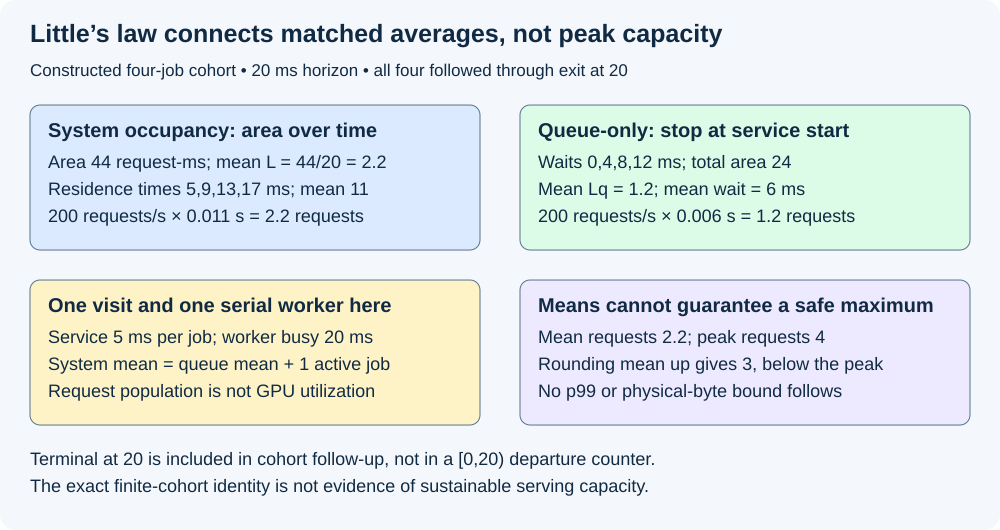
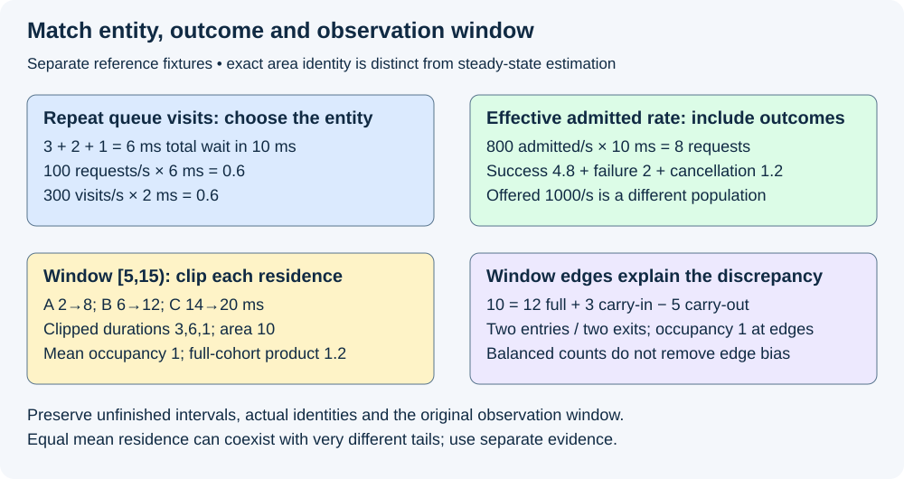

# M5-C09: Applying Little’s law with consistent boundaries

> **Status: Complete — detailed chapter authored and documentation validated; experimental procedures are proposed unless explicitly labelled observed.**

**Module:** Learn scheduling, operating systems, and queueing theory

**Category:** [Scheduling and queueing](index.md)

[Module 5 reading order](../module-5.md) · [Previous: M5-C08](../scheduling-and-queueing/m5-c08-queueing-delay-service-time-and-request-latency.md) · [Next: M5-C10](../scheduling-and-queueing/m5-c10-utilization-variability-and-tail-latency.md)

## Target concepts

Mean requests in system, effective arrival rate, mean residence time, L = lambda times W, queue-only accounting, stable measurement regimes, matched populations, finite-window effects, means versus percentiles.

[Execution plan and progress](../chapter-execution-plan.md)

## Concepts

### 1. Count the same work at the same boundary

**Little's law** relates three averages: **L = λ × W**. L is the time-average number of entities inside a chosen system; λ (lambda) is the effective rate at which those entities enter; W is their mean residence time inside it. An entity can be a request attempt, a queue visit or another declared unit. The units must match: **requests = (requests/second) × seconds**. L is usually fractional because it averages occupancy over time; it is not a fractional request at an instant.

Use [M5-C08's queue/system timing](m5-c08-queueing-delay-service-time-and-request-latency.md) and [M9-C07's distribution definitions](../measurement-experimentation-and-economics/m9-c07-latency-distributions-and-statistical-uncertainty.md). First define which entry and exit events make an entity present. For an admitted-request system, entry is admission and exit can be logical terminal. For a queue-only system, entry is joining the ready queue and exit is leaving that queue, including a cancellation/expiry if allowed. A client-outstanding boundary begins earlier and may end later. These are different systems, each requiring its own matching rate, occupancy and residence time.

[John D. C. Little's original 1961 paper](https://pubsonline.informs.org/doi/abs/10.1287/opre.9.3.383) establishes the relationship between mean population, entry rate and time in system under its stated conditions. [Karl Sigman's sample-path notes](https://www.columbia.edu/~ks20/4106-18-Fall/Notes-LL.pdf) explain the occupancy interpretation without requiring a particular stochastic arrival model. A **sample path** is one realized history of entries and exits. Poisson arrivals, exponential service and FIFO are not universal requirements for this accounting relation; do not import a more restrictive queue model merely to use it.

The long-run relationship requires matching, well-defined limiting averages and negligible boundary effects under the selected formulation. In practical serving studies, inspect a stable operating regime rather than assume one from a constant configured rate. **Stable** here means that backlog does not grow without bound and the required averages are meaningful over the studied regime. Exact finite-history accounting is possible without claiming stationarity, meaning an unchanging distribution over time. A finite empty-to-drained cohort identity is not proof that an indefinitely repeated workload will be stable.

### 2. Average occupancy is area divided by time

Let N(t) be the number inside at time t. Each entity i enters at aᵢ and exits at dᵢ, and is present for **aᵢ ≤ t < dᵢ**. Its residence Wᵢ is dᵢ−aᵢ. For a window [s,e) with duration T=e−s, the time-average occupancy is:

**L_window = occupancy area / T = (1/T) × ∫ from s to e N(t) dt.**

The integral means summing rectangle areas between events: occupancy times elapsed duration. Its unit before division is request-seconds. A snapshot average is equivalent only if observations have the appropriate time weighting. An event-log average that weights a busy 1-ms interval and idle 99-ms interval equally is wrong: occupancy one for 1 ms and zero for 99 ms gives **L=0.01**, not 0.5. Periodic sampling can also miss short bursts; record its resolution and uncertainty or integrate a complete event ledger.

When a window starts empty and every entity entering before e has exited by e, the area is the sum of their full residence times. For n such entities and positive T:

**Area = Σ Wᵢ; L_window = ΣWᵢ/T = (n/T) × (ΣWᵢ/n).**

Thus λ_cohort=n/T and mean residence W̄=ΣWᵢ/n give the exact finite-cohort identity. An exit at the endpoint e ends that entity's residence and contributes no area afterward; it is included in follow-up of that cohort even though an independent half-open departure-event counter [s,e) excludes the event at e. State this distinction rather than silently switching count conventions. If n=0, the mean of an empty cohort is undefined; a window can still have carried-in occupancy.

Revisit the four-job reference: arrivals [0,1,2,3] ms, service starts [0,5,10,15], terminal exits [5,10,15,20]. All are admitted at arrival, one visit each, no errors or overhead. Use [0,20) ms and follow the cohort through its terminal-at-20 endpoint. The changing system population is:

| Interval (ms) | Requests in system N | Area (request-ms) |
|---|---:|---:|
| 0–1 | 1 | 1 |
| 1–2 | 2 | 2 |
| 2–3 | 3 | 3 |
| 3–5 | 4 | 8 |
| 5–10 | 3 | 15 |
| 10–15 | 2 | 10 |
| 15–20 | 1 | 5 |

Area is **44 request-ms**; residence times [5,9,13,17] sum to 44. **L=44/20=2.2 requests**, **λ_cohort=4/0.020=200 requests/s**, and **W̄=11 ms=0.011 s**; **200×0.011=2.2**. The half-open window contains only three departure events, but four cohort members completed by the endpoint. Using 3/0.020 with the four-member mean would mismatch the population.

Peak occupancy is four, while mean occupancy is 2.2. A capacity of ceil(2.2)=3 would fail to retain this exact unconstrained trace. **ceil** means rounding upward to the next integer. The law is an average relationship, not a safe maximum-concurrency bound, admission rule or p99 sizing formula. Request count also cannot directly establish physical KV bytes: lengths, sharing, block rounding and final users differ by request. Apply the explicit memory inventory instead of multiplying unrelated averages.

*The exact cohort identity uses a constructed history. It neither estimates sustainable capacity nor guarantees that average occupancy bounds a burst.*

### 3. Queue-only accounting excludes service and handles repeated visits

For the same four jobs, queue residence ends at service start, not terminal. Waits are [0,4,8,12] ms, total **24 request-ms**. The queue area is 1×1 + 2×1 + 3×2 + 2×5 + 1×5 =24: between 1–2, 2–3, 3–5, 5–10 and 10–15 ms respectively. The zero-wait first request still counts among four queue arrivals at the chosen entry boundary. Thus **Lq=24/20=1.2**, **Wq=6 ms**, and **200×0.006=1.2**. Using the whole-system mean 11 ms would incorrectly give 2.2 for the queue.

The one worker is busy throughout these 20 ms, so its time-average active-job population is one. Here **L_system=Lq+L_service=1.2+1=2.2** and mean residence 11=6 waiting+5 service ms. This simple split assumes the declared one-visit server; a real request may wait between iterations while retaining state, and a batch can contain several requests during one invocation. Request service-population is not GPU utilization.

A separate one-request, 10-ms empty-to-drained reference illustrates repeat visits. Queue visits occupy [0,3), [4,6), [8,9) ms, with processing between them until exit at 10. Total queue waiting is **6 ms**, three visit durations are [3,2,1], and mean per-visit waiting is **2 ms**. Queue occupancy area divided by 10 gives **0.6**. Either of two consistent accounts works:

**Request account: 100 requests/s × 0.006 s total waiting/request = 0.6.**

**Visit account: 300 visits/s × 0.002 s waiting/visit = 0.6.**

Using 100 requests/s with the 2-ms per-visit mean gives 0.2 and loses two visits. For variable visit counts, sum each request's actual waits or count every visit explicitly; do not substitute an unweighted average from a different population. A queued request that cancels exits that queue without starting service, so the queue's departure count need not equal the model invocation count. Include zero waits, cancellations and expiry under the declared entry/exit rules.

### 4. Effective rates must match admission and outcome classes

**Offered rate** counts intended demand at a declared source. **Effective entry rate** counts work entering this chosen subsystem. A finite admitted system can remain bounded by rejecting excess demand; that does not mean it serves all offered work. A successful-throughput rate is an outcome-filtered departure rate, not automatically the entry rate for all admitted attempts.

For a stipulated long-run stable admitted-request example, offered rate is 1,000 attempts/s and admitted rate 800 attempts/s; 200 are rejected before this admitted boundary. If mean admission-to-logical-terminal residence across all admitted outcomes is 10 ms, **L_admitted=800×0.010=8**. Multiplying offered 1,000 by the same residence gives 10, because the rejected attempts never entered that population. A larger server boundary including rejection decisions would need its own short rejected-attempt residence and occupancy; do not erase those attempts from global service reporting.

The admitted classes can reconcile independently when their averages and class populations match:

| Terminal class | Long-run admitted entry rate | Mean residence | Contribution to L |
|---|---:|---:|---:|
| Eventually successful | 600/s | 8 ms | 4.8 |
| Eventually failed | 100/s | 20 ms | 2.0 |
| Eventually cancelled | 100/s | 12 ms | 1.2 |

Contributions sum to eight and the entry-weighted overall mean is **(600×0.008+100×0.020+100×0.012)/800=0.010 s**. These are stipulated limiting values, not observations. Class labels refer retrospectively to eventual outcomes; an online scheduler cannot use them as future knowledge. Successful rate 600/s times the all-outcome mean 10 ms gives six, another mismatch. In a finite cutoff, still-open attempts lack an eventual label or full residence yet: keep them unresolved rather than discarding them to force the equation.

Retries count as separate attempts with parent request identity; a request-level boundary must instead track the logical request through its declared retry policy. Logical terminal and final-user retirement are different exits. Apply [M9-C22](../runtime-and-concurrency/m9-c22-verifying-ownership-and-memory-safety-under-concurrency.md) if the population is allocations or retained claims; output completion does not discharge an uncertain device access.

### 5. Window edges can create a mismatch even with balanced counts

For any finite [s,e), define **hᵢ=max(0, min(dᵢ,e)−max(aᵢ,s))**, the overlap duration of entity i with the window. Then the exact pathwise identity is **Area_window = Σ hᵢ**, summed over every intersecting entity, including those entering earlier or leaving later. For an unfinished entity, overlap through e is known even if dᵢ is not yet known; its full residence remains censored, meaning observed only up to a cutoff. This identity requires neither a steady workload nor successful completion of every entity.

Consider A entering at 2 and exiting at 8, B at 6→12 and C at 14→20, all in ms. On **[5,15)**, A is carried in, C carries out, and B is wholly inside. Overlaps are **3,6,1 ms**; area is **10 request-ms**, so **L_window=1**. Two entries occur in the window (B,C), and both eventually have full residence 6 ms. Their arrival-cohort rate is 2/0.010=200/s; multiplying by their full 6-ms mean gives **1.2**, not one. Waiting for C to finish supplies its residence but does not make the original occupancy window longer.

The edge correction explains the difference:

**10 = 12 full residence of B/C + 3 carried-in area from A − 5 post-window area from C**, in request-ms.

There are also two departures inside [5,15) (A,B), and population is one at each edge. Balanced counts and equal start/end occupancy do not eliminate residence-area boundary bias. A completion-only cohort gives A/B's full mean 6 ms and the same misleading 1.2. Its full histories extend outside the window too.

One remedy is reporting the exact clipped area and edge correction. Another is a deliberately empty-to-drained cohort with a consistent follow-up horizon. For long-run estimates, inspect whether residual edge areas are small relative to total area and report sensitivity to window placement/length. Do not silently widen only the residence population, omit carried-in work, or replace unresolved durations with zero. A low residual alone does not prove instrument correctness: matching errors can cancel, so compare raw identities and event counts independently.

*Finite-window overlap accounting remains exact even when an ordinary entry-rate times full-cohort mean does not equal the window's occupancy average.*

### 6. Stability checks and percentiles answer different questions

Before interpreting long-run averages, inspect occupancy/backlog trends, cumulative entries versus all exits, outcome fractions and cohort follow-up. A constant target arrival rate does not prove stationarity. For an unbounded illustrative system admitting 120 attempts/s but exiting only 100/s over 10 seconds, backlog grows by **200 attempts**. Repeating that imbalance indefinitely cannot support a finite steady occupancy. A finite queue rejecting some demand may avoid that growth but changes the admitted population and useful service. Preserve all offered outcomes.

Use L=λW as a consistency check or a conditional estimate, not a causal performance model: knowing λ alone does not determine W, and a larger concurrency limit need not improve throughput. Actual lengths, arrival bursts, reuse, synchronization, CPU scheduling, KV pressure and backend capabilities determine the operating point. Little's law does not establish a GPU bottleneck or predict the effect of chunking without other evidence.

The law uses **means**, not percentiles. Consider two constructed sets of 100 residence observations: all values 10 ms, versus 95 values of 1 ms and five of 181 ms. Both means are **10 ms**. Using the empirical nearest-rank convention (rank ceil(0.99×100)=99), p99 values are **10 and 181 ms**. No measured population or uncertainty is claimed. A matching mean rate of 100/s and mean residence 0.010 s would give mean occupancy one in a valid matched regime for either mean, but says nothing about their occupancy percentiles. **λ×p99(W)** is not a general p99 concurrency formula. Use [M9-C07](../measurement-experimentation-and-economics/m9-c07-latency-distributions-and-statistical-uncertainty.md) for sample size, dependence and quantile uncertainty; 100 invented observations cannot establish a production tail.

## Experiments

All four experiments are proposed. Authorship observes reference arithmetic and documentation QA only; no queue, runtime, load generator, serving engine or hardware benchmark is executed. No implementation is supplied.

### E1 — Reconcile whole-system and queue areas

- **Name:** Match the rectangle area to the same four requests.
- **Description:** Independently integrate event-count occupancy and sum per-request system/queue residences.
- **Purpose/objective:** Hypothesis: matching entry/exit definitions gives exact finite-cohort equality; mixing queue and system means fails. HFT concern: in-flight events and waiting events need different backlog accounting.
- **Target concepts:** Mean requests in system, L=λW, residence versus queue waiting and units.
- **Baseline:** Four arrivals [0,1,2,3], 5-ms serial jobs, admission at arrival, follow all four through terminal at 20.
- **Workload:** System area 44 and queue area 24 request-ms; independent variable is subsystem boundary only. Include a zero-wait entry, endpoint exit at 20 and an event-unweighted snapshot average as negative cases.
- **Controlled variables:** Same request identities, arrival order, service costs, clock, cohort and 20-ms horizon. A half-open departure counter is not substituted for followed cohort count.
- **Hardware requirements:** CPU exact interval arithmetic; later coherent host lifecycle logs with resolution and event-loss checks.
- **Exit criteria:** First reconstruct occupancy between every event; then independently sum residences; finally reproduce 2.2=200×0.011 and 1.2=200×0.006. Peak remains four, so a mean-derived capacity of three is rejected as a guarantee. Invalid boundary/count substitutions must be identified, not rounded into agreement.

### E2 — Match repeated visits and effective outcome rates

- **Name:** Count entries into the chosen subsystem.
- **Description:** Audit the three queue visits and the separate 800/s admitted-class reference.
- **Purpose/objective:** Hypothesis: per-visit means require visit rates, while admitted residence requires admitted rates across all outcomes. HFT concern: retries and requeued events cannot disappear from resource accounting.
- **Target concepts:** Effective rate, queue-only accounting, matched populations and recurring residence.
- **Baseline:** Queue waits [3,2,1] in 10 ms; separately stipulated stable outcome rates and means, with 200/s pre-boundary rejections.
- **Workload:** Request-total versus visit account; offered/admitted/success substitutions. Independent variable is entity/rate selection in separately labelled audits. Include cancelled queue visits and retry-parent identity as extensions.
- **Controlled variables:** Entry/exit rules, request/visit IDs, outcome classification, units and weighting. Eventual labels remain retrospective.
- **Hardware requirements:** CPU population reference; later scheduler visit/attempt logs and complete terminal/final-user observations.
- **Exit criteria:** First reconcile 0.6 from both request and visit accounting; then show 0.2 is the mismatched-rate result; finally reconcile class occupancy 4.8+2+1.2=8 and overall 10-ms mean. Reject offered-rate result 10 and success-rate result six for the all-admitted system. Preserve waiting, open, failed and cancelled attempts.

### E3 — Expose finite-window edges

- **Name:** Balanced counts can still hide the wrong cohort.
- **Description:** Compare clipped occupancy against full arrival/completion-cohort residence for A/B/C on [5,15).
- **Purpose/objective:** Hypothesis: carry-in and post-window residence explain an apparent Little's-law discrepancy without changing the system. HFT concern: short captures must include already-active and unfinished events.
- **Target concepts:** Finite-window effects, matched populations, mean occupancy and censored residence.
- **Baseline:** A 2→8, B 6→12, C 14→20 ms; full identity ledger and fixed window.
- **Workload:** Clipped overlaps 3/6/1, edge correction, and predeclared shifted/longer windows. Independent variable: window placement or clipping/cohort convention, one at a time. Include missing C exit at first cutoff.
- **Controlled variables:** Actual event history, units, clock and boundary meaning. Later knowledge of C's exit cannot change the old occupancy window.
- **Hardware requirements:** CPU interval review; later event log with carry-in snapshots, terminal follow-up and explicit lost-event diagnostics.
- **Exit criteria:** First reproduce area ten and L=1; then show 200×0.006=1.2 belongs to a different full-cohort quantity; finally reconcile 10=12+3−5 and the one-request population at both edges. Unknown endpoints stay censored; equal entry/exit counts alone cannot certify no edge bias.

### E4 — Separate average consistency from stability and tails

- **Name:** A correct average does not size the worst burst.
- **Description:** Audit drift and equal-mean/different-tail references, then specify matched real operating-point comparisons.
- **Purpose/objective:** Hypothesis: average consistency can coexist with unacceptable tails, rejection or backlog trends. HFT concern: average in-flight work cannot guarantee a deadline or burst capacity.
- **Target concepts:** Stable regimes, means versus percentiles, effective rates and finite-window sensitivity.
- **Baseline:** Separate illustrative 120/100 per-second imbalance and two 100-value residence sets; no universal stochastic model assumed.
- **Workload:** Ten-second drift and empirical nearest-rank tails; independent variable is workload distribution or operating point in distinct frozen cells. Later vary offered load using matched text-length/reuse/arrival traces.
- **Controlled variables:** Subsystem, all outcome populations, quantile convention, hardware limits and diagnostic window policy. Do not pool different operating points into one steady-state mean.
- **Hardware requirements:** CPU distribution/drift arithmetic; later qualified generator/server event and resource logs, matched clocks and defined cache/reset state.
- **Exit criteria:** First reproduce +200 backlog and mean ten for both sets; then reproduce p99 ten/181 and reject λ×p99 as a concurrency guarantee; finally report actual drift, rejection, follow-up and tail uncertainty before any real capacity claim. A small algebraic residual is insufficient to certify stability, instrumentation or safety.

## Verification

| Experiment | Reference / invariants | Measurements and benchmarking | Acceptance scope |
|---|---|---|---|
| E1 | Independent event area and matched full residences | System/queue areas, time-weighted means, cohort rate, peak and endpoint conventions | Exact finite-cohort agreement; no capacity guarantee from the mean |
| E2 | Entity IDs, visits, outcomes and consistent units | Per-request total waits, visit rates, class contributions and rejected demand | No offered/success-rate substitution for all-admitted residence |
| E3 | Full carry-in/out history and clipped overlaps | Area, edge residuals, censored follow-up and window sensitivity | Balance of counts alone cannot validate the residence cohort |
| E4 | Same boundary across time/load cells | Occupancy trend, all entries/exits, mean and quantile uncertainty | Averages do not establish stationarity, production p99 or hardware capacity |

For later real runs, freeze the [M5-C07 workload](../measurement-experimentation-and-economics/m5-c07-describing-mixed-serving-workloads-and-arrival-traces.md), intended/actual arrivals, generator limits, resource budgets and cache state. Use a coherent lifecycle authority for identity/order and monotonic host elapsed observations under [M9-C02](../measurement-experimentation-and-economics/m9-c02-request-events-clocks-and-measurement-boundaries.md). Device durations require their qualified clock domain/correlation; GPU time cannot be substituted for server residence. Compare independent event-count integration with entity-interval integration. Retain missing events, counter overflow, discontinuities and impossible occupancy as errors, not silent corrections.

A proposed descriptive starting budget is 20 paired reset sessions per named workload/load cell with balanced arm order and one full scratch-trace warmup per arm, following [M9-C11](../measurement-experimentation-and-economics/m9-c11-controlled-comparisons-warmup-and-reproducibility.md). Restore the declared measured cache state and define windows before inspecting results. Keep all raw sessions, carried-in snapshots, edge corrections and invalid/missing records. Sessions are replication units; adjacent requests and windows may be dependent. Inspect preassigned subwindows and longer-window sensitivity, but do not search for a favorable stable-looking slice after seeing results. Any confirmatory sample size, residual tolerance, tail uncertainty or regression threshold needs a frozen [M9-C27 design](../measurement-experimentation-and-economics/m9-c27-designing-regression-experiments-and-validation-gates.md), not a universal arbitrary tolerance or the number 20 alone.

Record successful/failed/cancelled/rejected and unresolved populations with useful output, request and visit counts, terminal versus retirement, retained bytes and bounds. Measure logging/read overhead on matched fixtures and separate short diagnostic scheduler/device traces from clean timing. Drain admitted work and final users or declare quarantined/unresolved obligations; do not erase long survivors. For a real algebraic discrepancy, first audit units, identities, clipping, lost events and population selection; only then investigate operating-point drift. A law of averages supplies a consistency relation, not an execution profiler.

## Engineering dimensions and principles

| Dimension | Application |
|---|---|
| Semantics and invariants | Same entity, entry/exit, units and cohort define every L, λ and W |
| Workload and variability | Lengths, bursts, reuse skew and repeated visits change residence/occupancy; text only |
| Resources and bottlenecks | Mean request count is not peak slots, KV bytes or GPU utilization |
| Time and distributions | Time-weighted area differs from event averaging; means do not specify tails |
| Ownership and coordination | Identity-preserving visit/attempt logs and surviving cleanup owners define valid exits |
| Failure and adaptation | Rejection, retry, cancellation, missing events and unfinished work retain distinct populations |

| Engineering principle | Consequence |
|---|---|
| 1. Correctness defines the optimization boundary | Algebraic agreement cannot excuse incorrect output, missing attempts or early resource return |
| 2. Performance depends on workload and operating point | A mean measured under rejection or changed load does not describe full offered demand |
| 3. Data movement is part of the algorithm | Preparation, transfers and output paths affect residence even when kernel time is unchanged |
| 4. State has ownership, lifetime and recovery cost | Logical-terminal occupancy differs from allocations retained until final users finish |
| 5. Dependencies determine latency; bottlenecks determine capacity | The law relates averages but does not identify which resource limits throughput |
| 6. Variability and synchronization shape the tail | Equal means coexist with 10/181-ms empirical p99 values in the constructed sets |
| 7. Local improvements require end-to-end evaluation | Report useful service, rejection and fairness alongside an improved mean residence |
| 8. Claims require reproducible evidence | Preserve event paths, edge areas, class weighting, windows and independent reconciliations |

The HFT analogy is counting outstanding events or work items while measuring their time in a handler/queue boundary. Population and clock discipline transfer well; exchange deadlines and peak buffer guarantees do not follow from a mean law. Inference adds repeated visits, token dependencies and retained KV; no trading result is claimed.

## Specifications, articles, and hardware

The original Little research article and Sigman's sample-path notes are linked at their claims. [MIT's Spring 2026 queueing lecture](https://web.mit.edu/1.041/www/lectures/L8-queuing-models-2026sp.pdf) supplies a primary instructional comparison of stationary and finite-horizon reasoning. Sources were reviewed on 2026-10-29. This chapter states its finite-window accounting specification explicitly: half-open presence intervals, named entity identities, clipped overlap area and distinct cohort-follow-up versus event-window counts. No source's stochastic assumptions are silently imposed on serving traces.

Exact arithmetic needs CPU reference review only. Real experiments record generator/server CPU/core/SMT/NUMA/RAM, OS/kernel, Rust/runtime/compiler, affinity/quotas, clock resolution and logging overhead; GPU architecture/count/VRAM, interconnect, driver/backend/runtime and event scope; model/adapter/tokenizer/template/corpus hashes, dtype/layout, caps/stopping/random streams, queue/KV/workspace bounds and cache state. Preserve intended dispatch trace, retries, actual event logs, seed algorithms, window/warmup/reset/drain and recovery policy. No supplied machine was benchmarked. All rates and durations above are constructed or stipulated reference inputs.

## Key takeaways

Little's law connects matched averages. Reconstruct occupancy area, match the entity and entry/exit boundary, and treat finite-window edges explicitly. Use the relation to audit evidence; use separate measurements for peaks, tails, stability, useful capacity and physical memory.

## Continue learning

Next in Module 5 reading order is completed [M5-C10: Utilization, variability, and tail latency](m5-c10-utilization-variability-and-tail-latency.md). The next authoring chapter is [M5-C18: Choosing chunk sizes and balancing prefill with decode](../scheduling-and-queueing/m5-c18-choosing-chunk-sizes-and-balancing-prefill-with-decode.md), position 125. Follow the [execution plan and progress tracker](../chapter-execution-plan.md); Module 9 supports Modules 1–7 and Module 8 is excluded.
