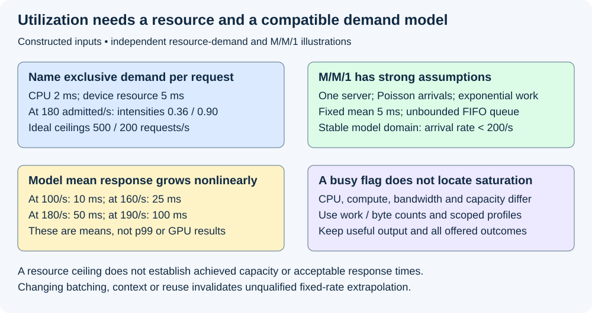
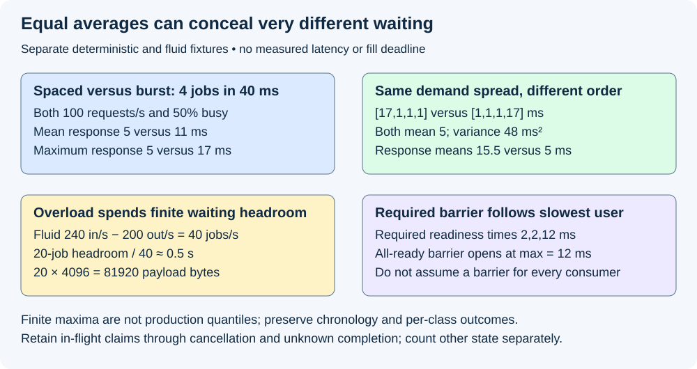

# M5-C10: Utilization, variability, and tail latency

> **Status: Complete — detailed chapter authored and documentation validated; experimental procedures are proposed unless explicitly labelled observed.**

**Module:** Learn scheduling, operating systems, and queueing theory

**Category:** [Scheduling and queueing](index.md)

[Module 5 reading order](../module-5.md) · [Previous: M5-C09](../scheduling-and-queueing/m5-c09-applying-little-s-law-with-consistent-boundaries.md) · [Next: M5-C11](../scheduling-and-queueing/m5-c11-defining-a-static-batching-baseline.md)

## Target concepts

Service demand, bottleneck utilization, saturation, burstiness, service-time variance, latency distributions, queue growth, simple queueing-model assumptions, limits of fixed-rate models for dynamic batches.

[Execution plan and progress](../chapter-execution-plan.md)

## Concepts

### 1. Service demand belongs to a named resource

**Service demand** is the work a specified resource must supply per declared entity, often expressed as seconds of resource occupancy per request. **Residence time** includes waiting and other stages; a 20-ms response does not establish 20 ms of GPU demand. A **bottleneck** is a resource limiting progress at the stated workload and operating point. **Utilization** needs a definition: fraction of time a serial resource is busy, fraction of its compute ceiling achieved, and fraction of bandwidth consumed are different quantities.

Use [M5-C09](m5-c09-applying-little-s-law-with-consistent-boundaries.md) for matched populations and [M3-C16](../measurement-experimentation-and-economics/m3-c16-using-the-roofline-model-to-predict-bottlenecks.md) for resource ceilings. The roofline model distinguishes arithmetic throughput and traffic at a named memory boundary; an “active GPU” percentage does not establish saturation of either. Dependencies, host starvation, launch overhead or memory capacity can limit useful service even when some compute units are idle.

For a single serial resource in a compatible long-run model, with effective entry rate λ and mean demand E[D], **ρ=λE[D]** is its traffic intensity and, when the resource serves all those demands in a stable work-conserving regime, its busy fraction. E denotes an average/expectation. **Work-conserving** means the resource does not idle while eligible work it can execute is waiting. Units cancel: requests/s × resource-seconds/request. This formula is not a rule for multiplying offered demand by an end-to-end latency or a tool's GPU-active percentage.

As a constructed resource-demand example, each request needs 2 ms of exclusive CPU service and 5 ms of exclusive service on one device resource. At 180 admitted requests/s, offered resource intensities are **ρ_CPU=0.36** and **ρ_device=0.90**. Individual ideal capacity ceilings are **1/0.002=500 requests/s** and **1/0.005=200 requests/s**. Their minimum is a necessary upper bound under this model, not achieved throughput: host/device dependencies, overlap capability, queues and other resources can lower capacity. Do not add the two busy fractions, and do not assume 200 requests/s is sustainable for a real GPU or a latency objective.

**Saturation** means additional demand cannot produce a matching increase in useful service at the chosen boundary. Increasing concurrency may initially hide waits and improve batching, then mostly increases backlog, memory pressure or rejection. A high utilization value can be a symptom rather than a cause; identify the actual limiting resource with independent work/byte counts, timing and profiles.

### 2. A simple model makes nonlinear waiting visible

The [MIT M/M/1 reference](https://ocw.mit.edu/courses/2-854-introduction-to-manufacturing-systems-fall-2016/927056a1af54772a587fd84ad4951e71_MIT2_854F16_Mm1Queue.pdf) describes one server, an unbounded waiting area, Poisson arrivals, independent exponentially distributed service times with a fixed mean, and stable rate λ<μ. Here μ is service rate and mean service time d=1/μ. Use FIFO, no rejection, no batching, no retries and one visit per request for this illustration. These are strong model assumptions, not findings about inference traffic.

Its steady-state mean response and waiting are **R̄=1/(μ−λ)=d/(1−ρ)** and **W̄q=R̄−d**, with **ρ=λ/μ**. These are means, not p99, and μ is fixed independently of queue length. A stationary distribution does not mean each short interval has constant occupancy. A Poisson process has random independent increments; it does not issue perfectly spaced requests. Exponential service has variability, so a fixed-5-ms deterministic trace is a different model.

For a teaching mean service d=5 ms, μ=200/s:

| λ (requests/s) | ρ | Model mean queue wait | Model mean response |
|---:|---:|---:|---:|
| 100 | 0.50 | 5 ms | 10 ms |
| 160 | 0.80 | 20 ms | 25 ms |
| 180 | 0.90 | 45 ms | 50 ms |
| 190 | 0.95 | 95 ms | 100 ms |

The device demand has not changed in this model, but waiting grows sharply as spare capacity shrinks. At λ≥μ this unbounded stochastic queue has no finite steady mean response under these assumptions; do not extend the table through division by zero or report a negative wait. This does not create a universal “safe utilization” percentage. Real admission, finite buffers, bounded concurrency and dynamic batch efficiency change the model, and application latency/fairness objectives determine acceptable operating points.

[The Tail at Scale](https://research.google/pubs/the-tail-at-scale/), by Dean and Barroso (2013), discusses how temporary slow episodes can dominate larger services and why high utilization complicates tail control. It motivates examining variability and synchronization, not copying a web-service optimization or numerical threshold into an inference engine.

*The utilization and M/M/1 numbers are constructed model inputs and calculated predictions, not measured GPU or serving behavior.*

### 3. Bursts create waiting even at modest long-window utilization

A **burst** concentrates arrivals over a declared shorter interval. Long-window rate and utilization hide when work arrives. For separate deterministic FIFO examples, one initially idle serial server processes four independent 5-ms jobs; there is no overhead or rejection. Compare an observation horizon [0,40) ms with all cohort exits before 40.

| Arrival pattern | Arrivals (ms) | Service starts (ms) | Waits (ms) | Responses (ms) |
|---|---|---|---|---|
| Spaced | [0,10,20,30] | [0,10,20,30] | [0,0,0,0] | [5,5,5,5] |
| Burst | [0,1,2,3] | [0,5,10,15] | [0,4,8,12] | [5,9,13,17] |

Both offer **4/0.040=100 requests/s** and use **20/40=50%** of the resource's time over this horizon. Mean responses are **5 versus 11 ms**, and maximum responses are **5 versus 17 ms**. Different idle placement explains the difference. The long-window mean demand rate is below the ideal 200/s service rate, yet the burst still queues. The finite deterministic results need not equal the M/M/1 mean at ρ=0.5 because their arrival and service distributions differ.

A finite burst can drain without proving indefinite stability, and a finite queue can remain bounded by rejecting excess demand. Keep intended arrival, actual dispatch, receipt, admission and useful completion counts separate. Generator catch-up after scheduling lag can create an unplanned burst; a client concurrency throttle can reduce actual demand instead. Follow [M5-C07](../measurement-experimentation-and-economics/m5-c07-describing-mixed-serving-workloads-and-arrival-traces.md) rather than treating a nominal rate as evidence of faithful dispatch.

### 4. Service variance and ordering change the experience

**Variance** measures squared spread about a mean; its unit is squared time. For a finite teaching list of n demands, **mean m=(ΣDᵢ)/n**, **population variance v=Σ(Dᵢ−m)²/n**, **standard deviation σ=√v**, and **squared coefficient of variation c²=v/m²** for positive m. This population variance summarizes the complete stipulated list; it is not an unbiased estimate of an unknown population variance.

The lists [5,5,5,5] and [17,1,1,1] ms both have mean **5 ms** and total demand **20 ms**. Their variances are **0 and 48 ms²**; the second has σ≈6.93 ms and c²=48/25=**1.92**. A long non-preemptive job can hold up following jobs even when average work is unchanged. However, variance alone does not determine a finite trace's waiting; arrival/order correlations matter too.

Hold FIFO arrivals at [0,2,4,6] ms and initial idle state. Keep the same [0,40) ms horizon:

| Demand sequence assigned in arrival order | Service intervals (ms) | Waits (ms) | Responses (ms) |
|---|---|---|---|
| Constant [5,5,5,5] | 0–5; 5–10; 10–15; 15–20 | [0,3,6,9] | [5,8,11,14] |
| Long first [17,1,1,1] | 0–17; 17–18; 18–19; 19–20 | [0,15,14,13] | [17,16,15,14] |
| Long last [1,1,1,17] | 0–1; 2–3; 4–5; 6–23 | [0,0,0,0] | [1,1,1,17] |

Mean responses are **9.5, 15.5 and 5 ms**. The last two have identical marginal demands and variance; their association with arrival position changes the queue. All still have 50% busy time over 40 ms. These are workload transformations, not evidence that an online policy knew future output length. The long-last case has the lowest mean but still has a 17-ms maximum. Averages, spreads, class-specific outcomes and chronology answer different questions.

In inference, prompt processing, context length, realized stopping, cache misses, host scheduling and output-reader delay can produce variability at different stages. Distinguish demand changes from waiting and observation delay using [M5-C08](m5-c08-queueing-delay-service-time-and-request-latency.md). A shared completion barrier can make several consumers wait for the slowest required member: for stipulated independent readiness times [2,2,12] ms, an all-ready barrier opens at **max=12 ms**, not the mean 16/3 ms. Only a design requiring all those dependencies has this barrier; do not assume every batch member's output is universally held back.

### 5. Overload spends headroom and retains state

For a fluid teaching approximation with persistent backlog, let λ be admitted jobs/s and μ completed jobs/s. If λ>μ, **backlog growth ≈λ−μ** jobs/s. With 240 admitted/s and fixed service capacity 200/s, excess demand is **40 jobs/s**. Twenty jobs of remaining waiting capacity fill after approximately **20/40=0.5 s**, starting from the stipulated current backlog. This ignores individual arrival/service events and variability, so it is not an exact exhaustion deadline. Once the bound is reached, admission/rejection/backpressure policy must change the accepted process; do not continue the unbounded equation through a finite limit.

If each additional waiting job retains a distinct 4,096-byte input payload, 20 extra jobs retain **81,920 bytes**, excluding queue metadata, model weights, KV, output buffers and generator backlog. Those claims must remain owned and bounded. Logical cancellation may release future admission promises while already submitted users still protect physical allocations; apply [M9-C22](../runtime-and-concurrency/m9-c22-verifying-ownership-and-memory-safety-under-concurrency.md). A timeout is not permission to recycle an in-flight buffer. Worker loss or unknown completion may require quarantine rather than pretending the bytes vanished.

An observed throughput plateau alone does not locate the bottleneck: it can be generator throttling, host CPU, device compute/bandwidth, launch serialization, capacity rejection, output delivery or a policy limit. Compare required work, bytes, occupancy/drift, all outcomes and focused profiles. Report useful successful service with latency and fairness goals. High utilization while rejecting most offered requests is not evidence that the desired workload is supported.

### 6. Dynamic batches do not have one fixed per-request service rate

A dynamic executor changes batch membership, prompt/decode composition and context lengths between iterations. Invocation cost is better regarded as a conditional function of those descriptors and the hardware/backend state, rather than one constant d per whole request. This is a conceptual cost specification, not an implementation. Weight reuse can improve per-request efficiency as a batch grows; memory traffic, padding, longer contexts and synchronization can reverse that effect. Dividing one mixed invocation duration by its row count does not establish the marginal cost or independent service time of each row.

Keep a conservative baseline with one executor and at most one batch in flight, then identify ready time, selection/submission, required completion and commit for each iteration. Requests revisit that resource and can be deferred while retaining KV. A fixed μ measured on a warm, homogeneous batch must not be extrapolated to bursty mixed prefill/decode, different reuse or longer outputs without validation. Mean utilization, model-based wait and measured end-to-end latency are different evidence layers.

**Tail latency** describes the slow end of a defined response distribution, such as empirical p99, not a synonym for the maximum in a four-request fixture. [M9-C07](../measurement-experimentation-and-economics/m9-c07-latency-distributions-and-statistical-uncertainty.md) establishes quantile conventions and uncertainty. Report successful request TTFT and terminal endpoints, eligible token gaps, rejected/failed/cancelled and unfinished populations, plus per-class regressions. A fast mean for short requests can coexist with delayed long requests or growing unresolved demand. Closed-loop feedback, successful-only filtering and omitted generator lag can all make overload look benign.

*Finite deterministic histories and fluid estimates explain mechanisms. They do not establish production p99, a measured fill deadline or a universal utilization target.*

## Experiments

All four experiments are proposed. Authorship observes bounded arithmetic and documentation QA only; no queue, simulator runtime, profiler, model server or hardware study is executed. No implementation is supplied.

### E1 — Qualify resource demand and the simple model

- **Name:** Name the bottleneck before treating a utilization number as capacity.
- **Description:** Reconcile CPU/device demand bounds and M/M/1 predictions under separate explicit assumptions.
- **Purpose/objective:** Hypothesis: the tighter resource ceiling is necessary but not achieved capacity; waiting can increase nonlinearly without changing mean demand. HFT concern: average utilization leaves less room for urgent arrivals.
- **Target concepts:** Service demand, bottleneck utilization, saturation and queue-model assumptions.
- **Baseline:** Constructed 2/5-ms resource demands and independent M/M/1 mean d=5 ms, μ=200/s; do not pool these as one calibrated backend.
- **Workload:** Resource intensities at 180/s and M/M/1 λ=100/160/180/190. Independent variable: model load, keeping its demand distribution fixed. Include λ=200/240 as cases where the stated finite steady mean does not exist.
- **Controlled variables:** Resource definition, effective admitted population, units and stated independence/FIFO/infinite-buffer assumptions. No end-to-end elapsed time is substituted for resource service.
- **Hardware requirements:** CPU arithmetic review; later isolated host/device workload with actual compute/byte counts, supported counters and qualified completion timing.
- **Exit criteria:** First reproduce 0.36/0.90 and 500/200 upper bounds; then 10/25/50/100-ms mean-response predictions; finally reject extrapolation past the model's stable domain or to p99. A real bottleneck claim needs observed resource evidence plus end-to-end useful service, not a busy flag alone.

### E2 — Preserve average demand and vary burst shape

- **Name:** Half busy over 40 ms can still mean a 12-ms wait.
- **Description:** Compare the four fixed-service spaced/burst traces with identical jobs and horizon.
- **Purpose/objective:** Hypothesis: changing arrival concentration changes waiting even when full-window rate and busy fraction match. HFT concern: brief bursts consume headroom hidden by a long-window average.
- **Target concepts:** Burstiness, queue growth, utilization and latency distributions.
- **Baseline:** Four independent FIFO 5-ms jobs, initially idle resource, no overhead/rejection and [0,40) ms observation.
- **Workload:** Spaced [0,10,20,30] versus burst [0,1,2,3]; independent variable: arrival shape only. Later include controlled generator lag/catch-up as separately labelled cases.
- **Controlled variables:** Request payload/cap/random identity, service assumptions, cache preparation, server capacity, deadline and outcome definitions.
- **Hardware requirements:** CPU exact event reference; later generator with verified intended/actual dispatch and separate host/resource timing logs.
- **Exit criteria:** First reproduce 100 requests/s and 50% busy for both; then per-job waits/responses, mean 5/11 and maximum 5/17 ms; finally retain every intended request and verify the generator actually applied the changed schedule. A finite maximum is labelled as such; four requests support no p99 claim.

### E3 — Separate service spread from ordering and synchronization

- **Name:** Identical service variance can produce different waiting.
- **Description:** Audit constant, long-first and long-last demand histories, then inspect stage-specific variability and required barriers.
- **Purpose/objective:** Hypothesis: demand spread and arrival association both affect latency; synchronization can propagate a slow member. HFT concern: rare long handlers can delay unrelated queued events.
- **Target concepts:** Service-time variance, latency distributions, simple-model limits and synchronization.
- **Baseline:** FIFO arrivals [0,2,4,6] in a 40-ms horizon with fixed toy demands; separate [2,2,12]-ms all-ready barrier.
- **Workload:** Constant versus variable demand is one cell; long-first versus long-last is a marginal-preserving order cell. Independent variables are spread or ordering separately. Include a consumer not depending on the slow member as a barrier counterexample.
- **Controlled variables:** Total demand 20 ms, mean five, resource/arrival/horizon and eligibility. These simulator inputs do not give an online LLM scheduler future lengths.
- **Hardware requirements:** CPU demand/event arithmetic; later per-stage traces with row/iteration identity, device/host correlation and supported memory/scheduling diagnostics.
- **Exit criteria:** First reproduce variance 0/48 ms² and c²=1.92; then responses with means 9.5/15.5/5 and equal 50% busy; finally show that the explicit all-ready barrier waits to 12. A variance estimate alone cannot explain all waiting or justify an end-to-end latency claim; preserve chronology and output correctness.

### E4 — Locate the operating point without hiding overload

- **Name:** A throughput plateau must retain its missing work.
- **Description:** Audit fluid backlog/byte headroom, then define a matched load sweep for qualified dynamic-batch service.
- **Purpose/objective:** Hypothesis: after a limiting resource saturates, extra accepted demand accumulates or outcomes change; fixed μ is not transferable across batch regimes. HFT concern: overload spends finite buffers and shapes the tail.
- **Target concepts:** Saturation, queue growth, bottleneck evidence, fixed-rate model limits and tail latency.
- **Baseline:** Fluid 240/200 jobs/s reference with 20 jobs of waiting headroom; separate future real comparisons preserve a frozen workload cell.
- **Workload:** Approximate fill time and payload bytes; later predeclared offered-load cells spanning the observed service plateau, with mixed length/reuse/arrival classes. Independent variable: offered load within one fixed policy/hardware/workload family, or policy in separately matched cells.
- **Controlled variables:** Generator dispatch rule, admission/capacity/future-growth bounds, cache state, model/tokenizer/sampling, numeric contract and reset/drain. Do not change batch policy and corpus without labelling both.
- **Hardware requirements:** CPU fluid/accounting QA; later qualified model server, characterized generator, supported CPU/GPU counters and memory/final-user traces.
- **Exit criteria:** First reproduce 40 jobs/s growth, approximate 0.5-s headroom fill and 81,920 payload bytes; then preserve waiting/rejected/failed/cancelled/open outcomes and cleanup claims; finally compare actual plateau, drift and per-class useful latency with independent bottleneck evidence. No real fill time, p99 or sustainable capacity follows from the fluid arithmetic.

## Verification

| Experiment | Correctness/reference | Measurement / benchmarking | Diagnostic and acceptance scope |
|---|---|---|---|
| E1 | Named resource units, compatible effective rate and explicit model assumptions | Demand, busy fraction, achieved compute/traffic, model means | A busy flag or roofline ceiling alone cannot certify a bottleneck |
| E2 | Same jobs/horizon, different declared arrival shapes | Per-job waits, responses, busy/idle placement and dispatch lag | Same long-window average does not establish same delay or tails |
| E3 | Full demand lists, arrival association and required dependency graph | Variance, chronological stage spans, response classes and barriers | Distinguish variable processing from waiting and observation delay |
| E4 | All intended, received and admitted attempts; outcomes and final-user populations | Useful output, offered/admitted load, drift, queue bytes and qualified latency distributions | Plateau attribution and capacity require actual workload/resource evidence |

For real studies, follow [M9-C02](../measurement-experimentation-and-economics/m9-c02-request-events-clocks-and-measurement-boundaries.md) for clocks and [M5-C07](../measurement-experimentation-and-economics/m5-c07-describing-mixed-serving-workloads-and-arrival-traces.md) for immutable traces, cap versus realized length, workload seeds and generator fidelity. Measure ready-to-dispatch waiting separately from invocation start-to-required-completion and commit delay. Report request TTFT/terminal endpoints and eligible consecutive selected/client token gaps without treating text chunks as tokens. Keep all unsuccessful and unfinished attempts and censored durations rather than assigning them zero or deleting them.

A proposed descriptive starting budget is 20 paired reset sessions per predeclared load/workload cell, balanced arm order, and one complete scratch-trace warmup per arm under [M9-C11](../measurement-experimentation-and-economics/m9-c11-controlled-comparisons-warmup-and-reproducibility.md). Restore declared cache state and define arrival windows before inspecting results. Drain admitted work and final users or report unresolved/quarantined claims; output-throughput denominators including drain must be named. Preserve every session, invalid/missing record, carried-in work and actual dispatch trace. Replication units are session pairs; requests and neighboring windows may be dependent. Small constructed examples and this session budget establish neither a production p99 confidence interval nor a sustainable load threshold.

For confirmatory comparisons, freeze [M9-C27](../measurement-experimentation-and-economics/m9-c27-designing-regression-experiments-and-validation-gates.md) hypotheses, operating-point definitions, sample-size/uncertainty reasoning, resource and per-class regression gates. Inspect backlog trends and offered/admitted/outcome rates alongside medians/ranges and justified tails. A fixed run duration cannot by itself prove stability. A finite queue with steady occupancy can be dropping demand. If changing hardware/frequency or cache conditions is necessary, treat that as a different comparison cell.

Use short independent host scheduling and device profiles to inspect launch gaps, compute/traffic, input/output movement, synchronization and per-iteration shape/composition. [M9-C12](../measurement-experimentation-and-economics/m9-c12-reading-cpu-gpu-timelines-and-scheduling-gaps.md) and [M9-C13](../measurement-experimentation-and-economics/m9-c13-using-kernel-profilers-to-explain-hardware-bottlenecks.md) separate timeline evidence from kernel counters. Estimate diagnostic overhead on matched cases and exclude profiling/sanitizer runs from clean timing. Instrumentation itself can change batching or expose a host bottleneck. No utilization optimization is accepted if it breaks token/numerical identity, capacity reservations, safe retirement or useful service goals.

## Engineering dimensions and principles

| Dimension | Application |
|---|---|
| Semantics and invariants | Same useful requests and qualified outputs precede any utilization/tail comparison |
| Workload and variability | E2/E3 vary bursts, spread and order; real cells preserve lengths, reuse skew and correlations; text only |
| Resources and bottlenecks | CPU, compute, bandwidth and retained capacity have distinct demand/counter boundaries |
| Time and distributions | Means, finite maxima and supported quantiles are separate; synchronization can propagate long work |
| Ownership and coordination | Backlog and in-flight payload/KV claims stay owned until their final users complete |
| Failure and adaptation | Finite admission, backpressure, cancellation, worker loss and rejected demand remain visible |

| Engineering principle | Consequence |
|---|---|
| 1. Correctness defines the optimization boundary | Higher device activity cannot justify incorrect output or premature buffer return |
| 2. Performance depends on workload and operating point | The same 50% finite busy time accompanies very different waiting histories |
| 3. Data movement is part of the algorithm | Weight/KV traffic, transfers and output delivery can limit service without saturating compute |
| 4. State has ownership, lifetime and recovery cost | Twenty extra 4,096-byte payloads retain 81,920 bytes before other state |
| 5. Dependencies determine latency; bottlenecks determine capacity | An all-ready barrier follows its slowest required member; independent resource ceilings do not guarantee throughput |
| 6. Variability and synchronization shape the tail | Bursts, long handlers, context mix and shared barriers matter beyond means |
| 7. Local improvements require end-to-end evaluation | Compare useful output, rejection, fairness and tails rather than utilization alone |
| 8. Claims require reproducible evidence | Freeze assumptions, load cells, actual traces, diagnostic scope and all outcomes |

The HFT lens is a shared event handler whose spare time absorbs bursts and whose long non-preemptive work delays other events. Resource demand, bounded headroom and chronology transfer well. Inference adds iterative dependencies, batching economies and growing KV; neither these toy models nor utilization percentages establish trading results or exchange deadlines.

## Specifications, articles, and hardware

The MIT M/M/1 reference and Dean/Barroso's research article are linked at their claims; primary sources were reviewed on 2026-10-29. Their assumptions and scope are stated locally. The operational measurement specification is the immutable workload, named resource counters, host/device event clocks, outcome populations and reset/drain rules; no profiler's generic utilization label is silently substituted for exclusive resource demand.

Reference calculations need CPU arithmetic only. Real studies record generator/server CPU/core/SMT/NUMA/RAM, OS/kernel, Rust/runtime/compiler, affinity/quotas, worker and connection limits, clock resolution and competing load; GPU architecture/count/VRAM, frequency/power/thermal conditions, interconnect, driver/backend/runtime, stream/event/graph policy and profiler counter definitions; model/adapter/tokenizer/template/corpus hashes, dtype/layout, output caps/stopping/random identity, cache state, batch/iteration composition and queue/KV/workspace/payload bounds. Record warmup/reset/drain, fault/recovery and logging overhead. No machine was benchmarked; all stated costs, rates and service lists are teaching inputs.

## Key takeaways

Name service demand and the limiting resource before interpreting utilization. Bursts, service spread, chronology and dependencies can change waiting without changing a long-window mean. Use simple queueing models within their assumptions, then qualify real dynamic-batch operating points through correct useful output, complete demand accounting and reproducible tail/resource evidence.

## Continue learning

Next in Module 5 reading order is completed [M5-C11: Defining a static batching baseline](m5-c11-defining-a-static-batching-baseline.md). The next authoring chapter is [M5-C18: Choosing chunk sizes and balancing prefill with decode](../scheduling-and-queueing/m5-c18-choosing-chunk-sizes-and-balancing-prefill-with-decode.md), position 125. Follow the [execution plan and progress tracker](../chapter-execution-plan.md); Module 9 supports Modules 1–7 and Module 8 is excluded.
