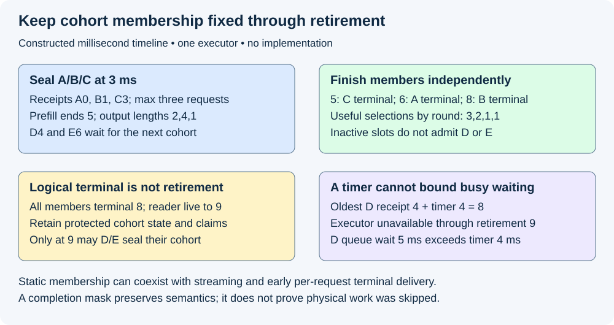
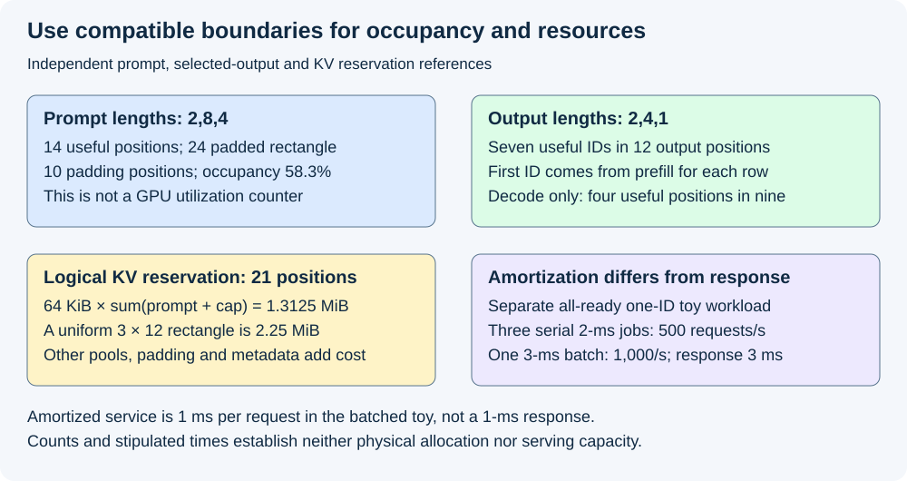

# M5-C11: Defining a static batching baseline

> **Status: Complete — detailed chapter authored and documentation validated; experimental procedures are proposed unless explicitly labelled observed.**

**Module:** Learn scheduling, operating systems, and queueing theory

**Category:** [Scheduling and queueing](index.md)

[Module 5 reading order](../module-5.md) · [Previous: M5-C10](../scheduling-and-queueing/m5-c10-utilization-variability-and-tail-latency.md) · [Next: M5-C12](../scheduling-and-queueing/m5-c12-continuous-batching-at-execution-boundaries.md)

## Target concepts

Fixed request cohorts, batch formation delay, length mismatch, completion masking, inactive slots, no mid-cohort admission, baseline policy definition, capacity and latency tradeoffs.

[Execution plan and progress](../chapter-execution-plan.md)

## Concepts

### 1. Define what remains fixed

A **batch** groups independent requests for shared model execution. A **cohort** is the identified set chosen together. In this chapter's **static batching baseline**, membership and slot assignment remain fixed from sealing the cohort until its final resources retire. A finished request leaves an inactive slot; a new request cannot fill it mid-cohort. Static membership does not require equal prompt/output lengths, identical completion times or withholding every response until the longest request finishes.

[Orca, OSDI 2022](https://www.usenix.org/conference/osdi22/presentation/yu), identifies inflexible batch scheduling as a problem for multi-iteration generation and motivates iteration-level scheduling. Its reported baseline behavior is not a universal definition of static batching. Our local baseline explicitly permits streaming and early per-request terminal delivery while preserving fixed membership. No Orca performance number is reproduced here. Completed [M5-C12](m5-c12-continuous-batching-at-execution-boundaries.md) explains admission at execution boundaries separately.

A baseline is an exact reference policy, not merely “batch size three.” Freeze these rules before comparing it with another policy:

| Policy item | Local baseline specification |
|---|---|
| Execution ownership | One scheduler-state owner, one executor and at most one cohort in flight; no overlapped next-cohort prefill |
| Eligibility and order | One compatible model/adapter/precision group; first-in-first-out among valid eligible requests; no length sorting |
| Formation | Maximum B requests; seal when B are available or the oldest eligible request's receipt-based timer Δ has expired and the executor is available |
| Tie convention | At one timestamp, observe receipts/cancellation before evaluating sealing; full cohort may seal at its timer endpoint |
| Membership | Freeze attempt IDs, slot-to-request mapping and generation identity; never replace an inactive slot |
| Execution shape | One padded prefill followed by fixed-slot decode rounds while any member remains active; backend work for masked slots is recorded, not assumed absent |
| Completion and output | Prefill may select the first output; stop each request at its own valid EOS/stopping/length condition; stream committed output without a cohort response barrier |
| Retirement | Conservatively retain cohort-owned KV, descriptors and shared buffers until all required device and host/output users finish; only then may the next cohort use them |
| Bounds and failure | Enforce declared queue, prompt/output, KV/workspace/output limits; reject invalid or unaffordable admission explicitly; cancellation never grants early reuse |

**Sealing** closes membership and authorizes an immutable execution descriptor. Admission reserves the resources promised by that descriptor; queue receipt alone is not admission. In a Rust design, a single owner can coordinate these states while the executor borrows protected descriptors. A runtime task returning or device enqueue succeeding does not establish completed access: use [M5-C06](../runtime-and-concurrency/m5-c06-asynchronous-execution-and-completion-driven-progress.md). This chapter provides no Rust or other implementation.

The [Triton batcher specification](https://docs.nvidia.com/deeplearning/triton-inference-server/user-guide/docs/user_guide/batcher.html) documents a delay-versus-batch-formation tradeoff and distinguishes stateless dynamic batching from stateful sequence mechanisms. Those named mechanisms are not assumed to implement this whole-request baseline. In particular, forming a batch from a queue and changing an already running generative cohort are different policy choices. Pin the backend and inspect its semantics before labelling a measurement “static.”

### 2. Formation delay is real request latency

Let aᵢ be client intended arrival, rᵢ scheduler receipt, b the cohort seal/execution start, fᵢ first visible output, zᵢ application terminal and q final physical retirement. Each timestamp needs a clock domain and observation definition. For compatible timestamps, queue wait is **b−rᵢ**; receipt-to-first-output is **(b−rᵢ)+(fᵢ−b)**. Client intended-to-first-output also includes dispatch and transport before receipt. Do not subtract unrelated client/server clocks; correlate them under [M9-C02](../measurement-experimentation-and-economics/m9-c02-request-events-clocks-and-measurement-boundaries.md).

For an idle executor, B regular arrivals separated by h, with no timer expiry first, seal at **b=r₁+(B−1)h**. Request k waits **(B−k)h** and mean formation wait is **(B−1)h/2**. With B=3, h=2 ms and Δ=5 ms, arrivals 0/2/4 seal at 4; waits 4/2/0 ms average 2. If only one request arrives at 0, a bounded timer seals its partial cohort at 5, assuming the executor/resources are available. Waiting forever for a full batch would violate the baseline's progress rule.

Δ is not a universal queue-latency bound. An earlier cohort, resource retirement, scheduler delay or unavailable credits can hold the executor beyond that timer. Record the reasons and total wait; do not report every queued request as delayed by at most Δ. Separate deliberate formation while the executor is available from waiting for the busy executor. A larger batch may amortize shared work but uses some of the first-output budget before computation starts.

### 3. Follow a fixed cohort through unequal completions

The following is a **constructed** timeline on one teaching clock, not a measured model run. B=3 and Δ=4 ms. Receipts are A at 0, B at 1, C at 3, D at 4 and E at 6 ms. A/B/C form the first cohort at 3 because it is full before the oldest timer endpoint 4. Their required valid output lengths are respectively **2,4,1 IDs**, stipulated by the reference output/stopping contract rather than changed to make packing convenient. First-cohort padded prefill takes 2 ms and selects the first output for every member at 5. Each subsequent decode round takes 1 ms independent of occupancy in this toy. It selects at most one additional ID for each still-active member.

| Boundary (ms) | Useful selections / terminal facts | Fixed cohort state |
|---:|---|---|
| 3 | Seal A/B/C; submit prefill | Three original slot identities retained |
| 5 | A₁,B₁,C₁; C terminal | C inactive; A/B still active |
| 6 | A₂,B₂; A terminal | A/C inactive; B still active; E remains queued |
| 7 | B₃ | Only B active; no replacement |
| 8 | B₄; B terminal | All logically complete; shared output reader still live |
| 9 | Final shared reader releases; first cohort retires | D/E may now seal a partial second cohort |
| 11 | Second-cohort prefill selects D₁/E₁; both terminal | Each has a valid one-ID reference answer |
| 12 | Second-cohort final users release | Entire reference workload physically drained |

A/B/C first-output receipt latencies are **5,4,2 ms**; terminal receipt latencies are **6,7,2 ms**, mean **5 ms**. C can return at 5 and A at 6 even though B completes at 8. Cohort retirement 9 remains different from all three terminal times. The latest request E at 6 cannot replace A or C at the round boundary 6; doing so changes the policy. D's queue wait to seal 9 is **5 ms**, exceeding Δ=4 because the previous cohort was unavailable through retirement 9. E waits 3 ms. D/E first-output receipt latencies are 7/5 ms. Transport and terminal overheads are stipulated zero here; real measurements must include or separately report them.

An **active mask** identifies requests still permitted to advance and commit output. **Completion masking** makes a finished/cancelled member ineligible for later visible IDs, position increments, random draws and request-owned KV updates. An inactive slot may still occupy a physical tensor row. Physical scratch computation is permissible only within a validated backend contract; a mask is not a promise that every corresponding instruction or memory access is skipped. Do not feed uninitialized/out-of-bounds data to inactive rows or assume multiplying a bad value by zero makes an operation safe.

An **attention mask** controls which token positions may influence attention. It is distinct from the active/completion mask controlling the request lifecycle. Correct padding positions, causal positions and model-specific position IDs remain necessary for active requests. Finished dummy slots must not append padding/EOS again to a user's output, advance its RNG or become another request through a stale slot index. Validate both output behavior and access/lifetime safety, including errors and duplicate completion signals.

*Constructed timeline. Early response is permitted; new admission still waits for the whole cohort's final-user retirement.*

### 4. Quantify mismatch without calling it GPU utilization

**Padding** creates a rectangular layout by adding nonsemantic positions to shorter inputs. **Truncation** removes input content and can change the task; it is not a free alternative to padding. The [Hugging Face padding specification](https://huggingface.co/docs/transformers/main/pad_truncation) describes these distinct transformations. Our baseline preserves each valid prompt and its output contract; any intentional truncation would need separately declared semantics and quality validation.

For prompt lengths pᵢ and B requests padded to pmax, define a token-position occupancy proxy:

**η_prefill=Σpᵢ/(B×pmax).**

With p=[2,8,4], useful prompt positions total 14, rectangular positions 24 and padding 10: **η_prefill=14/24≈58.3%**. This proxy does not model attention's context-dependent cost, kernel layouts, packed execution, memory traffic or measured compute utilization. A pad mask can preserve semantics without eliminating all physical work. [M3-C17](m3-c17-batching-weight-reuse-and-shifting-bottlenecks.md) explains reuse and row-count boundaries; a request count and newly processed token rows are not interchangeable.

For gᵢ valid selected output IDs, including the first from prefill, useful generation positions are **Σgᵢ**, while a fixed-slot output-round rectangle has **B×gmax** positions. In the A/B/C fixture this is **7/12≈58.3%**: active counts by selection boundary are 3,2,1,1. For **decode-only** rounds, the first output is excluded: useful positions **Σ(gᵢ−1)=4**, rectangle **B×(gmax−1)=9**, occupancy **4/9≈44.4%**. These two ratios describe different work. There are three decode forwards after one prefill, not four decode forwards; counting seven output IDs does not establish seven new KV writes or seven full forward passes. If all gᵢ=1 there are no decode rounds and that decode ratio is not applicable, not zero utilization.

In an equal-length comparison g=[4,4,4], generation-position occupancy is 12/12 and decode occupancy 9/9. That change adds five useful output IDs relative to [2,4,1]; it is a different workload, not proof that sorting or a new scheduler made the same work faster. To study grouping, preserve the same global request/arrival/output cohort, resource limits and order eligibility and report any changed waiting/fairness. No length prediction or sorting policy is implemented here.

KV capacity also follows retained state rather than current active count alone. For a conservative logical reservation, with uniform hypothetical q=64 KiB per token position, p=[2,8,4] and declared output caps G=[2,4,1], reserving **qΣ(pᵢ+Gᵢ)=64×21=1,344 KiB=1.3125 MiB** bounds those logical per-request positions. This deliberately reserves even a last selected ID that may never be fed through another forward. It excludes weights, allocator metadata, workspace, alignment and output/log storage. A backend using a uniform [B,max(pᵢ+Gᵢ)] KV rectangle may instead reserve 36 positions, **2.25 MiB**, before those other costs. Measure the chosen physical layout; a logical sum is not a physical allocation guarantee. No actual architecture with 64-KiB KV positions is claimed.

Under the conservative baseline, completed C's state remains reserved until cohort retirement rather than being immediately reused. More elaborate partial reclamation is a different qualified policy. Growing context, padded rows, output buffers and even a stalled client can therefore limit capacity when few slots remain active. Use [M9-C15](../state-memory-and-caching/m9-c15-accounting-for-weights-kv-state-workspace-and-fragmentation.md) for resource ledgers and [M9-C22](../runtime-and-concurrency/m9-c22-verifying-ownership-and-memory-safety-under-concurrency.md) for final users.

*Prompt positions, output selection rounds, decode inputs and physical allocation have different denominators. All values are constructed.*

### 5. Compare service tradeoffs under the same useful-work contract

For an isolated all-ready cohort with service interval T(B), **B/T(B)** is finite-cohort request throughput and **T(B)/B** is amortized service per request. The latter is not the response latency of any individual request. Additional batch wait, long-member lifetime and retirement are outside a narrow kernel interval. A pipelined or continuous policy needs another dependency/resource model; do not assume its overlap in this single-executor reference.

In a separate all-ready, one-ID teaching workload, three singleton executions each take 2 ms, so serial terminals are 2,4,6, mean response 4 ms, and cohort throughput **3/0.006=500 requests/s**. One three-request prefill stipulated to take 3 ms gives terminals 3/3/3, mean response 3 ms, and **3/0.003=1,000 requests/s**. Amortized service 1 ms is not response 3 ms. The earliest singleton answer at 2 becomes later at 3 under batching. No formation, transport, decode, retirement or capacity limitation is included in that separate arithmetic fixture. Hardware could behave differently; a bigger batch can improve reuse or worsen workspace, bandwidth and critical-path time.

Use [M9-C06](../measurement-experimentation-and-economics/m9-c06-defining-slos-goodput-and-useful-capacity.md) to evaluate a **joint per-request acceptance predicate**: correct output plus first-output, gap and terminal targets in the same eligible population. Preserve offered, admitted, rejected, successful, cancelled and incomplete work. Inactive slot reduction is useful only if the replacement policy preserves semantics and improves useful service under the same trace and resources. A low mean wait, high token count or 100% output-round occupancy does not establish p99, class fairness or sustainable capacity. [M5-C10](m5-c10-utilization-variability-and-tail-latency.md) explains variability and queue growth.

Cancellation received during an in-flight round cannot mutate its borrowed descriptor. The scheduler records the attempt/generation and applies the declared output-commit/cancellation ordering at a safe owner boundary. The local rule retains already committed output, processes observed cancellation before committing still-pending output at the same owner boundary, and prevents that pending output from becoming visible. Cancellation received after a successful terminal commit does not rewrite that success. Freeze this ordering for both comparison arms. In this baseline, stop further unsubmitted work for a cancelled member after the owner processes cancellation, retain its inactive slot, and preserve claims for all already submitted accesses. If an error makes device completion unknown, quarantine affected cohort state and use a documented recovery procedure; never force retirement to make the next batch fit. Queue/output allocation failure and slow-client backpressure need bounded rejection or stopping policies and complete counts, not silent omission.

## Experiments

All experiments are proposed. Authorship checks only constructed arithmetic, timeline/identity invariants and documentation. No model executor, scheduler, load generator, cancellation fault, hardware benchmark or profiler is implemented or run.

### E1 — Verify cohort formation and no replacement

- **Name:** Freeze membership through cohort retirement.
- **Description:** Audit the specified FIFO/cap/timer policy against the A–E timeline and sparse-arrival boundary cases.
- **Purpose/objective:** Hypothesis: fixed membership leaves new requests queued even after C/A finish, and busy-executor wait can exceed Δ. HFT concern: assembling more work consumes deadline budget and may delay new arrivals behind an older group.
- **Target concepts:** Fixed cohorts, formation delay, no mid-cohort admission and baseline policy definition.
- **Baseline:** B=3, Δ=4 ms; A at 0/B at 1/C at 3/D at 4/E at 6, first cohort seal 3 and retire 9, next seal 9.
- **Workload:** Exact receipt trace; separate regular 0/2/4 with Δ=5, singleton sparse arrival, exact timer tie, bounded-queue rejection and incompatible adapter. Independent variable: one arrival/timer/eligibility boundary per case.
- **Controlled variables:** Owner/executor count, FIFO rule, output lengths, resource bounds, sealing tie convention and identity/generation mapping.
- **Hardware requirements:** CPU timeline review first; later supported scheduler/client/device event recording with a frozen model/backend and bounded resources.
- **Exit criteria:** Reproduce first seal 3 and no D/E insertion before retirement 9, D queue wait 5 ms exceeds Δ=4 ms and E wait 3. Reproduce regular waits 4/2/0 and sparse partial seal 5 under its separate assumptions. Reject incompatible/unaffordable admission with explicit accounting; an early finished slot is never a new attempt.

### E2 — Measure padding and inactive-slot boundaries

- **Name:** Useful occupancy is a proxy, not a hardware speed result.
- **Description:** Reconcile prompt positions, output-round and decode-only rectangles, logical versus physical KV reservation.
- **Purpose/objective:** Hypothesis: length mismatch creates inactive positions while masks need not remove all physical work; changing lengths changes the workload. HFT concern: a group can remain resource-bound after most useful members finish.
- **Target concepts:** Length mismatch, completion masking, inactive slots and capacity tradeoffs.
- **Baseline:** p=[2,8,4], g/G=[2,4,1], fixed three slots, hypothetical 64-KiB KV positions.
- **Workload:** Heterogeneous and separately labelled equal-length references; all-one-ID case, long prompt/cap, invalid padding and memory-bound admission. Independent variable: one length/shape or reservation-layout assumption per reference.
- **Controlled variables:** Model/position/attention semantics, output stopping, slot identity, precision, mask policy and declared count boundaries; global workloads matched for real grouping comparisons.
- **Hardware requirements:** CPU count reference; later GPU/backend exposing supported shapes and physical work/traffic/allocator evidence, with all pools recorded.
- **Exit criteria:** Reproduce 14/24 prompt, 7/12 output and 4/9 decode occupancy; no decode denominator when all outputs have one ID; 21 logical positions = 1.3125 MiB versus 36 rectangular positions = 2.25 MiB. Validate masks/output before profiling physical work; do not infer FLOPs, DRAM bytes or speedup directly from these ratios.

### E3 — Validate completion, output and retirement separately

- **Name:** Terminal output does not authorize slot reuse.
- **Description:** Check A/B/C selected-ID histories and final-user claims, then define cancellation, duplicate and unknown-completion negative cases.
- **Purpose/objective:** Hypothesis: C returns at 5 and A at 6 without letting D/E steal their slots, and an output reader can retain the whole cohort after B's terminal 8. HFT concern: a retired event's storage must not corrupt later work through premature reuse.
- **Target concepts:** Completion masking, inactive slots, fixed identity and baseline lifetime definition.
- **Baseline:** A has 2 IDs, B 4 and C 1; first cohort all logically complete 8 and physically retired 9.
- **Workload:** Exact boundary ledger; separately one cancellation/commit race, stale slot generation, duplicate notification, reader stall or worker loss. Independent variable: one lifecycle observation or fault per case.
- **Controlled variables:** Per-request stopping/RNG reference, masks, committed-prefix policy, owner ordering, protected descriptor and device/host final users.
- **Hardware requirements:** CPU identity/lifetime review; later isolated supported host/device diagnostics and output validation with no unsafe shared production state.
- **Exit criteria:** Detect any extra visible C or A ID, post-stop request-state/RNG advancement, stale mapping or reuse before 9. Then require explicit racing-commit semantics, preserved cancellation outcomes and quarantined unknown completion. A mask, completed client future or counter reset alone cannot prove safe access retirement.

### E4 — Compare batching through useful latency and capacity

- **Name:** Amortized time is not request response time.
- **Description:** Reproduce the separate singleton/batched arithmetic, then design matched serving experiments across batch caps and formation timers.
- **Purpose/objective:** Hypothesis: better amortized throughput can delay the earliest answer, and real length/arrival variability can erase a local gain. HFT concern: throughput gains must still satisfy per-event correctness/deadline promises.
- **Target concepts:** Batch formation, baseline definition, capacity and latency tradeoffs.
- **Baseline:** Separate all-ready one-ID reference: three serial 2-ms executions versus one 3-ms three-request execution; no hardware performance assumed.
- **Workload:** Exact reference first; later M9-C08 fixed length/reuse/adapter and independent-arrival trace, including sparse, burst, cold/warm and long-tail classes. Independent variable: batch cap or formation timer, separately; all comparison policies use matched offered work.
- **Controlled variables:** Output/quality/stop reference, CPU/GPU/network bounds, clock endpoints, queue/KV/output limits, reset state, diagnostics and fault policy.
- **Hardware requirements:** Qualified generator/server, recorded CPU/GPU/VRAM/interconnect and supported physical completion, timing, memory and traffic tools.
- **Exit criteria:** Reproduce 500 versus 1,000 requests/s finite-cohort rates, 4 versus 3-ms mean response and 1-ms amortized versus 3-ms response. Then compare joint first-output/gap/terminal/quality goodput, per-class outcomes, queue/resource trends and drain across repeated real cells. No arithmetic fixture establishes sustainable hardware capacity or a p99 improvement.

## Verification

| Experiment | Correctness/reference | Measurements and benchmark | Acceptance scope |
|---|---|---|---|
| E1 | FIFO/cap/timer and immutable cohort mapping | Receipt, seal, executor wait, partial cohorts and rejection | No replacement; timer is not an overall wait guarantee |
| E2 | Prompt/position masks, valid output lengths and count boundaries | Useful/padded/inactive positions, physical traffic/work and retained bytes | Occupancy and logical reservation are not hardware utilization/allocation proofs |
| E3 | Exact ID/stop/lifetime and cancellation ordering | Per-request output/terminal, device final access and final readers | No extra output, stale identity or early reuse |
| E4 | Same offered work, quality and objective version | First output, gaps, terminal, goodput, resource trends and recovery | A faster isolated batch is insufficient for serving capacity |

Validate the exact selected-ID and stopping reference first under [M9-C19](../interfaces-protocols-and-streaming/m9-c19-validating-tokenization-stopping-and-final-output.md). For stochastic selection, preserve per-request random-state ownership and use the appropriate numerical/distributional checks; do not let dummy slots consume another request's draws. Attention correctness, completion masking and access safety need separate observations. Use [M9-C22](../runtime-and-concurrency/m9-c22-verifying-ownership-and-memory-safety-under-concurrency.md) for stale generations and final users, not a token counter as a substitute.

For proposed real comparisons, qualify intended versus actual traffic and accounting under [M9-C09](../measurement-experimentation-and-economics/m9-c09-open-loop-load-generation-and-coordinated-omission.md) and [M9-C10](../measurement-experimentation-and-economics/m9-c10-validating-the-load-generator-and-request-accounting.md). Keep immutable offered identities, retries, admission, cancellation, rejection, failure and unfinished work. Distinguish client receipt, scheduler receipt, cohort seal, prefill/round completion, first output, parsed terminal and final physical release. A device event alone may not include client parsing or the last output reader. Record every clock's domain/resolution and any correlation uncertainty.

A proposed descriptive starting budget is 20 paired reset sessions per workload/cap/timer cell, with one session per arm in each pair, balanced order and one full scratch-trace warmup per arm under [M9-C11](../measurement-experimentation-and-economics/m9-c11-controlled-comparisons-warmup-and-reproducibility.md). Restore declared cache/adapter state; keep all pairs, timestamps, invalid records and actual chronological arrival order. Sessions are replication units and neighboring requests may be dependent. Freeze output-length classes and reuse/skew from [M9-C08](../measurement-experimentation-and-economics/m9-c08-designing-representative-serving-workloads.md); text only, with other modalities and Module 8 excluded.

Report first-output and terminal distributions including failure/timeout/open populations; gaps require a qualified output-ID mapping and are not applicable to one-ID outputs under the stated contract. Measure deliberate formation separately from busy-executor/resource waiting, active slots per round, padded work, host dispatch, batch service, physical memory peaks, KV reservation, queue/output/log bounds, CPU and directional network demand. Compare useful request/token goodput with fixed eligible offered denominators and per-class coverage under [M9-C06](../measurement-experimentation-and-economics/m9-c06-defining-slos-goodput-and-useful-capacity.md). Partial/cancelled output does not become a whole-request success because its tensor slots were occupied.

Predeclare sample-size, confidence and per-class acceptance under [M9-C07](../measurement-experimentation-and-economics/m9-c07-latency-distributions-and-statistical-uncertainty.md) and [M9-C27](../measurement-experimentation-and-economics/m9-c27-designing-regression-experiments-and-validation-gates.md). Twenty pairs and tiny fixtures do not establish p99 or sustained capacity. Inspect repeated interval backlog/byte trends and post-load recovery, then drain or explicitly report unresolved attempts and final users; zero backlog at one endpoint is insufficient. Unknown device completion requires isolation/recovery evidence before reuse.

Use separate short profiles for prefill/decode physical shapes, masked-row execution, weight/KV traffic, workspace, host launch/synchronization and output-reader stalls. Measure diagnostic overhead on matched cells and keep intrusive traces out of clean timing. A simulator or paper count can verify policy boundaries but cannot establish GPU duration, skipped masked operations or achievable bandwidth. No hardware profiling is observed here.

## Engineering dimensions and principles

| Dimension | Chapter-specific application |
|---|---|
| Semantics and invariants | E1/E3 preserve cohort identity, valid output/stop and masked-state correctness |
| Workload and variability | E1/E2/E4 vary sparse/burst arrivals and prompt/output/reuse skew while matching comparison workloads |
| Resources and bottlenecks | Padded rows, retained KV, workspace, output copies, CPU/network and long-reader lifetime bound service |
| Time and distributions | Formation, busy waiting, first output, terminal and physical retirement have separate endpoints |
| Ownership and coordination | One owner seals a protected descriptor; final device/host readers outlive logical completion |
| Failure and adaptation | Cancellation, stale generation, allocation failure, overload and unknown device completion require explicit outcomes |

| Practical engineering principle | Application |
|---|---|
| 1. Correctness defines the optimization boundary | Padding preserves declared semantics; truncation or altered stopping needs a new qualified contract |
| 2. Performance depends on workload and operating point | A sparse timer and mixed-length cohort behave differently from an all-ready equal-length fixture |
| 3. Data movement is part of the algorithm | Weight reuse competes with padded work, growing KV and output traffic; ratios alone cannot explain time |
| 4. State has ownership, lifetime and recovery cost | Inactive rows retain claims and reserved state through final-user retirement |
| 5. Dependencies determine latency; bottlenecks determine capacity | Three serial forwards differ from one shared prefill; amortized time is not a request critical path |
| 6. Variability and synchronization shape the tail | The longest member and shared reader gate later cohorts even when short requests already returned |
| 7. Local improvements require end-to-end evaluation | Higher slot occupancy must improve valid offered service and resource/recovery gates |
| 8. Claims require reproducible evidence | E1–E4 freeze policy, references, workloads, hardware and uncertainty before comparing results |

The HFT lens is group formation under tight event deadlines, immutable identity, bounded waiting and safe storage reuse. Inference adds autoregressive dependencies, KV growth and streamed-output semantics; static cohort membership is not an exchange mechanism and these examples claim no trading outcome or production deadline.

## Specifications, articles, and hardware

Primary sources were reviewed on 2026-10-29: Orca (OSDI 2022) for inflexible multi-iteration batching and the later iteration-level alternative, Hugging Face's padding documentation for rectangular input transformations, and Triton's batcher specification for formation delay and distinct scheduler/backend mechanisms. Their linked definitions support the concepts, not an assertion that our local policy matches a particular engine. Pin actual backend/model/tool versions and validate masks, cancellation and output contracts before measuring.

No real CPU/GPU specifications were supplied or benchmarked. Paper references use stipulated times and uniform 64-KiB logical KV positions only. Actual studies need generator/server CPU model, cores/SMT/NUMA/RAM, OS/kernel, affinity/quotas and Rust/runtime/compiler; GPU model/architecture/count/VRAM, power/clocks/temperature, driver/backend, link/topology and network directional capacities. Record model/adapter/tokenizer/template/corpus hashes, precision/layout, prompt/output/stop/sampling rules, exact B/Δ/tie/compatibility policy, padding/attention/position/active masks, KV/workspace/output/log/queue pools, allocator/reservation layout, clock/transport semantics and reset/warmup/drain/fault policy. Supported counters and physical allocation evidence are required; hypothetical counts do not stand in for that manifest.

## Key takeaways

A static baseline fixes membership and explicitly defines formation, completion, output and retirement. Unequal lengths create padding and inactive slots without granting new admission or proving skipped physical work. Evaluate batching through correct per-request service, complete offered populations and resource/lifetime evidence, not amortized time or occupancy alone.

## Continue learning

Next in Module 5 reading order is completed [M5-C12: Continuous batching at execution boundaries](m5-c12-continuous-batching-at-execution-boundaries.md). The next authoring chapter is [M5-C18: Choosing chunk sizes and balancing prefill with decode](../scheduling-and-queueing/m5-c18-choosing-chunk-sizes-and-balancing-prefill-with-decode.md), position 125. Follow the [execution plan and progress tracker](../chapter-execution-plan.md); Module 9 supports Modules 1–7 and Module 8 is excluded.
