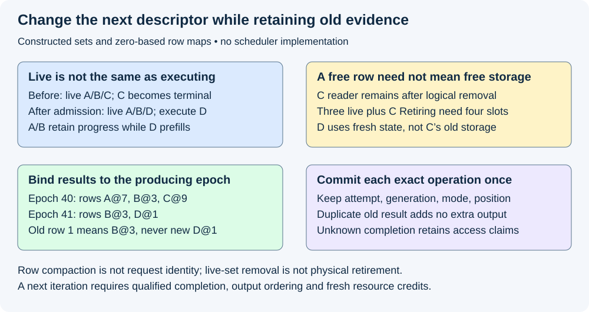
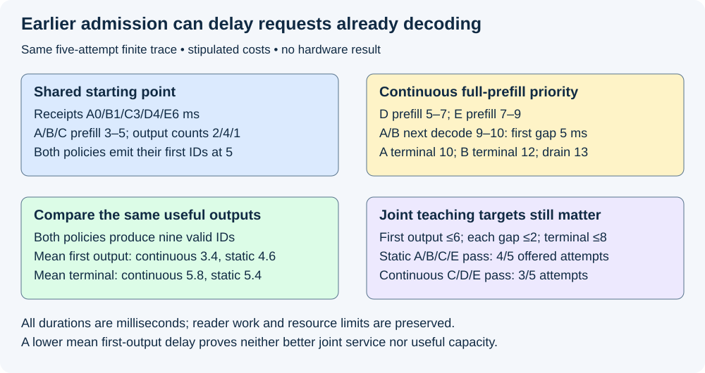

# M5-C12: Continuous batching at execution boundaries

> **Status: Complete — detailed chapter authored and documentation validated; experimental procedures are proposed unless explicitly labelled observed.**

**Module:** Learn scheduling, operating systems, and queueing theory

**Category:** [Scheduling and queueing](index.md)

[Module 5 reading order](../module-5.md) · [Previous: M5-C11](../scheduling-and-queueing/m5-c11-defining-a-static-batching-baseline.md) · [Next: M5-C13](../scheduling-and-queueing/m5-c13-budgeting-work-for-each-execution-iteration.md)

## Target concepts

Iteration-level scheduling, removing completed requests, admitting new work, active-set updates, request identity across reordered batches, decode progress, execution-boundary safety.

[Execution plan and progress](../chapter-execution-plan.md)

## Concepts

### 1. Change the next iteration, not work already in flight

**Continuous batching** reforms execution batches as requests finish and new requests become eligible. An **iteration** is a bounded model execution step with an immutable request/position mapping and a defined completion observation. A safe **execution boundary** is the point at which the scheduler has enough completion, output and ownership evidence to decide the next step. Enqueue returning, a wakeup, or a request's client timeout is not that evidence.

[M5-C11](m5-c11-defining-a-static-batching-baseline.md) fixed a cohort until all members and final users retired. Continuous membership can remove C when C finishes and schedule new D before other original members finish. It does not permit changing a device-visible descriptor while the device still reads it, making every byte formerly owned by C reusable, or sending D through decode without processing its prompt.

[Orca, OSDI 2022](https://www.usenix.org/conference/osdi22/presentation/yu) motivates scheduling at iteration granularity for multi-iteration generation. [Triton's iterative-sequence specification](https://docs.nvidia.com/deeplearning/triton-inference-server/user-guide/docs/user_guide/batcher.html#iterative-sequences) describes backend steps yielding unfinished requests for rescheduling and completing others. Its iterative-sequence interface is explicitly provisional; actual backend/version support must be checked. These sources motivate the mechanism, not the exact local policy below or any claimed speedup.

Use one scheduler-state owner, one executor and at most one model iteration in flight for this chapter. Keep the pending queue separate from **admitted live requests**, which retain authorized state and may be awaiting prefill, ready to decode or temporarily unscheduled. An **execution set** is the subset selected for this particular forward. A live request need not execute in every forward. This distinction matters when a new prefill occupies the executor while existing decode requests wait.

| Local policy item | Explicit contract |
|---|---|
| Admission | FIFO compatible model/adapter/precision; no more than three admitted live requests in the teaching trace; admission requires independently qualified memory/output credits |
| Updates | Observe covered iteration completion, process commands, validate/commit results once, remove terminal members from future execution, reserve new work, then seal the next immutable descriptor |
| Cancellation ordering | Cancellation observed at this owner boundary precedes still-pending output commit; retain committed prefix and submitted access claims; a previously committed successful terminal is not rewritten |
| Prefill versus decode | New work needs full valid prefill before first selection; the reference trace prioritizes one pending full prefill over decode, without mixing or chunking |
| Progress | Decode consumes each request's own next input/position; pause preserves progress; selection and KV counters are distinct |
| Lifetime | Completed requests leave the live set, but their physical state remains Retiring until every relevant reader/writer finishes |
| Bounds | Bounded queue, descriptors, KV/workspace/output/log pools; unavailable credits mean wait or explicit rejection, never reuse of still-live storage |

“Process commands” changes owner bookkeeping; it cannot mutate a submitted descriptor. In a Rust context, ownership of ordinary host values does not automatically cover device pointers or asynchronous output readers. [M2-C10](../runtime-and-concurrency/m2-c10-request-state-transitions-and-safe-block-reuse.md) requires separate exclusion, publication and lifetime proof; [M5-C06](../runtime-and-concurrency/m5-c06-asynchronous-execution-and-completion-driven-progress.md) distinguishes task progress from device completion. No scheduler implementation or pseudocode is supplied.

### 2. Update a live set without losing history

Let Aₖ be the admitted live set before boundary k, Tₖ its members completing successfully or failing there, Cₖ its members cancelled under the chosen ordering, and Nₖ newly admitted requests. Define Tₖ and Cₖ as disjoint terminal decisions and require Nₖ to contain fresh attempt identities, not members still in Aₖ. Then:

**Aₖ₊₁ = (Aₖ ∖ (Tₖ ∪ Cₖ)) ∪ Nₖ.**

**|Aₖ₊₁| = |Aₖ| − |Tₖ| − |Cₖ| + |Nₖ|.**

The cardinality formula assumes exactly those subset/disjointness conditions. It is not a resource-allocation formula: Retiring state is outside Aₖ₊₁ but still occupies storage. The next execution set Eₖ₊₁ is a qualified subset of Aₖ₊₁ with its own mode, input positions and resource checks. A cap on |A| does not bound token work, retained physical bytes or queue length by itself.

For a boundary example, A={A,B,C}, T={C}, Ccancel=empty, N={D} gives next live set {A,B,D}. Prefill-only execution E={D} is permitted by the stated local policy; A and B remain live but do not advance. If C's host reader remains, three live requests plus one Retiring request can require four request-state slots. Do not force the physical pool to three merely because the live-set cap is three.

Removal closes future scheduling and detaches the request's mutable mapping under the owner. Retain its immutable audit identity, outcome and pending physical-access claims. Duplicate completion notification cannot remove a different request, decrement a claim twice or count another successful output. A result with the wrong attempt/generation or an unknown completion scope is an error/uncertainty requiring isolation, not an invitation to discard bookkeeping until counts agree.

### 3. Reordering changes row numbers, not request identity

A **row** is a temporary position in one execution tensor. It is not a durable request identifier. Every sealed iteration records an epoch, meaning a unique descriptor version, and a mapping from row to request ID, attempt ID, allocation generation, mode, input position and valid state version. A generation distinguishes a new use of the same storage from its previous owner. Keep this mapping until every result and user depending on it has been resolved.

Here is a separate constructed identity example. Compact notation A@7 means request A's fixed attempt and storage generation 7; it does not mean tensor row 7. Rows are numbered from zero. Epoch 40 has rows [A@7,B@3,C@9] and result IDs [11,22,33]. After its authorized commit and membership update, epoch 41 has rows [B@3,D@1] with result IDs [23,44]. A late duplicate notification for epoch 40 row 1 refers to **B@3**, not epoch 41 row 1 **D@1**. It must not append 22 to D, append 22 again to B, or advance either request's RNG. Results are correlated with the producing snapshot, checked against their exact pending operation, and committed at most once.

A compacted row-to-KV map, output destination, stopping state, random stream and position must move consistently. Reordering one array while indexing another by an old row silently crosses requests even if tensor shapes remain valid. Validate the result against a serialized per-request reference, not merely a total token counter. An out-of-order host notification does not authorize out-of-order dependent generation: a later input still depends on its own previous selection.

*The live set, execution rows and physical retirement ledger answer different questions. All examples are constructed.*

### 4. A paused request must resume its own decode progress

**Prefill** processes a request's prompt; in ordinary cached generation it may select the first output. Subsequent **decode** forwards process the previous selected ID at the next request position and may select one more. An admitted new request cannot inherit a departed request's prompt state or start at its output count.

For a separate non-speculative reference with complete prompt length P=3 and required valid output count g=3, prefill publishes v=3 valid KV positions and selects output count n=1. The next two decode forwards process positions 3 and 4, giving (v,n)=(4,2) and (5,3). At terminal, five positions were actually processed even though three IDs were selected. A conservative reservation for P+g=6 positions is a capacity upper bound, not proof of six valid positions. Fixture outputs have no EOS; real stopping/EOS inclusion and cap rules must be declared under [M9-C19](../interfaces-protocols-and-streaming/m9-c19-validating-tokenization-stopping-and-final-output.md).

If other work pauses this request between n=1 and n=2, v stays 3 until its own next decode completes. A global iteration index, tensor row index or number of notifications must not become the request's position or random-draw count. Completion before terminal publishes matching KV validity and selection once; pending output cannot be read early just because its space was reserved. Partial prefill, speculation and more permissive KV access layouts need their own counters/contracts and are not assumed here.

### 5. New prefill can improve first output while hurting decode gaps

Use the **same offered trace and valid output lengths as M5-C11**: receipts A0/B1/C3/D4/E6 ms; output counts 2/4/1/1/1. These shorthand times are on one teaching clock. Both policies start the initial A/B/C prefill at 3 and select their first IDs at 5. Full prefill costs 2 ms, a decode forward 1 ms, and transport/commit overhead is stipulated zero. No timing is measured. The continuous variant has three live-request credits and four preallocated, sufficiently sized request-state slots; all other declared pools fit this finite trace. A/B/C initially use slots 0/1/2. C's old host reader ends at 6, so D at 5 uses fresh slot 3. At 7 E uses safely retired C slot 2 with a new generation. In both arms, each request's final output reader ends one millisecond after its terminal. The static policy retains its whole cohort through the last such reader; the continuous policy can use independent fresh state while other requests retire. Reader work is preserved, not eliminated.

| Interval / boundary (ms) | Continuous execution and live-set decision | Useful progress |
|---|---|---|
| 3–5 | Prefill A/B/C | At 5 A₁,B₁,C₁; C terminal; remove C from live set |
| 5–7 | Admit/prefill D using fresh state; A/B wait | At 7 D₁ terminal; C's former state was safe after 6 |
| 7–9 | Admit/prefill E; A/B still wait | At 9 E₁ terminal |
| 9–10 | Decode A/B using their own next inputs | At 10 A₂ terminal and B₂ |
| 10–11 | Decode B | At 11 B₃ |
| 11–12 | Decode B | At 12 B₄ terminal |
| 13 | Final B output reader releases | Finite trace physically drained |

The continuous first-output receipt latencies are **[5,4,2,3,3] ms**, mean **3.4 ms**. Static reference values are **[5,4,2,7,5] ms**, mean **4.6 ms**. Yet continuous terminal receipt latencies are **[10,11,2,3,3] ms**, mean **5.8 ms**, versus static **[6,7,2,7,5] ms**, mean **5.4 ms**. A's only gap and B's first gap grow from 1 to 5 ms because two prefills delay their next decode; B's later gaps remain 1 ms. Both policies produce exactly nine valid IDs for the same five attempts. Continuous logical completion extends to 12 and physical drain 13; static logical completion was 11 and drain 12. Early admission is a mechanism, not a theorem that every latency or total time improves.

For a further **teaching predicate**, require valid output, first output≤6 ms, every applicable gap≤2 ms and terminal≤8 ms from receipt, inclusive. One-ID answers have no applicable gap. Static passes A/B/C/E, failing D's first-output limit: **4/5 offered attempts**. This continuous prefill-first policy passes C/D/E, failing A/B gaps and terminal limits: **3/5**. These are finite-cohort fractions, not in-window completion rates or hardware capacity. Client intended-send objectives would additionally count dispatch/transport and use compatible observations.

The [vLLM V1 optimization guide](https://github.com/vllm-project/vllm/blob/main/docs/configuration/optimization.md) describes decode prioritization and chunked-prefill token budgets as ways to manage this interaction. This chapter does not implement that policy or transfer its behavior to our prefill-first fixture. Completed [M5-C13](m5-c13-budgeting-work-for-each-execution-iteration.md) defines iteration budgets; chunked prefill and fairness are developed later. Here the necessary lesson is explicit mode selection, no lost decode progress, bounded memory and end-to-end evidence.

*Same finite workload and reference outputs, different scheduling policy. Stipulated first-output gains coexist with worse decode gaps and joint acceptance.*

### 6. A safe boundary is a bundle of evidence

Before sealing another descriptor, the owner needs the required completion/visibility for previous results, exact producing-map identity, authorized cancellation/commit order, consistent request counters and credit reservations. This does not require waiting for every unrelated old host reader if independent fresh buffers are available. It does require protecting every old reader's storage. Device input/output descriptors, row maps, per-request KV and network/output buffers can have different final users and release times.

If no fresh request-state credit exists while C is Retiring, wait or reject D under the declared overload policy; do not overwrite C's storage to keep three tensor rows populated. If an allocation group fails, the next descriptor must not escape with partial mappings/reservations. Definitively unsubmitted work can roll back its tentative claims; uncertain submitted work cannot. Worker loss, stale state, log loss or missing completion leaves affected work unresolved/quarantined until the recovery contract establishes safety. Commands can be received while an iteration executes, but an in-flight view remains immutable.

Continuously refreshing membership also consumes host time, descriptor/mapping copies, allocation work and synchronization. Dynamic shapes can change kernel/graph eligibility; a smaller or fuller batch can move the bottleneck rather than remove it. [M9-C06](../measurement-experimentation-and-economics/m9-c06-defining-slos-goodput-and-useful-capacity.md) requires useful joint service, class coverage, bounded resources and recovery, not just fewer inactive rows. A full active set can still starve decode, overrun output buffers or accumulate unbounded queue/Retiring state.

## Experiments

All four experiments are proposed. Authorship observes only constructed arithmetic, set/identity/timeline checks and documentation validation. No scheduler, model, load generator, fault injector, device runtime or profiler is implemented or executed.

### E1 — Audit boundary membership and admission

- **Name:** A free execution row is not a free state allocation.
- **Description:** First reconstruct live/executing/queued sets at each boundary; then add Retiring users and physical credits; finally challenge one admission gate at a time.
- **Purpose/objective:** Hypothesis: C can leave the live set while retaining storage, so D needs a fresh credit to join safely. HFT concern: new event work must not overwrite state still read by an earlier consumer.
- **Target concepts:** Iteration scheduling, removing completed requests, admitting new work, active-set updates and boundary safety.
- **Baseline:** A/B/C at boundary 5; C terminal with reader through 6; D uses fourth state slot while live cap remains 3.
- **Workload:** Exact finite A–E trace; separately exhausted fourth slot, delayed reader, incompatible adapter, full queue and partial admission allocation failure. Independent variable: one eligibility/resource/lifetime condition per case.
- **Controlled variables:** One owner/executor, immutable iteration, FIFO compatibility, commit ordering, complete reservations and memory/output bounds shared by comparison arms.
- **Hardware requirements:** CPU set/lifetime reference first; later supported host/device completion evidence and bounded allocator/output diagnostics on an isolated recorded configuration.
- **Exit criteria:** Reproduce live {A,B,C}→{A,B,D}, execution {D}, three live plus one Retiring state at 5. Deny reuse of C before 6; if no fresh credit exists, record D waiting or rejection. Then require atomic mapping/reservation publication and retained claims for every submitted user.

### E2 — Preserve identity through compacted batches

- **Name:** Resolve results with their producing snapshot.
- **Description:** First bind each result to its producing map; then audit reordered and duplicate observations against a serialized per-request ledger; finally reject stale or crossed identities.
- **Purpose/objective:** Hypothesis: resolving old row 1 with the new map misroutes B's result to D, even when the output array is correctly shaped. HFT concern: recycled positions cannot become durable event identity.
- **Target concepts:** Request identity across reordering, active-set updates and execution-boundary safety.
- **Baseline:** epoch 40 [A@7,B@3,C@9]→[11,22,33]; epoch 41 [B@3,D@1]→[23,44], with fixed attempts and row numbering from zero.
- **Workload:** Exact mappings; independently permute rows, duplicate epoch 40 completion, delay an observer, change generation or corrupt an output destination. Independent variable: one mapping/evidence discrepancy per case.
- **Controlled variables:** Attempt/generation, producing epoch, operation identity, per-request output/reference, random-state ownership and authorized commit sequence.
- **Hardware requirements:** CPU identity reference; later supported request/row traces, validated backend output and independent host/device access evidence.
- **Exit criteria:** Map old row 1 only to B@3 and detect any 22 appended to D or appended twice to B. Detect stale generation and mismatched position/output mappings before useful counts. A delayed old notification cannot move either request's state, RNG or physical claims twice.

### E3 — Verify prefill and decode progress separately

- **Name:** Pause execution without advancing the request.
- **Description:** First reconstruct prompt validity, selected count and input positions; then insert a pause or one forbidden transition; finally audit terminal/cancellation and lifetime evidence.
- **Purpose/objective:** Hypothesis: per-request counters preserve autoregressive dependencies while global iteration/row counters can skip or repeat an input. HFT concern: preserving order means preserving causal progress, not just eventual totals.
- **Target concepts:** Decode progress, new-work admission, request identity and boundary safety.
- **Baseline:** Separate P=3,g=3 reference: (valid KV,selected IDs)=(3,1),(4,2),(5,3); conservative reservation 6 positions.
- **Workload:** Exact prefill/decode history, pause after first selection, new request without prefill, wrong next position, duplicate commit, cancellation before pending commit and unknown device completion. Independent variable: one transition or evidence fault per case.
- **Controlled variables:** Prompt/stop/output reference, position convention, complete prefill, non-speculative selection, exclusive mutation and publication/lifetime rules.
- **Hardware requirements:** CPU counter/identity review; later supported logits/output and KV-validity comparisons on an isolated model/backend with recorded numeric policy.
- **Exit criteria:** Reproduce processed positions 3 then 4 after prefill, terminal validity 5 versus selected count 3, and no advancement during pause. Reject decode without valid prompt state, wrong position, repeated selection/RNG use and reading unpublished output. Preserve committed prefix but suppress pending output when cancellation wins the owner ordering; retain uncertain access claims.

### E4 — Compare useful service under continuous admission

- **Name:** Earlier first output can coexist with worse decode service.
- **Description:** Compare the exact static and prefill-first continuous traces, then specify matched experiments varying admission/mode policy.
- **Purpose/objective:** Hypothesis: D/E first-output gains accompany A/B gap/terminal regressions; refreshing membership alone does not establish capacity. HFT concern: helping new arrivals must be judged alongside deadlines of work already admitted.
- **Target concepts:** Iteration scheduling, active updates, decode progress and safe end-to-end admission.
- **Baseline:** A–E receipt/output trace, static M5-C11 and the explicit local continuous policy, same four state slots and other resource limits.
- **Workload:** Exact references first; later fixed length/reuse/adapter and independent-arrival cells including burst, sparse, cold/warm and long-prefill cases. Independent variable: membership/mode policy, with all other trace/resources fixed; no assumed mixed/chunked backend support.
- **Controlled variables:** Output/quality/stopping, initial cohort, prompt costs, physical reader work, queue/KV/output bounds, reset state, clocks, observation and drain deadlines.
- **Hardware requirements:** Qualified generator/server CPUs, network, GPU/VRAM/interconnect, supported per-stage timing/memory counters and isolated diagnostic fault scope.
- **Exit criteria:** Reproduce continuous/static mean first output 3.4/4.6 ms and terminal 5.8/5.4 ms; first decode gaps 5 versus 1 ms; identical nine valid IDs; logical/physical endpoints 12/13 versus 11/12; joint acceptance 3/5 versus 4/5. Then require repeated per-class useful-service, resource/backlog and recovery evidence for real benefit; no toy result establishes universal capacity or p99.

## Verification

| Experiment | Reference and invariants | Measurements / comparison | Acceptance limit |
|---|---|---|---|
| E1 | Disjoint terminal decisions, live/execution sets and retained physical claims | Boundary admission, credits, waits/rejections and final users | Logical removal cannot authorize early physical reuse |
| E2 | Producing epoch, row map, attempt/generation and one authorized commit | Missing/duplicate/stale results and per-request output history | Correct totals/shapes cannot excuse crossed identity |
| E3 | Prompt validity, position, selected count and causal input | Prefill/decode transitions, pauses, stopping and cancellation ordering | No phantom progress or selection from unpublished state |
| E4 | Same offered workload, outputs, limits and reader work | First output, gaps, terminal, useful service and resource/drain trends | Earlier admission is not a universal service improvement |

Start with output/reference and lifecycle correctness under [M9-C19](../interfaces-protocols-and-streaming/m9-c19-validating-tokenization-stopping-and-final-output.md), [M9-C22](../runtime-and-concurrency/m9-c22-verifying-ownership-and-memory-safety-under-concurrency.md) and M2-C10. Compare exact selected IDs where equivalence is promised; use justified numerical/distributional checks for changed execution order, precision or stochastic behavior. Per-request random draws must remain independent of batch row and dummy work. Approximation or changed stopping needs a separately declared quality contract; do not call altered outputs equivalent because response times improve.

For hardware comparisons, qualify load and request accounting under [M9-C09](../measurement-experimentation-and-economics/m9-c09-open-loop-load-generation-and-coordinated-omission.md) and [M9-C10](../measurement-experimentation-and-economics/m9-c10-validating-the-load-generator-and-request-accounting.md). Preserve intended, dispatched, received, admitted, completed, rejected, cancelled, failed and unresolved attempts, with parent IDs for retries. Record client versus server outcomes separately. First-output/gap measurements require a qualified mapping from protocol observations to output IDs; fragments and notifications are not automatically tokens.

Define scheduler receipt, iteration seal/submission, covered device completion, host commit, first visible output, parsed terminal and every physical final-user endpoint. Use compatible clocks or qualified correlation under [M9-C02](../measurement-experimentation-and-economics/m9-c02-request-events-clocks-and-measurement-boundaries.md). A next iteration can be device-ready while an older output reader still needs different protected storage. Event scope, generation and observation resolution must be explicit; negative or impossible chronology invalidates the affected measurement.

A proposed descriptive starting design is 20 paired reset sessions per named workload/policy cell, one session per arm in each pair, balanced order and one full scratch-trace warmup per arm under [M9-C11](../measurement-experimentation-and-economics/m9-c11-controlled-comparisons-warmup-and-reproducibility.md). Restore declared cache/adapter state, retain all pairs and ordered records, and treat session pairs as replication units rather than neighboring requests as independent trials. Use [M9-C08](../measurement-experimentation-and-economics/m9-c08-designing-representative-serving-workloads.md) to freeze class weights, prompt/output lengths, arrival bursts, reuse and adapter skew. Text generation is in scope; other modalities and Module 8 are excluded.

Measure first-output, gap and terminal distributions, per-request joint acceptance, useful request/output-ID rates and per-class coverage under [M9-C06](../measurement-experimentation-and-economics/m9-c06-defining-slos-goodput-and-useful-capacity.md). Distinguish a window's actual completion events from an offered cohort followed through drain. Preserve timeout/failure/open populations and overlapping failure reasons alongside a disjoint primary outcome partition. Count Retiring bytes, live versus executing requests, queued arrivals, host mapping/descriptor work, KV/workspace/output/log occupancy, CPU demand and directional network/device traffic. More active rows alone do not certify sustainability or safe future growth.

Predeclare confidence, sample sizes, dependence treatment and regression thresholds under [M9-C07](../measurement-experimentation-and-economics/m9-c07-latency-distributions-and-statistical-uncertainty.md) and [M9-C27](../measurement-experimentation-and-economics/m9-c27-designing-regression-experiments-and-validation-gates.md). Twenty pairs and the small references establish no p99 or sustained operating guarantee. Show repeated interval backlog/retained-state trends, starvation/maximum-defer observations and post-load recovery, plus bounded-drain unresolved identities and physical claims. Stop unsafe overload cells under a predeclared rule and preserve their results rather than silently excluding them.

Use separate short profiles to attribute host boundary/compaction overhead, prefill versus decode service, changed kernel/graph shapes, data transfers, allocation and output-reader stalls. Measure diagnostic overhead on matched cells and keep intrusive tracing out of clean timing. A paper set update cannot measure GPU work, memory traffic or the latency cost of compaction. No hardware profile or actual race/fault experiment was run during authorship.

## Engineering dimensions and principles

| Dimension | Chapter-specific application |
|---|---|
| Semantics and invariants | E1–E3 preserve exact producing-map identity, legal transitions and causal output |
| Workload and variability | E4 exposes long-prefill, length, arrival/reuse/adapter skew and class effects; text only |
| Resources and bottlenecks | Three live requests can require four retained state slots; mapping copies and KV/output bytes still consume capacity |
| Time and distributions | Boundary completion, first output, decode gaps, terminal and physical drain remain distinct |
| Ownership and coordination | One owner seals immutable snapshots; old users retain claims through mapping changes |
| Failure and adaptation | Cancellation, stale generation, partial allocation, duplicate result and worker loss have explicit outcomes |

| Practical engineering principle | Application |
|---|---|
| 1. Correctness defines the optimization boundary | A faster compacted batch must preserve per-request reference and lifetime; changed numerics require justified validation |
| 2. Performance depends on workload and operating point | The prefill-first fixture helps D/E while hurting A/B; other mode policies need fresh evidence |
| 3. Data movement is part of the algorithm | Descriptor/row-map copies, KV accesses and output transfer accompany scheduling changes |
| 4. State has ownership, lifetime and recovery cost | C leaves the live set before its storage is reusable; uncertainty retains claims |
| 5. Dependencies determine latency; bottlenecks determine capacity | A/B's next outputs wait for their own decode and the busy executor, not merely a free row |
| 6. Variability and synchronization shape the tail | New prefills stretch existing gaps and can starve decode under sustained arrivals |
| 7. Local improvements require end-to-end evaluation | Lower mean first-output time coexists with lower joint offered acceptance in the same toy workload |
| 8. Claims require reproducible evidence | E1–E4 freeze identity, timing, outputs, resource limits and uncertainty before comparisons |

The HFT lens is preserving causal event identity and protected state while scheduling bounded work under competing deadlines. It transfers as systems reasoning. Inference adds autoregressive prompt/decode dependencies, KV growth and long-lived output readers; these references establish no exchange protocol, trading outcome or production readiness.

## Specifications, articles, and hardware

Primary Orca (OSDI 2022), Triton iterative-sequence and vLLM V1 optimization sources were reviewed on 2026-10-29. They support iteration scheduling and the need to distinguish admission from prefill/decode policy. Live engine documents can change; record actual versions/commits and backend capabilities. The local reference deliberately uses one owner/executor, full prefill priority and independent fresh state rather than claiming to reproduce an external scheduler. No chunks, speculative scheduling or overlapping in-flight iterations are assumed.

No machine specifications were supplied or measured. Paper references use stipulated times, four sufficiently sized request-state slots and exact identities. Actual studies require generator/server CPU model, core/SMT/NUMA/RAM, OS/kernel, affinity/quotas, Rust/runtime/compiler and network directional capacities; GPU model/architecture/count/VRAM, driver/backend/runtime, power/clocks/temperature and interconnect topology. Record model/adapter/tokenizer/template/corpus hashes, precision, valid prompt/output/stop/random-state policy, physical KV layout/allocator, queue/state/workspace/descriptor/output/log bounds, supported shapes/graph modes and all lifetime observers. Preserve objective versions, immutable trace/maps, clock provenance, reset/warmup/drain/fault policy and instrumentation overhead. Reference arithmetic does not replace this hardware/software manifest.

## Key takeaways

Continuous batching changes the next execution set at qualified boundaries. Preserve each request's identity, causal progress and surviving users as rows move and members finish. New admission can improve some requests while delaying others; useful service and safe bounded state determine whether the policy helps.

## Continue learning

Next in Module 5 reading order is completed [M5-C13: Budgeting work for each execution iteration](m5-c13-budgeting-work-for-each-execution-iteration.md). The next authoring chapter is [M5-C18: Choosing chunk sizes and balancing prefill with decode](../scheduling-and-queueing/m5-c18-choosing-chunk-sizes-and-balancing-prefill-with-decode.md), position 125. Follow the [execution plan and progress tracker](../chapter-execution-plan.md); Module 9 supports Modules 1–7 and Module 8 is excluded.
