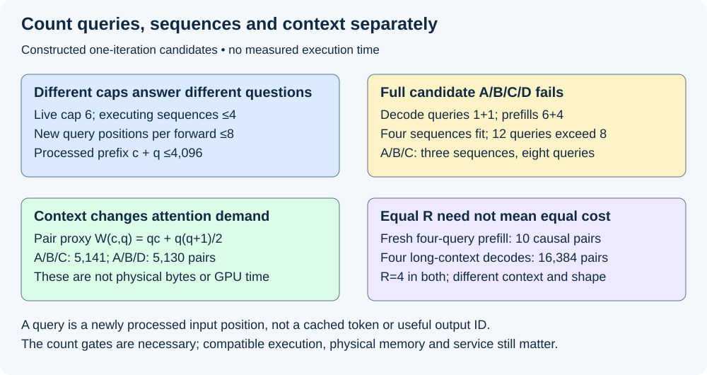
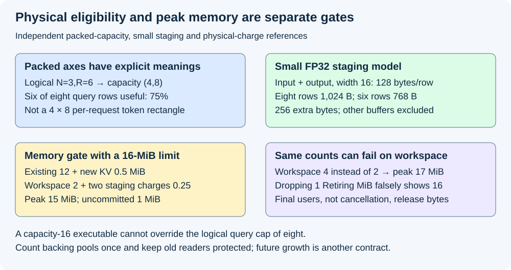

# M5-C13: Budgeting work for each execution iteration

> **Status: Complete — detailed chapter authored and documentation validated; experimental procedures are proposed unless explicitly labelled observed.**

**Module:** Learn scheduling, operating systems, and queueing theory

**Category:** [Scheduling and queueing](index.md)

[Module 5 reading order](../module-5.md) · [Previous: M5-C12](../scheduling-and-queueing/m5-c12-continuous-batching-at-execution-boundaries.md) · [Next: M5-C14](../scheduling-and-queueing/m5-c14-planning-for-future-kv-cache-growth.md)

## Target concepts

Request limits, token budgets, prefill versus decode work, context-dependent costs, sequence limits, kernel and graph shape constraints, batch packing, per-iteration memory checks.

[Execution plan and progress](../chapter-execution-plan.md)

## Concepts

### 1. A work budget has several independent boundaries

An **iteration budget** limits what one sealed execution step may consume or require. [M5-C12](m5-c12-continuous-batching-at-execution-boundaries.md) made membership changes safe at qualified boundaries. The next question is whether the proposed step fits the executor and preserves useful service. A request count alone cannot answer that question.

Keep **admitted live requests** separate from the **execution set**, the subset selected for this iteration. Let N be the number of executing sequences, where a sequence is one independently positioned prompt/generation history. The local reference uses one sequence per request; beam search, speculative branches and multimodal encoder work are excluded. A **query token** here is a newly processed input position in the current forward. Let qᵢ be the number of such positions scheduled for request i and **R=Σqᵢ** the logical query-token count. R is neither total cached context nor the count of useful output IDs.

Ordinary cached decode schedules one new input per participating request: qᵢ=1. Full prefill schedules the uncached prompt positions, potentially many for one request; it may select only the first output ID. Reused cached prefix positions are not newly processed query positions but can still be read by attention. Processing a prompt of six positions is not six completed requests or six generated IDs. Partial prefill requires explicit progress semantics and is developed later; this chapter's numerical selection reference uses whole uncached prefills.

The [vLLM scheduler specification](https://docs.vllm.ai/en/stable/api/vllm/config/scheduler/) distinguishes per-iteration token and sequence limits, as well as admitted-running limits and, where configured, a separate issued-token limit. This supports keeping boundaries distinct; exact fields and defaults are version-dependent and are not our local scheduler implementation. Record what each cap actually bounds before interpreting a benchmark.

| Budget or gate | Meaning in the local reference |
|---|---|
| Live-request cap | State admitted across iterations; fixed separately from requests currently executing |
| Sequence cap Nmax | Number of independently mapped sequences in this forward |
| Logical query cap Rmax | Sum of newly processed input positions in this forward |
| Processed sequence limit Lmax | Each request's existing valid prefix plus scheduled new positions stays within the supported processed-length boundary |
| Mode/kernel/graph contract | Supported prefill/decode mix, shape, strides, format, device, positions, masks and prepared bindings |
| Physical peak/credit limits | Existing retained state plus all overlapping new allocations/workspace fit, with valid ownership |
| Service/fairness requirements | Previously admitted decode and new arrivals retain their declared joint latency/quality/coverage obligations |

All applicable gates must pass. Invalid input is rejected; valid work outside a specialized shape may use a validated fallback; a memory shortage is not repaired by merely switching to another launch API. No Rust, kernel or scheduler implementation is provided. Rust is the intended host context for protected descriptors, checked sizes and retained access claims.

### 2. Count a candidate batch before deciding that it fits

For this constructed boundary, choose live-request cap 6, execution sequence cap **Nmax=4**, logical query cap **Rmax=8**, and maximum processed prefix **Lmax=4,096 positions**. These are teaching inputs, not measured recommendations. Requests are already eligible for their stated mode; remaining admission/output limits are qualified separately. cᵢ is the count of valid cached input positions before this forward.

| Candidate | Mode | cᵢ cached positions | qᵢ new query positions | cᵢ+qᵢ after completion |
|---|---|---:|---:|---:|
| A | Decode | 1,023 | 1 | 1,024 |
| B | Decode | 4,095 | 1 | 4,096 |
| C | Full uncached prefill | 0 | 6 | 6 |
| D | Full uncached prefill | 0 | 4 | 4 |

A/B/C/D has **N=4 but R=12**, so it fails the query cap even though the sequence cap passes. A/B/C has **N=3,R=8**, passing both count gates. In this ordinary selection model it may select three output IDs, one per request, rather than eight. A/B/D has **N=3,R=6**, leaving two logical query credits unused; adding the indivisible six-position C would exceed 8. Credits remaining after ready decode do not imply that the next whole prefill fits.

The local selection reference considers ready decode A/B first, then whole prefills C/D in FIFO order, with no prefill splitting or bypass. It chooses A/B/C when all other gates pass. It does not truncate C to make R fit or assume the executor can mix these modes without qualification. Candidate A/B/D is a separate packing comparison, not an unexplained change of that policy. Fitting the largest R is not the objective by itself: leaving credits unused may preserve the declared order, mode compatibility or resource headroom.

The processed-length check is **cᵢ+qᵢ≤Lmax** for every selected request. B is exactly at the boundary. A separate negative case with c_B=4,096 and q_B=1 would require 4,097 and fails even if R≤8. Here Lmax limits processed KV positions; it does not silently redefine prompt/output API limits. A selected final output may not be fed through another forward. Validate the original stopping/output contract and future capacity separately; Completed [M5-C14](m5-c14-planning-for-future-kv-cache-growth.md) explains future-demand reservation. Never shorten a valid requested answer merely to hide a budget violation.

### 3. Equal query counts can have different attention costs

A token budget is a useful work proxy, not a calibrated time guarantee. Linear projections often scale with newly processed positions at a given model shape, while attention also depends on existing context. For causal attention on one sequence with c valid prior positions and q consecutive new queries, a logical query-to-key-position count is:

**W(c,q)=qc+q(q+1)/2.**

The jth new query can attend to c prior positions plus its first j new positions, for j=1…q. This is a logical attention-pair proxy for the declared full causal pattern. It omits heads/layers/dimensions, sliding windows, sparsity, kernel implementation, reuse, layouts and data movement; it is not FLOPs, measured GPU utilization or physical DRAM bytes.

For A/B/C, W is **1,024+4,096+21=5,141 pairs**. For A/B/D it is **1,024+4,096+10=5,130**. Reducing logical query positions from 8 to 6 barely changes this proxy because the two long-context decode requests dominate it. Two new prefill positions and two long-context decode positions are not interchangeable demands.

In a separate same-R comparison, one fresh four-position prefill has **R=4,N=1,W=10**. Four decode requests each with c=4,095 have **R=4,N=4,W=16,384**. Both count configurations fit the declared N/R limits but have different context, KV reads, independent outputs and execution shapes. This does not prove a 1,638.4× time ratio: kernel efficiency, shared weights, caching and other work can dominate. It demonstrates why R alone cannot predict duration or safe memory traffic.

A proposed calibrated service model might include fixed host/launch cost, query-dependent work and context-dependent work. For an independent arithmetic illustration only, stipulate **Tproxy=10+2R+0.001W µs**. This gives A/B/C **31.141 µs**, fresh R=4 prefill **18.010 µs**, and four long-context decodes **34.384 µs**. Coefficients are invented teaching inputs, not hardware measurements or upper bounds. Real models require measurements across mode/context/shape/cache cells, residual error, tail variation and validation on held-out sessions before informing a service margin. A proxy falling below a deadline does not certify that deadline.

The [vLLM V1 tuning guide](https://github.com/vllm-project/vllm/blob/main/docs/configuration/optimization.md) explains decode-priority token budgeting and chunked-prefill tradeoffs. It motivates testing first-output against decode-gap behavior, not adopting a universal token setting. Our whole-prefill reference is intentionally narrower; it does not claim to implement that engine or its chunking mechanism.

*Constructed counts and causal attention-pair proxies. Neither token count nor the stipulated time model is a measured service guarantee.*

### 4. Packing and prepared shapes add physical work and obligations

**Packing** assigns selected logical query positions to execution rows while preserving request, attempt, absolute position, KV mapping and output destination. Different request boundaries must not attend across one another. The first selection of a prefill request uses its proper final prompt position; intermediate prompt rows are not separate generated outputs. A token budget does not validate this mapping.

A **capacity shape** is the physical extent supported by a chosen prepared variant, often larger than the logical extent. Use [M4-C10](../kernels-compilers-and-execution/m4-c10-shape-specialization-padding-and-dispatch.md) for masks/layout guards and [M4-C16](../runtime-and-concurrency/m4-c16-replay-constraints-graph-variants-and-buffer-lifetimes.md) for prepared bindings and final users. A supported shape still needs the correct model/format/device, strides/alignment, mode mix, context metadata, output semantics and buffer generation.

For a hypothetical mixed-mode packed executor, suppose prepared sequence capacities are {2,4} and total-query capacities {4,8,16}. These are independent axes: Rcapacity is the total packed query-row capacity, not a per-sequence padded length. The variant also covers the required context and mode combination and has a qualified fixed-address slot available. A/B/C needs logical (N,R)=(3,8) and may select capacity (4,8); A/B/D needs (3,6) and may select (4,8). The latter has **6/8=75%** useful query-row occupancy and two inactive query rows. The metadata sequence capacity 4 does not turn six packed query rows into 24.

In a separate small staging specification, one FP32 (32-bit floating-point) input and output vector of width 16 per query row use **2×16×4=128 bytes/row**. Capacity 8 retains 1,024 bytes versus 768 logical bytes for six rows: 256 extra bytes. This deliberately small staging example is not a model hidden size or full executor memory estimate. Padding also needs safe initialization/masks and can require copies; logical occupancy is not measured lane utilization or proof that masked work disappears.

A nine-query candidate violates Rmax=8 even if a capacity 16 executable exists. Physical support cannot override a logical policy limit. Conversely, passing Rmax does not guarantee that a particular kernel/graph supports the mode, address bindings or current live buffers. The [CUDA Graph programming specification](https://docs.nvidia.com/cuda/cuda-programming-guide/04-special-topics/cuda-graphs.html#updating-instantiated-graphs) distinguishes prepared execution and supported updates with compatibility restrictions. A changed host shape variable is not an implicit rebinding. Use a validated matching variant/update or ordinary fallback only for valid safe inputs; count preparation misses, retained graph slots and fallback costs end to end.

### 5. Check physical peak memory before publishing the iteration

At a boundary, a memory ledger must include earlier work still Retiring, shared/graph-retained backing allocations, new KV growth, temporary workspace, packing/descriptor storage and output buffers. **Peak** means the largest simultaneously retained footprint over the relevant schedule, not the final live payload after temporaries disappear. Count shared backing once; an allocator's already reserved pool is not a fresh allocation again whenever a logical block is used.

Here is a separate constructed physical-charge model with an iteration limit **16 MiB**, where MiB=2²⁰ bytes and KiB=1,024 bytes. Existing unavailable/retained allocations occupy 12 MiB, including earlier Retiring state and prepared graph storage. This toy assumes new query KV positions require additional physical backing at 64 KiB/position, with no sharing or extra alignment/metadata. For A/B/C, eight new positions add 0.5 MiB. All following allocations overlap at the stipulated peak:

| Simultaneous charge | MiB |
|---|---:|
| Existing physical allocations, including Retiring/graph state | 12 |
| New physical KV backing,8×64 KiB | 0.5 |
| Qualified workspace | 2 |
| Packing/descriptor temporary storage | 0.25 |
| Output staging | 0.25 |
| Total peak | 15 |

Thus **Mpeak=12+0.5+2+0.25+0.25=15 MiB≤16**, leaving 1 MiB uncommitted under this exact ledger. A second candidate execution variant requiring 4 MiB workspace instead of 2 peaks at **17 MiB** and fails even though N=3,R=8 still fit. If 1 MiB of the original 12 belongs to Retiring readers, subtracting it before those readers finish falsely turns the failing 17 into 16. Cancellation and logical removal are not evidence of free backing.

For a real pool that already owns the backing, translate logical credits into that pool's current free/reserved state and count the physical pool once; do not blindly add q×bytes to its full allocation. Conversely, do not count logically free but still pinned positions as available credits. Device/host reader claims, allocator fragmentation, output backpressure and layout-specific workspace are part of the admission proof. This example's 64-KiB positions and memory sizes are hypothetical and provide no actual hardware capacity.

Per-iteration growth feasibility does not promise capacity for all future generation. Preserve that distinction for M5-C14. Likewise, R spare credits are not bytes and unused sequence slots are not memory headroom. An iteration may fit one of these three budgets while failing the others.

*Constructed packed capacities and a separate physical-charge ledger. Future KV commitments and already retained allocation lifetimes require their own evidence.*

### 6. Budgeting is a protected boundary decision

Use one scheduler owner and at most one iteration in flight for this reference. The owner checks the exact candidate, backend/shape and actual resource credits together before the sealed descriptor can escape. Reserve complete mapping/KV/workspace/output obligations as one authorized admission; partial allocation failure must not publish half a batch. A definite pre-submission failure can release tentative claims, while uncertain submitted use retains them. Commands arriving during device execution do not authorize mutation of borrowed row maps.

A failed count/shape gate can mean deferring work to a later iteration or a qualified alternative. Invalid sequence lengths require explicit rejection under the API contract. An unsupported whole prefill may wait or reject according to the stated policy; it must not wait forever if no permitted budget can ever fit it, and truncation is not an invisible recovery. If an update fails, do not publish it as installed. Unknown device completion, stale generations or trace loss require isolation/recovery and unresolved outcome accounting rather than early pool reuse.

Budget policy also affects timing. Larger prefills can improve first-output progress while delaying ready decode; small budgets can increase boundary/launch overhead and waiting across iterations. Context skew, bursts and reuse change the operating point. Profile mapping copies, launches, workspace and KV traffic alongside kernel work, then evaluate complete per-request first-output/gap/terminal and quality acceptance under [M9-C06](../measurement-experimentation-and-economics/m9-c06-defining-slos-goodput-and-useful-capacity.md). “Eight tokens per iteration” is neither a latency objective nor sustainable useful capacity.

## Experiments

All experiments are proposed. During authorship only reference arithmetic, eligibility/lifetime reasoning and documentation QA are performed. No scheduler, model, packing kernel, graph runtime, load generator, hardware benchmark or profiler is implemented or executed.

### E1 — Separate count, mode and context gates

- **Name:** Passing the sequence cap does not imply that work fits.
- **Description:** First reconstruct each candidate's mode, cached prefix and query positions; then evaluate count/sequence boundaries and context-pair proxies; finally challenge one violated condition at a time.
- **Purpose/objective:** Hypothesis: four requests can exceed the query cap, and equal query counts can imply very different attention demand. HFT concern: a fixed event count does not establish a fixed service cost.
- **Target concepts:** Request limits, token budgets, prefill/decode work, context-dependent costs and sequence limits.
- **Baseline:** A/B/C/D, live cap 6, Nmax=4, Rmax=8 and Lmax=4,096; full prefills indivisible, ready decode before FIFO prefills.
- **Workload:** Exact candidate table; separate B at processed-length endpoint and one beyond, full prefill too large ever to fit, fresh four-position prefill versus four long-context decodes. Independent variable: one query/context/cap boundary per reference.
- **Controlled variables:** Query versus output definitions, complete valid-prefix reference, sequence meaning, stopping policy, compatibility group and full causal attention assumptions.
- **Hardware requirements:** CPU arithmetic initially; later qualified model/backend with supported context/mode limits and per-stage work/timing observations.
- **Exit criteria:** Reproduce all-four N=4/R=12 rejection, A/B/C N=3/R=8 and A/B/D N=3/R=6 count feasibility, B at 4,096 exact processed boundary versus 4,097 failure, W=5,141/5,130 and equal-R W=10/16,384. Detect query/output/byte substitutions; no proxy becomes a hardware time claim.

### E2 — Audit packing and specialized execution eligibility

- **Name:** Physical support cannot override logical policy or identity.
- **Description:** First map logical queries to request/position/output identities; then select declared capacity shapes and inspect masks/bindings; finally challenge invalid shape, metadata and stale-generation cases.
- **Purpose/objective:** Hypothesis: A/B/D fits a capacity-eight packed path with inactive positions, but a capacity-sixteen path cannot legalize nine logical queries under Rmax=8. HFT concern: fixed execution envelopes still need correct event identity and current storage.
- **Target concepts:** Kernel/graph shape constraints, batch packing, request limits and token budgets.
- **Baseline:** Hypothetical mixed-mode executor, sequence capacities {2,4}, total-query capacities {4,8,16}; A/B/C(3,8), A/B/D(3,6), compatible context/mode and available prepared slot.
- **Workload:** Exact mapping/capacity references; invalid cross-request attention, wrong prefill output row, unsupported stride/format/mode, busy graph binding, failed update and stale allocation generation. Independent variable: one guard or mapping fact per case.
- **Controlled variables:** Model/output reference, packed-axis definitions, mask/position semantics, exact producing snapshot, fixed addresses and final-user claims.
- **Hardware requirements:** CPU capacity/identity review; later supported kernel/graph backend, prepared slots, output/guard diagnostics and ordinary validated fallback.
- **Exit criteria:** Reproduce logical (3,6)→capacity (4,8), 6/8 occupancy and small staging 1,024 versus 768 bytes with 256 extra. Reject R=9 under cap 8 even if capacity 16 exists. Then validate masks, output selection and all binding guards before timing; fallback is legal only for valid safe work.

### E3 — Reconcile physical peak and retained-state credits

- **Name:** Spare token credits do not make memory available.
- **Description:** First inventory physical backing and overlapping lifetimes; then add new charges without double counting; finally compare qualified and oversized workspace or stale-free-state claims.
- **Purpose/objective:** Hypothesis: identical N/R work passes with 2-MiB workspace and fails with 4 MiB; pretending Retiring memory is free creates false feasibility. HFT concern: abandoned work still owns storage until its last access ends.
- **Target concepts:** Per-iteration memory checks, physical shape costs and safe batch packing.
- **Baseline:** 16-MiB limit, 12 MiB existing allocations, eight 64-KiB new KV positions, 2-MiB workspace and two 0.25-MiB staging charges, simultaneously live.
- **Workload:** Exact ledger; separate 4-MiB workspace, 1-MiB still-Retiring state, already allocated pool backing, partial allocation failure, cancellation and unknown completion. Independent variable: one physical charge or lifetime fact per case.
- **Controlled variables:** Count/mode/workload, allocation identities, pool-versus-new-backing accounting, alignment assumptions, peak lifetime overlap and atomic reservation publication.
- **Hardware requirements:** CPU memory ledger first; later bounded allocator/backend with independent physical allocation, workspace and host/device completion diagnostics.
- **Exit criteria:** Reproduce 15 MiB peak and 1 MiB uncommitted, 17 MiB failure for the second workspace, and false 16 MiB after an illegal early 1-MiB subtraction. Reject double-counted pool backing and partial descriptors; retain uncertain claims and report wait/rejection/recovery rather than force fit.

### E4 — Test budgets through useful service and measured cost

- **Name:** Calibrate work proxies before using them to steer deadlines.
- **Description:** First reproduce the stipulated proxy arithmetic; then design matched budget cells across workload/context/shape; finally confirm end-to-end service, resource and model-prediction error on fresh sessions.
- **Purpose/objective:** Hypothesis: R alone misses context and shape costs, while larger per-step budgets may help new output and delay existing decode. HFT concern: optimization must preserve complete event/deadline evidence, not merely improve one local rate.
- **Target concepts:** Context-dependent work, token/request budgets, kernel/graph shapes and per-iteration resource tradeoffs.
- **Baseline:** Independent Tproxy=10+2R+0.001W µs arithmetic; actual comparison starts from the same validated budget policy and output/reference with qualified generator traffic.
- **Workload:** Fixed prompt/output/reuse/adapter classes, context range, burst/sparse arrivals, cold/warm and variant hit/fallback cells. Independent variable: query cap or sequence cap separately, with the other gates fixed; hold out fresh matched sessions for cost-model validation.
- **Controlled variables:** Model/precision/output/stop reference, resources, mode priority/whole-prefill policy, shape preparation state, reset/drain and clock endpoints.
- **Hardware requirements:** Qualified generator/server CPU/network and GPU/VRAM/interconnect manifest, supported host/device timing, memory/traffic and profiler counters.
- **Exit criteria:** Reproduce 31.141/18.010/34.384 µs teaching values without claiming them measured. Then require correct per-request output, first-output/gap/terminal joint acceptance, per-class useful goodput, bounded queue/Retiring bytes and recovery. Report model residual/tail uncertainty, fallbacks and unsafe/unresolved cells; no arithmetic fixture or single cap proves sustainable capacity.

## Verification

| Experiment | Reference / invariants | Measurement and comparison | Acceptance limit |
|---|---|---|---|
| E1 | Correct mode, valid prefix, query/sequence counts and processed length | Count boundaries, context distribution and pair proxies | Equal tokens do not establish equal service demand |
| E2 | Producing map, masks, output row and all prepared-path guards | Logical/capacity rows, packing bytes, hit/miss/fallback cost | Prepared capacity does not override policy or safe binding |
| E3 | Physical allocation identity, peak overlap and final users | Existing/new/pool backing, workspace, staging and Retiring state | No double charge, phantom free credit or partial publication |
| E4 | Same workload, output semantics and full gate set | Joint service, useful rates, timing/model residuals and resource trends | A local token/time proxy cannot certify useful capacity |

Validate request/attempt/position, causal attention and valid KV ranges before timing. Check reference logits/selection/stopping under [M9-C19](../interfaces-protocols-and-streaming/m9-c19-validating-tokenization-stopping-and-final-output.md), and use the appropriate exact, numerical or distributional tolerance for the promised equivalence. Masked query rows must not publish extra IDs, advance another request's RNG or read outside a valid binding. Changed precision, truncation or stopping requires separate quality acceptance, not unexplained output tolerance.

Use [M9-C15](../state-memory-and-caching/m9-c15-accounting-for-weights-kv-state-workspace-and-fragmentation.md) for physical/live/reserved memory scope and [M9-C22](../runtime-and-concurrency/m9-c22-verifying-ownership-and-memory-safety-under-concurrency.md) for stale bindings and surviving users. Correlate peak allocations with the actual overlapping step; record other streams, graph-retained pools, allocator headroom and any uncertainty. Before mutation/reuse, qualify all required device/host completion and visibility; an allocation counter, cancellation or completed client task is insufficient.

For proposed hardware studies, freeze workloads under [M9-C08](../measurement-experimentation-and-economics/m9-c08-designing-representative-serving-workloads.md), and qualify intended/dispatch/receipt accounting under [M9-C09](../measurement-experimentation-and-economics/m9-c09-open-loop-load-generation-and-coordinated-omission.md) and [M9-C10](../measurement-experimentation-and-economics/m9-c10-validating-the-load-generator-and-request-accounting.md). Preserve admitted, deferred, rejected, successful, failed, cancelled and open work; retries keep distinct attempts under their original logical request. Do not remove a long context or fallback cell after observing a slow outcome.

A proposed descriptive starting budget is 20 paired reset sessions per named workload/cap/shape cell, one session per arm in each pair, balanced order and one full scratch-trace warmup per arm under [M9-C11](../measurement-experimentation-and-economics/m9-c11-controlled-comparisons-warmup-and-reproducibility.md). Restore declared cache/adapter and preparation state; retain all pairs, invalid/missing records and ordered arrivals. Sessions are replication units and neighboring requests need not be independent. Report cold preparation and warm execution separately, including variant misses and packing/fallback costs end to end.

Record intended arrival, scheduler receipt, budget decision, packing, submission, covered completion, host commit, first visible output, terminal and final-user release, with clock domains/resolution under [M9-C02](../measurement-experimentation-and-economics/m9-c02-request-events-clocks-and-measurement-boundaries.md). Measure R/N/context, mode and physical capacity shape per iteration; queue/ready waiting and request gap distributions; useful request/output-ID rates, quality, class coverage and joint acceptance under [M9-C06](../measurement-experimentation-and-economics/m9-c06-defining-slos-goodput-and-useful-capacity.md). Separate time-window completions from offered-cohort follow-up. No-output and one-ID gap absence are not missing measurements or zero durations.

Report CPU budget/packing time, physical KV/workspace/staging peaks, graph retention, allocation failures, directional network/device bytes, kernel time and host/device idle/dependency intervals. Use separate short profiles and matched overhead checks; intrusive tracing stays out of clean timing. Explain which bytes/counters are logical versus physical. If fitting a cost model, keep calibration and confirmation sessions separate and report residuals by context/mode/shape/cache state; a mean fit is not a tail bound.

Use [M9-C07](../measurement-experimentation-and-economics/m9-c07-latency-distributions-and-statistical-uncertainty.md) and [M9-C27](../measurement-experimentation-and-economics/m9-c27-designing-regression-experiments-and-validation-gates.md) for confidence, dependence, sample-size and regression gates. Twenty pairs and tiny fixtures do not establish p99 or a safe universal budget. Inspect repeated queue/Retiring-byte trends, decode starvation and post-load recovery, then drain or list unresolved attempts and physical claims. Bounded safe stopping at overload preserves failure evidence; it is not a successful capacity result.

## Engineering dimensions and principles

| Dimension | Chapter-specific application |
|---|---|
| Semantics and invariants | E1/E2 preserve query meaning, processed-length and request/position/mask identity before resource claims |
| Workload and variability | Context, prompt/output length, arrivals, reuse/adapter skew and cache state change cost; text only |
| Resources and bottlenecks | E2/E3 include packing, KV, workspace, graph retention, output, CPU and traffic alongside token work |
| Time and distributions | E4 separates proxy, measured step, waiting, first output, decode gaps, terminal and retirement |
| Ownership and coordination | One owner atomically qualifies/reserves an immutable step; prior users retain storage claims |
| Failure and adaptation | Oversized prompt, invalid length, failed update/allocation, cancellation and uncertain completion have explicit outcomes |

| Practical engineering principle | Application |
|---|---|
| 1. Correctness defines the optimization boundary | Do not truncate or change output semantics to fit a work budget; validate numerical changes appropriately |
| 2. Performance depends on workload and operating point | Equal-R prefill and long-context decode have different costs; no cap is universal |
| 3. Data movement is part of the algorithm | Packing copies, KV reads, output buffers and descriptor transfers accompany arithmetic |
| 4. State has ownership, lifetime and recovery cost | Retiring and graph-bound allocations remain charged after logical removal |
| 5. Dependencies determine latency; bottlenecks determine capacity | Query limits organize one step; context, resource pressure and queued dependencies determine useful service |
| 6. Variability and synchronization shape the tail | Prefill size, context skew, variant misses and barriers can delay decode beyond a mean estimate |
| 7. Local improvements require end-to-end evaluation | Fuller query budgets must improve valid offered service, not only per-step work |
| 8. Claims require reproducible evidence | E1–E4 freeze semantics, workload, physical ledger, shape versions and uncertainty before comparison |

The HFT lens is bounded event work under variable per-event cost, competing deadlines and retained-state obligations. It transfers as systems reasoning. Inference adds causal attention, prompt/decode asymmetry, model quality and KV growth; these references establish no exchange deadline, trading outcome or production readiness. Other modalities and Module 8 remain outside this text curriculum.

## Specifications, articles, and hardware

Primary vLLM scheduler/configuration and V1 optimization sources plus the CUDA Graph programming specification were reviewed on 2026-10-29. They support distinct work limits, scheduling tradeoffs and prepared-path compatibility, not a claim that an external engine implements this local policy. Live documentation can change; pin actual backend/model/tool versions and verify each field's scope. The local specification uses full causal attention, non-speculative one-sequence-per-request work, whole uncached prefills and guarded packed variants.

No actual hardware configuration was supplied or benchmarked. Paper examples use stipulated caps, coefficients, small FP32 staging and 64-KiB KV positions. Real studies record generator/server CPU model, cores/SMT/NUMA/RAM, OS/kernel, affinity/quotas, Rust/runtime/compiler and directional network capacity; GPU model/architecture/count/VRAM, driver/backend/runtime, clocks/power/temperature and interconnect topology. Retain model/adapter/tokenizer/template/corpus hashes, precision, prompt/output/stop/random-stream policy, exact live/sequence/query/length caps, mode priority, physical KV layout, allocator/pool/graph/workspace/packing/output/log bounds, variant bindings and completion scopes. Record reset/warmup/drain, fault policy, clock provenance, diagnostics and cost-model calibration/confirmation identities. Hypothetical counts do not substitute for that manifest.

## Key takeaways

Budget requests, new query positions, context, execution shapes and physical memory separately. Every selected iteration must preserve semantics and pass all applicable gates before submission. Evaluate budget policy through complete useful service and retained-state evidence; a fuller batch or a simple cost proxy is insufficient.

## Continue learning

Next in Module 5 reading order is completed [M5-C14: Planning for future KV-cache growth](m5-c14-planning-for-future-kv-cache-growth.md). The next authoring chapter is [M5-C18: Choosing chunk sizes and balancing prefill with decode](../scheduling-and-queueing/m5-c18-choosing-chunk-sizes-and-balancing-prefill-with-decode.md), position 125. Follow the [execution plan and progress tracker](../chapter-execution-plan.md); Module 9 supports Modules 1–7 and Module 8 is excluded.
