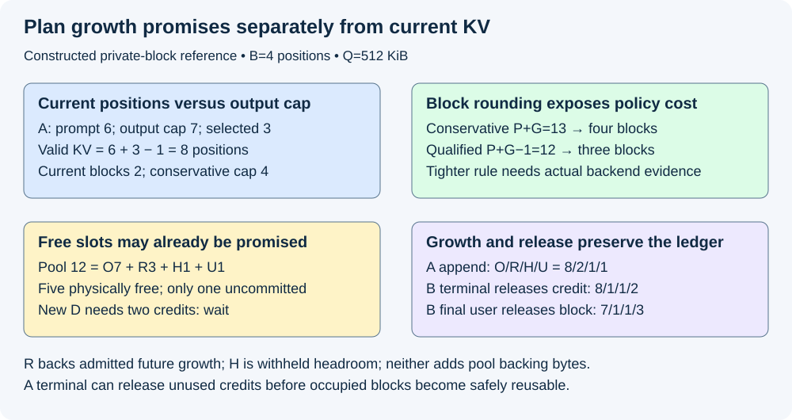
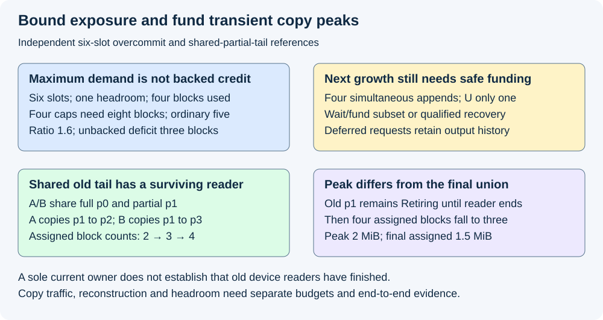

# M5-C14: Planning for future KV-cache growth

> **Status: Complete — detailed chapter authored and documentation validated; experimental procedures are proposed unless explicitly labelled observed.**

**Module:** Learn scheduling, operating systems, and queueing theory

**Category:** [Scheduling and queueing](index.md)

[Module 5 reading order](../module-5.md) · [Previous: M5-C13](../scheduling-and-queueing/m5-c13-budgeting-work-for-each-execution-iteration.md) · [Next: M5-C15](../scheduling-and-queueing/m5-c15-admission-control-and-backpressure.md)

## Target concepts

Current versus future cached tokens, declared output limits, conservative reservation, incremental growth, bounded overcommit, headroom, shared physical blocks, unknown future demand, exhaustion policy.

[Execution plan and progress](../chapter-execution-plan.md)

## Concepts

### 1. Current cached positions are not future output promises

A request can fit now and still require more KV storage before it finishes. KV means the attention keys and values retained from processed input positions. [M5-C13](m5-c13-budgeting-work-for-each-execution-iteration.md) checked one iteration's work and physical peak. This chapter asks what capacity has been promised across later iterations and what happens when actual growth differs from expectations.

Let P be prompt length, G the accepted maximum number of new output IDs, n the number already selected, and v the number of input positions with valid published KV. These counters have different meanings. For ordinary non-speculative cached generation after full prefill, prefill may select the first ID with v=P,n=1. Each following decode processes the previously selected ID and may select another, giving **v=P+n−1** at a completed selection boundary. This identity assumes no alternate cache representation, partial prefill or extra speculative destinations. Submitted but incomplete writes are not valid published positions.

The [Transformers generation specification](https://huggingface.co/docs/transformers/main_classes/text_generation) defines a new-output limit independently of prompt length. Translate each real API's prompt/output/context semantics explicitly; a cap is a maximum, not a prediction of the actual stopping time. Changing or silently shortening G to make a request fit changes the accepted output contract. Missing required caps, invalid lengths and checked arithmetic overflow must be resolved before admission.

For the private full-causal reference, choose a conservative position bound **vmax=P+G** and validate the model/API context limits separately. The final sampled ID may never enter another forward, so a specifically qualified ordinary path may need at most P+G−1 processed positions when G≥1. Do not apply that tighter bound to a backend with different terminal/EOS, speculative or staging requirements without evidence. A conservative bound can cost whole blocks, not merely one position.

Use synthetic all-layer storage **k=128 KiB per position**, **B=4 positions per block**, and **Q=Bk=512 KiB per physical block**. KiB=1,024 bytes; MiB=1,048,576 bytes. These are teaching dimensions, not a measured checkpoint or a recommendation. For private minimally allocated blocks:

**bcurrent=ceil(v/B); bcap=ceil((P+G)/B); r=bcap−bcurrent.**

ceil rounds upward. r is a backed future-growth credit count, not initialized storage. In the following constructed snapshot all requests have valid nonempty prompts and accepted caps; prompt/selected-ID identities and stopping rules remain fixed.

Pairs below use P/G for prompt/output cap and n/v for selected IDs/valid KV positions; all counts are positions or IDs, not bytes.

| Request | P / G | n / v | Current blocks | Cap blocks / credits |
|---|---|---|---:|---|
| A | 6 / 7 | 3 / 8 | 2 | 4 / 2 |
| B | 3 / 5 | 1 / 3 | 1 | 2 / 1 |
| C | 5 / 2 | 1 / 5 | 2 | 2 / 0 |

A has selected three IDs but cached eight input positions. Its conservative P+G=13 rounds to four blocks. Under the separately qualified P+G−1=12 bound it would round to three. That one-block difference is an explicit reservation-policy tradeoff, not a reason to pretend G predicts an output length. C's private partial tail can accommodate its conservative bound without another block; invalid tail positions are still not readable KV.

### 2. Physically free blocks may already back earlier promises

[M2-C15](m2-c15-admission-and-growth-under-a-finite-kv-budget.md) introduced a protected capacity ledger. Restate it here for an equal-block pool of Cpool slots:

**Cpool=O+R+H+U; physically free F=R+H+U.**

O counts unique physically assigned slots, including active, retained-only and Retiring state. **Retiring** means future use has closed but old users still prevent reuse. R counts unoccupied capacity already committed to admitted requests' growth. H is unoccupied headroom withheld for a separately controlled recovery need; ordinary admissions cannot spend it. U is unoccupied, uncommitted capacity that can back a new ordinary promise. R/H are exclusive credits against free capacity, not extra physical allocations. Do not add them again to pool backing bytes.

Use a 12-slot pool, backing **12×512 KiB=6 MiB**. The three requests above own five occupied blocks and three unused growth credits. Add one retained-only cache block and one Retiring block, so **O=7,R=3,H=1,U=1**. There are **F=5** physically free slots, but only **U=1** uncommitted. A new private request D with P=5,G=3 needs bcap=2 credits and must wait under this conservative policy despite five free slots. It could fit in an otherwise empty ordinary pool, so this is temporary lack of credits, not permanently invalid size. No new admissions occur in the next ledger replay.

For a private append of q new processed positions, required additional blocks are:

**Δb=ceil((v+q)/B)−ceil(v/B).**

One-position appends at v=3/4/7/8 give Δb=0/1/0/1. A's append 8→9 consumes one of its own credits: O increases, R decreases and U stays unchanged. Capacity was promised earlier, not created by a global free-count check. One serial authority protects reservation, allocation, safe return and publication of the matching request mapping.

| Event order; no elapsed time implied | O | R | H | U | Meaning |
|---|---:|---:|---:|---:|---|
| Initial snapshot | 7 | 3 | 1 | 1 | Five active, one retained-only, one Retiring block |
| A grows 8→9 | 8 | 2 | 1 | 1 | One reserved credit becomes occupied |
| B ends early; closes future growth | 8 | 1 | 1 | 2 | Its unused credit returns; its occupied block remains protected |
| B's final reader completes; block safely returns | 7 | 1 | 1 | 3 | One physical return creates another uncommitted credit |

Ending B early is stipulated valid reference stopping, not an artificial cap reduction. Duplicate terminal or reader notifications cannot release a credit/block twice. A retained-cache entry counts as reclaimed only after the actual eviction/lifetime contract establishes safe return. A missing completion leaves the relevant occupied slot unavailable.

*Constructed private-block reference. Backed promises, withheld headroom and uncommitted capacity partition free slots without adding physical bytes.*

### 3. Incremental growth and bounded overcommit need an exhaustion contract

**Conservative reservation** backs the declared cap before admission. It can leave storage physically idle when requests end early, but protects the specified pool promise without predicting length. It does not guarantee deadlines, compute service, correct execution or recovery from a failed worker. Workspace/output/graph limits from M5-C13 still apply.

**Incremental allocation** assigns blocks as valid state grows. This can coexist with full-cap reservation: credits become occupied only when needed. **Incremental admission**, in contrast, may accept a request without backing its entire cap. The latter is a weaker promise and needs an explicit response if future blocks cannot be acquired. Do not use the two meanings interchangeably.

A two-slot negative reference has two private requests, each P=4 and G=2, each requiring two valid output IDs before terminal. Both currently have v=4,n=1 and occupy one block. With no headroom, free block, preemption or safe reclaimable state, both need another block for their next forward and neither can finish. Merely waiting cannot manufacture capacity. Full-cap reservation would have admitted one two-block budget. This is a conditional resource deadlock example, not a claim that every incremental policy deadlocks.

**Overcommit** accepts aggregate maximum demand exceeding ordinary resident capacity, relying on bounded deferral or qualified recovery. A bound on overcommit makes exposure explicit; it does not turn unbacked demand into R credits. In a separate six-slot pool with H=1, four private requests each P=4,G=4 have conservative cap 2 blocks each and current 1 block each. They occupy O=4; R=0 and U=1. Ordinary capacity is 5 blocks, aggregate cap demand 8, so:

**cap-demand ratio α=8/5=1.6; maximum unbacked cap deficit D=8−5=3 blocks.**

This reference authorizes at most three such unbacked blocks and freezes further admissions at that exposure. That bound is a policy limit, not a claim of statistical safety. All four requests attempting their next append need four new blocks, while only one ordinary credit is free. The iteration must not escape with those unfunded writes. It could schedule a funded subset with a separately justified progress policy; it cannot claim all four next steps fit.

One prescribed recovery illustration safely removes two one-block resident victims after their users finish. O becomes 2,U=3,H=1. The two remaining residents can each grow by one block, giving O=4,U=1,H=1, within ordinary capacity. The two deferred logical requests still exist and must requalify capacity before resuming. If each victim's valid prompt cache was four positions, restoring that cache requires **eight prompt query positions in total**, before later work. Preserve their already committed first IDs, next inputs and random-state snapshots; reconstruction must not expose or count those first IDs again. This is a paper recovery-cost example, not an implemented preemption/resumption design or an assertion that two evictions are always necessary.

The [vLLM preemption guide](https://docs.vllm.ai/en/stable/configuration/optimization/#preemption) describes recomputation when cache space is insufficient and warns of end-to-end latency effects. Actual recovery behavior is version/backend-specific. Our bounded exposure and victim counts are independent teaching inputs. If no qualified reclaim/deferral/recovery path can make progress, reject or fail under the declared service contract rather than spin forever, borrow headroom silently or report truncated partial output as success.

### 4. Shared prefixes reduce present bytes but can raise future copy peaks

A **shared physical block** has multiple logical request views but one allocation identity. Count that identity once. Sharing requires matching model/adapter, token/position/format and isolation contracts; identical displayed text is insufficient. The [PagedAttention paper v1, section 4.4](https://arxiv.org/html/2309.06180v1#S4.SS4) explains block sharing and copy-on-write. Its mechanism motivates the accounting; this chapter's reader lifetimes and peaks are deliberately specified local cases.

For two requests of valid length 5, sharing exactly the first full four-position block and holding separate one-position tails, their logical block-view count is 2+2=4, but their unique assigned blocks are 3. At Q=512 KiB this is **2 MiB request-view storage versus 1.5 MiB unique assigned storage**. Unused tail positions belong to those allocated blocks, not to the free pool. New private growth and any required copy destinations must still be funded. A cache hit saves today's duplicate allocation; it does not automatically fund tomorrow's divergence.

**Copy-on-write (COW)** preserves shared immutable data by allocating a private destination before modifying a request's view. Here is a separate constructed partial-tail-sharing case, not a claim that every prefix cache supports partial blocks. A/B each have P=6,G=2,n=1,v=6 and share blocks p0 (full 4) and p1 (valid 2). The old p1 has an independent device-reader claim that persists through both requests' upcoming mapping changes. All writers follow M2-C10's conservative rule: no mutation of a block while a conflicting old reader remains.

| Stage | Unique assigned blocks | Reason |
|---|---:|---|
| Before append | 2 | Shared p0/p1 |
| A obtains destination p2 and copies valid p1 payload | 3 | Old p1 remains for B and the old reader |
| B obtains destination p3 before its own write | 4 | Reader still prevents writing old p1 in place |
| Both private mappings published; old reader still live | 4 | p1 now has no request owner but remains Retiring |
| Old reader ends and p1 safely returns | 3 | Shared p0 plus private p2/p3 remain |

Peak is **four blocks=2 MiB**, final assigned state **three blocks=1.5 MiB**. Reserving only the final union would miss the transient peak. The exact two-destination requirement follows this old-reader lifetime; if that reader had already completed and other sharing/mutation gates passed, a different qualified path might modify the remaining owner's tail in place. One reference count dropping to one does not by itself prove that all old device readers finished.

Each copy moves two valid positions: 256 KiB logical source reads plus 256 KiB destination writes, or 512 KiB per copy. Two copies total **1 MiB logical copy traffic**, plus the separately required append writes; these are not measured DRAM transactions or copy times. A full-block-copy backend would have a different byte ledger. Do not read or publish invalid tail positions merely because the destination has capacity for them.

Shared full-cap planning therefore needs the union of physical identities plus worst permitted private destinations and old-reader overlap, not a sum of logical lengths and not just today's deduplicated union. Use [M9-C15](../state-memory-and-caching/m9-c15-accounting-for-weights-kv-state-workspace-and-fragmentation.md) to keep active, retained-only, Retiring, pool backing and other memory roles disjoint.

*Independent six-slot exposure and partial-tail COW references. Logical owner counts, maximum promises and physical final-user claims are different facts.*

### 5. Unknown lengths require scenarios, not an invented guarantee

The actual generated length g is unknown before valid stopping, although the accepted G is bounded. Representative length/arrival/reuse correlations can inform an incremental policy's expected behavior, but mean output length is not a hard capacity bound. Bursts of long outputs, many private tails crossing block boundaries together, or simultaneous divergence of shared prefixes can invalidate a comfortable average. Include upper-cap and correlated-growth cases, not just independent short requests.

Headroom H must name its owner, eligible purpose and transfer rule. If recovery spends one headroom credit, move that credit into occupied/committed accounting under its separate authority; do not keep counting it as unspent H. COW/workspace/output backing can also need separate margins. No universal headroom percentage follows from these fixtures. An eager-backed KV pool already consumes its outer allocation; free internal credits do not create additional device-free bytes.

Use one owner to coordinate cap changes, growth credit conversion, identity/mapping publication and final-user return. A requested increase in G needs a new feasibility decision before it becomes an accepted promise. Reject impossible sizes up front; wait only for requests that can become fundable under a declared finite waiting policy. On growth shortage, stop new admissions, keep unsafe iterations unsubmitted and apply the chosen funded-subset/reclaim/preemption/failure contract. Never free a pinned/shared block, emit extra output, or silently lower a cap to force progress.

A failed reservation before submission may roll back tentative claims exactly once. Unknown submitted completion keeps its physical claims and may require isolating the worker/pool; cancellation closes future work but does not certify reuse. Keep client outcome, server terminal, committed prefix and physical retirement separate. Completed [M5-C15](m5-c15-admission-control-and-backpressure.md) develops the admission/backpressure flow.

### 6. Capacity safety and useful service need separate evidence

Full-cap reservation may reduce concurrency and increase waiting; incremental policies may admit more work but add allocation checks, stalls, copies, recomputation and longer decode gaps. Prefix sharing changes both allocation count and recovery/copy costs. A faster local allocator, higher hit ratio or larger admitted batch is useful only through correct service at the stated workload.

Evaluate offered/admitted/rejected/deferred work, per-request first-output/gap/terminal and quality acceptance, class coverage, queue/Retiring-byte trends and recovery under [M9-C06](../measurement-experimentation-and-economics/m9-c06-defining-slos-goodput-and-useful-capacity.md). A pool-capacity invariant does not establish p99, sustained useful capacity or a deadline guarantee. Keep prompt reconstruction, COW, synchronization and host allocation costs in the end-to-end comparison. All reference counts and sizes here are constructed; no allocator, model or hardware experiment has been executed.

## Experiments

All experiments are proposed. Authorship performs only reference arithmetic, credit/identity/lifetime reasoning and documentation checks. No allocator, scheduler, copy kernel, model, preemption runtime, fault injector or hardware profiler is implemented or executed.

### E1 — Reconcile current state and backed future growth

- **Name:** Free capacity may already belong to another promise.
- **Description:** First reconstruct P/G/n/v and block rounding; then audit the private 12-slot ledger; finally replay growth, early terminal and safe-return events without intervening admissions.
- **Purpose/objective:** Hypothesis: present valid KV, selected output count and cap reservation differ, while free slots overstate what a new request may spend. HFT concern: future obligations cannot reuse capacity already promised elsewhere.
- **Target concepts:** Current/future cached tokens, declared output limits, conservative reservation, incremental growth and headroom.
- **Baseline:** A/B/C table, B=4, 128-KiB positions, 512-KiB blocks; O/R/H/U=7/3/1/1 with fixed private full-cap policy.
- **Workload:** Exact snapshot and growth replay, A's separately qualified tighter bound, block edges 3/4/7/8, valid early stop, duplicate release, cap increase, invalid cap and permanently unaffordable size. Independent variable: one count, boundary or lifetime event per case.
- **Controlled variables:** Prompt/stop/output semantics, private ownership, minimally allocated blocks, pool/backing boundary, no competing admission and serialized budget authority.
- **Hardware requirements:** CPU credit/arithmetic reference first; later bounded allocator/model with independently attributable allocation and host/device completion evidence.
- **Exit criteria:** Reproduce current 5/cap 8/unused 3 blocks, A v=8/n=3 and conservative 4 versus tighter 3 blocks, 6-MiB backing, F=5 versus U=1 and D needing 2 credits. Reproduce 7/3/1/1→8/2/1/1→8/1/1/2→7/1/1/3 and reject duplicate/early physical release or unapproved cap changes.

### E2 — Account for shared identities and COW overlap

- **Name:** Reserve transient copies, not just the final union.
- **Description:** First deduplicate full-prefix allocation identities; then follow the partial-tail two-writer case through both destination allocations; finally challenge publication and final-reader retirement.
- **Purpose/objective:** Hypothesis: sharing lowers present bytes but a pinned old tail can require two private destinations before it is reusable. HFT concern: a reader's old snapshot remains protected when current owners change.
- **Target concepts:** Shared physical blocks, future private growth, headroom and exhaustion at copy peaks.
- **Baseline:** Separate length 5/full-prefix case and P=6/G=2 partial-tail case, with p1 reader held through both writes and the conservative no-reader-during-mutation contract.
- **Workload:** Exact identity/copy timeline; separate late reader, stale generation, failed second allocation, invalid copied tail and premature old-block free. Independent variable: one sharing, destination-credit or lifetime fact per case.
- **Controlled variables:** Compatible model/adapter/position/format, original output/reference, fixed B/Q, protected row/block maps, valid copy range and no assumed in-place permission.
- **Hardware requirements:** CPU union/traffic reference; later qualified block-copy/backend diagnostics with supported access-completion scope and recorded copy/temporary-buffer allocation.
- **Exit criteria:** Reproduce four logical block views versus three unique full-prefix blocks, 2 versus 1.5 MiB. Reproduce partial-tail assigned counts 2→3→4→4→3, 2-MiB peak versus 1.5-MiB final and 1-MiB logical copy traffic. Detect unfunded destination, crossed identity, invalid-tail use or reuse before final access; a sole owner count does not erase old readers.

### E3 — Challenge incremental and bounded-overcommit progress

- **Name:** A bounded exposure is not a backed completion promise.
- **Description:** First audit the two-slot growth deadlock assumptions; then apply the six-slot exposure limit and next-append check; finally inspect prescribed safe victim removal, reconstruction and resume gates.
- **Purpose/objective:** Hypothesis: accepting current-only state can prevent progress, and a finite overcommit ratio still needs funded scheduling or qualified recovery. HFT concern: bounded outstanding work must have an explicit overload exit, not an endless wait.
- **Target concepts:** Incremental growth, bounded overcommit, unknown demand, headroom and exhaustion policy.
- **Baseline:** Two P=4/G=2 requests in two slots with no recovery; separate Cpool=6,H=1,O=4,R=0,U=1, four P=4/G=4 requests and a maximum unbacked deficit 3.
- **Workload:** Exact negative and recovery ledgers; upper-cap correlated growth, unavailable recovery, retained victim readers, unknown worker completion, longer-than-expected output and changed cap. Independent variable: one growth/recovery assumption per case.
- **Controlled variables:** Physical versus logical admission state, ordinary/headroom authority, no double-backed R credits, output/RNG history, victim scope and safe return conditions.
- **Hardware requirements:** CPU liveness/exposure review; later isolated allocator/scheduler with bounded recovery resources and supported terminal/reader evidence. No preemption implementation is supplied here.
- **Exit criteria:** Show both two-slot requests need an unavailable block to finish; reproduce α=1.6/deficit=3 and four simultaneous growth demands versus U=1. Reproduce safe two-victim O=2/U=3/H=1, subsequent survivor O=4/U=1/H=1 and eight prompt query positions of reconstruction. Deny unfunded writes and premature reclaim; retain deferred logical requests/outcomes and requalify every resume. No statistical length estimate is a hard guarantee.

### E4 — Compare reservation policies through useful service

- **Name:** Higher admission is useful only after growth and recovery costs.
- **Description:** First freeze output/cap/workload and physical bounds; then compare full-cap reservation with one explicitly specified incremental/exposure policy; finally confirm per-class service, peak state and recovery on fresh sessions.
- **Purpose/objective:** Hypothesis: conservative reservation may increase waiting while incremental policies trade more initial concurrency for stalls/copies/reconstruction and tail risk. HFT concern: local utilization gains must preserve correct complete service under the offered workload.
- **Target concepts:** Reservation, incremental growth, sharing, unknown demand, headroom and exhaustion tradeoffs.
- **Baseline:** Same eligible offered requests, cap/stop/quality contract, compatible pool/physical-memory limits and frozen recovery capabilities; no invented hardware gains.
- **Workload:** Fixed prompt/output/cap and prefix-sharing classes, bursts, cold/warm cache, early-stop and correlated near-cap growth cases. Independent variable: reservation/exposure policy or headroom level in separate comparisons; all other constraints held fixed.
- **Controlled variables:** Model/tokenizer/adapter/precision, valid input/output identities, arrival trace, future-demand assumptions, workspace/output/graph bounds, reset/drain and recovery policy.
- **Hardware requirements:** Qualified generator/server, CPU/network/GPU/VRAM/interconnect manifest and supported physical allocation, lifetime, copy, reconstruction and service-timing counters.
- **Exit criteria:** Require reference output/lifetime correctness before timing; then compare offered/admitted/rejected, waits, growth stalls, copy/recompute work, unique assigned/Retiring/pool bytes and joint useful service. Preserve failed/unresolved and recovery cases; a larger active set or lower present-memory count alone cannot certify capacity, p99 or a safe headroom percentage.

## Verification

| Experiment | Reference / invariants | Measurements and comparison | Acceptance limit |
|---|---|---|---|
| E1 | P/G/n/v meanings, block rounding and exclusive backed credits | Current/cap blocks, O/R/H/U transitions and safe returns | Physically free is not uncommitted or already valid state |
| E2 | Unique allocation/generation, copy range, mappings and final users | Shared union, private destinations, transient peak and copy traffic | Final assigned footprint is insufficient for a peak promise |
| E3 | Explicit exposure, funded subset/recovery and preserved output history | Deficit, growth waits, victim lifetime and reconstruction/resume cost | Unbacked maximum demand is not R or a completion guarantee |
| E4 | Same offered trace, caps, output/quality and physical bounds | Joint service, class coverage, memory trends, stalls and recovery | More initial admission does not establish useful capacity |

Validate valid-prefix lengths, per-request selected IDs/stopping and the accepted cap under [M9-C19](../interfaces-protocols-and-streaming/m9-c19-validating-tokenization-stopping-and-final-output.md). Use exact, numerical or distributional references appropriate to the implementation's promise. Reconstruction must preserve committed output and correct next inputs/random state; extra visible IDs, silent truncation or a switched adapter fail regardless of speed. Missing future-demand bounds must not be replaced by a conveniently short observed answer.

Use [M9-C15](../state-memory-and-caching/m9-c15-accounting-for-weights-kv-state-workspace-and-fragmentation.md) for unique backing, pool/live/reserved and simultaneous-peak boundaries, and [M9-C22](../runtime-and-concurrency/m9-c22-verifying-ownership-and-memory-safety-under-concurrency.md) for final-user claims. Track request/attempt, block owner, worker/pool/slot/generation, reservation authority and pending access identity. Reconcile Cpool after every protected event; separately record unbacked cap exposure for overcommit. Never charge R/H again as backing or count a Retiring block as U before safe return. A graph/output/workspace allocation outside the KV pool still belongs in the device peak.

Freeze workload and output/cap/share/arrival correlations under [M9-C08](../measurement-experimentation-and-economics/m9-c08-designing-representative-serving-workloads.md). Qualify actual traffic and request populations using [M9-C09](../measurement-experimentation-and-economics/m9-c09-open-loop-load-generation-and-coordinated-omission.md) and [M9-C10](../measurement-experimentation-and-economics/m9-c10-validating-the-load-generator-and-request-accounting.md). Preserve offered, admitted, waiting, rejected, completed, cancelled, failed and unresolved attempts; a preempted request does not disappear or become another successful user when resumed.

A proposed descriptive starting budget is 20 paired reset sessions per named workload/policy/headroom cell, one session per arm in each pair, balanced order and one full scratch-trace warmup per arm under [M9-C11](../measurement-experimentation-and-economics/m9-c11-controlled-comparisons-warmup-and-reproducibility.md). Restore declared prefix/adapter state, retain all sessions and ordered observations, and treat pairs as replication units rather than adjacent requests as independent trials. Separate warm hits, cold reconstruction, copy peaks and late-reader cases. Text generation is the scope; other modalities and Module 8 remain excluded.

Record intended arrival, scheduler receipt, admission/reservation, block conversion, copy start/covered completion, output commit/visibility, terminal, credit release and physical final-user return with compatible clocks under [M9-C02](../measurement-experimentation-and-economics/m9-c02-request-events-clocks-and-measurement-boundaries.md). Measure first-output/gap/terminal distributions, useful request/output-ID rates, quality and class coverage under [M9-C06](../measurement-experimentation-and-economics/m9-c06-defining-slos-goodput-and-useful-capacity.md). Distinguish offered-cohort follow-up from in-window completions. One-ID gap absence and no output after rejection are not fabricated zero durations; client timeout, server outcome and physical drain remain distinct.

Report O/R/H/U, unbacked exposure, unique shared/private/retained/Retiring blocks, tail waste, actual backing, workspace/output/graph peaks, growth failures, recovery admissions, copy bytes, recomputed input positions and newly useful output separately. Reconstruction work is real resource demand without necessarily creating new useful IDs. Use short separate allocation/copy/device/host profiles and matched overhead checks; intrusive diagnostics stay out of clean timing. A paper credit model cannot measure allocator latency, GPU copy bandwidth or reconstruction cost.

Use [M9-C07](../measurement-experimentation-and-economics/m9-c07-latency-distributions-and-statistical-uncertainty.md) and [M9-C27](../measurement-experimentation-and-economics/m9-c27-designing-regression-experiments-and-validation-gates.md) for sample-size/confidence, dependence and regression criteria. Twenty pairs and small fixtures do not prove p99, a safe exposure ratio or rare-exhaustion probability. Include upper-cap/correlated-growth negative cases alongside representative distributions; inspect queue/Retiring-byte trends, bounded-wait/progress and post-load recovery. Drain or list unresolved identities/claims; unknown completion and failed recovery cannot be dropped from the capacity claim.

## Engineering dimensions and principles

| Dimension | Chapter-specific application |
|---|---|
| Semantics and invariants | E1 preserves cap/current/selected meanings; E2/E3 preserve valid copied/reconstructed output and lifetime |
| Workload and variability | Prompt/output/cap, arrivals, reuse/adapter skew and correlated near-cap growth change exposure; text only |
| Resources and bottlenecks | Unique KV backing, credits, COW/recompute traffic, workspace/output/graph pools and CPU/device work all matter |
| Time and distributions | Growth waits, copies, recovery, decode gaps, terminal and physical return have distinct endpoints |
| Ownership and coordination | One authority protects backed credits, block maps and safe return; old readers outlive current owners |
| Failure and adaptation | Missing bounds, cap increases, exhaustion, cancellation, allocation/update failure and worker loss require explicit outcomes |

| Practical engineering principle | Application |
|---|---|
| 1. Correctness defines the optimization boundary | A cap reduction, invalid copy or duplicated reconstructed output is not an equivalent improvement |
| 2. Performance depends on workload and operating point | Early stops and near-cap correlated growth stress reservation policies differently |
| 3. Data movement is part of the algorithm | COW and reconstruction add traffic/work even when sharing saves current allocations |
| 4. State has ownership, lifetime and recovery cost | A terminal request releases unused credits before its occupied blocks become reusable |
| 5. Dependencies determine latency; bottlenecks determine capacity | A free query slot cannot advance an unfunded append; safe returns depend on final users |
| 6. Variability and synchronization shape the tail | Simultaneous block crossings and shared-tail divergence create peaks missed by averages |
| 7. Local improvements require end-to-end evaluation | More admitted work must improve useful service after growth stalls, copies and recovery |
| 8. Claims require reproducible evidence | E1–E4 freeze caps, credit/exposure contracts, identity, workload, hardware and uncertainty |

The HFT lens is accounting for future obligations and retained state under bounded capacity and competing deadlines. It transfers as systems reasoning. Inference adds uncertain generated lengths, shared causal KV, output stopping and reconstruction; these fixtures establish no exchange rule, trading outcome or production readiness.

## Specifications, articles, and hardware

Primary Transformers generation, PagedAttention v1 (2023) sharing/scheduling and vLLM preemption sources were reviewed on 2026-10-29. They support cap semantics, variable growth and sharing/recovery concepts; they do not define our local 12-slot ledger, six-slot exposure or delayed-reader COW policy. Pin actual backend/API/model versions and identify whether partial-block sharing, in-place mutation or reconstruction is supported before adapting a study.

No actual machine was supplied or benchmarked. The references use synthetic 128-KiB positions and four-position blocks. Actual studies need generator/server CPU model, cores/SMT/NUMA/RAM, OS/kernel, affinity/quotas, Rust/runtime/compiler and network directional limits; GPU model/architecture/count/VRAM, driver/backend/runtime, power/clocks/temperature and interconnect topology. Record model/adapter/tokenizer/template/corpus hashes, full/sliding attention policy, KV precision/layout, actual per-layer block sizes, accepted prompt/output/context/stop/random-state rules, sharing identity and pool/allocator/graph/workspace/output/log bounds. Preserve reservation/exposure/headroom ownership, victim/resume constraints, physical completion scope, workload/clock provenance, reset/warmup/drain/fault policy and diagnostic overhead. Synthetic capacity math cannot substitute for that manifest or hardware results.

## Key takeaways

Plan for accepted future growth, not only present KV. Physically free blocks may back earlier promises, and shared final state can require a larger transient copy peak. Incremental admission and bounded overcommit need funded progress or recovery while preserving caps, output history and final-user safety; capacity accounting alone does not prove useful service.

## Continue learning

Next in Module 5 reading order is completed [M5-C15: Admission control and backpressure](m5-c15-admission-control-and-backpressure.md). The next authoring chapter is [M5-C18: Choosing chunk sizes and balancing prefill with decode](../scheduling-and-queueing/m5-c18-choosing-chunk-sizes-and-balancing-prefill-with-decode.md), position 125. Follow the [execution plan and progress tracker](../chapter-execution-plan.md); Module 9 supports Modules 1–7 and Module 8 is excluded.
