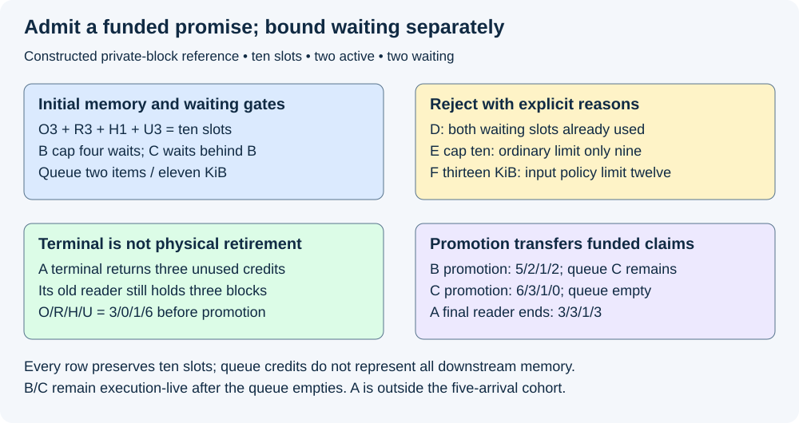
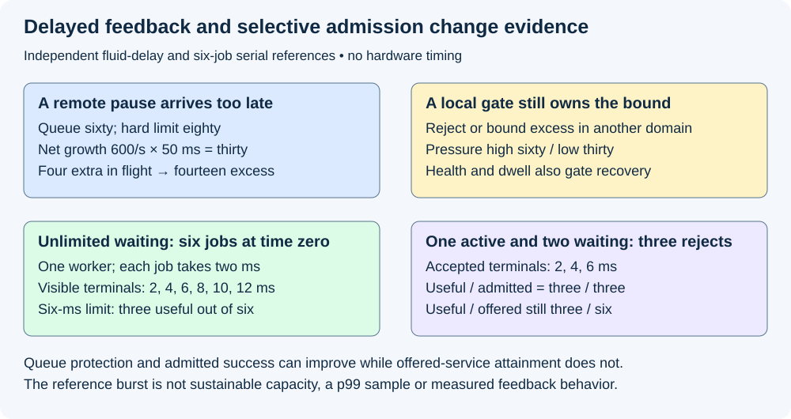

# M5-C15: Admission control and backpressure

> **Status: Complete — detailed chapter authored and documentation validated; experimental procedures are proposed unless explicitly labelled observed.**

**Module:** Learn scheduling, operating systems, and queueing theory

**Category:** [Scheduling and queueing](index.md)

[Module 5 reading order](../module-5.md) · [Previous: M5-C14](../scheduling-and-queueing/m5-c14-planning-for-future-kv-cache-growth.md) · [Next: M5-C16](../scheduling-and-queueing/m5-c16-fairness-priorities-and-starvation-prevention.md)

[Execution plan and progress](../chapter-execution-plan.md)

## Target concepts

Admit-wait-reject decisions, bounded queues, memory-aware admission, upstream backpressure, rejection accounting, capacity reservations, overload thresholds, avoiding admission-growth deadlock.

## Concepts

### 1. Receiving a request is not promising execution capacity

**Admission control** decides whether the service can take responsibility for executing a request under its declared resource and output contract. **Backpressure** communicates limited capacity toward producers so they reduce or delay submission. **Load shedding** explicitly declines work when keeping it would violate the service's policy. A queue can absorb a finite burst; it cannot create compute capacity, KV memory or a guarantee of timely completion.

Use the bounded ownership contracts from [M5-C04](../runtime-and-concurrency/m5-c04-producer-consumer-queues-and-bounded-work.md), future-growth accounting from [M5-C14](m5-c14-planning-for-future-kv-cache-growth.md) and offered-service acceptance from [M9-C06](../measurement-experimentation-and-economics/m9-c06-defining-slos-goodput-and-useful-capacity.md). Rust is the host-language context. No admission controller, protocol or engine implementation is supplied.

Specify three outcomes at the execution-admission boundary:

| Decision | Promise and responsibility | Required evidence |
|---|---|---|
| Admit | Execution domain accepts the request and its funded obligations | Request identity, accepted cap, acquired credits and admission time |
| Wait | A bounded waiting domain owns the request temporarily | Queue count/bytes, expiry, cancellation and wakeup responsibility |
| Reject | This attempt will not enter execution under this decision | Explicit reason, acceptance certainty and client-visible outcome |

Here a waiting request is **accepted into the waiting domain but not execution-admitted**. An API may instead call queue acceptance “admission”; translate that boundary before comparing counters. HTTP receipt, parsing, queue insertion, KV reservation, first execution, first output and terminal outcome are different events. Rejecting an already execution-admitted request after a worker failure is an execution failure, not a retroactive pre-admission rejection.

Define attempt identity separately from logical-request identity. An attempt is one submission; a logical request is the user's original operation, which may have retries. A timeout without acceptance evidence leaves uncertainty. Blindly submitting again can duplicate work or output. Reconciliation needs identity and a declared duplicate/response policy; a request ID alone does not magically provide exactly-once execution.

A valid size that cannot fit an empty supported worker under the configured hard bounds needs rejection or an explicitly supported alternative, rather than an endless wait. Temporarily unavailable capacity may justify waiting only with a finite bound and an owner that can resolve cancellation, expiry and closure. Never silently reduce the accepted output cap, change the model or return incomplete output as success to make admission appear feasible.

### 2. Bound the waiting domain and the execution domain separately

Let Q be queued waiting requests and Bq their charged bytes. Let Cq and Cb be the corresponding configured limits. Count unpublished reservations Rq and Br when producers can acquire space before publishing. In this teaching contract:

**Q+Rq≤Cq and Bq+Br≤Cb.**

The byte charge includes the named retained payload and metadata; an actual system must also bound parsing buffers, task stacks, input copies, connections, retry lists, tokenization and pending responses. A queue limit of two cannot bound RAM if every prompt is arbitrarily large. Releasing a queue credit at promotion does not release the prompt or output buffers still used downstream. Network flow control bounds particular transport buffers, not the application's accepted future KV obligations.

Let L be execution-admitted nonterminal requests and Cl their limit. With no additional staging population, **Naccepted,nonterminal=Q+L**. This identity counts requests, not distinct physical allocations or unknown device users. Cancelled execution can leave Retiring state, meaning allocations unavailable for reuse until their last users finish. Count those physical claims even after the logical request leaves L.

Use a resource vector: current/reserved host bytes, active slots, future KV credits, temporary copy/workspace capacity and output-buffer capacity all have their own bounds. A request passes only if every applicable hard gate passes. Rate limiting, meaning a bound on submissions per time interval, is useful for quotas and pressure control but cannot by itself bound live memory when lengths or processing times vary. Low queue depth also cannot certify a healthy worker whose GPU or output path has stopped.

**Memory-aware admission** includes accepted future growth. For private KV blocks, use M5-C14's disjoint ledger:

**Cpool=O+R+H+U.**

Cpool is the number of physical pool slots. O is occupied, including retained and Retiring blocks; R backs future admitted growth; H is withheld recovery headroom; U is uncommitted. Physically free slots include R+H+U, but only U is available for an ordinary new promise. These counts partition an existing pool; they are not extra allocations added on top of its backing bytes.

For a conservative private cap, a request with P prompt positions and accepted new-output limit G needs **bcap=ceil((P+G)/B)** blocks, where B is positions per block and ceil rounds upward. A reserved cap includes the initial occupied blocks, so do not charge current blocks and the full cap twice. Sharing, copy-on-write, changed caps or bounded overcommit require their separately qualified peak/exposure rules; the private fixture below does not prove them safe.

### 3. A bounded FIFO example makes the promises visible

This is constructed reference arithmetic, not observed scheduler behavior. FIFO means first waiting request is considered first. Our deliberately strict policy never bypasses the waiting head; fairness alternatives belong to M5-C16. Perform validation before checking temporary queue fullness; record all failed gates as diagnostics while using one documented primary reason.

Use Cpool=10 blocks, H=1, initially O=3,R=3,U=3. All three occupied blocks belong to active A; its three future credits cover a private six-block cap. Cl=2. The waiting domain has Cq=2 and Cb=12 KiB. A queued descriptor's stated byte charge is its entire charge for this tiny reference; real metadata needs a manifest. There are no unpublished queue reservations. B–F arrive in that total order before any A transition:

| Attempt | Cap blocks / queue KiB | Initial decision | Reason |
|---|---|---|---|
| B | 4 / 5 | Wait | U=3 cannot fund four |
| C | 2 / 6 | Wait | Strict FIFO behind B |
| D | 1 / 1 | Reject | Two waiting slots used |
| E | 10 / 1 | Reject | Exceeds ordinary empty-pool limit nine |
| F | 2 / 13 | Reject | Exceeds configured per-request waiting payload limit 12 KiB |

The payload limit for F is an explicit input policy regardless of immediate execution eligibility. Q=2 and Bq=11 KiB after the arrivals. B would fit the empty ordinary pool, so waiting is potentially meaningful. C could fit the present U, but bypassing B would be a different policy. D is rejected for count even though one KiB remains in the byte budget. E and F have permanent configured size failures; merely enlarging this queue does not resolve them. These five eligible offered attempts remain in the audit population, including all rejections.

Now A validly terminates and releases its three unused R credits. Its old reader still holds its three occupied blocks. Promote B, assigning two initial blocks and retaining two future credits. Then promote C, assigning one initial block and retaining one future credit. These promotions need no shared blocks or extra temporary allocation in this reference. Each requires a fresh coherent feasibility decision and ownership transfer:

| Boundary | O / R / H / U | Q / queued KiB | Execution-live requests |
|---|---|---|---|
| Before A terminal | 3 / 3 / 1 / 3 | 2 / 11 | A |
| A terminal; reader remains | 3 / 0 / 1 / 6 | 2 / 11 | None |
| Promote B | 5 / 2 / 1 / 2 | 1 / 6 | B |
| Promote C | 6 / 3 / 1 / 0 | 0 / 0 | B, C |
| A final reader ends | 3 / 3 / 1 / 3 | 0 / 0 | B, C |

Every memory row sums to ten. An empty queue after C's promotion still has two live requests and A's three Retiring blocks. Only A's final-reader evidence makes those blocks U. B/C terminal outcomes are not stipulated by this partial history: at its cutoff, five offered attempts partition as two admitted unfinished and three rejected. A was already present and is outside that offered cohort. Queue bytes moved downstream, not out of existence.

*Private reference: waiting does not reserve the whole output cap. Promotion acquires funded execution promises without spending old-reader blocks.*

Two concurrent candidates can both observe an obsolete budget. In a separate case with U=3, two private cap-two requests cannot both reserve two. Separate “check then act” observations would promise four against three. One serialized authority admits the first, leaving U=1, and waits/rejects the second according to policy. Protect the feasibility decision and claim transfer together; do not hold a control lock while waiting for GPU completion, queue space or a consumer that needs that lock. A failed unpublished transfer rolls back its own tentative claims once. Unknown submission completion retains physical claims for recovery.

### 4. Preserve a funded path to progress

A bounded queue establishes a space bound, not liveness. **Liveness** means relevant accepted work can make progress or reach its declared failure/expiry outcome. Consider an independent four-slot pool with no headroom or recovery. Active X and Y occupy one block each and each requires one more before it can finish. A waiting Z has reserved the other two blocks but cannot execute until X or Y leaves the two-active-request limit. X/Y wait for Z's credits; Z waits for an active slot. All four slots are accounted for, yet nobody can progress.

This is an **admission-growth deadlock**, a cycle between future growth and admission. Remove the inappropriate waiting reservation and fund both active growth obligations: O=2,R=2,U=0 supports their next appends. This repaired state uses the same four physical slots and keeps Z in bounded waiting without a KV promise. An alternative policy could reserve waiting work only after proving that active progress/recovery remains funded. Neither a queue-size limit nor an output-length average proves that condition.

Under incremental admission, first protect a feasible execution subset and its future resource dependencies before spending remaining capacity on new admissions. Recovery may require headroom, safe victim retirement and reconstruction, not just changing a counter. Worker loss can invalidate free-capacity reports; stale credits need an epoch, meaning a worker/pool version that distinguishes old evidence from the current owner. Unknown access completion may require quarantine: isolating those allocations from reuse. Overload must not free pinned state or fabricate normal completion.

Cancellation of a waiter releases its queue claims at the declared removal point. It must not double-release a concurrent promotion's execution credits. Define a single winner between expiry/cancellation and promotion, with matching identity and one outcome. After submission, cancellation prevents future work under policy but cannot certify that the device has stopped using memory. Preserve a bounded response path for terminal/error messages, or overload can prevent the very acknowledgements needed for upstream recovery.

### 5. Backpressure is delayed feedback, so keep a local hard bound

A backpressure signal may take time to reach the sender, and work already sent can still arrive. Let λ be the arrival rate reaching this waiting domain, μ its departure rate, Δ the feedback delay and I additional already-sent requests not included in that rate model. With constant rates and no rejection over this interval, the fluid estimate is:

**Additional backlog ≈ max(0,λ−μ)Δ+I.**

The approximation ignores integer event timing and changing service. Do not double-count I in λ. Suppose Q=60, Cq=80, λ=1,000/s, μ=400/s, Δ=0.050 s and I=4. The estimated extra backlog is 30+4=34, exceeding the twenty remaining slots by fourteen. Without a local bound this model reaches Q=94. With a hard cap of eighty, fourteen equivalent excess arrivals must be rejected or held in another explicitly bounded domain; a remote pause signal alone is insufficient. This is a planning stress estimate, not measured packet behavior.

Use **hysteresis**, different thresholds for entering and leaving a pressure state, to reduce rapid oscillation. A hypothetical policy enters pressure at Q≥60 and exits only at Q≤30 with memory/worker health recovered continuously for a stipulated 100-ms dwell interval. Queue count, queue bytes, oldest age, free uncommitted credits, host load and output stalls may require separate signals. Thresholds are illustrative, not recommended production values. A threshold cannot authorize exceeding a hard memory cap; health loss can require immediate protective action regardless of low Q.

Backpressure moves waiting toward clients; it does not erase demand. Bound paused producer tasks and buffers and report application-intended submissions, client-held/throttled work, wire attempts, server receipts and execution admissions separately. A closed-loop client that waits longer before submitting changes the offered trace. Compare that policy as a complete feedback system, not as the same fixed offered workload as an open-loop test. Open-loop means intended arrivals are scheduled independently of response completion.

Retries add load. For ten logical requests, a global maximum of three attempts per logical request allows at most thirty attempts. Three independent retrying layers, each permitting three attempts at its next layer, can instead create up to 3³=27 downstream attempts per logical request, or 270 for ten. These are worst-case counts, not likely rates. An end-to-end budget must actually be shared/enforced at the selected attempt boundary to achieve the thirty bound. Use bounded attempts, deadline-aware delays and randomized retry timing when supported; randomization spreads synchronization but supplies no memory guarantee. Preserve the original logical deadline and deduplicate committed output according to the contract.

The engineering article [Handling Overload](https://sre.google/sre-book/handling-overload/) explains resource-based limits, client throttling, the cost of rejecting traffic and retry budgets. Its service-specific policies are not default InferX parameters. In particular, rejecting every request still costs parsing, connections and CPU; protect those paths before their resource limits are exceeded.

For an HTTP interface, [RFC 6585 §4](https://www.rfc-editor.org/rfc/rfc6585#section-4) defines 429 for excessive requests over time and permits Retry-After. [RFC 9110 §15.6.4](https://www.rfc-editor.org/rfc/rfc9110.html#section-15.6.4) defines 503 for temporary overload or maintenance and also permits that header. Document which reason maps to which response; they are not interchangeable accounting categories. Retry-After is guidance, not a capacity reservation or successful retry promise. After a streaming response has begun, use the declared stream termination/error protocol; do not assume a second HTTP status can replace the one already sent.

### 6. Rejection can protect admitted work while offered service still fails

At a stated cutoff, partition eligible server-received attempts into J rejected before execution, W still waiting, X terminal while waiting, and A ever execution-admitted. X includes queued expiry/cancellation; assign one primary classification in races. Then:

**Nreceived=J+W+X+A; A=S+F+C+U.**

S is successful server terminal, F failed, C cancelled and U execution-admitted unfinished/unknown. Client-visible timeout/quality/latency classifications remain a separate aligned ledger. If receipt/decision logging is ambiguous, retain an unresolved category at that boundary instead of forcing this fully observed partition. Client-throttled attempts outside the server boundary need an upstream ledger and do not disappear from the user's offered population.

Use an independent serial reference to see the denominator problem. Six equal jobs A–F arrive at time zero in that order. Each requires exactly 2 ms, produces its only output at completion, and has a 6-ms arrival-to-visible-terminal limit. There is one worker, no scheduling/transport overhead and all outputs are correct. An unlimited waiting baseline admits all six, completing at 2,4,6,8,10,12 ms. Three of six meet the limit. A bounded alternative allows one active and two waiting, admitting A/B/C and rejecting D/E/F immediately at the reference decision boundary. Its accepted completions remain 2,4,6 ms.

| Policy | Admitted / rejected | Useful / admitted | Useful / offered |
|---|---|---|---|
| Unlimited waiting | 6 / 0 | 3 / 6 = 50% | 3 / 6 = 50% |
| One active, two waiting | 3 / 3 | 3 / 3 = 100% | 3 / 6 = 50% |

Admitted-only service improves while the number of useful served users remains three. The bounded system protects memory and avoids spending worker time on late jobs, but an offered-service requirement of 90% still fails. Do not insert zero-latency successes for rejected requests, remove failures from the denominator, or infer p99 from six jobs. This reference is a fixed finite burst, not a sustainable rate estimate. In real generation, uncertain lengths and batching make response time depend on other work; admitting the shortest known realized jobs would be an unjustified future-information advantage.

*Independent references: delayed feedback needs a local bound, and three accepted successes do not erase three rejected users.*

A deadline is the latest acceptable time under a defined clock. Remaining slack equals deadline minus current time. A service-time prediction with uncertainty can inform waiting policy; it cannot guarantee that a queued request will complete within slack. Revalidate expiry and memory at promotion, and distinguish an application timeout from a confirmed server cancellation. Evaluate all policies through correctness, joint first-output/gap/terminal objectives, quality, class coverage, retained-state trends and overload recovery under Module 9.

## Experiments

All four studies are proposed. Authorship checks only reference arithmetic, state/identity reasoning and documentation. No server, allocator, retry runtime, load generator, fault injector or hardware benchmark is executed. For each study, make a prediction before observation and explain discrepancies afterward. Their module focus is scheduling policy under bounded resources; their HFT lens concerns stale work, overload and retained obligations, not trading outcomes.

### E1 — Reconcile bounded admission and promotion

- **Name:** A queued request has an owner but no automatic KV promise.
- **Description:** First replay B–F decisions and queue charges; then A's terminal, B/C promotions and A's final reader; finally challenge concurrent reservations and cancellation/promotion ordering.
- **Purpose/objective:** Hypothesis: FIFO and separate count/byte/future-memory gates explain differing decisions without overspending. Predict the exact five-row ledger. HFT concern: a capacity promise cannot be spent twice during a burst.
- **Target concepts:** Admit-wait-reject, bounded queues, memory-aware admission, reservations and rejection accounting.
- **Baseline:** Private ten-slot fixture, Cl=2,Cq=2,Cb=12 KiB, O/R/H/U=3/3/1/3, fixed B–F order and no unlisted allocations.
- **Workload:** Five arrivals and the specified transitions; separate U=3/two-cap-two race, duplicate rollback, stale worker epoch, invalid cap and promotion/expiry race. Independent variable: one gate, lifetime or ordering fact per negative case.
- **Controlled variables:** FIFO no-bypass, primary reason precedence, payload policy, cap/stop semantics, private blocks, identity, queue charge scope and atomic budget authority.
- **Hardware requirements:** CPU arithmetic/history review first; later qualified bounded host scheduler and actual KV allocator with independently attributable completion and allocation evidence.
- **Exit criteria:** Reproduce B/C wait and D/E/F rejection, Q=2/Bq=11, all five O/R/H/U rows and B/C admitted unfinished plus three rejections. Detect four promised against U=3, duplicate release or early A reuse; only one race winner may own promotion/cancellation claims.

### E2 — Challenge admission-growth liveness

- **Name:** A conserved pool can still be deadlocked.
- **Description:** First construct X/Y/Z's dependency cycle; then compare the active-growth-funded state; finally test unavailable recovery, worker loss and cancellation with surviving device readers.
- **Purpose/objective:** Hypothesis: a bounded waiting queue and a correct total count do not establish progress. Predict the cycle and its removal under the stated capabilities. HFT concern: backlog must have a bounded resolution rather than occupy all resources needed to retire earlier work.
- **Target concepts:** Capacity reservations, admission-growth deadlock, memory-aware admission and overload failure handling.
- **Baseline:** Four slots, two active one-block requests each needing one more, one waiter holding two credits, active limit two, no headroom/recovery.
- **Workload:** Exact negative/repaired states; separately unavailable consumer, held control lock, delayed final-reader completion and unknown worker completion. Change one dependency or capability at a time.
- **Controlled variables:** Same logical requests/output requirements, physical capacity, lifetime proof and declared fail/expiry policy; no assumed extra slot or shortened output.
- **Hardware requirements:** CPU dependency/reference review; later isolated scheduler/device fault environment with bounded teardown and safe quarantine, not live production traffic.
- **Exit criteria:** Identify X/Y→Z credits and Z→active-slot cycle; reproduce repaired O=2,R=2,U=0 before growth. Demonstrate progress or the declared bounded failure/expiry outcome under each capability; never report cancellation as physical completion or certify finite experimental success as a universal liveness proof.

### E3 — Stress delayed feedback and retry amplification

- **Name:** Remote pressure must coexist with a local hard cap.
- **Description:** First calculate delay backlog and nested retry counts; then vary feedback delay, already-sent work and sender behavior separately; finally restore health and inspect release from pressure.
- **Purpose/objective:** Hypothesis: delayed or ignored feedback can overflow a remote-only policy, while a local gate preserves its own bound. Predict Q=94 absent that gate and up to fourteen excess requests requiring another outcome. HFT concern: stale load information and synchronized retries can worsen a burst.
- **Target concepts:** Upstream backpressure, bounded queues, overload thresholds, rejection accounting and reservations.
- **Baseline:** Q60/Cq80, λ1000/s, μ400/s, Δ50 ms and four additional requests; illustrative high/low thresholds 60/30. Ten logical requests with global three-attempt budget versus three independent three-attempt layers.
- **Workload:** Constant fluid reference plus separately timestamped integer burst traces, delayed/ignored pause, restart with stale signals, output stall, failure recovery and retry exhaustion. Independent variable: delay, in-flight count, threshold or retry scope, in separate comparisons.
- **Controlled variables:** Explicit λ/I boundary, local hard count/bytes/KV bounds, original logical identity/deadline, response protocol, intended trace and backoff/random seed manifest.
- **Hardware requirements:** CPU reference first; later instrumented client/proxy/server topology with controlled delay, bounded connections/tasks and documented monotonic-clock mapping.
- **Exit criteria:** Reproduce 34 additional/14 excess fluid counts and 30 versus 270 worst-case attempts. Preserve hard local bounds under ignored signals; account upstream-held, locally throttled, server-rejected and ambiguous submissions. Observe recovery only after the stipulated low/health/dwell conditions; no universal threshold, delivery time or capacity guarantee follows.

### E4 — Compare useful offered service under overload

- **Name:** An admitted-only success rate can hide lost service.
- **Description:** First replay the six-job finite burst; then compare reject, bounded-wait and feedback policies on independently specified text-generation traces; finally measure recovery after a surge or worker loss.
- **Purpose/objective:** Hypothesis: admitted-only attainment can rise without improving offered useful service. Predict three useful requests in both references. HFT concern: dropping stale work may protect a critical path but must not be counted as served demand.
- **Target concepts:** Admit-wait-reject tradeoffs, overload thresholds, rejection accounting, bounded queues and upstream backpressure.
- **Baseline:** Six 2-ms jobs, one worker, all arrive 0, terminal limit 6 ms; unlimited waiting versus one active/two queued. Real benchmarks must separately qualify same model/output/cap/quality and physical bounds.
- **Workload:** Prompt/output-cap/reuse classes, burst and sustained intended arrivals, slow consumers, late cancellation, correlated long outputs and worker loss. Vary one admission policy at a time; report feedback comparisons as changed arrival behavior where applicable.
- **Controlled variables:** Client objective/deadline version, FIFO baseline, offered eligibility, model/tokenizer/adapter/precision, resource ceilings, source trace, reset/warmup/drain and recovery support.
- **Hardware requirements:** Qualified generator/server with CPU/network/GPU manifest and reliable client-output, queue/reservation and physical-lifetime observations.
- **Exit criteria:** Reproduce completion 2/4/6/8/10/12 versus 2/4/6, admitted attainment 50% versus 100%, offered 50% for both and failure of 90% target. Real comparisons require correct output/lifetimes, complete outcome ledgers, per-class joint objectives and bounded retained state/recovery before any useful-capacity claim; no six-job p99 claim.

## Verification

| Study | Correctness reference | Measurement / comparison | Acceptance limit |
|---|---|---|---|
| E1 | Five decisions, queue bytes, ten-slot conservation and unique transfer owner | Receipt→decision, wait→promotion, reserve→safe release | Old-reader blocks and stale free reports are not spendable |
| E2 | Dependency cycle and funded active obligations | Growth-wait age, missing dependency, recovery and final-user times | Total conservation alone is insufficient for progress |
| E3 | Fluid bound, explicit in-flight scope and retry tree | Signal delay, actual arrivals, pressure transitions and all attempts | Remote throttling cannot override a local hard bound |
| E4 | Six-job completion/denominator reference and fixed output contract | Offered joint service, class coverage, resource trends and recovery | Better admitted attainment does not establish offered capacity |

Use exact integer/count/identity comparisons for reference histories. Real outputs require accepted token/stop/cap checks under [M9-C19](../interfaces-protocols-and-streaming/m9-c19-validating-tokenization-stopping-and-final-output.md), with justified numerical/distributional comparisons if the backend promises those rather than bit identity. A speed gain cannot excuse silent truncation, crossed request state, duplicate publication or a stale block generation. Apply [M9-C15](../state-memory-and-caching/m9-c15-accounting-for-weights-kv-state-workspace-and-fragmentation.md) and [M9-C22](../runtime-and-concurrency/m9-c22-verifying-ownership-and-memory-safety-under-concurrency.md): distinguish assigned, reserved, pool-backed, Retiring and device-free memory, and retain final-user evidence through cancellation and faults.

For each attempt capture application intent, send, server receipt, queue acceptance, decision, reservation, promotion, first execution, output visibility, client/server terminal and physical retirement. Record control-signal issue/receipt, worker epoch and retry parent/global budget. Measure queue residence from waiting acceptance to physical removal/promotion, not from unrelated receipt time. Record decision CPU time separately from elapsed waiting. Compatible monotonic clock domains and uncertainty are required for cross-host delay under [M9-C02](../measurement-experimentation-and-economics/m9-c02-request-events-clocks-and-measurement-boundaries.md); unsynchronized timestamp subtraction is not feedback latency.

Reconcile attempts and logical requests separately at every cutoff. Preserve W and U, client-local throttling and ambiguous submissions, with follow-up bounds rather than dropping unknowns. Server success is not necessarily client-visible useful service. Report rejection reason and latency, queued expiry, cancellation, retries, original-deadline attainment, first-output/gap/terminal distributions, useful output and per-class coverage. Rejected/no-output requests have no observed first-token latency, not zero. Use [M9-C06](../measurement-experimentation-and-economics/m9-c06-defining-slos-goodput-and-useful-capacity.md) for joint useful service and distinguish offered-cohort follow-up from terminal events inside the measurement window.

For E4 a proposed descriptive starting budget is 20 paired reset sessions per named workload/policy/load cell, balanced arm order, one full scratch-trace warmup per arm and a bounded documented drain. Restore prefix/adapter state and record faults and all sessions, including failures. Sessions/pairs, rather than adjacent requests, are replication units. Freeze prompt/cap/reuse/arrival correlations under [M9-C08](../measurement-experimentation-and-economics/m9-c08-designing-representative-serving-workloads.md); qualify generator capacity and intended/actual arrivals through [M9-C09](../measurement-experimentation-and-economics/m9-c09-open-loop-load-generation-and-coordinated-omission.md) and [M9-C10](../measurement-experimentation-and-economics/m9-c10-validating-the-load-generator-and-request-accounting.md). An overwhelmed generator must not be mistaken for successful server backpressure.

Predeclare overload duration, rate steps, maximum queue age, recovery/failure timeout, per-class service objectives and confidence method before the main study. Twenty pairs are a starting descriptive budget, not proof of p99 or rare-failure rates. Under [M9-C07](../measurement-experimentation-and-economics/m9-c07-latency-distributions-and-statistical-uncertainty.md), retain ordered samples, report uncertainty and extend fresh confirmation when effective tail observations are inadequate. Tune thresholds separately from confirmatory traces under [M9-C27](../measurement-experimentation-and-economics/m9-c27-designing-regression-experiments-and-validation-gates.md). [M9-C11](../measurement-experimentation-and-economics/m9-c11-controlled-comparisons-warmup-and-reproducibility.md) supplies controlled comparison and reset discipline.

Profile short separate diagnostic runs: parser/rejection CPU, queue/lock contention, wakeup/promotion delay, reservation checks, allocation/COW/reconstruction, device gaps and blocked output sends. A profile attributes time/resource use; it does not establish clean end-to-end latency. Compare instrumented/uninstrumented overhead with the same trace. Report queue and task bytes, active and Retiring memory, stale-credit/quarantine volume, discarded work and time from overload removal to the declared healthy state. Bound waiting, retry and response domains as well as execution memory. The paper fixtures establish neither lock cost, HTTP service speed nor measured recovery time.

## Engineering dimensions and principles

| Dimension | Chapter application and check |
|---|---|
| Semantics and invariants | E1/E4 separate waiting acceptance, funded execution and client useful output; never shrink caps silently |
| Workload and variability | E3/E4 vary burst timing, uncertain output length, reuse, slow consumers and feedback arrivals; scope is text |
| Resources and bottlenecks | E1/E2 bound count/bytes, active slots and future KV; E3 includes rejection and retry overhead |
| Time and distributions | E2 tracks growth dependencies; E3 measures delayed feedback; E4 retains late/rejected/unresolved populations |
| Ownership and coordination | E1 protects promotion/expiry claims; E2 preserves final-user and worker-epoch evidence |
| Failure and adaptation | E2/E3 challenge deadlock, worker loss, cancellation, ignored signals and recovery hysteresis |

| Engineering principle | Concrete learning path |
|---|---|
| 1. Correctness defines the optimization boundary | Fixed model/caps/output and single ownership constrain all four policy studies |
| 2. Performance depends on workload and operating point | E4 compares burst/sustained, length/reuse classes and slow-consumer cells |
| 3. Data movement is part of the algorithm | Queue release moves retained payload downstream; copies/output/network work remain charged |
| 4. State has ownership, lifetime and recovery cost | Waiting reservations, accepted KV, Retiring blocks and quarantined workers have distinct owners |
| 5. Dependencies determine latency; bottlenecks determine capacity | E2 exposes a growth cycle; E3's delayed signal cannot supply missing local capacity |
| 6. Variability and synchronization shape the tail | Bursts, shared thresholds and retries can synchronize; means and six-job references do not prove p99 |
| 7. Local improvements require end-to-end evaluation | E4 raises admitted attainment without raising useful offered service |
| 8. Claims require reproducible evidence | E1–E4 fix identities, policy/threshold scope, workloads, clocks, failures and uncertainty |

The HFT lens transfers disciplined resource promises, stale-information handling, bounded waiting and tail-aware overload decisions. Inference has generated-length uncertainty, shared causal KV and stream/output contracts of its own. Queue cancellation must follow the application's semantics; this chapter establishes no exchange behavior, financial result or production certification. Module 9 supports Modules 1–7; Module 8 and non-text modalities are excluded.

## Specifications, articles, and hardware

Primary RFC 6585 (2012) §4, RFC 9110 (2022) §15.6.4 and the Google SRE engineering article linked above were reviewed on 2026-10-29. They support HTTP status semantics and resource/feedback/retry reasoning. Our FIFO, caps, ledger, thresholds, fluid calculation and six-job workload are independent teaching contracts, not claimed project defaults. Pin the actual proxy/server/runtime versions and consult their queue, retry, cancellation and streaming specifications before adapting the studies.

No actual machine was supplied or benchmarked. CPU-only reference review needs no GPU to check decisions and arithmetic. A serving study must record generator/proxy/server CPU model, core/SMT counts, NUMA placement, RAM, affinity/quotas, OS/kernel, Rust/compiler/runtime versions, connections and directional network capacity/topology. Record GPU model/architecture/count/VRAM, power/clocks/temperature, interconnect, driver/backend/runtime, model/weight/adapter/tokenizer/template hashes, attention/KV format and accepted prompt/output/context limits. Hardware characteristics must come from the machine/vendor manifest rather than invented values.

Preserve queue count/byte/age and active limits, actual payload/metadata/output charges, KV block/pool/reservation/overcommit/headroom rules, graph/workspace/copy peaks, pressure thresholds/dwell, feedback delay scope, retry topology/budget and stream error policy. Keep clock provenance, instrumentation version, reset/warmup/drain and fault/recovery permissions. The chapter's ten-block pool, 12-KiB queue and 2-ms serial jobs are synthetic specifications for reference reasoning, not hardware capabilities or measured benchmark results.

## Key takeaways

Admit only a coherent funded promise; wait only inside a bounded owned domain with a declared exit; reject with explicit accounting. Keep active growth possible before reserving for waiting work. Local hard bounds remain necessary under delayed feedback, and overload claims must include the useful service lost through rejection, expiry and retries.

## Continue learning

Next in Module 5 reading order is completed [M5-C16: Fairness, priorities, and starvation prevention](m5-c16-fairness-priorities-and-starvation-prevention.md). The next authoring chapter is [M5-C18: Choosing chunk sizes and balancing prefill with decode](../scheduling-and-queueing/m5-c18-choosing-chunk-sizes-and-balancing-prefill-with-decode.md), position 125. Follow the [execution plan and progress tracker](../chapter-execution-plan.md); Module 9 supports Modules 1–7 and Module 8 is excluded.
