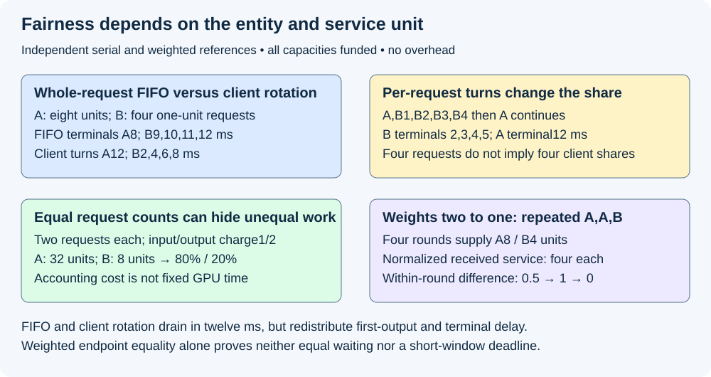
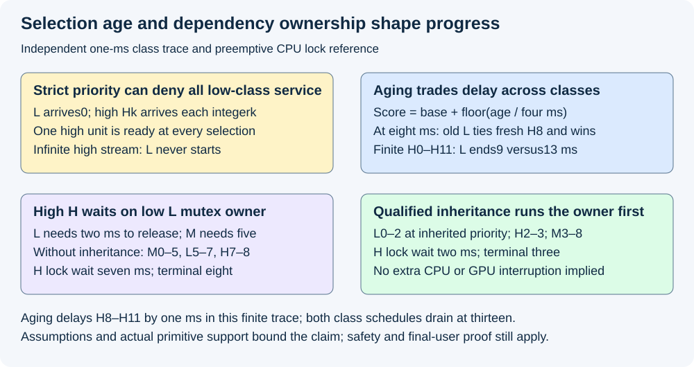

# M5-C16: Fairness, priorities, and starvation prevention

> **Status: Complete — detailed chapter authored and documentation validated; experimental procedures are proposed unless explicitly labelled observed.**

**Module:** Learn scheduling, operating systems, and queueing theory

**Category:** [Scheduling and queueing](index.md)

[Module 5 reading order](../module-5.md) · [Previous: M5-C15](../scheduling-and-queueing/m5-c15-admission-control-and-backpressure.md) · [Next: M5-C17](../scheduling-and-queueing/m5-c17-chunked-prefill-and-resumable-prompt-processing.md)

[Execution plan and progress](../chapter-execution-plan.md)

## Target concepts

FIFO and age-based policies, priority classes, request versus token fairness, weighted budgets, starvation, priority inversion, unknown job sizes, avoiding clairvoyant policies.

## Concepts

### 1. Define who receives which kind of service

**Fairness** is a declared rule for distributing service among competing entities. The entity might be an authenticated client, a tenant, a request or a priority class. A **tenant** is an isolated customer/account domain sharing a service. Equal completed requests, equal output IDs, equal charged work and equal response times are different goals. State the entity, service unit, eligibility, weights, observation interval and permitted deviation before calling a scheduler fair.

A **priority** expresses preference when eligible work competes. A weight expresses a relative share, not necessarily permission to run before everyone else. **Starvation** means eligible pending work can be postponed indefinitely while other work continues. A finite long wait is evidence to investigate, not by itself a proof of indefinite starvation. Conversely, an empty queue or high aggregate throughput cannot prove every client makes progress.

[M5-C15](m5-c15-admission-control-and-backpressure.md) supplies bounded admit/wait/reject domains and funded KV obligations. [M5-C10](m5-c10-utilization-variability-and-tail-latency.md) explains how bursts, variable demand and batching invalidate simplistic latency conclusions. This chapter chooses among work that can execute safely; a preference cannot create memory, shorten accepted output or authorize unsafe reuse. Rust is the host-language context; no scheduler implementation or pseudocode is provided.

A client is **backlogged** when it has unfinished demand at the declared boundary. It is **eligible** for a decision only when its required input/state is ready, capacity is funded and the backend can execute the chosen unit. Keep backlogged-but-blocked clients visible. Otherwise an unfair admission policy could exclude a client forever and claim fairness only among the survivors. A fair execution selector does not automatically establish fair admission, prompt processing, active decode, output delivery or cancellation recovery.

**Work-conserving** here means not idling the chosen resource while safe eligible work it can execute is waiting. It is conditional on dependencies and hard bounds; launching an unfunded request is not required. A reservation that cannot be borrowed can deliberately leave capacity idle for isolation. Such a policy must declare that exception and measure its cost.

### 2. FIFO and service rotation favor different outcomes

**FIFO**, first in first out, orders by a specified acceptance point and tie rule. It is simple and preserves queue order but gives no automatic equality of service between clients with different request counts or sizes. **Head-of-line blocking** occurs when the first item prevents later eligible work from proceeding. A non-preemptive request retains its selected resource until completion; a preemptive or boundary-based policy can choose again at authorized stopping points. In inference, safe iteration boundaries matter: an already submitted GPU operation cannot be assumed interruptible.

Use an independent serial teaching reference with one resource, no overhead and all requests arriving at time zero. Client A has one request needing eight service quanta; client B has four requests B1–B4 each needing one. A **quantum** is the smallest selectable service unit in this reference: one millisecond and one valid output ID. All prompt work is already complete, state is private and funded, and completion follows the last ID immediately. The fixed demands describe the eventual reference trace; the online policy discovers completion as it happens rather than reading these lengths in advance.

FIFO acceptance order is A,B1,B2,B3,B4, and whole-request FIFO finishes a request before choosing another. Client rotation instead gives A one quantum, then B one quantum, repeating while both have demand. Within B use FIFO. After B finishes, A uses the remaining resource. This is an abstract per-client service contract, not a claim about the implementation of a particular inference scheduler.

| Policy | Service order | A terminal | B1–B4 terminals |
|---|---|---|---|
| Whole-request FIFO | A×8, B1, B2, B3, B4 | 8 ms | 9,10,11,12 ms |
| Per-client rotation | A,B1,A,B2,A,B3,A,B4,A×4 | 12 ms | 2,4,6,8 ms |

Both drain at 12 ms and supply twelve units. B's mean arrival-to-terminal improves from **10.5 to 5 ms**; A's terminal worsens from **8 to 12 ms**. A's first ID is at 1 ms under both, whereas B's first visible ID is at 9 versus 2 ms. For a separate common terminal objective ≤8 ms, FIFO has one useful request out of five and rotation has four, assuming all other acceptance conditions pass. A distinct objective protecting A's terminal could favor FIFO. Neither mean, fairness label nor drain time determines the correct product objective.

Equal rotation across individual requests is a third policy. Cycling A,B1,B2,B3,B4 once, then A alone, gives B terminals **2,3,4,5 ms**, while A still ends at 12. B receives four of the first five units because it owns four requests. That may satisfy per-request fairness but not equal per-client service. Splitting a tenant's demand into many requests must not silently multiply its client-level entitlement; authenticate and bound the entity that owns the share.

*Constructed serial histories. Per-client and per-request rotation differ even with identical jobs and total work; a fair share is not a deadline guarantee.*

### 3. Tokens and weighted budgets need a precise charging rule

Request count hides size. In a separate completed reference cohort, A and B each finish two requests. Each A request processes eight prompt IDs and four output IDs; each B request processes two prompt IDs and one output ID. Define a synthetic accounting charge:

**Sᵢ=α×Ninput,ᵢ+β×Noutput,ᵢ**, where Sᵢ is client i's charged service over a named interval, Ninput and Noutput are counted processed input and output events under the policy, and α,β are declared charge units per event.

For this reference Ninput counts prompt positions processed once and Noutput counts valid selected output IDs once; decoding an already charged output ID does not create another prompt charge.

With α=1 and β=2, A receives **2×(8+2×4)=32 units** and B receives **2×(2+2×1)=8 units**. Equal completed requests gives an **80%/20%** charge split. Even “equal tokens” needs qualification: eight prompt events cost eight units here while eight output events cost sixteen. These weights are illustrative accounting choices, not GPU timing ratios. Define whether reused prompts, failed/replayed computation, speculative proposals and reconstruction are charged. Keep resource charges and newly useful client output in separate ledgers; repeated recovery must not masquerade as extra useful service.

The OSDI 2024 paper [Fairness in Serving Large Language Models](https://www.usenix.org/system/files/osdi24-sheng.pdf), by Sheng and colleagues, studies input/output-based service accounting and Virtual Token Counter scheduling under continuous batching. It addresses unknown output length with service counters updated during execution and discusses weighted variants and idle-client treatment. Its proofs depend on its definitions and bounds; our fixtures are independent contracts and do not inherit those guarantees.

For positive client weights wᵢ, define normalized received service **Vᵢ=Sᵢ/wᵢ**. For an ideal divisible resource with a fixed set E of continuously eligible, backlogged clients, weight-proportional reference service is **Srefᵢ=T×wᵢ/(Σⱼ∈E wⱼ)**, where T is total service supplied to that set over the interval. A diagnostic lag is **Lᵢ=Srefᵢ−Sᵢ**; positive lag means less than this scoped reference. Dynamic membership requires piecewise accounting across eligibility changes, not granting a client a share for time it had no demand. This ideal is a comparison, not a feasible GPU schedule or a measured capacity formula.

A separate twelve-quantum reference uses weights A:B=2:1, both continuously eligible, equal one-unit atoms and repeated order A,A,B. At each complete three-unit round, A receives two and B one. After four rounds, **S_A=8,S_B=4,V_A=V_B=4**, with ideal shares eight/four and zero endpoint lag. Within a round, normalized difference V_A−V_B follows **0.5,1,0**. Endpoint equality does not establish zero short-window deviation or equal waiting. A bounded atom size, total eligible weight and explicit scheduling rule are needed before claiming a finite lag/wait bound.

A **budget** gives an entity a named amount of charge over a named period or scheduling round. It is not automatically a physical reservation. Specify charge timing, rounding, debt, maximum indivisible operation, borrowing, carryover and recovery. A large prompt operation may exceed a small remaining budget; deferring it forever would starve it. Permit a qualified bounded overshoot/debt or another supported selection policy, while still passing physical gates. Chunked prefill is developed in M5-C17; do not assume it is implemented to solve this problem here.

Unused share can be lent to other eligible clients to preserve work conservation. Define how an idle client rejoins: allowing unbounded saved credit can cause a return burst that dominates active clients, while forgetting all history after every disconnect can reward identity resets. State the policy's baseline/carryover cap and retain tenant identity; the twelve-quantum example assumes continuously backlogged clients and establishes nothing about idle reentry. Shared batching, context length, cache reuse and workspace change actual resource cost, so test the charge model against profiles rather than equating a token with fixed device time.

### 4. Priority classes and aging need explicit limits

A **priority class** groups requests under an authorized preference, such as interactive versus offline work. A **strict-priority** selector always chooses the highest eligible class. It can protect urgent traffic but give a lower class no service if higher-priority work remains continuously eligible. This is a policy consequence even if the queue is bounded and every capacity counter is correct. Restrict who assigns class, define within-class order, and retain per-class offered/rejected/expired outcomes. Calling all new work urgent defeats the contract.

**Aging** increases preference with waiting age. Age needs a clock anchor: admission wait, execution-ready wait and time since last service are different. Our next independent reference ages from original arrival until dispatch; all pending work is continuously ready/funded. Let base priority p be an integer, age a in milliseconds, and choose score:

**score=p+floor(a/4 ms)**, with larger score preferred and older original arrival winning a score tie. floor rounds downward. This is a teaching rule, not a universal scheduler recommendation.

One low-priority one-quantum request L arrives at 0 with p=0. High-priority one-quantum Hk arrives at each integer k ms with p=2, before selection at that instant. Each quantum lasts exactly 1 ms, there is one resource, and an executing quantum finishes before reselection. Under strict priority and an infinite H stream, L never starts: at every selection another H is ready. This is an analytical starvation witness, not an executed infinite experiment.

Under the aging rule, L's score is one at 4 ms and two at 8 ms. At 8 ms it ties fresh H8, and its older arrival wins. L runs **[8,9) ms** and ends at 9. At 9, H8 is older than fresh H9; H8 runs next. For a separate finite H0–H11 trace, strict priority starts L at 12 and ends it at **13 ms**; aging starts at 8 and ends at **9 ms**. H8–H11 each wait **1 ms** under aging rather than zero; both finite policies drain at 13 ms. Aging trades lower-class delay against higher-class delay without increasing serial capacity.

This witness proves only the stipulated history. A finite guarantee needs assumptions about bounded higher-priority arrival/service, bounded non-preemptive segments, finite earlier backlog, positive available service and resource readiness. Unbounded base priorities, broken dependencies, unavailable KV or blocked output can defeat a simplistic aging claim. A bounded service floor for low-priority work is another possible contract, but requires admission/load conditions and an enforceable budget, not merely a configuration label.

### 5. Priority inversion follows dependencies across layers

**Priority inversion** occurs when high-priority work waits for a resource owned by lower-priority work, and intermediate-priority work delays that owner. A **mutex** gives one holder exclusive access to protected state. Increasing the blocked request's queue priority alone cannot release the resource. The owner must run far enough to satisfy the dependency.

Consider a separate single preemptive CPU reference. Before time zero, L acquired a mutex; at zero it has 2 ms of CPU work remaining before release. H arrives, blocks on that mutex, then needs 1 ms of CPU after acquisition. M is ready at zero and needs 5 ms CPU with no lock. Priorities are H>M>L; there is no overhead, additional blocking or device work. M has higher priority than L, so without inheritance M runs first.

| Contract | CPU intervals from zero | H lock wait / terminal |
|---|---|---|
| No inheritance | M 0–5; L 5–7; H 7–8 ms | 7 / 8 ms |
| Qualified priority inheritance | L 0–2; H 2–3; M 3–8 ms | 2 / 3 ms |

**Priority inheritance** temporarily gives the blocking owner the effective priority of its higher-priority waiter, and removes that inherited preference when the dependency no longer requires it. The [Linux RT-mutex design](https://docs.kernel.org/locking/rt-mutex-design.html) explains this mechanism and dependency chains. This is a specialized locking/scheduling contract; do not assume a Rust mutex, asynchronous task runtime, user-space queue or installed kernel configuration supplies it. Pin the primitive, scheduler, privileges and kernel/runtime version before testing.

Our finite M delays H by five extra milliseconds without inheritance; unbounded intermediate work could produce unbounded inversion under this reference model. Inheritance does not make L's two milliseconds disappear, cure a lock cycle, add CPU or make a submitted GPU kernel safely preemptible. A high-class request can also depend on a low-class completion/retirement worker that returns KV credits. Diagnose that chain and reserve/fund the necessary progress rather than relabeling memory as free. Keep state ownership, final-user completion and cancellation semantics from [M9-C22](../runtime-and-concurrency/m9-c22-verifying-ownership-and-memory-safety-under-concurrency.md).

*Independent histories: aging changes who is selected next; qualified inheritance changes who must run to unblock a waiter. Neither overrides memory safety or in-flight device dependencies.*

### 6. Unknown sizes forbid a future-information advantage

An **online policy** uses only information available at the decision: prompt length, accepted cap, processed/selected counts, age, observed service, class, credits and declared estimates. **Clairvoyant** means knowing the eventual future workload, such as exact remaining output length before stopping. A cap is a maximum, not an exact completion prediction. Past service is observed; total future service is not.

Use two currently indistinguishable work descriptors apart from identity, each with the same class, age, prompt, cap and past service. In world W1 their hidden remaining demands are A=1,B=7 units; in W2 they are A=7,B=1. For an independent serial whole-request reference, shortest-remaining-first with perfect future knowledge completes at **1 and 8**, mean **4.5** units. Choosing the seven-unit request first completes at **7 and 8**, mean **7.5**. An online tie rule choosing A first is short-first in W1 and long-first in W2. That counterexample prevents claiming the oracle's benefit for the same uninformative online observations.

A **size estimate** is a prediction with errors, not an oracle. Declare its training/profiling source, features available at decision time, uncertainty, update/debt rule and treatment of underestimation. Freeze estimates before a comparison; do not use measured completion length to sort the very trace being scored. Oracle/offline results can be labelled diagnostic bounds under their scoped model, never a deployable baseline with equal information. Shortest-job preference also needs long-request protection; a low mean can coexist with starvation or poor per-class coverage.

To validate information flow, pair two traces sharing an identical observable prefix while swapping hidden future demands. Until an actual distinguishing event occurs, a deterministic online selector with the same tie identity must make the same choice. A seeded randomized policy should have the same conditional decision distribution, not choose the short future in both worlds. This test is separate from output equivalence: reordering execution must preserve request/token/random identity and accepted stop rules. Counters and priorities are scheduling state, not permission to change the answer.

## Experiments

All studies are proposed. Only independent reference arithmetic, bounded ordering/identity reasoning and documentation are checked during authorship. No scheduler, simulator runtime, inference server, lock primitive, fault injector or hardware profiler is implemented or executed. For each study, record the prediction before measurement and explain deviations afterward. These experiments study Module 5 scheduling through the HFT concerns of competing latency classes, stale work, bounded blocking and overload; they establish no trading behavior.

### E1 — Compare FIFO, client rotation and request rotation

- **Name:** The fairness entity changes the service order.
- **Description:** First replay A and B's twelve units; then change only the selection entity; finally compare output identity, completion and class objectives.
- **Purpose/objective:** Hypothesis: client rotation limits B's initial delay while request rotation gives B more early service through four requests. Predict all three histories and A's regression. HFT concern: an aggregate improvement can hide a harmed latency class.
- **Target concepts:** FIFO, request versus token/client fairness, unknown sizes and per-class service tradeoffs.
- **Baseline:** One eight-unit A request, four one-unit B requests, all arrival 0; one funded serial resource, 1-ms/one-ID atoms and no overhead. Selection sees observed progress only.
- **Workload:** Exact three histories; separately split/coalesce B demand, unequal context costs, non-preemptive prompt work and one blocked output consumer. Independent variable: fairness entity or one eligibility/cost assumption per separate cell.
- **Controlled variables:** Tenant identity, FIFO within B, accepted model/output/cap/stop/random contract, total offered demand, capacity and safe selection boundaries.
- **Hardware requirements:** CPU reference review first; later qualified host/device scheduler with supported iteration boundaries, client-visible ID and physical-completion evidence.
- **Exit criteria:** Reproduce A terminal 8/12/12 ms; B terminals 9/10/11/12 versus 2/4/6/8 versus 2/3/4/5. FIFO/client rotation both drain 12 with B mean 10.5/5 ms and ≤8-ms useful counts 1/4 of five. Detect changed answer, unaffordable scheduling or claims that equal per-request selection establishes equal client share.

### E2 — Audit token charges and weighted budgets

- **Name:** Equal counts and equal normalized service answer different questions.
- **Description:** First calculate the two-request-per-client charge ledger; then inspect every prefix of weighted A,A,B rounds; finally challenge idle reentry, oversized atoms and entity resets.
- **Purpose/objective:** Hypothesis: equal completed requests can hide an 80/20 charge split, while weights 2:1 give equal normalized service only at declared round endpoints. HFT concern: service promises and actual resource costs need separate accounting.
- **Target concepts:** Request versus token fairness, weighted budgets, starvation from indivisible work and unknown costs.
- **Baseline:** α=1/β=2 charge, A input 8/output 4 and B input 2/output 1 per request, two requests each; separate twelve one-unit atoms, continuously eligible weights 2:1 and repeated A,A,B.
- **Workload:** Exact cost/round histories; separate prompt versus output, cache hits, recomputation, cold reentry, cancelled work, changed weight, oversize atom and multiple request IDs under one tenant. Vary one charge/carryover/eligibility rule at a time.
- **Controlled variables:** Service unit, weight authority, interval/membership, maximum atom/overshoot rule, physical capacity, accounting identity, no unbounded saved idle credit and unchanged output utility.
- **Hardware requirements:** CPU count/share references; later event-attributable scheduler and qualified profiles of mixed prompt/decode/context/copy behavior, with actual model/GPU manifest.
- **Exit criteria:** Reproduce 32/8 charges, 80/20 split, 8/16 prompt/output event charges, weighted 8/4 service and normalized 4/4 with prefix difference 0.5/1/0. Detect double charging, unbounded idle catch-up, starvation of an unaffordable atom, or a token share claimed as a GPU-time or memory guarantee.

### E3 — Challenge starvation, aging and priority inversion

- **Name:** Progress requires both a selection rule and its dependencies.
- **Description:** First audit the infinite strict-priority witness analytically; then replay finite H0–H11 with/without aging; finally compare the separate CPU mutex histories and follow delayed completion dependencies.
- **Purpose/objective:** Hypothesis: strict class preference can starve L, aging trades class delay under bounded assumptions, and inheritance helps only a qualified owner dependency. Predict L 9 versus 13-ms terminal and H 2/3 versus 7/8-ms lock-wait/terminal. HFT concern: urgent work may depend on lower-class cleanup.
- **Target concepts:** Priority classes, age-based policies, starvation, priority inversion and limits of service guarantees.
- **Baseline:** Hk at integer k before selection, pH=2/pL=0, 1-ms atoms; score=p+floor(age/4 ms), oldest arrival tie. Separate H>M>L CPU/lock case with 2/5/1-ms remaining L/M/H work.
- **Workload:** Finite twelve-H trace and dependency graph; separate equal-score tie, unbounded class assignment, unavailable memory, non-preemptive device work, owner cancellation and worker loss. Change one assumption per negative case.
- **Controlled variables:** Arrival/age anchor, class authority, quantum/preemption capability, stable identity, bound scope, final-user proof and actual inheritance support; no claim that host boosting interrupts GPU work.
- **Hardware requirements:** CPU paper reference first; later isolated authorized scheduler/lock environment with documented kernel/runtime/primitive support, CPU affinity/priority permissions and bounded fault teardown.
- **Exit criteria:** Show inductively why L never starts under the infinite strict H stream; reproduce finite strict L[12,13) versus aged[8,9), four H waits increased by 1 ms, both drain 13. Reproduce CPU histories ending 8 ms with H wait 7 versus 2 and terminal 8 versus 3. Reject unconditional aging/priority-inheritance claims when their dependency or resource assumptions fail.

### E4 — Qualify online decisions and end-to-end service

- **Name:** A scheduler must not read the future trace.
- **Description:** First swap hidden 1/7 demands behind identical observable prefixes; then compare declared online policies on fixed multi-client text traces; finally examine offered/class useful service, lag, memory and recovery.
- **Purpose/objective:** Hypothesis: one deterministic first choice cannot be shortest-first in both hidden worlds; a favorable mean or share index alone cannot certify useful service. HFT concern: policy evaluation must not benefit from information unavailable in production.
- **Target concepts:** Unknown job sizes, avoiding clairvoyant policies, weighted/client fairness, aging and priority-class tradeoffs.
- **Baseline:** W1 A1/B7 and W2 A7/B1 remaining-unit reference; same observations/tie identity. Real comparisons use a declared FIFO or fair baseline with matched model/output and funded capacity.
- **Workload:** Prompt/cap/realized-length/reuse classes, tenant skew and splits, burst/sustained load, high-class saturation, idle-return and blocked-consumer/fault traces. Vary policy or estimator separately; freeze online features before evaluation.
- **Controlled variables:** Eligible offered cohort, authenticated weights/classes, reference output/quality, initial counters, seed, physical limits, source trace, reset/warmup/drain and absence of future-length leakage.
- **Hardware requirements:** CPU prefix/reference audit; later qualified client/server CPU/network/GPU manifest and reliable decision-input, charge, latency, allocation and lifetime records.
- **Exit criteria:** Reproduce oracle 1/8 mean 4.5 and long-first 7/8 mean 7.5; deterministic identical-prefix first choice stays fixed across worlds. Require correct output/lifetimes plus per-client/class offered attainment, normalized service/lag, wait/gap distributions, blocked/rejected/unresolved accounting and bounded recovery before any fairness/capacity claim. No universal p99 or starvation guarantee follows from a finite successful benchmark.

## Verification

| Study | Exact reference / correctness | Measurements and comparison | Acceptance limit |
|---|---|---|---|
| E1 | Three selection histories, private funded state and same output IDs | Client/request service prefixes, first ID and terminals | Aggregate drain or request rotation does not prove client fairness |
| E2 | Charge 32/8, weighted 8/4 and normalized 4/4; scoped membership | Charge error, normalized lag, overshoot and idle return | Token charge is not fixed physical resource time |
| E3 | Aging/tie witness and separate mutex dependency histories | Age, eligible wait, blocking owner and preemption events | Claims require bounded arrivals/atoms and actual supported primitives |
| E4 | Identical-prefix information contract and hidden-world arithmetic | Offered/class usefulness, estimates, tail, memory and recovery | An oracle or successful-only mean is not an online service result |

Exact reference histories use integer counts, rational charges and fully ordered events, with no numerical tolerance. For actual inference validate model/tokenizer/adapter/template, valid-prefix KV, token IDs, stopping/caps and random identity under [M9-C19](../interfaces-protocols-and-streaming/m9-c19-validating-tokenization-stopping-and-final-output.md). Reordering rows or changing selection must not cross tenant data, duplicate outputs or reset random draws. Choose exact, numerical or distributional output comparison according to the declared backend promise; scheduling preference never licenses a lower-quality answer.

Record tenant/logical-request/attempt identity, authorized class/weight, immutable policy version, decision time, age anchor, current eligible/backlogged/blocked set, consumed/pending charge, chosen atom and all input features available then. Record enqueue/admission/ready/selection/submission/completion/commit, first and subsequent client-visible ID times, terminal, credit return and final-user retirement. Reconstruct the decision from that snapshot without future output lengths. A failed submission needs explicit charge rollback or retained debt under the policy; safe memory release needs its own evidence under [M9-C22](../runtime-and-concurrency/m9-c22-verifying-ownership-and-memory-safety-under-concurrency.md). A cancelled request can leave device users; a fairness counter cannot erase those claims.

Use compatible monotonic clock boundaries under [M9-C02](../measurement-experimentation-and-economics/m9-c02-request-events-clocks-and-measurement-boundaries.md). Queue age is current time minus the declared entry anchor. Eligible wait excludes explicitly recorded blocked intervals only for its conditional metric; also report total user waiting and blocked duration, so exclusion cannot conceal denied service. A time since last grant can diagnose progress gaps even before a terminal is observed. For each fixed or piecewise eligible set, report service/weight, short-window maximum lag and grant gaps alongside total charges. Do not compare cumulative counters with different reset times as though they share a common origin.

Under [M9-C06](../measurement-experimentation-and-economics/m9-c06-defining-slos-goodput-and-useful-capacity.md), report client/class offered, admitted, waiting, rejected, expired, failed, cancelled, finished and unfinished/unknown outcomes and joint first-output/gap/terminal/quality acceptance. Show one-client, aggregate and per-class distributions. A rejected or no-output attempt has no first-token latency, not a zero one. Slowdown, if reported, is response divided by an explicitly defined isolated/reference demand; do not estimate that denominator from the same contended response. Report recovery/recomputation resource demand separately from newly useful IDs.

For E4, a proposed descriptive starting budget is 20 paired reset sessions per named policy/workload/load cell, balanced arm order, one full scratch-trace warmup per arm, and a fixed documented drain/fault cutoff. Restore tenant counters, prefix/adapter state and membership rules consistently; also run separately declared idle-return and live-migration histories rather than silently resetting away debt. Preserve failures and all sessions. Pairs/sessions are replication units; adjacent tokens/requests share queues and are not independent trials.

Freeze correlations among tenant, priority, prompt, accepted cap, actual stopping, context, arrivals and reuse with [M9-C08](../measurement-experimentation-and-economics/m9-c08-designing-representative-serving-workloads.md). Qualify intended/actual arrivals and generator capacity with [M9-C09](../measurement-experimentation-and-economics/m9-c09-open-loop-load-generation-and-coordinated-omission.md) and [M9-C10](../measurement-experimentation-and-economics/m9-c10-validating-the-load-generator-and-request-accounting.md). A closed-loop client slows its own offered arrivals when service worsens; disclose that feedback rather than treating it as a matched fixed trace. Tune weights/aging/estimators on separate traces, then confirm under [M9-C11](../measurement-experimentation-and-economics/m9-c11-controlled-comparisons-warmup-and-reproducibility.md) and [M9-C27](../measurement-experimentation-and-economics/m9-c27-designing-regression-experiments-and-validation-gates.md).

Twenty pairs are a starting descriptive budget, not sufficient by definition for p99 or rare starvation/failure claims. Preserve ordered observations and uncertainty under [M9-C07](../measurement-experimentation-and-economics/m9-c07-latency-distributions-and-statistical-uncertainty.md); extend fresh confirmation if tail support is inadequate. For the deterministic E1–E3 fixtures, exact histories and negative cases provide semantic checks without pretending repeated arithmetic creates statistical evidence. Real liveness bounds require stated assumptions/proof obligations plus dependency/fault tests; finite tests can falsify a guarantee but cannot prove arbitrary future progress.

Profile short separate diagnostic runs to attribute selector/counter cost, lock contention, CPU ready delay, wakeup, prefill/decode execution, copying/reconstruction and output stalls. A profile identifies contributors, not clean timing; compare instrumentation overhead on matched unprofiled runs. Record occupied/reserved/Retiring/shared KV, pool/graph/workspace/output backing and peaks under [M9-C15](../state-memory-and-caching/m9-c15-accounting-for-weights-kv-state-workspace-and-fragmentation.md). Service-share counters alone cannot identify a memory bottleneck, a GPU preemption capability or a safe recovery budget.

## Engineering dimensions and principles

| Dimension | Chapter application and check |
|---|---|
| Semantics and invariants | E1/E4 fix tenant/output identity; preference cannot change accepted caps or answers |
| Workload and variability | E1/E4 vary request splitting, length, bursts, reuse and class skew; scope is text |
| Resources and bottlenecks | E2 separates charge from real GPU/CPU/memory cost; E3 follows blocking owners |
| Time and distributions | E1/E3 compare first output, terminal and class delay; E4 retains long/unresolved waits |
| Ownership and coordination | Counter/class authority and request/worker lifetimes survive cancellation and reentry |
| Failure and adaptation | E2–E4 challenge idle resets, denied growth, stale state, worker loss and recovery debt |

| Engineering principle | Concrete application |
|---|---|
| 1. Correctness defines the optimization boundary | All policy comparisons preserve references, stop/random identities and safe lifetimes |
| 2. Performance depends on workload and operating point | FIFO/rotation and aging trade outcomes across clients, classes and load cells |
| 3. Data movement is part of the algorithm | Shared KV, context reads, copy/reconstruction and output stalls qualify token cost |
| 4. State has ownership, lifetime and recovery cost | Idle counters, pending charges, blocked owners and Retiring allocations need distinct rules |
| 5. Dependencies determine latency; bottlenecks determine capacity | Priority inheritance follows the owner chain; a preference cannot fund missing state |
| 6. Variability and synchronization shape the tail | Bursts and indivisible work create wait spikes even at equal endpoint normalized service |
| 7. Local improvements require end-to-end evaluation | More equal shares or a lower mean cannot replace offered/class joint service |
| 8. Claims require reproducible evidence | E1–E4 declare observable features, policy contracts, exact references and qualified metrics |

The HFT lens transfers disciplined class isolation, bounded dependency blocking, tail-aware policy evaluation and avoidance of hindsight. Text generation adds unknown output lengths, shared causal state and stream correctness; a fairness charge is not a trading entitlement or measured execution result. No exchange rule or financial claim follows. Module 9 supports Modules 1–7; Module 8 and non-text modalities are excluded.

## Specifications, articles, and hardware

The linked OSDI24 paper (2024) and Linux RT-mutex design documentation were reviewed on 2026-10-29. The paper supplies a concrete inference-fairness research context; Linux supplies specialized priority-inheritance semantics. Our serial rotations, α/β charges, A,A,B rounds, aging score and CPU timeline are explicitly independent specifications. No proof, benchmark number, kernel configuration or production setting from those sources is asserted for InferX. Pin any actual backend scheduler/runtime/primitive and its supported boundaries before conducting the studies.

No actual machine was supplied or benchmarked. CPU-only reference arithmetic needs no GPU and cannot establish scheduling overhead, device throughput or tails. A hardware study must record generator/server CPU model, core/SMT counts, NUMA/RAM, affinity/quotas, OS/kernel/scheduler configuration, Rust/compiler/runtime, mutex/task primitive and allowed scheduling privileges; record client/server network capacity and topology. For inference include GPU model/architecture/count/VRAM, driver/backend/runtime, power/clocks/temperature and interconnect; model/weights/adapter/tokenizer/template/corpus hashes, attention/KV layout/precision and prompt/output/context limits.

Record authenticated tenant/class/weight policy, accounting coefficients, budget period/round/overshoot/carryover rules, admission/queue and future-memory bounds, maximum selectable operation, batch/graph/workspace/output limits, initial counters, idle/recovery behavior, clocks and overhead. The 1-ms atoms, twelve-unit rounds and 2/5/1-ms CPU demands are constructed reference specifications, not hardware capabilities or measured results. Actual mixed batches need profiling and end-to-end evidence before a token-cost model can support a resource or latency claim.

## Key takeaways

Name the fairness entity and service unit before choosing a policy. Equal requests, equal charged service and protected latency classes have different outcomes. Weighted budgets and aging need eligibility, atom-size and recovery assumptions; priority inversion follows the resource owner. Evaluate online policies with information available at decision time and preserve offered/class outcomes alongside service-share diagnostics.

## Continue learning

Next in Module 5 reading order is completed [M5-C17: Chunked prefill and resumable prompt processing](m5-c17-chunked-prefill-and-resumable-prompt-processing.md). The next authoring chapter is [M5-C18: Choosing chunk sizes and balancing prefill with decode](../scheduling-and-queueing/m5-c18-choosing-chunk-sizes-and-balancing-prefill-with-decode.md), position 125. Follow the [execution plan and progress tracker](../chapter-execution-plan.md); Module 9 supports Modules 1–7 and Module 8 is excluded.
