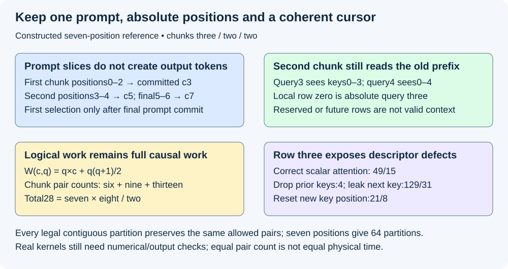
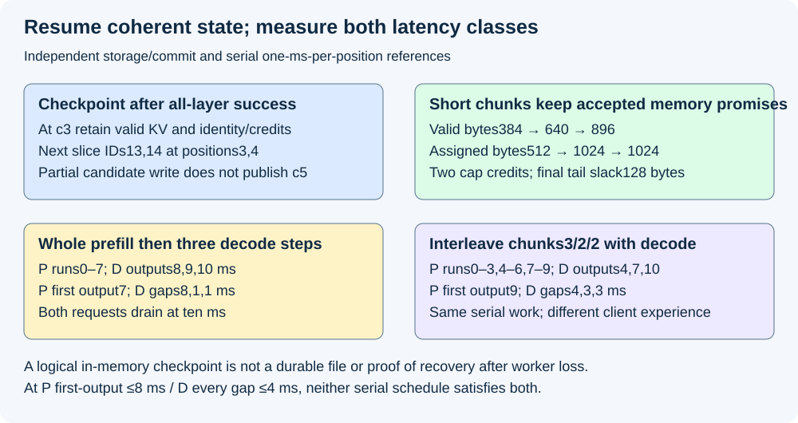

# M5-C17: Chunked prefill and resumable prompt processing

> **Status: Complete — detailed chapter authored and documentation validated; experimental procedures are proposed unless explicitly labelled observed.**

**Module:** Learn scheduling, operating systems, and queueing theory

**Category:** [Scheduling and queueing](index.md)

[Module 5 reading order](../module-5.md) · [Previous: M5-C16](../scheduling-and-queueing/m5-c16-fairness-priorities-and-starvation-prevention.md) · [Next: M5-C18](../scheduling-and-queueing/m5-c18-choosing-chunk-sizes-and-balancing-prefill-with-decode.md)

[Execution plan and progress](../chapter-execution-plan.md)

## Target concepts

Splitting prompts into token chunks, partial-prefill state, cache positions, causal dependencies, mixing prefill and decode, semantic equivalence, checkpointing progress within a request.

## Concepts

### 1. A chunk is a consecutive part of one prompt

**Prefill** processes prepared prompt IDs through the model and establishes their per-layer attention keys and values, called KV. **Chunked prefill** divides that work into consecutive ranges processed in separate forwards while retaining earlier KV. A **forward** applies the model to specified new input positions. Chunking is a scheduling transformation: it does not split one user request into unrelated prompts or tokenize each piece independently.

Use [M1-C18](../runtime-and-concurrency/m1-c18-understanding-prefill-and-decode.md) for first-output/decode progression, [M2-C19](../runtime-and-concurrency/m2-c19-connecting-block-allocation-to-the-request-generator.md) for all-layer publication and safe growth, and [M5-C13](m5-c13-budgeting-work-for-each-execution-iteration.md) for independent token/sequence/shape/memory gates. Rust is the host-language context. No engine, scheduler, attention kernel or checkpoint implementation is provided.

Assume one nonempty text prompt per request, fixed model/tokenizer/template/adapter, deterministic inference with dropout disabled, full causal attention, compatible private KV and no speculation or beam branches. Position operations and normalization must obey the model's inference semantics; do not assume arbitrary sequence-global or batch-dependent operations are separable. Sliding-window/hybrid/MLA representations need their own verified retention contract. Here **P** is prepared prompt length and **c** is the committed prompt prefix length: positions [0,c) have completed every layer. A half-open range includes its start and excludes its end.

A selected chunk of **q** new prompt positions is [c,c+q), with **0<q≤P−c**. After a successful all-layer commit, **c′=c+q**. The next chunk consumes exactly that next range. Disjoint chunk ranges cover [0,P) once, in order. Replaying a committed slice through an append interface would duplicate positions; skipping a slice leaves a hole. A queued or submitted chunk does not advance c merely because host submission returned.

Use prepared IDs [10,11,12,13,14,15,16], P=7, partition [3,2,2]. These are control-flow labels, not vocabulary/model predictions. The output cap is G=1; the final prompt logit row selects one valid ID under a separately specified selection rule. All earlier prompt logits are intermediate predictions conditioned on incomplete prompts; this generation contract emits none of them.

| Completed chunk | New prompt positions | Committed c | Selected output IDs |
|---|---|---:|---:|
| None | None | 0 | 0 |
| First, q=3 | 0,1,2 | 3 | 0 |
| Second, q=2 | 3,4 | 5 | 0 |
| Final, q=2 | 5,6 | 7 | 0 before selection; 1 afterward |

A prompt cursor is not a selected-output count. At c<P no ordinary decode input exists for this request. After final prefill commits c=P, selection chooses the first output; if nonterminal and more output is required, that selected ID is the next decode input at position P. After n≥1 selections in ordinary non-speculative generation, valid processed length is **v=P+n−1**, under M1-C18's boundaries. A final selected ID need not be ingested. With G=1, this request has three prefill forwards, zero subsequent decode forwards, seven processed positions and one selected ID. G=0 follows the earlier no-forward/no-selection policy rather than creating empty chunks.

### 2. Preserve absolute positions and the whole causal prefix

At local row r of a q-position chunk, r=0…q−1, the query's absolute position is **i=c+r**. Its allowed key positions are **0≤j≤c+r**. That includes the old prefix plus earlier/current rows of this chunk and excludes later rows. The current layer can read ready candidate KV for its own chunk while the request's public c still denotes the previous all-layer prefix. Waiting for request-level commit before this layer's attention could read its own new keys would create a circular dependency.

The logical attention rectangle has q query rows and c+q candidate key columns, but its causal mask excludes future columns. A mask is the rule deciding which keys each query may read. A q×q triangular mask without accounting for the old-prefix offset is insufficient. For the second chunk c=3,q=2, query 3 may read keys 0–3 and query 4 keys 0–4; neither uses a new position numbering 0–1. Valid KV length is not the allocated block capacity or a row index in a packed multi-request buffer.

The versioned [Transformers v4.50.0 caching specification](https://huggingface.co/docs/transformers/v4.50.0/en/cache_explanation) describes combined old/new KV, compatible attention-mask lengths and logical insertion positions. Actual cache-position, padding, rotary/absolute-position and backend mask conventions must be translated explicitly; this chapter does not copy one library's tensor convention into every model.

For full causal attention, the logical count of allowed query/key-position pairs for this chunk is:

**W(c,q)=qc+q(q+1)/2.**

For partition 3/2/2, the counts are **W(0,3)=6**, **W(3,2)=9**, **W(5,2)=13**, total **28=7×8/2**. Splitting has not removed any required causal pair. This proxy is not FLOPs, physical HBM bytes or elapsed time. Kernels can pad, reuse data differently, repeat weight reads, allocate temporary storage or pay more launches after chunking. The physical cost can change even when logical model work is equivalent.

A **semantic equivalence** argument proceeds by dependencies. At the first layer, each new row sees the same token/position input and required old/current keys as unchunked causal execution. Assuming that layer's computation agrees, its row output and KV agree; the argument extends through later layers and subsequent chunks. Earlier rows have no future dependencies under these assumptions, so they need not be recomputed. This is a real-arithmetic/model-semantics argument, not a bitwise guarantee for every finite-precision kernel or reduction order. Backend-specific numerical and output checks remain necessary.

*Seven prepared IDs remain one prompt. Chunk boundaries alter scheduling, not causal reach or output-selection count.*

### 3. A small attention reference exposes mask and position errors

Use a separate one-dimensional attention-only mathematical fixture, not a full decoder or the scripted IDs' model. At absolute position j=0…6 choose key Kⱼ=j and value Vⱼ=j+1. Every query Qᵢ=ln2, where ln is natural logarithm; scale is one. Softmax, the normalized exponential weighting of eligible scores, gives exp(QᵢKⱼ)=2ʲ. The correct row output is therefore:

**hᵢ=[Σⱼ₌₀…ᵢ 2ʲ(j+1)]/[Σⱼ₌₀…ᵢ 2ʲ]=[i×2⁽ⁱ⁺¹⁾+1]/[2⁽ⁱ⁺¹⁾−1].**

This finite geometric-sum reference gives rows 0–6 as **1,5/3,17/7,49/15,129/31,107/21,769/127**. Unchunked execution and every legal contiguous partition must expose the same eligible pairs and row results. Seven positions have six interior boundaries, each either a split or not: **2⁶=64** possible partitions, including all-one and unchunked. This is a bounded exhaustive partition check for the fixture, not a proof for every model/backend.

For query 3 in the second chunk, correct h₃=49/15. Dropping the old prefix leaves only its self-value 4, which differs. Letting query 3 read the next row's future key 4 yields **129/31**, also wrong. If only the new row's key is incorrectly reset from K3=3 to K3=0 while earlier keys remain 0/1/2, the weights become 1/2/4/1 and the output becomes **21/8**. These distinct negative references diagnose context, masking and position defects. The fixture has externally specified keys/values and no logit head or selection rule; it cannot establish whole-model token equivalence by itself.

For an actual model, compare per-layer valid KV and final prompt logits against whole-prefill reference behavior at the same absolute positions. Preserve a conditional generated prefix when diagnosing numerical drift rather than allowing an early different sample to change every later input. [M9-C17](../numerics-and-correctness/m9-c17-comparing-logits-with-justified-numerical-tolerances.md) supplies justified numerical bounds; [M9-C19](../interfaces-protocols-and-streaming/m9-c19-validating-tokenization-stopping-and-final-output.md) supplies output identity and stopping. Do not relax tolerances after seeing a faster candidate fail.

### 4. A resumable checkpoint is a coherent committed state

A **checkpoint** here is a logical, retained in-memory state from which this attempt can continue at a safe chunk boundary. It is not a durable file, cross-machine migration format or recovery guarantee after worker loss. Saving just c=3 is insufficient if its model/KV/table ownership no longer exists.

Retain immutable prepared prompt and model/adapter/tokenizer/template/position identity; committed c; every layer's compatible valid prefix; protected block-table/representation version and generation; growth credits and physical claims; request/attempt/worker epoch; output/stop/selection/random state; and outstanding access/cleanup obligations. An epoch is a version separating old worker/pool evidence from the current owner. The checkpoint publication must bind these fields coherently. At c=3 the next slice is IDs[13,14] at positions 3/4; selected output count and generation RNG draws remain zero.

Use an independent storage reference with 128 bytes of all-layer KV per position, four positions per block and 512 bytes per block, as in M2-C19's synthetic conventional layout. For P=7,G=1, conservative full-cap admission needs **ceil((P+G)/4)=2 block credits**. Start with a six-slot pool, one withheld headroom slot, no other requests and **O/R/H/U=0/2/1/3** after reservation. O denotes occupied slots, R funded future slots, H headroom and U uncommitted. These partition pool backing, not additional physical allocations.

| Commit boundary | c / valid rows by block | Occupied / future credits | Valid / assigned bytes |
|---|---|---|---|
| First chunk | 3 / [3] | 1 / 1 | 384 / 512 |
| Second chunk | 5 / [4,1] | 2 / 0 | 640 / 1,024 |
| Final chunk | 7 / [4,3] | 2 / 0 | 896 / 1,024 |

The full pool backing remains **6×512=3,072 bytes**; final assigned tail slack is 128 bytes. Neither the next unused row nor a reserved slot is valid KV. At position p, logical block=floor(p/4), row=p mod 4. Position 3 is block 0/row 3; position 4 is block 1/row 0 even if physical slots are noncontiguous. Scheduling a short chunk does not itself reduce the accepted future-cap reservation.

All-layer success publishes the new c once. If the second chunk has written candidate positions 3/4 in some layers and then fails, the baseline publishes neither c=5 nor an output. A checkpoint at c=3 remains usable only if old committed rows are intact and candidate accesses are drained or isolated under the backend's supported retry contract. A private invalid tail can be discarded after its final users, but do not overwrite shared or still-read state. This chapter does not assume transparent retry after arbitrary device failure; failure may terminate the attempt instead.

A duplicate completion must not advance c twice, resample or release credits twice. A stale result from a lost worker epoch cannot modify a replacement attempt. Cancellation closes future chunks, preserves already committed output and retains submitted access claims until completion/quarantine. At final c=P but before first selection, a resume needs the correct final logit row or explicitly qualified reconstruction without duplicate append; preserve any pending random draw/selection commit. An intermediate chunk never authorizes a premature user-visible “first token.”

### 5. Mix independent requests without breaking one request's dependency chain

One request's later chunk depends on its earlier committed state; independent requests can share a supported iteration. **Mixed prefill/decode** means processing a prompt chunk for one request alongside one new cached input for another, with separate positions, masks and ownership. A packed buffer concatenates rows physically; logical request boundaries still isolate attention. Not every kernel/graph supports every mix. Reject or use a separately qualified fallback before submission rather than reinterpret a decode-only graph.

For a descriptor-only example, let request P have prompt partition 3/2/2 and D be a different already decoding request with eight valid positions and one pending selected ID. Query cap Rmax=4 and sequence cap Nmax=2; assume shape, lifetime, future capacity and workspace gates also pass. One decode input is processed for D in each iteration:

| Iteration | P old c / new q | D old valid / new q | Total query positions |
|---|---|---|---:|
| 1 | 0 / 3 | 8 / 1 | 4 |
| 2 | 3 / 2 | 9 / 1 | 3 |
| 3 | 5 / 2 | 10 / 1 | 3 |

P becomes prompt-complete only in iteration 3. D valid length advances 8→9→10→11; its selected count follows its separate prompt/history contract. There are ten processed query positions and four newly selected IDs across the three iterations: P's first plus D's three subsequent IDs. D's pre-existing selected ID is not newly produced here. This is descriptor accounting, not a timing model. With Rmax=4, P's whole seven-position prefill would fail that same per-step gate. A valid performance baseline must explicitly allow an executable whole-prefill configuration; comparing against an impossible rejected operation as though it ran fast or slow is invalid.

The OSDI 2024 work [Sarathi-Serve](https://www.usenix.org/conference/osdi24/presentation/agrawal) studies chunked prefills and schedules that accommodate ongoing decode. The [vLLM V1 optimization guide](https://docs.vllm.ai/en/stable/configuration/optimization/#chunked-prefill) describes batching decode and prefill chunks under a query-token budget. These motivate the design space; defaults and backend behavior need pinned versions. Their results are not measured evidence for our fixtures, and “mixed” does not by itself prove useful overlap or a faster kernel.

### 6. Smaller interruption units change latency tradeoffs

Use a separate serial timing reference to isolate scheduling order. This is neither the Rmax=4 descriptor case nor a calibrated mixed GPU batch. All work is funded, the backend can run whole or chunked prefill, there is no query cap preventing either, and no launch/selection/transport overhead. Processing each prompt position or D decode input takes exactly 1 ms serially. P arrives at 0 with seven prompt positions and cap 1. D's prior visible output is at 0, followed by three required decode steps. Outputs are visible immediately at the end of the appropriate operation; final required selection ends the request.

Whole prefill occupies P[0,7), then D[7,8),D[8,9),D[9,10). Chunk interleaving uses P[0,3),D[3,4),P[4,6),D[6,7),P[7,9),D[9,10).

| Reference order | P first output / terminal | D new outputs | D gaps from prior output 0 |
|---|---|---|---|
| Whole prefill then decode | 7 / 7 ms | 8,9,10 ms | 8,1,1 ms |
| Chunk interleaving | 9 / 9 ms | 4,7,10 ms | 4,3,3 ms |

Both process ten positions and drain at10 ms. Interleaving lowers D's maximum gap **8→4 ms** while delaying P's first output **7→9 ms**. It has not created serial capacity. For stipulated P first-output≤8 ms and D every-gap≤4 ms, whole-prefill passes P/fails D, while interleaving fails P/passes D; neither passes both. These are exact reference classifications, not hardware SLO findings. A mixed GPU implementation may change elapsed costs through batching, weight reuse and extra launches, so actual benchmarks must measure them.

A first selection for P still waits for its entire causal prompt. Small chunks can increase launch/counter overhead, fragmentation of scheduling work, repeated weight movement or time waiting between chunks. Large chunks can delay already admitted decode and consume workspace. A fixed token count does not fix cost when context, kernel or batch membership changes. [M5-C18](m5-c18-choosing-chunk-sizes-and-balancing-prefill-with-decode.md) will develop tuning; this chapter establishes the progress/equivalence contract rather than recommending a universal chunk size.

*Independent state/storage and serial timing references. Prompt progress is published after all-layer success; interleaving trades first-output and decode-gap behavior.*

## Experiments

All studies are proposed. Authorship performs reference arithmetic, causal/identity/lifetime review and documentation checks only. No model server, allocator, checkpoint runtime, mixed kernel, fault injector or hardware benchmark is implemented or executed. Record a prediction before each measurement and explain discrepancies afterward. The Module 5 focus is safe scheduling boundaries; the HFT lens is bounded interruption, coherent retained state and competing latency obligations, not trading results.

### E1 — Verify chunk coverage and causal equivalence

- **Name:** Chunk boundaries must preserve every required predecessor.
- **Description:** First audit partition 3/2/2 and its mask; then compare all 64 legal partitions in the scalar attention fixture; finally apply the same checks to a pinned causal model against whole prefill.
- **Purpose/objective:** Hypothesis: valid contiguous chunks preserve 28 causal pairs and exact fixture rows; dropping context, leaking future keys or resetting positions breaks equivalence. HFT concern: bounded work segments must preserve the meaning of the full operation.
- **Target concepts:** Prompt splitting, cache positions, causal dependencies and semantic equivalence.
- **Baseline:** P=7, c=0→3→5→7, no padding/sharing/speculation; separate one-dimensional Q=ln2,Kj=j,Vj=j+1 full-causal reference.
- **Workload:** All 64 contiguous partitions, row 3 negative mask/context/key cases, future-token perturbation and crossed-request identity. Independent variable: partition or one deliberately invalid descriptor per separate case.
- **Controlled variables:** Fixed prepared prompt/model/positions/attention, no training dropout, supported cache representation, precision and predeclared numerical/output comparator.
- **Hardware requirements:** CPU exact rational/pair reference first; later pinned model/backend and per-layer KV/logit diagnostics on supported CPU/GPU hardware.
- **Exit criteria:** Reproduce 6+9+13=28, all seven row fractions, row 3 correct 49/15 versus 4,129/31 and 21/8 faults. No gaps/duplicates/future keys; actual model must pass valid-KV/logit and output checks at the same causal prefixes, without assuming bit identity across changed kernels.

### E2 — Audit checkpoint, block growth and failure publication

- **Name:** A cursor without its all-layer state is not a resume point.
- **Description:** First reconstruct each boundary's IDs/positions/valid rows and credits; then pause/resume at c=3/c=5; finally challenge partial-layer failure, cancellation, duplicate completion and stale worker epochs.
- **Purpose/objective:** Hypothesis: coherent committed checkpoints resume the next slice once, while submitted candidate state cannot be published early. Predict cursor/storage tables. HFT concern: recovery must preserve both state identity and outstanding obligations.
- **Target concepts:** Partial-prefill state, cache positions, checkpointing progress and semantic equivalence.
- **Baseline:** Scripted seven-ID control trace, G=1, private 128-byte positions/four-row 512-byte blocks, six-slot pool and after-admission O/R/H/U=0/2/1/3; all-layer publication authority.
- **Workload:** Exact 3/5/7 commits, c=3 next IDs 13/14 at 3/4, failure during chunk 2, duplicate/stale completion, final-forward-before-selection failure and cancellation with late readers. Change one fault/ownership boundary at a time.
- **Controlled variables:** Immutable prompt/model/representation identity, public versus private layer readiness, intact old KV, final-user claims, cap/selection/random contract and explicitly supported retry or terminal policy.
- **Hardware requirements:** CPU state/byte reference first; later isolated allocator/model with protected table generations and qualified read/write completion/quarantine support.
- **Exit criteria:** Reproduce valid 384/640/896 and assigned 512/1024/1024 bytes, two full-cap credits, pool 3072 bytes and tail 128. Partial failure leaves public c=3 and no premature selection; resume/reconstruction cannot double-append or redraw a committed selection. Unknown completion never authorizes reuse or durable-checkpoint claims.

### E3 — Qualify mixed iteration descriptors

- **Name:** Packed rows remain separate causal histories.
- **Description:** First reconstruct the three P/D descriptors; then vary packed order and boundary shapes; finally challenge unsupported modes, unfunded growth and cross-request cache mappings.
- **Purpose/objective:** Hypothesis: query/sequence limits permit the stated mix only with correct individual contexts, shape support and physical peaks. Predict totals 4/3/3 and ten processed versus four newly selected IDs. HFT concern: shared execution must not confuse independent state or hide an unfunded promise.
- **Target concepts:** Mixing prefill/decode, partial-prefill state, positions and causal dependencies.
- **Baseline:** P chunks 3/2/2 with D one new input per step, D valid 8→9→10→11, Rmax=4/Nmax=2 and independently passing memory/mode gates; at most one in-flight forward per request.
- **Workload:** Exact descriptor replay, packed reorder, empty final remainder, block-boundary growth, unsupported mixed graph, cancelled member and delayed completion. Independent variable: row order, shape or one gate failure per case.
- **Controlled variables:** Stable request/attempt/token IDs, absolute offsets, mask/block-table versions, accepted outputs, graph bindings, credit authority and safe retirement.
- **Hardware requirements:** CPU descriptor/pair review; later actual backend with documented mixed-attention support, shape/position metadata and physical-allocation evidence.
- **Exit criteria:** Reproduce P cursor 3/5/7,D valid 9/10/11, query totals 4/3/3, ten new input positions and four selections. Detect P's premature decode, wrong packed offsets, invalid capacity reads and unsupported/unfunded submission. The whole seven-position prefill fails Rmax=4 and is not an executable benchmark arm under that same cap.

### E4 — Measure first-output and decode-gap tradeoffs

- **Name:** Shorter prefill segments do not remove the full-prompt dependency.
- **Description:** First compare the two serial schedules; then compare executable whole/chunked/mixed policies on matched model traces; finally inspect overhead, memory and overload/fault recovery.
- **Purpose/objective:** Hypothesis: interleaving improves D's largest gap while delaying P; a GPU schedule must establish its own end-to-end benefit. Predict both drain at 10 ms, P first output at 7/9 ms and D maximum gap 8/4 ms. HFT concern: protecting one critical path must include the cost imposed on competing work.
- **Target concepts:** Prompt splitting, mixed prefill/decode, causal dependencies, semantic equivalence and checkpoint overhead.
- **Baseline:** Independent serial 1-ms/position fixture with no query cap preventing either schedule, P=7/G=1 and three D steps after visible output 0; real arms require equal executable resource/API contracts.
- **Workload:** Fixed prompt/output-cap/context/reuse and burst/sustained arrival classes, idle gaps between chunks, slow consumers and cancellation. Vary chunk policy or size in separate cells; future M5-C18 develops systematic tuning.
- **Controlled variables:** Model/tokenizer/adapter/precision and stopping, useful offered cohort, physical/live limits, output visibility, reset/warmup/drain and supported recovery; disclose any necessary changed query cap.
- **Hardware requirements:** Qualified generator/server CPU/network/GPU manifest, supported timing/profiling, client-ID mapping and allocator/lifetime observations.
- **Exit criteria:** Reproduce serial P first 7/9,D outputs 8/9/10 versus 4/7/10 and gaps 8/1/1 versus 4/3/3; neither schedule passes both stipulated P≤8/Dgap≤4 objectives. Real comparison needs numerical/output/lifetime correctness before offered/class useful-service, memory and recovery evidence. No universal optimal chunk size, p99 or capacity gain is established by the fixture.

## Verification

| Study | Correctness reference | Measurements / comparison | Acceptance limit |
|---|---|---|---|
| E1 | All 64 partitions, same positions/mask and seven attention rows | KV/logit errors, first divergent row/layer, selected output | Equal logical work is not universal bitwise equivalence |
| E2 | Coherent all-layer cursor, tables, credits and output state | Commit/resume, candidate lifetime and actual peak | A saved cursor or task exit does not prove recoverable state |
| E3 | Request-local positions and supported funded descriptors | Per-step queries/sequences, physical peak and selection count | Packed adjacency and free reserved capacity are not causal validity |
| E4 | Same model/output and executable resource contract | First output, token gaps, useful service and recovery | Faster decode gaps may coexist with worse prefill first output |

Use exact rational rows/counts/identities for the mathematical fixtures. For an actual backend, freeze a numerical comparator under [M9-C17](../numerics-and-correctness/m9-c17-comparing-logits-with-justified-numerical-tolerances.md): identify reference precision, per-layer absolute/relative/aggregate bounds, near-tie policy and output contract before timing. Compare whole prefill and chunked causal prefixes, final logits and conditional generated histories. Required keys/values and model positions, not merely plausible final text, must agree. Approximate arithmetic or cache compression needs its own quality/distributional justification.

Log request/attempt/worker epoch, immutable prepared-ID/model identity, chunk step/range, committed/candidate cursor, per-layer readiness, table/block generation, old-reader claims, query offsets and pending selection/random identity. At every commit reconcile contiguous [0,c), per-layer valid rows, occupied/reserved/Retiring blocks and accepted cap. [M9-C22](../runtime-and-concurrency/m9-c22-verifying-ownership-and-memory-safety-under-concurrency.md) supplies final-user rules; [M9-C15](../state-memory-and-caching/m9-c15-accounting-for-weights-kv-state-workspace-and-fragmentation.md) separates pool backing, assigned/valid state, workspace and physical peaks. A chunk commit is not a network delivery acknowledgement or a durable recovery record.

Time intended arrival, server receipt/admission, each chunk ready/selection/submission/covered completion/all-layer publication, final-prefill completion, first selection, each client-visible ID, terminal and physical drain with compatible clocks under [M9-C02](../measurement-experimentation-and-economics/m9-c02-request-events-clocks-and-measurement-boundaries.md). Separate cumulative prefill execution from waits between chunks and from arrival-to-first-output. Use [M9-C03](../measurement-experimentation-and-economics/m9-c03-measuring-time-to-first-token-including-queueing.md) and [M9-C04](../interfaces-protocols-and-streaming/m9-c04-measuring-inter-token-latency-in-a-streamed-protocol.md): a selected ID, text fragment and client token event are different boundaries, and D's first measured gap includes the previous visible output.

For E4 a proposed descriptive starting budget is 20 paired reset sessions per executable policy/workload/load cell, balanced arm order, one full scratch-trace warmup per arm and a bounded drain with separately recorded unresolved/fault populations. Restore initial prefix/adapter/checkpoint state consistently; do not warm one arm's cache only. Retain every session. Pairs/sessions are replication units, not adjacent chunks or tokens sharing a queue. Tune separately from confirmation under [M9-C11](../measurement-experimentation-and-economics/m9-c11-controlled-comparisons-warmup-and-reproducibility.md) and [M9-C27](../measurement-experimentation-and-economics/m9-c27-designing-regression-experiments-and-validation-gates.md).

Freeze workload correlations under [M9-C08](../measurement-experimentation-and-economics/m9-c08-designing-representative-serving-workloads.md); qualify actual intended/dispatch/receipt populations with [M9-C09](../measurement-experimentation-and-economics/m9-c09-open-loop-load-generation-and-coordinated-omission.md) and [M9-C10](../measurement-experimentation-and-economics/m9-c10-validating-the-load-generator-and-request-accounting.md). Preserve offered/admitted/rejected, partial-prefill waiting, cancelled, failed, completed and unfinished/unknown attempts, plus per-class joint first-output/gap/terminal/quality attainment under [M9-C06](../measurement-experimentation-and-economics/m9-c06-defining-slos-goodput-and-useful-capacity.md). Processing a chunk is not serving another user; repeated recovery input is not new useful output. A rejected/no-output request has no observed first-token latency rather than zero.

Twenty pairs do not automatically establish p99 or rare-failure behavior. Preserve chronology, define quantiles and uncertainty with [M9-C07](../measurement-experimentation-and-economics/m9-c07-latency-distributions-and-statistical-uncertainty.md), and extend fresh confirmation when tail evidence is inadequate. E1–E3 exact finite histories validate stipulated semantics without turning repeated arithmetic into hardware evidence. Predeclare fault timeouts and safe quarantine/drain outcomes; a watchdog expiry identifies uncertainty rather than proving physical completion.

Profile separate short runs for scheduler/position/mask preparation, allocations and table copies, host launch/synchronization, weight/KV traffic, attention/MLP shapes, graph fallback, final logits/selection and output stalls. Explain observed costs using supported counters and actual shapes; logical 28 causal pairs cannot measure HBM traffic. Compare profiled/unprofiled overhead on matched traces. Report inter-chunk idle time, repeated weight movement, physical workspace peaks, retained partial prefixes, reconstruction and recovery alongside end-to-end service. Chunking creates scheduling opportunities; dependencies and resources determine whether overlap is useful.

## Engineering dimensions and principles

| Dimension | Chapter application and check |
|---|---|
| Semantics and invariants | E1/E2 preserve contiguous all-layer progress, positions and one final-prefill selection |
| Workload and variability | E3/E4 vary prompt/remainder/context, bursts, reuse and slow output; scope is text |
| Resources and bottlenecks | E2/E3 separate valid/assigned/reserved state and temporary peaks; E4 profiles repeated launches/traffic |
| Time and distributions | E4 trades P first-output 7→9 against D maximum gap 8→4 in the independent serial reference |
| Ownership and coordination | Candidate layer views, public cursor, table generations and final users have separate authority |
| Failure and adaptation | E2/E3 challenge partial writes, duplicate/stale completion, cancellation and unsupported resume |

| Engineering principle | Concrete application |
|---|---|
| 1. Correctness defines the optimization boundary | Chunking preserves the causal model; numerical/stop contracts remain gates |
| 2. Performance depends on workload and operating point | Context, chunk remainder and mixed shapes qualify every timing comparison |
| 3. Data movement is part of the algorithm | Equal 28 logical pairs can still change weight/KV/workspace movement |
| 4. State has ownership, lifetime and recovery cost | A checkpoint binds all-layer KV, cursor, generation, credits and access claims |
| 5. Dependencies determine latency; bottlenecks determine capacity | P waits for its final prompt chunk; independent D can execute at safe boundaries |
| 6. Variability and synchronization shape the tail | Long chunks, shared completion and inter-chunk waits affect different classes |
| 7. Local improvements require end-to-end evaluation | Smaller decode gaps do not by themselves establish better offered joint service |
| 8. Claims require reproducible evidence | E1–E4 fix partitions, masks, prefixes, executable baselines, clocks and failures |

The HFT lens transfers coherent state transitions, bounded interruption and competing deadlines. Inference adds causal attention, unknown generated output and model-specific positions/cache. Neither analogy nor a shorter interruption unit establishes exchange behavior, financial outcomes or production readiness. Module 9 supports Modules 1–7; Module 8 and non-text modalities are excluded.

## Specifications, articles, and hardware

Primary Transformers v4.50.0 caching semantics, OSDI 2024 Sarathi-Serve research description and vLLM V1 chunked-prefill guidance were reviewed on 2026-10-29. They support combined-prefix/position requirements and mixed scheduling context; they do not prescribe our partition, ledger, scalar fixture, checkpoint or serial times. Pin actual backend/API/model versions and verify full/sliding/architecture-specific attention, cache position, mixed kernels/graphs and retry support before a study. No paper's hardware results or current library defaults are asserted as InferX measurements.

No actual machine was supplied or benchmarked. CPU exact rational and identity review needs no GPU. A serving study requires generator/server CPU model, core/SMT counts, NUMA/RAM, affinity/quotas, OS/kernel, Rust/compiler/runtime and network directional limits/topology. Record GPU model/architecture/count/VRAM, driver/backend/runtime, power/clocks/temperature and interconnect; model/weights/adapter/tokenizer/template/corpus identity, attention/mask/position semantics, precision/KV representation and context/output limits.

Preserve chunk/query/sequence/live limits, initial reusable prefix, block/pool/credit/headroom policy, candidate/workspace/logit/graph/output peaks, exact prepared IDs/ranges, table generations, checkpoint/resume/selection state, supported kernel shapes and clocks. Record reset/warmup/drain, fault/quarantine and instrumentation-overhead policy. The 128-byte positions, 512-byte blocks and 1-ms serial costs are synthetic specifications, not realistic GPU cache sizes, supported hardware capabilities or measured latency.

## Key takeaways

Chunk consecutive prepared prompt positions while retaining their complete causal prefix and absolute positions. Publish a resumable cursor only with coherent all-layer state and lifetime ownership. Mix independent decode at supported funded boundaries, then verify numerical/output equivalence and both prefill and decode service; a smaller chunk does not remove the first-output dependency on the whole prompt.

## Continue learning

Next in Module 5 reading and authoring order is [M5-C18: Choosing chunk sizes and balancing prefill with decode](m5-c18-choosing-chunk-sizes-and-balancing-prefill-with-decode.md), position 125. Follow the [execution plan and progress tracker](../chapter-execution-plan.md); Module 9 supports Modules 1–7 and Module 8 is excluded.
