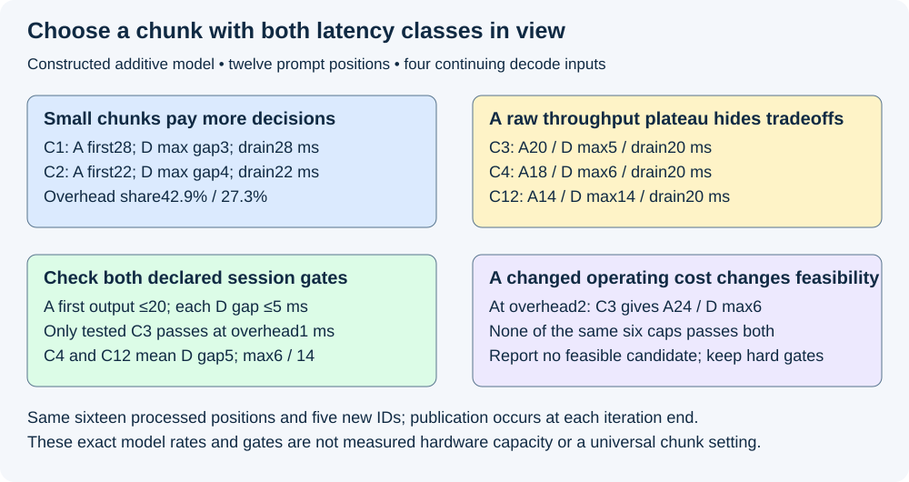
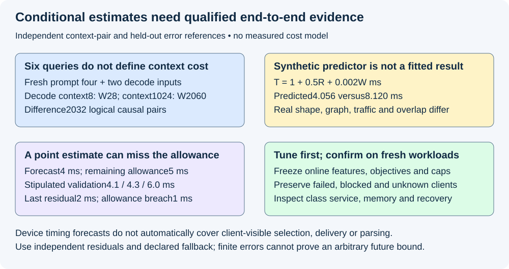

# M5-C18: Choosing chunk sizes and balancing prefill with decode

> **Status: Draft — detailed chapter undergoing documentation validation; experiments remain proposed.**

**Module:** Learn scheduling, operating systems, and queueing theory

**Category:** [Scheduling and queueing](index.md)

[Module 5 reading order](../module-5.md) · [Previous: M5-C17](../scheduling-and-queueing/m5-c17-chunked-prefill-and-resumable-prompt-processing.md) · [Next: M5-C19](../scheduling-and-queueing/m5-c19-preemption-resumption-and-the-cost-of-lost-progress.md)

[Execution plan and progress](../chapter-execution-plan.md)

## Target concepts

Chunk-size budgets, decode interference, time-to-first-token versus inter-token latency, scheduling overhead, throughput tradeoffs, measured cost estimates, workload-dependent tuning.

## Concepts

### 1. Choose a chunk within several independent limits

A **chunk-size budget** limits how many new prompt positions a request may process in one selected step. A **decode** step processes a previously selected ID to obtain the next output. [M5-C17](m5-c17-chunked-prefill-and-resumable-prompt-processing.md) established consecutive prompt ranges, absolute positions, all-layer commit and output equivalence. This chapter chooses how much eligible work to put between scheduling decisions; it does not weaken that contract. Rust is the host-language context, without implementation code or pseudocode.

Let P be prompt length, c its committed prefix and q the new prompt positions selected now. Let C be the configured per-request chunk cap, Rmax the total new-query cap per step and d the number of independent ordinary decode inputs selected in this step, each contributing one query. For a single partial prefill plus those decodes:

**0<q≤min(P−c,C,Rmax−d).**

C and Rmax are positive integer limits; d is a nonnegative integer. This bound applies only if at least one prompt position can be selected. The sequence count is **N=d+1**, which must fit its own sequence cap. There must also be funded KV growth, safe old/current state, supported masks/positions, prepared kernel/graph bindings and a valid physical peak including workspace. Query count does not replace any of these gates. The remaining prompt determines the final short chunk; do not create a zero-length forward after completion.

For a descriptor-only example, Rmax=8, three selected decodes, C=6 and seven prompt positions remaining give q≤min(7,6,5)=**5**. A separately qualified memory/shape gate might allow only two positions, reducing the feasible q to two. If d=8, no prompt work fits this query budget. Always selecting all eight decodes could starve prefill. Apply [M5-C16's declared class/client service policy](m5-c16-fairness-priorities-and-starvation-prevention.md), and M5-C15's bounded admission/backpressure contract; a smaller C alone cannot solve sustained overload or invent spare capacity.

A chunk cap is not automatically the backend's total-token configuration field. The [vLLM V1 tuning guide](https://docs.vllm.ai/en/stable/configuration/optimization/#performance-tuning-with-chunked-prefill) describes decode prioritization and prefill chunks using the remaining per-step token budget, with different settings affecting first-output and inter-token behavior. Pin the actual backend release and inspect which limit is being changed. Its numerical examples/defaults are not universal settings or measurements of this curriculum.

### 2. Define interference through the request's actual timing boundary

**Decode interference** is additional delay or resource contention experienced by decode because other work shares its dependencies or resources. A long prompt operation can occupy an executor before the next decode; a mixed batch can change the decode kernel, memory traffic or common completion time. Conversely, tiny prompt chunks can add scheduling/launch work that delays both classes. Neither “decode first” nor “mixed batch” alone establishes a latency bound.

Use [M9-C03](../measurement-experimentation-and-economics/m9-c03-measuring-time-to-first-token-including-queueing.md) to define the first-output endpoint and [M9-C04](../interfaces-protocols-and-streaming/m9-c04-measuring-inter-token-latency-in-a-streamed-protocol.md) to define gaps. For a qualified client ID protocol, let a be the intended send time on the client clock, f the first validated ID availability, and tⱼ successive ID availability times on that same client clock. Then **TTFT=f−a** and **gapⱼ=tⱼ−tⱼ₋₁**. TTFT means time to first token under that explicit event contract. Text fragments, server selection and network write acceptance are different endpoints and need their own names if IDs are not observable.

For a decode whose last ID was visible at tlast and whose allowed next gap is Ggap, current age is **tnow−tlast** and remaining gap allowance is **Ggap−(tnow−tlast)**. This is an accounting deadline, not evidence that a predicted iteration can meet it. Selection, publication, buffering, transport and parsing after device completion can still consume time. Across hosts, subtract only mapped compatible clocks with known uncertainty; a device duration is not client arrival-to-output latency.

A prompt's first output still depends on all its required prompt positions. Break its first-output path into observed admission/preparation, inter-chunk waiting, chunk computation, final logits/selection and output visibility. Attribute overlap with a dependency trace rather than summing concurrent spans. A lower maximum decode gap can coexist with a later prompt first output. Choose joint per-class objectives before selecting a tuning result.

### 3. A six-point sweep exposes overhead and competing objectives

Use an independent teaching model, not measured GPU execution or a continuation of M5-C17's no-overhead timing fixture. One new request A arrives at 0 with twelve prepared prompt positions and output cap 1. A different request D has a previous visible ID at 0 and four remaining decode inputs, after which it terminates. State is private, valid and funded; outputs and stopping are fixed. No speculation, rejection, transfer or output delay is modeled. Each iteration chooses up to C remaining prompt positions and one D input while D remains unfinished. After A finishes only D runs, or after D finishes only A runs. There is no idle interval.

All arms share a supported sequence cap 2, query cap 13 and sufficient identical physical limits, so even C=12 plus D's one input is executable. Both A/D outputs are published at the end of their iteration. Iterations complete in series. Within this **stipulated additive model**, each selected prompt or decode position contributes 1 ms and each nonempty iteration adds overhead h=1 ms:

**Tstep=h+q+d**, in milliseconds, with d either 0 or 1 and at least one of q,d positive.

This is a fixed mathematical cost specification. It is not a claim that real GPU mixed work adds linearly or that CPU scheduling and device work cannot overlap. The per-iteration overhead includes no hidden extra modeled work; real attribution must separately establish what a measured overhead contains.

Let Kp=ceil(12/C), the number of prompt chunks, and K=max(Kp,4), the total iterations in this fixture. ceil rounds upward. Every arm processes **12+4=16 positions** and produces **1+4=5 newly selected IDs**, excluding D's pre-existing ID. Model drain time is **Tdrain=16+Kh**. A's first output is at the end of its Kp-th iteration: **TA=12+min(Kp,4)+Kp×h**. These formulas depend on the exact fixed selection and end-of-iteration publication policy.

| Chunk cap C | Iterations K | A first output | D maximum gap | Drain time |
|---:|---:|---:|---:|---:|
| 1 | 12 | 28 ms | 3 ms | 28 ms |
| 2 | 6 | 22 ms | 4 ms | 22 ms |
| 3 | 4 | 20 ms | 5 ms | 20 ms |
| 4 | 4 | 18 ms | 6 ms | 20 ms |
| 6 | 4 | 16 ms | 8 ms | 20 ms |
| 12 | 4 | 14 ms | 14 ms | 20 ms |

For C=2, D outputs are at **4,8,12,16 ms**; A finishes later at 22. For C=3 they are **5,10,15,20 ms**, coinciding with A's final step at 20. For C=4 they are **6,12,18,20 ms**, with gaps 6/6/6/2 and A first output 18. C=12 gives D 14/16/18/20; the first gap includes the output at 0 and must not be dropped. Equal mean D gap over this last pair of schedules conceals different maxima: both C=4 and C=12 have mean **20/4=5 ms**, but maxima **6 versus 14 ms**.

For stipulated session gates **A TTFT≤20 ms and every new D gap≤5 ms**, only the tested **C=3** passes both. This is not a production recommendation. C=1/2 protect D but fail A; larger caps improve A while failing D. All caps≥3 have the same 20-ms drain, so a raw throughput plateau does not choose a latency policy. The five-new-ID count divided by drain time is approximately **178.6,227.3,250,250,250,250 IDs/s**. This is a constructed count/rate, not useful capacity or a sustainable offered-load estimate; missing session gates cannot be hidden behind equal raw rates.

The overhead fraction is **Kh/(16+Kh)**: C=1 spends 12/28≈42.9%, C=2 spends 6/22≈27.3%, and C≥3 spends 4/20=20%. Decreasing chunk size can reduce one interruption while increasing total decisions/launches and prompt waiting. If the independent model's h rises to 2 ms, C=3 instead yields **A first 24 ms, D gaps 6/6/6/6 and drain 24 ms**, so its previous passing classification disappears. No candidate among the same six caps passes both gates under that changed cost. A tuner must be allowed to report “no feasible tested policy” and trigger its declared admission/fallback contract.

*Constructed additive sweep, fixed workload and end-of-iteration output. The passing point depends on cost and service assumptions; it is not a measured GPU optimum.*

### 4. Measure conditional cost instead of assigning a constant price to a token

A **cost estimate** predicts elapsed work from observations available before selection. **Calibration** fits or adjusts it using qualified measurements. A **residual** is observed duration minus prediction. Predictions need a stated scope: scheduler CPU time, device iteration completion, or client-visible gap are different targets. A model calibrated on device time cannot directly certify the client objective.

At fixed architecture/precision, new queries R=Σqᵢ provide a useful work descriptor, but attention also depends on prior context. Use M5-C13's full-causal pair proxy **W(c,q)=qc+q(q+1)/2**, summed over all selected sequences. It is logical query/key pairs, not physical traffic, FLOPs or a duration. Other predictors may include sequence count, prompt/decode mix, context distribution, padding, shape bucket, kernel/graph variant, reuse and allocation/copy requirements. A **shape bucket** groups operations sharing a prepared bounded execution shape; its padded capacity can exceed logical work.

For two separate descriptors, schedule one four-position fresh prompt and two one-position decodes, so R=6 and N=3 in both. With each decode having c=8, total W=**10+9+9=28**. With each having c=1024, W=**10+1025+1025=2060**. Equal query count differs by 2032 pairs. For an explicitly synthetic predictor **Tpred=1+0.5R+0.002W ms**, these values predict **4.056 versus 8.120 ms**. The coefficients are invented for arithmetic teaching, not fitted data or a calibrated device model. Real nonlinear kernels may reverse or distort such simple extrapolation.

To build an actual measured estimator, first fix the target event interval and collect repeated qualified cells across new-query counts, contexts, mixes and supported kernel/graph states. Separate cold compilation/allocation from declared warm execution. Record full cell descriptors and errors, not just a fitted coefficient. Reserve independent sessions/workloads for validation and inspect one-sided underprediction by class, especially near the allowed gap and physical peak. Refit or reject use outside the covered region; do not silently turn a mean into a worst-case bound.

For another independent error reference, a 4-ms point forecast meets a 5-ms remaining allowance on paper. Stipulated held-out observations 4.1/4.3/6.0 ms have residuals **0.1/0.3/2.0 ms**; the last violates the allowance by 1 ms. Those are invented observations demonstrating the check, not author-observed measurements. A margin learned from a finite set may fail on future bursts, kernel fallback or host delay. Define confidence, coverage, fallback and freshness; p99 forecasts require tail data and uncertainty rather than renaming a point estimate.

A learned or adaptive policy must use prompt/cap/context, current age, past service and qualified estimates available at decision time. Eventual output length or measured future batch duration cannot select the arm in the trace being evaluated. Keep the no-clairvoyance checks from M5-C16, preserve original request/random identities and record policy/model versions through every change.

### 5. Tuning is a constrained comparison across operating points

An **operating point** is a workload/load/hardware state, including active decode count and context, prompt lengths, arrivals, cache/adapter state and output-consumer behavior. A chunk size that helps a long-prompt burst can hurt short prompts or low-load first-output time. **Throughput** must name its counted entities, event/cohort window and useful-output rule. Processing prompt positions or recomputed state is resource work, not new output goodput.

The research description [Taming Throughput-Latency Tradeoff in LLM Inference with Sarathi-Serve](https://www.usenix.org/conference/osdi24/presentation/agrawal), OSDI 2024, motivates chunked-prefill scheduling under throughput/latency constraints. Its experiments concern its own models, hardware and policies. Our controlled sweep and cost examples establish no reproduction of those results.

Start from an executable whole-prefill or fixed-chunk baseline with identical accepted model/stop/cap/quality and resource contracts. Predeclare a small candidate set, representative workload cells, correctness and per-class latency/coverage/resource/recovery gates. If a baseline needs a different query limit to execute, disclose it as a combined configuration comparison rather than isolating C. Reject wrong outputs or unsafe memory before ranking speed. Then compare useful offered service under all declared gates; do not choose the fastest successful-only mean.

Vary chunk cap while holding selection/fairness policy fixed; vary decode reservation/priority in a separate comparison. A policy reserving every budget slot for decode can deny prompt progress; a policy filling a large prompt batch can violate decode obligations. Use bounded admission, declared client/class weights and age/progress constraints rather than hidden preference for the shortest realized output. A policy change cannot cancel old accepted future KV promises or spend a block still held by a reader.

Adaptive tuning can change the selected cap only at a supported coherent boundary. Retain committed prompt cursor, positions, table generations, pending selection and random state. More shape variants may require extra prepared graphs, workspace or allocations. Charge their concurrent physical footprint, and distinguish a valid smaller chunk from an unsupported shape. Failed or uncertain work retains its lifetime claims; it is not made safe by retrying with a smaller q.

A **Pareto tradeoff** means one tested policy improves a metric while worsening another, leaving no universal winner without objectives. In the sweep, C=3 versus C=4 keeps drain equal but trades A 20→18 against D max 5→6. Freeze objective versions and report failed/unknown cells as well as passes. Tune on exploratory traces, confirm the selected configuration on fresh sessions, and retain a known supported fallback whose own limitations are declared. If workload drift invalidates calibration or all candidates fail, record that fact rather than silently lowering a service threshold.

## Experiments

All studies are proposed. Authorship checks only arithmetic, descriptor/state reasoning and documentation. No scheduler, tuner, estimator, model, profiler or hardware benchmark is implemented or executed. Write a prediction before observing each study and explain deviations afterward. Their Module 5 focus is budgeting work under competing request dependencies; the HFT lens concerns interruption budgets, tail behavior and stale forecasts rather than trading results.

### E1 — Qualify the feasible chunk set

- **Name:** A smaller chunk cap does not replace admission or shape checks.
- **Description:** First reconstruct query/sequence bounds; then test remainder, blocked growth and unsupported shapes; finally inspect the all-decode saturation case for prompt progress.
- **Purpose/objective:** Hypothesis: min(P−c,C,Rmax−d) gives only a logical upper bound. Predict q≤5 in the 8-budget reference and no prefill room at d=8. HFT concern: a nominal work allowance cannot override retained obligations.
- **Target concepts:** Chunk-size budgets, decode interference and workload-dependent feasibility.
- **Baseline:** Seven remaining prompt positions, C=6/Rmax=8/d=3, separate qualified memory/shape bound 2; immutable all-layer cursor/position/output contract from M5-C17.
- **Workload:** Exact feasible/remainder cases; empty remainder, sequence-limit failure, old-reader growth block, graph fallback, cancelled member and all-decode budget occupancy. Change one descriptor/gate at a time.
- **Controlled variables:** Same identities, caps, physical/growth-credit limits, supported backend/graph variants, class policy and readiness evidence; no output shortening.
- **Hardware requirements:** CPU gate/reference review; later actual scheduler/allocator/backend with supported mixed shapes and attributable allocation/final-user evidence.
- **Exit criteria:** Reproduce q bound 5, reduced feasible 2 and zero prompt room at d=8. Reject invalid/unfunded/unsupported steps before submission; preserve committed state. Do not claim that a finite query bound prevents prefill starvation under sustained competing work.

### E2 — Reconstruct the chunk-size sweep

- **Name:** Account for every iteration and both latency classes.
- **Description:** First replay all six C policies; then reconcile work, output, overhead and gaps; finally change only h to 2 ms and reevaluate the same objectives.
- **Purpose/objective:** Hypothesis: small C protects decode interruption but increases overhead; large C can plateau in throughput while worsening a gap. Predict the six rows and changed feasibility at higher overhead. HFT concern: average progress cannot hide a single breached interval.
- **Target concepts:** Scheduling overhead, TTFT versus inter-token latency, decode interference and throughput tradeoffs.
- **Baseline:** Independent A twelve-position/G1 prompt and D four remaining steps after visible output 0; serial iterations, end publication,1-ms/position+h=1, Nmax=2/Rmax=13 and all physical gates pass.
- **Workload:** C1/2/3/4/6/12 plus h=2 stress; exact event boundaries, no timing noise, no rejection or idle time. Independent variable: C, then h in a separate stress comparison.
- **Controlled variables:** Accepted outputs, 16 processed positions/five new IDs, one D input per eligible step, supported shapes, no hidden transport/preparation costs and unchanged A≤20/Dgap≤5 gates.
- **Hardware requirements:** CPU reference arithmetic first; later backend timing must replace the additive model with qualified observed costs and actual visibility events.
- **Exit criteria:** Reproduce K 12/6/4/4/4/4, A 28/22/20/18/16/14, D max 3/4/5/6/8/14 and drain 28/22/20/20/20/20 ms. Only C=3 passes both at h=1; none passes at h=2. Reconcile selected-ID rates, overhead fractions and C=4/C=12 equal mean 5 but max 6/14; no measured-capacity or universal-optimum claim.

### E3 — Calibrate and falsify cost estimates

- **Name:** Equal queries do not establish equal time or a safe deadline forecast.
- **Description:** First calculate the two-context pair/predictor reference; then audit held-out forecast errors; finally propose fitting and independent validation over actual kernel/context/workload cells.
- **Purpose/objective:** Hypothesis: context and execution state qualify token cost, and a point forecast can violate a client gap. Predict W 28/2060, synthetic 4.056/8.120 ms and held-out underprediction. HFT concern: stale or overconfident cost information can breach an interruption budget.
- **Target concepts:** Measured cost estimates, decode interference, overhead and workload-dependent tuning.
- **Baseline:** R6/N3 with one fresh four-query prompt plus two decode contexts 8 or 1024; separate 4-ms forecast, 5-ms allowance and stipulated 4.1/4.3/6.0 observations. No measurements claimed.
- **Workload:** Exact pair/error references; proposed factorial query/context/mix/graph/reuse cells, cold/warm state and drift/fallback held-out cases. Vary one descriptor or model feature set per controlled comparison.
- **Controlled variables:** Target clock/endpoints, precision/model/output, measurement overhead, train/validation separation, decision-time features, uncertainty method and estimator version/freshness.
- **Hardware requirements:** CPU pair/error review; later qualified model/kernel timings and CPU/device profiles with actual architecture, clock/power and allocator manifest.
- **Exit criteria:** Reproduce context delta 2032, forecast residuals 0.1/0.3/2.0 and last-cell 1-ms breach. Real estimator requires independent error/underprediction coverage and declared out-of-domain fallback; a mean, fitted coefficient or finite maximum residual is not a universal deadline bound.

### E4 — Confirm a policy across offered workload and recovery

- **Name:** A tuning winner must satisfy useful service beyond its training trace.
- **Description:** First freeze candidate policies/objectives and exploratory traces; then confirm the chosen configuration on fresh matched sessions; finally test workload drift, saturation, slow consumers and failure recovery.
- **Purpose/objective:** Hypothesis: a local raw throughput or decode-gap gain may fail offered/class service elsewhere. Predict which classes/regimes can regress before measurement. HFT concern: a production setting needs a declared response when no tested operating point is acceptable.
- **Target concepts:** Workload-dependent tuning, throughput tradeoffs, overhead, cost-estimate uncertainty and TTFT/gap balance.
- **Baseline:** Qualified executable whole-prefill or fixed-chunk configuration, same accepted model/quality/stop/cap and physical bounds; separate cap-only from class-policy changes.
- **Workload:** Short/long prompts, remaining chunks, output/context lengths, reuse/cold adapters, low/sustained/bursty load, tenant/class skew, output stalls and worker-loss traces. Change one policy factor at a time; preserve correlations and intended traffic.
- **Controlled variables:** Client objectives/deadlines, initial cache/counters, admission/credits, backend/graph variants, model/precision, online information, source traces, reset/warmup/drain and recovery support.
- **Hardware requirements:** Qualified generator/server CPU/network/GPU with client-output mapping, physical-memory/lifetime evidence and supported timing/profiling; isolated fault runs with bounded teardown.
- **Exit criteria:** Correct numerical/output/lifetime behavior precedes ranking. Require complete offered/class outcomes, joint first-output/gap/terminal/quality gates, bounded partial-prefill/Retiring state and qualified recovery. Confirm on fresh sessions with uncertainty; report failed/unknown cells and no feasible candidate when appropriate, without claiming finite tests prove p99 or production safety.

## Verification

| Study | Correctness / reference | Measurements and comparison | Acceptance limit |
|---|---|---|---|
| E1 | Query/sequence/shape/memory gates and coherent prompt cursor | Proposed q, remainder, blocked cause and safe submission | Count bound alone does not fund state or guarantee progress |
| E2 | Six exact schedules, identical work/output and end-publication | A first output, every D gap, iteration/overhead/drain counts | Raw plateau or mean gap cannot establish joint service |
| E3 | Context pairs, synthetic predictor and held-out residuals | Conditional prediction error and one-sided underestimation | Point forecasts are not hard end-to-end latency bounds |
| E4 | Frozen objectives/online inputs and matched executable baseline | Offered/class useful service, tails, memory and recovery | Exploration winner requires fresh confirmation and full outcome accounting |

Preserve prepared IDs, absolute positions, valid per-layer KV, causal masks, request/worker/table identity and once-only selection under [M9-C17](../numerics-and-correctness/m9-c17-comparing-logits-with-justified-numerical-tolerances.md), [M9-C19](../interfaces-protocols-and-streaming/m9-c19-validating-tokenization-stopping-and-final-output.md) and [M9-C22](../runtime-and-concurrency/m9-c22-verifying-ownership-and-memory-safety-under-concurrency.md). Use exact counts/rational arithmetic for paper references. Actual changed kernels require predeclared numerical/output comparators, including near ties or stochastic equivalence as appropriate. Reject wrong answers, duplicate append/publication or premature reuse regardless of speed.

Record request/attempt/class/weight, committed/candidate cursor, chosen q,d,R,N, context lengths, supported shape/graph, physical credit/workspace peak and protected final-user claims at each decision. Preserve rejected candidate reasons and blocked intervals, not just submitted iterations. If a cost estimate chooses the cap, log its version, training/calibration scope, forecast/error allowance and all features available at that instant. Future realized length or duration must not enter the decision. Cancelled/failed work retains its physical obligations even when its timing sample fails.

Use [M9-C02](../measurement-experimentation-and-economics/m9-c02-request-events-clocks-and-measurement-boundaries.md) for compatible clocks. Timestamp intended arrival, actual send/receipt/admission, chunk-ready/selection/submission/covered completion/all-layer commit, final prefill, selection/output visibility, client terminal and physical retirement. Report prefill execution, inter-chunk waits, selection and output delay separately without summing overlapping spans. Follow M9-C03/C04 for TTFT and individual gaps. Include the last visible ID before the benchmark interval when measuring the next continuing-decode gap; do not erase the first long interruption. Zero/one-ID answers have no applicable internal gap, not a zero-duration success statistic.

For an actual E3 estimator, use repeated calibration sessions spanning named descriptor cells and separate validation sessions/traces. Retain ordered residuals, cold/warm and fallback populations; quantify bias and underprediction by context/class/shape rather than averaging away rare slow cells. Define the prediction target, acceptance error/coverage and recalibration trigger before fitting. A finite observation of nonnegative slack is not proof of a hard real-time bound. Cross-host output uncertainty, extra post-device work and unsupported feature regions remain explicit limitations.

For E4 a proposed descriptive starting budget is 20 paired reset sessions per named policy/workload/load cell, balanced arm order, one full scratch-trace warmup per arm and a bounded drain with unresolved/fault cutoff. Confirm selected settings on fresh pairs after exploration; do not repeatedly select the luckiest confirmation arm. Preserve all sessions, failed gates and declared initial prefix/adapter/graph/counter state. Pairs/sessions are replication units; adjacent chunks/tokens share resources. [M9-C11](../measurement-experimentation-and-economics/m9-c11-controlled-comparisons-warmup-and-reproducibility.md) and [M9-C27](../measurement-experimentation-and-economics/m9-c27-designing-regression-experiments-and-validation-gates.md) supply comparison/confirmation discipline.

Freeze trace correlations under [M9-C08](../measurement-experimentation-and-economics/m9-c08-designing-representative-serving-workloads.md) and qualify generator intent/dispatch/receipt under [M9-C09](../measurement-experimentation-and-economics/m9-c09-open-loop-load-generation-and-coordinated-omission.md) and [M9-C10](../measurement-experimentation-and-economics/m9-c10-validating-the-load-generator-and-request-accounting.md). A concurrency-throttled closed-loop client changes arrival behavior; disclose it. Under [M9-C06](../measurement-experimentation-and-economics/m9-c06-defining-slos-goodput-and-useful-capacity.md), report per-class offered/admitted/waiting/rejected/expired/cancelled/failed/finished/unfinished outcomes and joint quality/first-output/gap/terminal acceptance. Distinguish new useful output, prompt work and recovery work. An improved decode mean cannot hide denied prompt admissions or unresolved clients.

Twenty pairs are descriptive, not automatically enough for p99 or rare-failure rates. Retain chronology and quantile convention, report uncertainty and expand fresh evidence when needed under [M9-C07](../measurement-experimentation-and-economics/m9-c07-latency-distributions-and-statistical-uncertainty.md). Finite exact E1–E3 references explain mechanisms; they do not certify a hardware predictor, sustained capacity or tail bound. Fix overload duration, progress/expiry limits, drift/recovery trigger and physical drain policy before testing; watchdog timeout identifies uncertainty rather than safe reuse.

Use separate short diagnostic profiles under [M9-C12](../measurement-experimentation-and-economics/m9-c12-reading-cpu-gpu-timelines-and-scheduling-gaps.md) and [M9-C13](../measurement-experimentation-and-economics/m9-c13-using-kernel-profilers-to-explain-hardware-bottlenecks.md). A timeline shows host/device intervals and dependencies; a kernel profiler attributes selected operations/counters. Inspect selector/counter CPU, launch rate, graph replay/fallback, projection/attention shapes, weight/KV traffic, allocation/COW/reconstruction and output stalls. Qualify counter scope and compare instrumentation overhead on matched unprofiled runs. [M9-C15](../state-memory-and-caching/m9-c15-accounting-for-weights-kv-state-workspace-and-fragmentation.md) distinguishes pool backing, valid/assigned/reserved/Retiring state and concurrent graph/workspace/output peaks. Do not add logical credits again as physical bytes or interpret a lower sampled peak as a guaranteed bound.

*Independent context-cost and residual arithmetic. Fitted timing models and adaptive choices require qualified data, decision-time inputs and fresh end-to-end confirmation.*

## Engineering dimensions and principles

| Dimension | Chapter application and check |
|---|---|
| Semantics and invariants | E1/E4 preserve funded cursor/mask/output and accepted objectives while changing selected work |
| Workload and variability | E2/E3 vary overhead/context; E4 covers arrivals, lengths, reuse, class and output skew |
| Resources and bottlenecks | Query cap, graph/sequence support, lifetime and physical peak gate every candidate |
| Time and distributions | E2 separates A first output from every continuing D gap; E3 validates underprediction |
| Ownership and coordination | Cost/policy versions, cursor/table claims and final users survive adaptive changes |
| Failure and adaptation | E1/E4 challenge denied prompt progress, drift, unsupported fallback, cancellation and worker loss |

| Engineering principle | Concrete application |
|---|---|
| 1. Correctness defines the optimization boundary | Preserve model/output/lifetime gates before comparing chunk policies |
| 2. Performance depends on workload and operating point | The six-point passing cap disappears when the stipulated overhead changes |
| 3. Data movement is part of the algorithm | Context, weight/KV reads and workspace qualify a query-token proxy |
| 4. State has ownership, lifetime and recovery cost | Partial prompts, graph variants, forecasts and Retiring blocks retain distinct owners |
| 5. Dependencies determine latency; bottlenecks determine capacity | A still needs its final prompt; decode's next visibility has additional dependencies |
| 6. Variability and synchronization shape the tail | Equal mean D gaps 5 ms conceal maxima 6/14; common iteration completion can delay both classes |
| 7. Local improvements require end-to-end evaluation | Equal raw throughput or a faster kernel does not replace offered joint service |
| 8. Claims require reproducible evidence | E1–E4 fix executable baselines, cost assumptions, trace features and confirmation gates |

The HFT lens transfers bounded interruption, tail-aware contention, stale forecast handling and explicit operating limits. Inference adds causal prompt completion, shared model state and generated-output semantics. These references establish no trading result, exchange behavior or certified real-time bound. Module 9 supports Modules 1–7; Module 8 and non-text modalities are excluded.

## Specifications, articles, and hardware

Primary vLLM V1 chunked-prefill/tuning guidance and the OSDI 2024 Sarathi-Serve research description linked above were reviewed on 2026-10-29. They motivate scheduling budgets and throughput/latency evaluation; our additive sweep, gate values, synthetic predictor and residuals are independent teaching specifications. Pin actual runtime/backend/graph/model versions and record which cap/priority/shape setting changes. Do not inherit a paper's measured gains, hardware configuration or numerical recommendation as an InferX result.

No actual machine was supplied or benchmarked. CPU reference arithmetic requires no GPU and cannot measure scheduling overhead or decode interference. Actual studies require generator/server CPU model, core/SMT counts, NUMA/RAM, affinity/quotas, OS/kernel, Rust/compiler/runtime and network capacity/topology; GPU model/architecture/count/VRAM, driver/backend/runtime, power/clocks/temperature and interconnect. Record model/weights/adapter/tokenizer/template/corpus identity, precision, causal/position/KV contract, prompt/output/context limits and initial reusable prefix.

Preserve chunk/query/sequence/live limits, fairness/admission/credit/headroom policy, maximum supported shapes and concurrent graph/workspace/output footprint. Record cost-model features/version/coverage, clock endpoints, estimator drift/fallback, source traces, warmup/reset/drain/fault policy and diagnostic overhead. The 1-ms position/iteration coefficients and all timing/forecast cells here are synthetic examples, not hardware capabilities or author-observed measurements.

## Key takeaways

Choose chunk size inside logical, physical and semantic gates. Balance prompt first-output, individual decode gaps and the cost of repeated scheduling across the intended workload. Calibrate conditional estimates without future information, confirm the chosen setting on fresh end-to-end evidence, and report when no tested policy satisfies the declared service contract.

## Continue learning

Next in Module 5 reading and authoring order is [M5-C19: Preemption, resumption, and the cost of lost progress](m5-c19-preemption-resumption-and-the-cost-of-lost-progress.md), position 126. Follow the [execution plan and progress tracker](../chapter-execution-plan.md); Module 9 supports Modules 1–7 and Module 8 is excluded.
