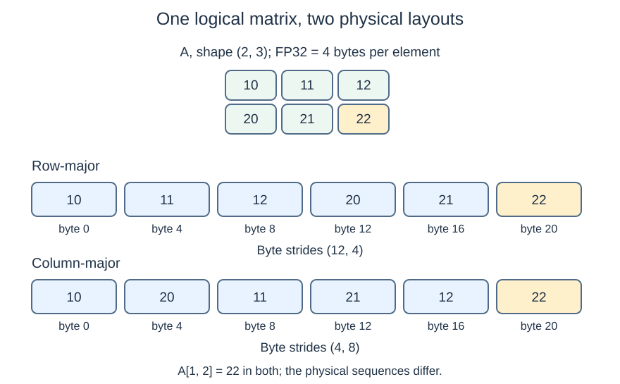
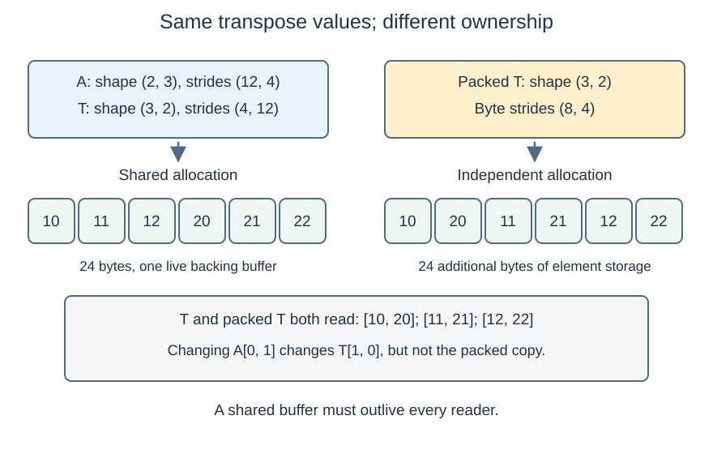
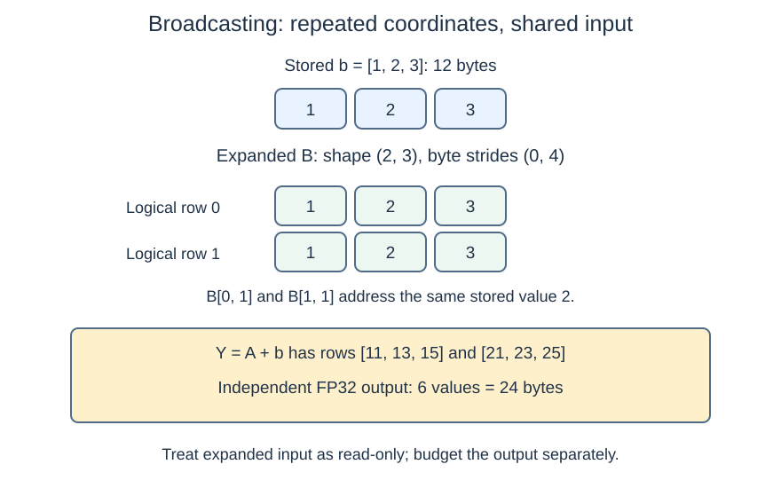

# M1-C05: How tensors occupy memory

> **Status: Complete — detailed chapter authored and documentation validated; experimental procedures are proposed unless explicitly labelled observed**

**Module:** Understand exactly what happens when an LLM generates a token

**Category:** [State, memory, and caching](index.md)

[Module 1 reading order](../module-1.md) · [Previous: M1-C04](../model-computation-and-semantics/m1-c04-dot-products-and-matrix-multiplication.md) · [Next: M1-C06](../numerics-and-correctness/m1-c06-reductions-probabilities-and-stable-softmax.md)

## Target concepts

Bytes, contiguous storage, strides, row-major and column-major layouts, reshaping, transposing, views versus copies, broadcasting.

## What you should be able to explain

A tensor's shape describes its logical coordinates. It does not completely describe where its values live. After this chapter you should be able to trace a coordinate to storage, distinguish changing a description from moving values, and decide what evidence is needed before removing a copy. This matters when text-generation activations change shape between model operations: a cheap view can leave expensive work for its consumer, or keep an unexpectedly large buffer alive.

Read [M1-C03](../model-computation-and-semantics/m1-c03-numbers-vectors-matrices-and-tensors.md) first. Its axes and indexing are prerequisites. The projection in [M1-C04](../model-computation-and-semantics/m1-c04-dot-products-and-matrix-multiplication.md) is a useful application, but the examples here require no matrix multiplication. All experiments below are **proposed procedures**, not observed runtime measurements. They contain no implementation.

## Concepts

### 1. Separate the values, their description and their owner

A **bit** has two possible values; a **byte** contains eight bits. A numeric type specifies how bytes represent a value. Here every element is an FP32 value occupying four bytes. FP32 means 32-bit floating point; its rounding rules belong to M1-C07. The small integer-valued examples here are exactly representable.

A **buffer** is a region of storage containing values. **Metadata** describes how to interpret it: element type, shape, starting position and strides. A stride is the distance to the next element along an axis. An **owner** is responsible for keeping the buffer valid and eventually releasing it. Multiple tensor descriptions can refer to one buffer. This separation is central to the original [Array Programming with NumPy article, array discussion and Figure 1](https://arxiv.org/html/2006.10256).

For a dense, fixed-width tensor with shape (d₀, …, dᵣ₋₁), define:

**Element count E = ∏ dₖ; logical element bytes L = qE**, where r is the number of axes, dₖ is an axis length and q is bytes per element.

For shape (2, 3), E = 6 and L = 4 × 6 = **24 bytes**. A scalar has one element and therefore four logical bytes here. A zero-length axis gives zero elements and no legal element access. We keep positive dimensions in the main experiments; empty shapes are a separate metadata check.

A kilobyte (kB) is 1,000 bytes; a kibibyte (KiB) is 1,024 bytes. A mebibyte (MiB) is 1,048,576 bytes. Always include the unit. Logical element bytes exclude object metadata and allocator overhead; NumPy's [nbytes definition](https://numpy.org/doc/2.3/reference/generated/numpy.ndarray.nbytes.html) measures element bytes, not the entire retained allocation.

Consider a 1,024 × 1,024 FP32 parent: **4,194,304 bytes = 4 MiB**. One 1,024-element row describes **4,096 bytes = 4 KiB**, but a view of that row may keep the entire parent allocation alive. An independent row copy needs another 4 KiB of element storage; while both allocations live, the total is 4,198,400 bytes. If no other references or consumers need the parent, releasing it leaves the 4 KiB copy. An allocator, the component managing reusable storage, may still retain released memory for later reuse; process memory need not immediately fall.

For accounting, count each unique live buffer once. Adding the logical bytes of all views can either double-count shared data or hide retained capacity. This is why a capacity decision cannot rely on shape alone.

### 2. Strides turn coordinates into storage locations

Use this logical tensor A throughout:

| Logical row | Column 0 | Column 1 | Column 2 |
| --- | --- | --- | --- |
| 0 | 10 | 11 | 12 |
| 1 | 20 | 21 | 22 |

A **storage offset** o is the byte distance from an allocation's beginning to the tensor's logical first element. With byte strides sₖ and zero-based coordinates iₖ:

**Byte position within the allocation = o + Σ iₖsₖ.**

The address is the allocation's starting address plus that position. This formula describes a valid strided tensor; it does not authorize constructing arbitrary addresses. Indices must be in range, arithmetic must not overflow, and every accessed element's complete byte range must belong to live storage. [NumPy 2.3 strides](https://numpy.org/doc/2.3/reference/generated/numpy.ndarray.strides.html) use bytes. Other APIs may report element distances: a stride of three elements corresponds to 12 bytes for FP32. Always record the API's units before comparing metadata.

For row-major A, take o = 0 and byte strides (12, 4). The coordinate A[1, 2] starts at 0 + 1 × 12 + 2 × 4 = **20 bytes**. Its four bytes occupy positions 20–23, within the 24-byte allocation.

A view S selecting columns 0 and 2 has shape (2, 2), strides (12, 8), and values [[10, 12], [20, 22]]. Its four elements start at positions **0, 8, 12, 20**. It describes 16 logical bytes while spanning 24 bytes including holes. It does not own a new 16-byte data buffer.

A reversed view of A's columns can have offset 8 and strides (12, −4): its rows are [12, 11, 10] and [22, 21, 20]. For [1, 2], position = 8 + 12 − 8 = 12. Negative strides are supported by some libraries, including NumPy slicing; they are not a universal device or interchange capability. A consumer that rejects them needs an explicit conversion or rejection policy. Do not manually edit strides to bypass checks.

### 3. Contiguity has an order

**Row-major**, also called C order, places the last axis's neighbors next to each other. **Column-major**, also called Fortran order, places the first axis's neighbors next to each other. Both can be contiguous: their values occupy one unbroken segment in the declared order. Contiguous does not mean that every possible traversal is adjacent.

For a nonempty dense tensor with all axis lengths greater than one, canonical strides are:

**Row-major: s[k] = q × ∏ d[j], over axes satisfying k < j < r.**

**Column-major: s[k] = q × ∏ d[j], over axes satisfying 0 ≤ j < k.**

Here s[k] is the byte stride of axis k, d[j] is the length of axis j, and ∏ means multiply the selected lengths together. Row-major uses lengths after axis k; column-major uses lengths before it.

An empty product is one. For shape (2, 3), these give row-major (12, 4) and column-major (4, 8), in bytes. These are special cases of strided layouts in the [NumPy array storage specification](https://numpy.org/doc/2.3/reference/arrays.ndarray.html#internal-memory-layout-of-an-ndarray).

| Representation of the same logical A | Physical sequence from lowest address | Byte strides |
| --- | --- | --- |
| Row-major | 10, 11, 12, 20, 21, 22 | (12, 4) |
| Column-major | 10, 20, 11, 21, 12, 22 | (4, 8) |

*The logical coordinate A[1, 2] still means 22. The storage sequence and coordinate-to-byte calculation depend on layout. The two rows of storage in this illustration represent separate alternative allocations.*

The stepped view S has gaps and is neither C-contiguous nor Fortran-contiguous. A transpose of dense row-major A, however, is Fortran-contiguous even though it is not C-contiguous. This distinction prevents the mistaken rule “every transpose is non-contiguous.”

Axes of length one and empty arrays need special care: unused strides do not uniquely determine contiguity. Some arrays can satisfy both orders. Use the library's documented flags rather than testing only the last stride. [NumPy flags](https://numpy.org/doc/2.3/reference/generated/numpy.ndarray.flags.html) document these cases. An aligned address meets a type or operation's address-boundary requirements; alignment and contiguity are separate properties. No particular cache-line size or vector alignment is assumed here.

### 4. Reshape preserves an enumeration; transpose changes axis roles

A **reshape** changes the shape while preserving a declared enumeration of values. Enumeration means the order in which logical coordinates are visited. A **transpose** permutes, or reorders, axes: for two axes, T[j, i] = A[i, j]. Neither term alone promises an independent allocation.

For this chapter, reshapes use **C logical index order**: visit the last axis fastest, regardless of underlying physical layout. NumPy's [reshape specification](https://numpy.org/doc/2.3/reference/generated/numpy.reshape.html) distinguishes this indexing choice from storage layout and offers a no-copy policy that rejects a required copy.

| Operation starting from row-major A | Shape | Logical rows | Storage behavior for this fixture |
| --- | --- | --- | --- |
| Reshape in C index order | (3, 2) | [10, 11]; [12, 20]; [21, 22] | A view is possible, strides (8, 4) |
| Transpose | (3, 2) | [10, 20]; [11, 21]; [12, 22] | A view is possible, strides (4, 12) |
| C-contiguous copy of the transpose | (3, 2) | [10, 20]; [11, 21]; [12, 22] | Independent buffer, strides (8, 4) |

The first two operations have equal output shapes and different meanings. Replacing transpose with reshape silently changes the tensor's values at coordinates. [NumPy transpose](https://numpy.org/doc/2.3/reference/generated/numpy.transpose.html) specifies axis permutation; it is the coordinate relation, not shape equality, that defines correctness.

For the transpose T, C-order flattening must visit **10, 20, 11, 21, 12, 22**. Its original byte positions are 0, 12, 4, 16, 8, 20. Consecutive differences are 12, −8, 12, −8, 12, so one constant 1-D stride cannot describe this enumeration. Reshaping T to a six-element C-order vector therefore needs a copy, or must be rejected under a no-copy contract. A different order can change that answer; state it explicitly.

A view is still an object with metadata and management overhead. “No data copy” does not mean “zero elapsed time.” A later consumer may also demand C-contiguous input and move data then. [PyTorch 2.14 tensor views](https://docs.pytorch.org/docs/2.14/tensor_view.html) distinguish view operations, reshape's possible copy, and making a tensor contiguous. Library-specific behavior must be inspected rather than inferred from an operation's name.

*Both T and its packed copy have the transpose's logical values. Only T shares A's original allocation. Packing means arranging values in the contiguous order required by a consumer.*

### 5. Views create ownership obligations; copies create costs

A **view** shares element storage. A **copy** duplicates the selected values into independent storage in these fixed-width numeric examples. An **alias** is another reference to overlapping storage. NumPy's [copies and views guide](https://numpy.org/doc/2.3/user/basics.copies.html) explains why mutations through writable views can affect the original.

In a controlled, sequential check, changing A[0, 1] from 11 to 99 makes T[1, 0] equal 99. A previously created independent transpose copy still contains 11 there. Restore the original before subsequent comparisons. Read-only metadata on one view is not a global freeze of all aliases; shared model weights require an ownership policy forbidding writes throughout their use.

Rust's [references and borrowing rules](https://doc.rust-lang.org/book/ch04-02-references-and-borrowing.html) express the central discipline: references must remain valid, and mutation must obey borrowing restrictions. The [ndarray 0.16.1 array documentation](https://docs.rs/ndarray/0.16.1/ndarray/struct.ArrayBase.html) provides owned arrays and borrowed read-only/read-write views, and distinguishes standard logical order from physical memory order. These are representation contracts, not code to implement here. Device libraries and foreign interfaces can add lifetime obligations that Rust's ordinary references alone cannot prove.

For inference, keep an input buffer alive until **every consumer has completed**, not merely until work is submitted. Cancellation of a request is a logical decision to stop producing useful output; it does not establish that an outstanding reader stopped. A buffer may be reused only after those readers finish or are confirmed stopped. Premature reuse can mix requests even when every shape remains valid. Reconstructing a lost view is cheap only if its backing values still exist and their identity is known.

HFT systems face a related issue when a market-event view refers to a reusable receive buffer. Reducing copies helps only while consumers see the intended event and lifetime rules hold. The transferable lesson is ownership and measured critical-path cost; model activations and market events have different semantics, so this is not a claim about trading behavior or latency.

### 6. Broadcasting repeats a logical input, not necessarily its storage

**Broadcasting** lets compatible axes participate in elementwise operations. Compare shapes from the right; paired lengths must be equal or one must be one. Missing leading axes act as length one. For positive lengths the result takes the non-one length. [NumPy's broadcasting rules](https://numpy.org/doc/2.3/user/basics.broadcasting.html) describe this alignment. Broadcasting does not infer that an axis means “feature” or “request.” You must assign those meanings.

Let b = [1, 2, 3] be a per-feature bias. Adding b of shape (3,) to A of shape (2, 3) gives Y with rows **[11, 13, 15]** and **[21, 23, 25]**. Formally:

**Y[i, j] = A[i, j] + b[j].**

A broadcast view B of b across two rows can use byte strides (0, 4). Then B[0, 1] and B[1, 1] both address the same stored value 2. B describes 24 logical bytes but references only the 12-byte bias allocation; the separately materialized Y needs 24 bytes of element storage. **Materialization** means allocating and filling physical storage for logical values.

*Six logical bias coordinates refer to three stored values. The addition's output has independent values; avoiding replication of b does not eliminate output storage or output work.*

[NumPy broadcast_to](https://numpy.org/doc/2.3/reference/generated/numpy.broadcast_to.html) returns a read-only view. [PyTorch 2.14 expand](https://docs.pytorch.org/docs/2.14/generated/torch.Tensor.expand.html) documents zero strides and warns against overlapping in-place writes. The exercise contract therefore treats expanded inputs as read-only and requires an independent copy before editing rows separately. Never assume a framework will reject every unsafe overlap automatically.

A shape (2,) bias is incompatible with A: rightmost lengths 2 and 3 conflict. A shape (2, 1) bias is compatible but means a per-row offset, not the same per-feature operation. For text activations (B, S, D), B means requests, S token positions and D features; a (D,) feature bias broadcasts across B and S. Padding positions remain invalid even when the bias makes their values nonzero. Broadcasting can also produce very large outputs from small inputs; check result shape and byte budget before allocation.

### 7. Choose layouts through the complete consumer boundary

A CPU **cache** holds recently used data near the processor. A traversal that accesses neighboring values may reuse fetched data better than one that jumps, but actual behavior depends on cache capacity, prefetching (fetching data ahead of use), operation implementation and competing work. A library can support strided inputs directly or internally pack them. Neither “contiguous is always faster” nor “views are always faster” follows from the definitions.

Compare two valid routes from the same strided input to the same result:

**Direct route time = strided consumption time.**

**Packed route time = allocation + packing + contiguous consumption + required completion overhead.**

If a packed result can safely be reused R times, an illustrative condition is:

**tₚ + R t꜀ < R tₛ**, or **R > tₚ / (tₛ − t꜀)** when tₛ > t꜀.

Here tₚ includes preparation, t꜀ is one contiguous consumption and tₛ is one strided consumption. Invented values tₚ = 12 µs, tₛ = 5 µs and t꜀ = 2 µs give a tie at R = 4 and a possible benefit only above four uses. These are algebra examples, not hardware observations. Changed inputs require a fresh copy; stale packed values violate correctness. Reuse must also fit memory capacity.

Copying L bytes entails at least L source bytes read and L destination bytes written at the logical transfer level: **2L bytes**. A 4 MiB copy therefore accounts for 8 MiB of logical read-plus-write volume. Actual memory-bus traffic can differ because of caches and other effects. Dividing 2L by measured seconds produces **effective logical bandwidth**, not a measurement of physical DRAM traffic. DRAM is the machine's main memory. Hardware performance analysis continues in later modules.

## Experiments

### Shared prerequisites and exercise contract

Use a diagram or spreadsheet for exact tracing and an existing tensor runtime's inspector, benchmark facility and profiler for proposed runtime studies. A profiler attributes time or resource use to operations. No new tensor engine is required. Fix numeric FP32 CPU arrays, order choices and software versions; use NumPy 2.3 as the semantic reference, recording the actual patch release if run. Another runtime must document differences rather than claiming identical APIs. Rust remains the eventual implementation context; Python is only the language of this reference library, with no code supplied.

Inputs are immutable except for the isolated alias check in E2. Outputs must match every reference coordinate exactly, with no numeric tolerance: these cases rearrange representable values or add small exact integers. Reject unsupported layouts, invalid shapes and budget violations before unsafe access or publication of partial results. Empty outputs require valid metadata and no element accesses. No model checkpoint, network service or GPU is required; do not infer generated-token quality from these fixtures.

### E1 — One coordinate, several physical layouts

**Name:** One coordinate, several physical layouts.

**Description:** Compare row-major A, an independent column-major A, the stepped view S and reversed-column view from Concepts 2–3.

**Purpose/objective:** Test whether coordinate meaning survives different physical orders and whether logical bytes establish retained capacity.

**Target concepts:** Bytes, strides, contiguous storage, row-major and column-major layouts, views.

**Hypothesis and baseline:** The same logical A has equal values under both dense layouts but different strides. Baseline is the explicit six-cell table; predict every byte position before inspection. The stepped and reversed views have their own declared coordinate mappings, not equality to unmodified A.

**Workload and controls:** Fix A, FP32 and a 24-byte numeric buffer per independent dense representation. Vary only layout or selected columns. Use the 4 MiB parent/4 KiB row example separately for retained-storage accounting. Use the shared CPU requirements below; paper tracing alone yields no performance evidence.

**Procedure:** First enumerate each valid coordinate and its expected value. Then inspect shape, stride units, starting offset, element width and contiguity flags. Compare all computed positions and values to the inspector. Finally inventory unique backing buffers and their lifetimes for the row view and independent row copy. Check a singleton axis and an empty axis through safe metadata operations; do not invent an element address for an empty tensor.

**Systems and HFT connection:** This mirrors auditing a packet or event layout before a low-latency consumer reads it. For inference, swapped feature coordinates are the concrete failure. Record an invalid coordinate as rejected; never demonstrate it by reading outside a real allocation.

**Exit criteria:** Every valid coordinate/value and full byte range agrees with the reference; S's positions are 0, 8, 12, 20; logical bytes and unique retained bytes are reported separately. Invalid coordinates are rejected, and unsupported negative-stride consumers are recorded explicitly. No universal speed conclusion is permitted.

### E2 — A shape match can hide the wrong operation

**Name:** Reshape, transpose and alias independence.

**Description:** Compare A's C-order reshape, transpose view, packed transpose copy and C-order vector reshape of the transpose.

**Purpose/objective:** Falsify the claim that equal output shape proves equivalent transformations, and establish where copying or no-copy rejection occurs.

**Target concepts:** Reshaping, transposing, views versus copies, strides, contiguity, ownership.

**Hypothesis and baseline:** The Concept 4 table is the baseline. Predict that reshape and transpose differ at [0, 1] (11 versus 20); packing the transpose preserves every transpose value. Predict that the specified vector reshape of T cannot be a no-copy strided view.

**Workload and controls:** Fresh A per trial; FP32, C-order reshape and explicit C packing fixed. Change only transformation and copy policy. Use a CPU inspector and safe isolated mutation support; record library/version and any automatic copying. No concurrency is introduced into the mutation check.

**Procedure:** First compare every result against the table, not only its dimensions. Inspect documented storage-sharing information and allocation events; pointer equality alone is insufficient for views with different starting offsets. Try the vector reshape under a no-copy contract, expecting rejection; separately allow a copy and verify its six-value enumeration. On a fresh fixture create T and an independent packed copy, change only A[0, 1] to 99, and observe T[1, 0] changing while the copy retains 11. Restore A and confirm the restoration. Trace when the parent and both dependents may be released. Keep lifetime violations as rejected lifecycle events rather than performing a real use-after-free.

**Systems and HFT connection:** A small metadata operation can defer work to the next inference operator. Shared event-buffer views have a similar lifetime obligation, but no event-format or exchange protocol is being modelled.

**Exit criteria:** All transformation references pass; the deliberately substituted reshape fails transpose equivalence; copy independence and restored alias behavior are demonstrated. Required no-copy rejection is recorded. Retained storage is not counted twice and no parent is reused before its consumers finish. Metadata-only time is never presented as full consumption latency.

### E3 — Virtual repetition with a real output budget

**Name:** Feature-bias broadcasting and overlapping reads.

**Description:** Compare virtual bias expansion with an explicitly materialized two-row bias copy; add each to A into an independent Y.

**Purpose/objective:** Test equal output semantics while accounting for different input storage, and detect accidental axis alignment and overlapping writes.

**Target concepts:** Broadcasting, zero strides, views versus copies, bytes and result capacity.

**Hypothesis and baseline:** Both valid routes produce [[11, 13, 15], [21, 23, 25]]. Expanded B shares three values; its independent materialization stores six. Avoiding bias replication does not remove Y's six values.

**Workload and controls:** Fix A, b = [1, 2, 3], FP32 and independent output allocation. Vary only bias representation; use the shared CPU environment. Negative controls are incompatible bias (2,), semantically wrong per-row bias (2, 1), and attempted independent edits of overlapping expanded rows.

**Procedure:** First align all axis lengths from the right and state their meanings. Inspect B's zero row stride and sharing, then compare every Y cell for the two valid routes. Record bias, input, output and temporary bytes separately. Predict the negative controls before safe validation. Require the exercise's read-only contract to reject overlapping row edits, or make an independent copy first; a runtime that permits an unsafe write does not satisfy the exercise policy. For (B, S, D) = (2, 4, 3), calculate the 96-byte FP32 output budget and keep padding validity separate from values. Finally submit a symbolic result shape that exceeds a declared byte budget and require rejection before allocation, rather than exhausting real memory.

**Systems and HFT connection:** Reusing a read-only feature vector resembles sharing immutable configuration across event consumers. Request-specific mutable state cannot inherit that sharing policy. Text positions and features remain the actual inference axes.

**Exit criteria:** Exact Y equality, 12-byte unique expanded-bias storage versus 24-byte materialized bias storage, and 24-byte small-output storage are accounted for. Wrong-axis intent, incompatible shape, write policy and oversized result are detected. A skipped or rejected result is never counted as successful work.

### E4 — Pay for packing before claiming a faster consumer

**Name:** Strided consumption versus packing across reuse counts.

**Description:** Benchmark a direct strided route against explicit C packing plus the same consumer; include one-shot and repeated-use workloads.

**Purpose/objective:** Test whether a local contiguous-consumer improvement survives its preparation, allocation and lifetime costs.

**Target concepts:** Strides, contiguity, views versus copies, bytes, data movement and workload-dependent reuse.

**Hypothesis and baseline:** Direct strided consumption is the baseline. Predict the winning route separately for each size and reuse count; allow direct consumption to win. The output contract is elementwise addition of scalar one into an independent C-order output. The consumer must accept strided input and produce the same logical tensor on both routes.

**Workload and controls:** Construct a C-order parent P with shape (N, 2N) and values P[i, j] = 10000i + j. Select every second column to create V of shape (N, N) with byte strides (8N, 8); V[i, j] = 10000i + 2j. Use N = 32, 256, 1,024 and reuse counts R = 1, 4, 16, with one active job and one runtime thread. Parent construction and initial page touching occur outside both routes. Keep inputs unchanged during a job. Both routes reuse an equally preallocated output; packed route's input-copy allocation and fill stay inside its timed boundary. Record any consumer-internal temporary copies on either route. No output may be elided merely because later uses overwrite it: completion must be observable for each use, and correctness audits inspect outputs outside timing.

**Procedure:** First verify all V coordinates and exact outputs V + 1. Predict peak element storage. Then warm the runtime, measure paired direct and packed jobs with the protocol below, and preserve the narrower preparation and consumer times as explanatory measurements. Repeat for every N and R. Use separate profiled trials to inspect allocation, copy operations and CPU work; never infer a bandwidth bottleneck solely from a slower time. Run a stale-copy negative control outside timing: after packing, change parent P[0, 0] from 0 to 7 and require an unchanged packed value to fail comparison against the current input (expected output there is now 8). Restore the input and rebuild the packed copy. Treat budget rejection or cancellation as explicit outcomes, not fast successes.

**Systems and HFT connection:** Inference may reuse weights or immutable intermediates, whereas a changing event window cannot reuse a stale packed snapshot. This experiment exposes that distinction without modelling a full model or market feed. A real asynchronous reader must complete before V's parent or packed storage is recycled.

**Exit criteria:** Exact coordinate outputs pass for every configuration; stale snapshots fail the reference check. Report full job latency, rows or elements processed per second with R explicit, copy count and peak storage by route. Record variability, rejections and profiler overhead. Claim an improvement only where the full boundary supports it beyond observed variation; otherwise report inconclusive or no benefit. No universal threshold, inference latency gain or p99 claim follows from this microbenchmark.

## Verification

### Module 9 support used here

[M9-C01](../numerics-and-correctness/m9-c01-defining-reference-behavior-and-evidence-before-optimizing.md) supplies the reference/invariant discipline; [M9-C02](../measurement-experimentation-and-economics/m9-c02-request-events-clocks-and-measurement-boundaries.md) supplies completion and clock boundaries; [M9-C11](../measurement-experimentation-and-economics/m9-c11-controlled-comparisons-warmup-and-reproducibility.md) supplies paired comparisons. [M9-C15](m9-c15-accounting-for-weights-kv-state-workspace-and-fragmentation.md) guides unique storage and peak accounting, and [M9-C22](../runtime-and-concurrency/m9-c22-verifying-ownership-and-memory-safety-under-concurrency.md) guides alias/lifetime safety. M9-C01 and M9-C02 are complete; the other linked support chapters remain outlines. Their necessary introductory checks are defined below; reading them is not a claim that advanced concurrency validation has been completed.

### Target-concept coverage

| Target concept | Explanation | Experiment and check |
| --- | --- | --- |
| Bytes | Concepts 1, 7 | E1 retained storage; E3 output budget; E4 volume and peaks |
| Contiguous storage | Concepts 3–4 | E1 flags and stepped layout; E2 packed transpose; E4 routes |
| Strides | Concepts 2–3 | E1 all coordinates; E3 zero stride; E4 stepped rows |
| Row-major and column-major | Concept 3 | E1 same logical A in both orders |
| Reshaping | Concept 4 | E2 enumeration, equal count and no-copy rejection |
| Transposing | Concept 4 | E2 every cell and wrong-reshape negative control |
| Views versus copies | Concepts 1, 5 | E1 retention; E2 alias/independence; E4 stale snapshot |
| Broadcasting | Concept 6 | E3 exact outputs, axis meaning, overlap and budget |

### Correctness, benchmarking and profiling by experiment

| Experiment | Correctness reference and failure checks | Measurement/benchmark boundary | Profiling and evidential limit |
| --- | --- | --- | --- |
| E1 | All coordinate ranges, values, offsets and stride units; invalid index, empty and singleton cases | Counts and unique live element bytes; separate metadata inspection from allocation | Allocation/lifetime inventory if runtime available; paper arithmetic cannot establish cache or elapsed behavior |
| E2 | Complete transformation table, T[j, i] = A[i, j], mutation isolation and no-copy rejection | Compare transformations only under stated policy; any consumption/copy must have its own completed boundary | Inspect sharing and copy events; an identical start address or a tiny metadata time alone is insufficient |
| E3 | Every Y value, explicit feature axis; incompatible shape, overlap policy and budget rejection | Bias storage, output/temporary bytes; optional completed bias-add comparison includes materialization | Allocation/copy trace shows whether virtual expansion stays virtual through the consumer; no bus-traffic claim from logical bytes |
| E4 | Every V + 1 coordinate, exact dtype/shape/order, stale-copy negative control | Full direct versus packed job plus narrower stages, at each N and R | Separate CPU and allocation/copy profile; compare unprofiled timing to expose instrumentation overhead |

Exact equality is justified for these fixtures. The largest E4 output is **10,232,047**, below 2²⁴ = 16,777,216; every integer involved is exactly representable in FP32. No general floating-point tolerance or bitwise-equivalence guarantee for arbitrary model computations is implied. A checksum can miss reordered coordinates; check all values in correctness runs. Avoid object-containing arrays, dtype reinterpretation, device transfer or arithmetic reductions in this experiment, since those introduce different contracts.

Use documented storage-sharing inspection on these small regular arrays, allocation records, and isolated alias checks together. [NumPy shares_memory](https://numpy.org/doc/2.3/reference/generated/numpy.shares_memory.html) can be expensive for complicated layouts; bound diagnostic effort and record an indeterminate answer rather than putting unbounded overlap analysis on a request's critical path.

### Memory accounting and timing boundaries

For E4 with q = 4 and shape (N, 2N), parent element storage is 8N² bytes. V describes 4N² logical bytes but shares the parent. The output needs another 4N²; the packed route adds a 4N² packed input. Thus expected live element storage, while the parent is retained, is **12N² direct** versus **16N² packed**, excluding runtime metadata, allocator reserves and hidden temporaries.

At N = 1,024: parent **8 MiB**, V logical bytes **4 MiB**, output **4 MiB**, direct total **12 MiB**, packed total **16 MiB**. With a 14 MiB live-element budget the direct route fits and packing must be rejected under this simplified accounting. This is a symbolic admission check, not an instruction to force an out-of-memory failure. Actual admission must also budget runtime workspace and headroom. Copy volume for packing is at least 8 MiB of logical read-plus-write traffic; R output writes add R × 4 MiB to either route, before other accesses.

Use one **monotonic host clock**, whose readings do not jump with wall-clock adjustments. Start a full job when its ready V and common output buffer are available, just before route-specific preparation; stop after the Rth output is complete and the route has relinquished its input readers and temporary packed storage. Verification scans occur outside both timing windows and are documented separately. Measure them separately if they are part of a real deployment's acceptance path. The narrower consumer-only time deliberately excludes preparation and must be labelled that way. If a runtime submits asynchronous work, submission time is insufficient: use its documented completion event or synchronization, and include required waiting. CPU-only runs avoid cross-device clock assumptions.

The benchmark's boundary is a local activation-processing job. It excludes tokenization, model computation, queueing, network transport and response delivery. A complete inference-request claim would need all of those relevant stages and an unchanged output contract. For an invented request with 900 µs elsewhere and 100 µs here, halving this stage yields 950 µs, a 5% reduction from 1,000 µs. If packing adds 80 µs, the result is 1,030 µs, slower overall. These figures illustrate boundary arithmetic only.

### Repetition, uncertainty and outcome accounting

For E1–E3, complete paper reference tables first. If runtime measurements are added, use the same paired protocol as E4 and label the operation actually timed. Do not time a single six-element operation and interpret timer noise as a hardware improvement.

For E4, record five untimed warmup pairs per configuration, then **30 paired observations per (N, R) in each of three independently warmed sessions**. Randomize which route goes first in each pair and retain that order. There are nine configurations; do not pool their timings. If individual jobs are too short relative to timer overhead, time a declared block of identical jobs and divide by the block count, applying the same rule to both routes. Keep the definition of R distinct from this repetition count. Record timer resolution and an empty measurement control; do not silently subtract unstable overhead.

Report raw paired observations, medians, ranges and differences between sessions. Differences comparable to variation are inconclusive. Warmup does not establish a cold-cache condition; record cache state as warm/uncontrolled unless a separately justified cold protocol exists. Identify first-use allocation or initialization costs separately. CPU frequency changes, competing processes and allocator reuse can change the outcome. Run profiled trials separately and compare their overhead against unprofiled trials; missing hardware counters mean attribution remains limited.

No p99 estimate is justified by this design's small per-configuration population. Production tail studies need representative arrivals, larger populations and cancellation/overload accounting; concurrency and queueing are later topics. Do not manufacture a tail distribution from one repeated warm input.

For every job record success, rejected input/budget, cancelled, failed and incomplete outcomes. At stopping, each submitted job belongs to exactly one category; reconcile outstanding jobs after waiting for readers to finish (draining). A cancelled job may occupy storage until completion is confirmed. In the paper lifecycle check, reject a proposed early-reuse event; in an existing runtime use supported fault controls only. Do not deliberately free live storage or corrupt memory. Worker loss is a later integration case: uncertain buffers must not be reused until the old reader is known stopped, and lost input needs a valid source for reconstruction. This chapter does not claim to test worker failure recovery.

### Reproducibility record

Preserve the fixture formulas and coordinate tables, byte/element stride units, dtype, enumeration order, offset, C/F flags, unique allocation identities and sharing relationships. Record library patch version/build, OS, CPU and memory details below, thread count, affinity (which cores can run the work), allocator/profiler identity, exact timing boundaries, warmup, route order, raw samples and failure counts. Keep a stage timeline showing input ready, packing if any, consumption completion, cancellation if any and release. Record actual allocation peaks separately from formula predictions. No checkpoint or tokenizer identity applies to these synthetic activation fixtures; if later substituted into a model, record those identities and verify the complete model behavior again.

## Engineering dimensions and principles

### Six dimensions applied

| Dimension | Application to this chapter |
| --- | --- |
| Semantics and invariants | A coordinate must retain its intended value under a declared transformation. E2 distinguishes transpose from reshape, and E4 rejects stale copies even when shape and layout match. |
| Workload and variability | N and R change capacity and preparation amortization. Text activation lengths and repeated consumers matter; E4 fixes arrivals to one ready job. Bursty arrivals, reuse skew and non-text modalities are not measured; Module 8 is excluded. |
| Resources and bottlenecks | E1 distinguishes logical bytes from a retained parent; E4 accounts for copying, output writes, CPU work and peak storage. A measured timeline is needed before naming bandwidth or allocation as the bottleneck. |
| Time and distributions | Packing can precede consumption on the critical path. E4 includes that dependency and repeated-session variation; a warm median establishes neither queueing behavior nor p99. |
| Ownership and coordination | A, T and S can share one owner. E2's sequential mutation exposes aliases; E4's immutable reuse contract and completion boundary prevent premature recycling. |
| Failure and adaptation | Reject incompatible shapes, stale snapshots and oversized output; treat cancellation as a lifecycle state. Use a supported direct route if packing cannot fit and correctness is preserved, or reject explicitly. |

### Eight practical engineering principles

1. **Correctness defines the optimization boundary.** Repacking preserves the coordinate mapping; replacing transpose with reshape does not. E2's wrong-operation control and E4's stale-copy control must fail before any speed comparison is accepted.
2. **Performance depends on workload and operating point.** E4 varies size and reuse. Packing may lose at R = 1 or exceed capacity even if repeated consumption would be faster; measured crossover is specific to the chosen consumer and environment.
3. **Data movement is part of the algorithm.** The packed route reads and writes an extra input copy. Include that transfer, output writes and any consumer-internal packing rather than explaining time by arithmetic alone.
4. **State has ownership, lifetime and recovery cost.** A 4 KiB view can retain 4 MiB. Copies may shorten parent lifetime but need storage and reconstruction. E1 inventories unique allocations; E2 checks when dependents permit release.
5. **Dependencies determine latency; bottlenecks determine capacity.** Consumption of packed input depends on completed packing. A single ready-job comparison cannot establish how many concurrent requests memory or CPU resources can sustain.
6. **Variability and synchronization shape the tail.** Occasional copies, first-use allocation and waiting for readers can create slow cases. Preserve E4's per-session variation and rejected/cancelled outcomes; a fast average cannot establish predictable service.
7. **Local improvements must be evaluated end to end.** Time the complete local route and label its exclusions. A faster contiguous consumer can lose after packing, and a local gain can be small within full token generation.
8. **Claims require reproducible evidence.** E1–E4 require exact fixtures, versions, layout metadata, reference checks, supported fault controls and raw measurements. Paper counts and documentation validation are evidence about the chapter, not observed runtime speed.

## Specifications, articles, and hardware

### Primary sources and their scope

Sources checked on 24 October 2026. Versioned links explain contracts, not a claim that those packages were installed or experimentally compared.

| Source | Use in this chapter |
| --- | --- |
| [NumPy 2.3 array storage](https://numpy.org/doc/2.3/reference/arrays.ndarray.html#internal-memory-layout-of-an-ndarray), [strides](https://numpy.org/doc/2.3/reference/generated/numpy.ndarray.strides.html), [flags](https://numpy.org/doc/2.3/reference/generated/numpy.ndarray.flags.html), [nbytes](https://numpy.org/doc/2.3/reference/generated/numpy.ndarray.nbytes.html) | Coordinate addressing, physical orders, contiguity exceptions and element-byte accounting. |
| [NumPy 2.3 reshape](https://numpy.org/doc/2.3/reference/generated/numpy.reshape.html), [transpose](https://numpy.org/doc/2.3/reference/generated/numpy.transpose.html), [copy](https://numpy.org/doc/2.3/reference/generated/numpy.ndarray.copy.html), [copies and views](https://numpy.org/doc/2.3/user/basics.copies.html) | Explicit enumeration/copy policy, axis meaning and numeric copy independence. |
| [NumPy 2.3 broadcasting](https://numpy.org/doc/2.3/user/basics.broadcasting.html), [broadcast_to](https://numpy.org/doc/2.3/reference/generated/numpy.broadcast_to.html), [shares_memory](https://numpy.org/doc/2.3/reference/generated/numpy.shares_memory.html) | Shape alignment, read-only expansion and bounded diagnostic use of overlap inspection. |
| [PyTorch 2.14 tensor views](https://docs.pytorch.org/docs/2.14/tensor_view.html) and [expand](https://docs.pytorch.org/docs/2.14/generated/torch.Tensor.expand.html) | Cross-library cautions about view/copy behavior and overlapping expanded writes. |
| [Rust Book, references and borrowing](https://doc.rust-lang.org/book/ch04-02-references-and-borrowing.html); [ndarray 0.16.1 ArrayBase](https://docs.rs/ndarray/0.16.1/ndarray/struct.ArrayBase.html) | Ownership vocabulary and safe borrowed versus owned array representations; no implementation supplied. The Book is a live reference, checked on the date above. |
| [Harris et al., Array Programming with NumPy, 2020, arXiv v1](https://arxiv.org/html/2006.10256) | Primary article connecting multidimensional array metadata to shared data and array operations. Versioned API pages govern the specific exercise behavior. |

### Hardware requirements and measurement manifest

Paper tracing needs no special hardware. A proposed CPU runtime study can use a 64-bit machine with at least four physical cores, **8 GiB RAM** and **1 GiB free local storage** for software and traces. These are planning allowances, not measured requirements or a guarantee against allocation failure. E4 uses one thread; the largest route has 16 MiB of predicted live element storage before overhead. A GPU, network adapter, exchange feed or model weights would add unnecessary variables to these exercises.

Before measurement record exact CPU model, core/thread counts, cache capacities, available RAM and memory configuration, OS/kernel, clock/power policy, affinity, background load and runtime build. On a multi-socket machine record where CPU execution and memory reside; remote memory adds a placement variable. Record actual storage available for traces. No particular CPU frequency, cache-line width, DRAM bandwidth or device completion latency is assumed. GPU studies require separate device model, memory capacity, driver/runtime, stream and synchronization records and should not be mixed with the CPU results.

## Key takeaways

Shape is a logical contract; strides and offset connect it to live storage. Reshape, transpose and packing solve different problems. Views save element copies while sharing ownership obligations, and logical byte counts do not reveal all retained memory. Broadcasting can reuse a small read-only input while still creating a large output. A layout optimization earns its claim only after exact coordinate checks, complete preparation-to-completion timing and capacity/lifetime accounting.
