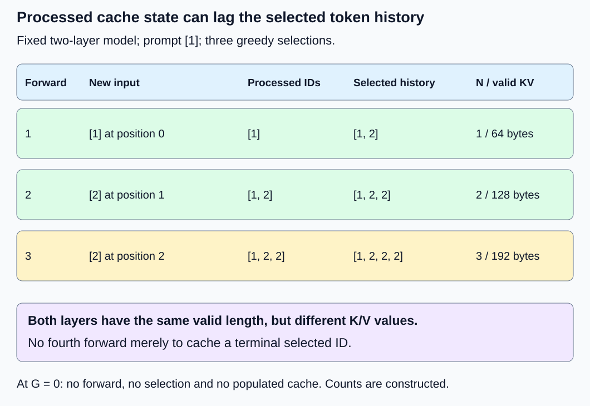
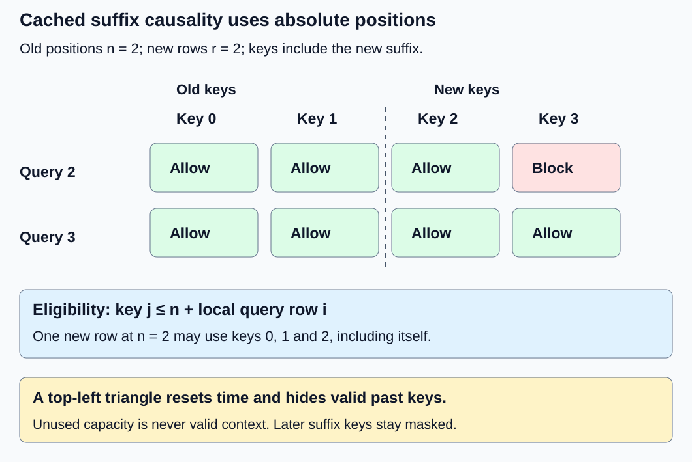

# M1-C17: Reusing attention state with a KV cache

> **Status: Complete — detailed chapter authored and documentation validated; experimental procedures are proposed unless explicitly labelled observed**

**Module:** Understand exactly what happens when an LLM generates a token

**Category:** [State, memory, and caching](index.md)

[Module 1 reading order](../module-1.md) · [Previous: M1-C16](../interfaces-protocols-and-streaming/m1-c16-building-the-single-request-generation-loop.md) · [Next: M1-C18](../runtime-and-concurrency/m1-c18-understanding-prefill-and-decode.md)

## Target concepts

Repeated computation without caching, per-layer keys and values, cache shapes, appending state, cache growth, position offsets, cached causal masking.

## Concepts

### Remember derived state instead of repeating the prefix

A **key-value cache**, abbreviated KV cache, retains attention keys and values from positions already processed by a decoder. It is request state derived from fixed model weights and an exact token prefix, not a cache of final text or a CPU hardware cache. In [M1-C16](../interfaces-protocols-and-streaming/m1-c16-building-the-single-request-generation-loop.md), every forward recomputed the entire growing prefix. With valid retained state, a later forward can process just the new input position while attending to earlier keys and values.

For one layer and head, let xᵢ be that layer's input representation at absolute position i. Its normalized/projected query, key and value are qᵢ, kᵢ and vᵢ. With head width d, attention is **aᵢⱼ = softmaxⱼ(qᵢ · kⱼ / √d)** over permitted j ≤ i, and **oᵢ = Σⱼ₌₀ⁱ aᵢⱼvⱼ**. Softmax converts permitted scores to weights summing to one. Earlier queries and attention probabilities are not needed to evaluate a new query. Earlier keys and values are.

Why can they remain valid? In deterministic causal inference, adding a suffix cannot change the inputs or permitted predecessors of an earlier position. By induction through the ordered layers, that earlier position's hidden states, keys and values are unchanged. This relies on fixed weights, unchanged prefix/positions/masks, per-position normalization, compatible arithmetic and no active dropout. A bidirectional operation, edited prefix or changed model breaks the argument. Mathematical equivalence does not promise bit-identical floating-point results when shapes, reduction order or kernels change.

The [Transformer paper](https://arxiv.org/html/1706.03762v7) establishes causal attention and its projections. The [Transformers v4.57.1 cache explanation](https://huggingface.co/docs/transformers/v4.57.1/en/cache_explanation) documents retained per-layer KV and growing state. Here we specify an unpadded, single-request, full-attention cache. Paging, sliding windows, cross-request sharing, quantization and cancellation machinery belong to later chapters. Rust is the primary language context; this chapter supplies contracts and experiments without implementation code.

### Each layer owns different keys and values

Layer ℓ's retained state is the pair **Kℓ = [kℓ,₀, …, kℓ,ₙ₋₁]**, **Vℓ = [vℓ,₀, …, vℓ,ₙ₋₁]** for n processed positions. Layer 1 receives layer 0's outputs; it cannot reuse layer 0's keys just because their shapes match. Keep layer identity, request identity and the exact processed prefix with the state. New layer-0 state becomes available before new layer-1 state; partial completion must not be advertised as a fully extended cache.

Use logical tensor layout **(B, Hkv, N, d)** separately for K and V at every layer: B requests, Hkv key/value heads, N processed positions, d features per head. New state for r appended positions has shape (B, Hkv, r, d). Queries have (B, Hq, r, d), with Hq query heads. In ordinary multi-head attention Hq = Hkv; grouped-query attention maps several query heads to each KV head. The latter is an architecture choice from [M1-C12](../model-computation-and-semantics/m1-c12-multi-head-attention-and-its-variants.md), not permission to discard distinct heads from an existing model. Physical strides/layout may differ from these logical axes.

For r new inputs and n valid old positions, the successful result has **N′ = n + r** in every layer. Previous positions 0 through n − 1 remain unchanged; new positions occupy n through n + r − 1. The cache contains representations of *processed inputs*. It does not automatically contain the newly selected output ID.

*The selected token becomes a future input only if another forward is needed. The terminal selected ID need not enter the cache.*

### A complete generation trace with an intentionally lagging cache

Use [M1-C14's exact two-block model](../model-computation-and-semantics/m1-c14-assembling-a-small-decoder-only-transformer.md): D = 2, one KV head per layer, FP64, absolute position embeddings, context capacity C = 4 and fixed weights. Its original no-cache computation is the reference; retaining exactly the keys/values produced by its two layers is the candidate mechanism. Do not change normalization, projections, positions, output head or arithmetic specification. Here K = V within a layer because its Q/K/V matrices are identities, but the two layers still have different inputs and state. Production models need not have K = V.

Prepared prompt [1], greedy selection with lowest-ID ties, EOS ID 3, no text stop and cap G = 3 reproduce M1-C16's selected IDs [2, 2, 2]. The constructed display is “ccc”; this is not pretrained language quality.

| Forward | New input IDs | New absolute positions | Cache length before → after, each layer | Last logits, rounded to six decimals | Selected ID |
| --- | --- | --- | --- | --- | --- |
| 1 | [1] | [0] | 0 → 1 | [1.231147, 1.230632, 2.461779, −0.000514] | 2 |
| 2 | [2] | [1] | 1 → 2 | [2.451513, 0.642534, 3.094047, −1.808979] | 2 |
| 3 | [2] | [2] | 2 → 3 | [2.127601, 0.877838, 3.005439, −1.249764] | 2 |

At termination the internal token history has length four, [1, 2, 2, 2], but cache length is three: it represents [1, 2, 2]. No fourth forward is required merely to cache a terminal token. In general, with nonempty prompt length P and g ≥ 1 selections, one prompt forward followed by g − 1 single-position forwards processes **P + g − 1** positions. The uncached loop processes **Σₜ₌₀ᵍ⁻¹(P + t) = gP + g(g − 1)/2**. With P = 1, g = 3 these are 3 versus 6. A G = 0 request performs neither path's forward and has no populated cache.

This is also a publication rule. If the first layer extends and a later layer fails, do not use the inconsistent lengths as valid next-step state. A safe elementary policy is to invalidate the whole request cache and retain committed token history for a separately specified recomputation/recovery decision. Do not silently retry on partially appended state. Reclamation waits until all readers have finished, including device work if an asynchronous backend is later used. This chapter specifies the rule without claiming a rollback allocator or service exists.

### Positions and rectangular masks must refer to the same sequence

New input row i in a block of r inputs has absolute position **pᵢ = n + i**. Use this for learned absolute embeddings; do not add position zero just because the local tensor has one row. For rotary-position models, the cached-key representation must consistently include the transformation expected by future queries, exactly once. M1-C14 uses absolute embeddings and no rotary transformation; the rotary observation is a compatibility requirement, not a change to that model.

After appending, key j has absolute position j, 0 ≤ j < n + r. The correct causal eligibility is **Aᵢⱼ = 1 when j ≤ n + i; otherwise 0**. A = 1 means allowed here; APIs can use different Boolean polarities. For n = 2 and r = 2, queries at positions 2, 3 against keys 0, 1, 2, 3 need:

| Query absolute position | Key 0 | Key 1 | Key 2 | Key 3 |
| --- | --- | --- | --- | --- |
| 2 | Allow | Allow | Allow | Block |
| 3 | Allow | Allow | Allow | Allow |

A local top-left triangular mask would instead allow only key 0 for its first row, then keys 0 and 1 for its second: wrong alignment. With n = 2 and r = 1, the only query at position 2 may use all three valid keys, including its newly appended self-key. There are no future valid keys in that particular one-row case. A preallocated backing array may contain unused slots; these are never valid keys and must be excluded. For r > 1, later new keys must still be hidden from earlier new queries.

The [PyTorch 2.14 scaled-dot-product attention specification](https://docs.pytorch.org/docs/2.14/generated/torch.nn.functional.scaled_dot_product_attention.html) documents its particular non-square causal alignment and mask polarity. A generic “causal” switch is not proof that a backend implements this cached-suffix mask; verify actual eligibility at the requested shapes.

*Rows are new query positions, columns include old and new keys. The old/new boundary is not a restart of time.*

For an independently checkable one-head attention example, use d = 1, new query q = 1 at position 2, keys [0, 1, 2], and values [10, 20, 40]. This is an isolated attention fixture, not M1-C14's model. Let e ≈ 2.71828 be the base of the natural exponential. Correct attention is **(10 + 20e + 40e²)/(1 + e + e²) ≈ 32.404513**. An erroneous top-left one-row mask returns 10; omitting the self-key gives **(10 + 20e)/(1 + e) ≈ 17.310586**. These distinct values make mask faults observable without relying on sampled text.

### Caching trades repeated work for growing retained state

With L layers, B equal-length independent requests, Hkv KV heads, head width d and w bytes per element, logical retained KV payload is **Mkv = 2LBHkvNdw bytes**. The 2 counts separate K and V. Per added position per request it grows by **2LHkvdw**. Unequal lengths use the sum of request lengths instead of BN. This counts only live, unshared KV payload; weights, histories, positions, masks, unused capacity, temporary tensors, allocator metadata and fragmentation are separate. Logical axes and payload do not establish actual peak memory.

For M1-C14, L = 2, B = Hkv = 1, d = 2 and w = 8: **64 bytes per processed position**, hence 64, 128 and 192 bytes after the three forwards. The selected fourth ID does not imply 256 bytes of valid cache. A reserved four-position backing store has 256 bytes of KV capacity, of which 192 are valid at that point. FP64 values in these counts have eight bytes each; they are unrelated to the number of vocabulary IDs.

An illustrative larger configuration L = 32, Hkv = 8, d = 128, w = 2 needs **131,072 bytes = 128 KiB per position per request**. At N = 4,096 it has **512 MiB** logical payload per request; four equal requests require **2 GiB**. KiB, MiB and GiB use powers of 1,024. With Hkv = 32 and everything else unchanged the payload is four times larger, but changing an existing architecture requires a new model-quality contract. These are sizing calculations, not measured hardware or a supplied model.

A dynamic contiguous cache that copies all old KV when appending can move much more data than the new payload. Over g − 1 appends after prompt length P, old positions copied sum to **(g − 1)P + (g − 1)(g − 2)/2**; multiply by bytes per position for one-way payload copied, and count both reading and writing when estimating traffic. For P = 1, g = 3, three old positions are copied: 192 payload bytes, or 384 read-plus-write bytes under this simple copy model, separate from 192 bytes of new KV writes over the three forwards. A reserved-capacity cache can avoid these old-payload copies, while retaining unused capacity. Neither allocation strategy changes valid length or permits attention to unused slots.

Count a multiply-add as two operations, following M1-C14. Its last-row-head uncached three-forward trace counts 944 matrix operations. The cached trace has three new positions, dense attention rectangles 1×1, 1×2, 1×3, and three last-row heads: **112 × 3 + 16 × (1 + 2 + 3) + 16 × 3 = 480** counted operations. This convention includes dense masked work in prompt attention; normalization, softmax, activations, lookups, additions, cache copies and allocation are excluded from the count but belong inside timing. It does not imply a 944/480 elapsed-time speedup.

For one new position, attention score/value work still grows with retained N; caching does not turn full attention into constant work per output token. For a fixed-width model, uncached dense attention summed over many growing prefixes is cubic in generated length, while cached one-row attention sums to quadratic; repeated per-position projections/MLPs become linear after one prompt pass. Those orders describe arithmetic under this policy, not hardware timing or a promise that memory capacity is sufficient. Weight movement, KV bandwidth, allocation and tiny-operation dispatch may dominate at different operating points.

## Experiments

These procedures are proposed, not executed cache-runtime benchmarks. Use an existing inference/reference environment if available; no implementation or pseudocode is provided.

### E1 — Trace two independent layer caches against full recomputation

**Description:** Compare full-prefix and cached mathematical paths for the complete three-selection trace. **Purpose/objective:** Establish that retained state preserves model behavior and represents processed inputs. **Target concepts:** Repeated computation, per-layer K/V, append semantics and lagging cache length.

**Baseline and workload:** M1-C14 model, prepared [1], C = 4, G = 3, greedy, EOS 3 and no stop; baseline prefixes [1], [1, 2], [1, 2, 2]. Add G = 0 and M1-C16's stop “cc” case. Fixed synthetic display is unchanged.

**Controls and prediction:** Same weights, FP64, positions, numerical contract and output policy; vary retained-state use only. Expect the table's logits/IDs, lengths 1/2/3 and 192-byte final valid payload. Stop “cc” ends after two selections with cache length two, generated IDs [2, 2] and empty visible text.

**Procedure:** Record each layer's full-prefix normalized K/V reference and compare the cached old prefix and new suffix after each successful forward. Inspect logits before selection, then internal IDs and terminal result. Deliberately substitute layer-0 KV for layer-1 KV to confirm detection. Verify G = 0 initializes no populated cache and no forward. Do not perform an extra forward after stopping.

**Hardware/software:** CPU FP64 reference, fixed model equations and one request; actual backend/allocator identities recorded if run. **Failure and HFT connection:** Reusing a summary under the wrong stage identity resembles consuming stale derived event state; equal shapes do not establish meaning. Trading state transitions require their own semantics. **Exit criteria:** All layer K/V prefixes and last logits meet V1, exact IDs/lengths/reasons match and wrong-layer state is detected. No runtime speed claim follows. Use V1.

### E2 — Challenge position offsets and cached causal masks

**Description:** Compare cached suffix attention with full causal references for multiple suffix shapes. **Purpose/objective:** Make position/reset, self-key and alignment faults observable. **Target concepts:** Position offsets, rectangular masks, cache shapes and appending several positions.

**Baseline and workload:** All full-prefix M1-C14 sequences [1], [1, 2], [1, 2, 2], [1, 2, 2, 2]. For each length S, compare every split n = 0 through S − 1 into n old positions and r = S − n new positions: ten cases, 20 suffix rows and 80 last-axis logit coordinates in total. Include the independent scalar attention fixture and the explicit n = 2, r = 2 mask.

**Controls and prediction:** Fixed weights/arithmetic, no padding, no dropout, no sliding window. Cache only the declared prefix. Every new row matches that row of the full-prefix reference; absolute positions advance continuously. The scalar fixture distinguishes correct, top-left and missing-self behavior.

**Procedure:** Compare eligibility entries, positions, each layer's appended KV and all suffix logits. Introduce local-position reset, top-left triangular alignment and missing self-key as separate defects. Perturb the last token and ensure earlier causal outputs do not change. An empty suffix is not an extra model call; define it as no-op outside the forward contract. Reject total lengths beyond C before appending.

**Hardware/software:** CPU mathematical reference or an existing backend with inspectable masks/positions; record actual attention API and mask polarity. **Failure and HFT connection:** A local buffer index is not event time; resetting position resembles replaying events with the wrong sequence offset. Token positions are not market timestamps. **Exit criteria:** All ten split cases pass V2, all three faults are detected and bounds/no-op handling is explicit. Use V2.

### E3 — Account for valid length, capacity and failed extension

**Description:** Trace live KV payload separately from reserved capacity and copy work. **Purpose/objective:** Connect reduced computation to memory growth and safe ownership. **Target concepts:** Cache growth, shapes, append state and request/layer identity.

**Baseline and workload:** M1-C14's three-forward trace with 64 bytes per position, plus the illustrative 32-layer sizing example. Compare a reserved four-position payload with a dynamic-copy accounting model. Add a conceptual failed second-layer extension after layer 0 has advanced.

**Controls and prediction:** Same logical K/V and valid lengths; vary storage policy only. Reserved capacity can be 256 bytes with only 192 valid; dynamic-copy old payload is 192 bytes over two appends. Allocation failure must not become a published successful cache extension.

**Procedure:** Record valid lengths per layer, unique live bytes, reserved bytes, allocation/copy counters and last-reader completion at every boundary. Keep old-prefix identity exact. In a fault-capable existing environment inject failed extension; require cache invalidation before reuse, preservation of prior committed token history and a classified request error. A paper trace can establish the expected invariant but cannot demonstrate real allocator safety. Rebuild from token history only under a separately defined recovery contract.

**Hardware/software:** CPU byte accounting; runtime allocator diagnostics only if an implementation is supplied independently. No GPU required. **Failure and HFT connection:** Partially updated state must not be exposed as a coherent event snapshot; lifetime follows readers, not submission. No trading recovery or device-cancellation mechanism is implemented here. **Exit criteria:** V3 payload/capacity/copy equations balance; any actual fault trial is reported separately and never reuses inconsistent state. Paper predictions are labelled. Use V3.

### E4 — Compare complete prepared-request cost

**Description:** Benchmark cached versus uncached generation in an existing environment after correctness gates pass. **Purpose/objective:** Test whether less repeated work improves completion time with added state costs included. **Target concepts:** Recomputation, cache reads/writes, growth and workload-dependent performance.

**Baseline and workload:** The complete fixed three-selection trace, then a second case prepared [1, 2], G = 2, C = 4 under the same model/policy. Both paths use the same last-row head strategy and output sink. Do not extend this model beyond its four-position specification to manufacture a large workload.

**Controls and prediction:** Same model/precision, generated policy, decoder/sink, one thread, allocator mode and clock boundary. Candidate starts with an empty request cache; no hidden prefilled state outside timing. Cache construction/copies may outweigh arithmetic saved on these tiny cases; inconclusive or slower results are valid.

**Procedure:** In each of three sessions, perform five untimed warmups per path and workload, then 30 paired timed trials per workload, alternating order. Time prepared IDs and ready weights to final visible output, terminal record and completed required work. Include prompt processing, cache allocation/updates and required finalization. Measure teardown separately if outside that boundary; report retained bytes at completion and when they are reclaimed. Profile preparation-independent model stages, attention/KV traffic and allocation in separate runs. Do not infer capacity or concurrent service tails from isolated requests.

**Hardware/software:** Existing CPU FP64 backend, recorded compiler/runtime, attention path, allocation/sink and clock conditions. Device variants need synchronized completion and their own configuration, not assumed CPU equivalence. **Failure and HFT connection:** Faster state access matters through complete decision/publication work, while allocation variability can hurt slower outcomes. This is not an HFT latency benchmark. **Exit criteria:** V1–V3 pass; timing population, instrumentation overhead, per-session differences and resource costs are reported under V4 without inventing a speed threshold. Use V4.

## Verification

### V1 — Compare state before trusting selected text

For E1, use independent full-prefix equations and high-precision reference values, with [M9-C01](../numerics-and-correctness/m9-c01-defining-reference-behavior-and-evidence-before-optimizing.md) stage evidence. Compare every old/new layer K and V coordinate, layer lengths and all 12 selected-position logits. The two layers' arrays are independent even where Q/K/V projections have identical coefficients. A final “ccc” string cannot substitute for these checks.

For the small FP64 model, use an 80-digit reference cross-checked at 120 digits. A concrete candidate screen is **|candidate − reference| ≤ 10⁻¹⁰ + 10⁻¹⁰|reference|** for each KV and logit coordinate, retaining the fixture's conservative small-model scale from M1-C14. This is an exercise acceptance budget, not a universal numerical guarantee: document backend arithmetic and inspect stage errors under [M9-C17](../numerics-and-correctness/m9-c17-comparing-logits-with-justified-numerical-tolerances.md); investigate near-tie decisions separately. IDs, positions, masks and lengths require exact equality. Mathematical-reference agreement is not evidence that any actual FP64 runtime passed this screen.

Use [M9-C19](../interfaces-protocols-and-streaming/m9-c19-validating-tokenization-stopping-and-final-output.md) to preserve prompt identity, generated/processed distinction, visible prefixes and terminal precedence. G = 0 has no selected-ID or visible-text timestamp. The hidden “cc” stop can also have no visible text despite two selections. Record these outcomes without assigning a zero first-visible latency.

### V2 — Validate all suffix rows and deliberately wrong masks

For E2, the ten split cases contribute **Σₛ₌₁⁴ Σₙ₌₀ˢ⁻¹(S − n) = 20 rows**, each with four logits: 80 comparisons. Count and compare all suffix rows, not just the last. The eligibility matrices contain **Σₛ₌₁⁴ S²(S + 1)/2 = 65 entries** across these cases; every entry must match absolute causality. Compare the full-prefix per-layer KV reference to the combined old/new state after each split. Include n = 0 as an empty-cache forward, rather than pretending it has old state.

Check scalar results 32.404513, 10 and 17.310586 against independently evaluated exponential expressions; rounding to six decimals permits at most 0.5 × 10⁻⁶ display error. No tolerance permits an extra blocked/allowed key. Position reset must be checked with M1-C14's nonconstant position table; a scalar fixture without positions cannot reveal that defect. A future padded or rotary backend needs separate mask/position contracts, beyond this no-padding corpus.

Profiling is unnecessary to establish these discrete faults. If stage timings are collected, preserve the corresponding shape and diagnostic overhead and keep them outside the timing comparison in E4. A backend accepting a mask without an error is not a semantic pass.

### V3 — Reconcile valid payload with ownership

For E3, verify all layers' successful valid lengths agree and their old prefixes remain unchanged. Check 64/128/192 live bytes, 256 reserved bytes at capacity four, 128 KiB per position in the larger example, 512 MiB per 4,096-position request and 2 GiB for four requests. Report unique state once; shared views of one allocation must not be summed as separate physical caches. The arithmetic assumes independent requests, equal element widths and no sharing.

The dynamic-copy calculation counts 1 + 2 old positions, 192 payload bytes or 384 read-plus-write bytes, plus new KV writes counted separately. Actual traffic can differ through layout, caching, allocation growth or fusion; profiler evidence must identify its counter boundary. Peak allocation includes temporary old/new coexistence and cannot be inferred from final payload alone.

On a partial failure, compare valid-state publication with actual layer completion, not merely submitted work. Required result is a classified error and invalidated cache before further use under the elementary policy; committed token history remains evidence. A fault injected before versus after selected-ID commitment changes the ledger and must be recorded. No real allocation, lifetime or recovery trial is claimed by a paper trace. Advanced accounting and reuse validation remain planned in M9-C15/M9-C20.

### V4 — Explain complete-request measurements

For E4, each workload has 90 planned pairs across three sessions. Across two workloads this is 180 pairs/360 timed path trials, plus **3 × 2 × 2 × 5 = 60** untimed warmup path trials. Preserve every attempted trial, correctness failure and incomplete execution; a failed path is not a fast completion. Report per-session medians/ranges and paired uncached-minus-cached differences in declared time units. Use [M9-C07](../measurement-experimentation-and-economics/m9-c07-latency-distributions-and-statistical-uncertainty.md) for population and uncertainty limits. Three small sessions cannot justify a production p99 or capacity claim.

For the first workload, reconcile 6 versus 3 processed positions, 944 versus 480 counted operations and candidate peak/live/reserved state. For the second, actual generated IDs must be verified against full recomputation before accepting timing; early EOS/stop changes work and must be matched. Calibrate the monotonic clock's granularity and empty timing brackets; assess trace/profile overhead in separate diagnostic runs. For asynchronous hardware, completion requires all timed readers/writers to finish, not just dispatch to return. Keep preparation and teardown boundaries explicit, with required sink copies included equally.

A profile should distinguish projection/MLP recomputation, growing attention, cache reads/writes, copying and allocation. It explains a measured difference but cannot replace state/logit equivalence. If the small model is dominated by timer or dispatch cost, report the comparison as inconclusive. Archive fixed weights/configuration, input/terminal contract, reference/candidate traces, error budget, backend/hardware, all trial outcomes and allocation policy. The experiments remain proposed; no timing or memory-residency observation is asserted here.

## Engineering dimensions and principles

| Dimension | Chapter-specific application |
| --- | --- |
| Semantics and invariants | Causal fixed-prefix state, per-layer identity, exact offsets and valid lengths constrain reuse before E4. |
| Workload and variability | Prompt/output lengths and suffix shape change recomputation and KV traffic; early stops leave selected history ahead of processed cache. Non-text modalities are outside scope. |
| Resources and bottlenecks | Retained bytes grow linearly, single-query attention still reads growing context, and append copies can add traffic. |
| Time and distributions | Dependent selections remain sequential; include initial cache population, updates and final publication in completion timing. |
| Ownership and coordination | Each request/layer owns its state; partial layer updates are invalid and reclamation follows last-reader completion. |
| Failure and adaptation | Reject bounds/identity mismatch, classify allocation/extension failure, and invalidate inconsistent state before any recovery. |

| Practical principle | How the reader applies it |
| --- | --- |
| 1. Correctness defines the optimization boundary | Compare layer KV and logits, then IDs/text/terminal reasons; caching is equivalent reuse under stated assumptions. |
| 2. Performance depends on workload and operating point | Tiny sequences can lose to allocation costs; longer retained state increases attention and memory pressure. |
| 3. Data movement is part of the algorithm | Account for old-state reads, new writes and dynamic-copy traffic alongside matrix operations. |
| 4. State has ownership, lifetime and recovery cost | Derived state belongs to a specific prefix/model; invalidation/recomputation needs retained history and a defined failure policy. |
| 5. Dependencies determine latency; bottlenecks determine capacity | Reuse removes repeated work but does not remove token dependencies or guarantee enough memory for more requests. |
| 6. Variability and synchronization shape the tail | Capacity growth, allocation and completion synchronization can add variability; isolated trials do not measure service tails. |
| 7. Local improvements must be evaluated end to end | E4 includes prompt population, cache updates and the same required output sink. |
| 8. Claims require reproducible evidence | Freeze model/prefix/position/mask identities, test known defects and archive counts, trials and conditions. |

HFT means High-Frequency Trading, whose systems process market events under tight timing constraints. Reusing valid derived state, preserving event order and publishing coherent updates are useful engineering parallels. A KV entry is not an order-book entry, and token generation has different correctness and recovery semantics. No trading strategy, production latency, cancellation service or hardware cache implementation is supplied.

## Specifications, articles, and hardware

| Primary source | Relevant scope and limit |
| --- | --- |
| [Vaswani et al., Transformer (2017)](https://arxiv.org/html/1706.03762v7) | Attention projections and causal architecture; this chapter's exact small model remains M1-C14. |
| [Transformers v4.57.1 caching](https://huggingface.co/docs/transformers/v4.57.1/en/cache_explanation) | Per-layer state, position and combined context background; actual backend layout must be recorded. |
| [PyTorch 2.14 scaled-dot-product attention](https://docs.pytorch.org/docs/2.14/generated/torch.nn.functional.scaled_dot_product_attention.html) | Non-square causal alignment and Boolean eligibility conventions; do not presume every API shares them. |
| [Ainslie et al., GQA (2023)](https://arxiv.org/html/2305.13245v3) | Query groups share KV heads within a specified architecture; reducing heads in another model is not automatically equivalent. |

Proposed reference exercises require a CPU supporting FP64, one worker thread and at least 1 GiB free RAM for the tiny model/reference evidence, not for allocating the illustrative larger KV example. Record CPU model, core/socket/cache/RAM, NUMA placement (memory proximity), affinity, OS, power/frequency/thermal conditions, compiler/runtime/allocator, precision/backend, clock granularity, model/position/mask identity and cache capacity policy. No GPU or network adapter is required. Actual larger-model studies require enough memory for weights, KV, temporary work and headroom; no machine or serialized model artifact was supplied. GPU extensions need device model/memory/bandwidth, driver/runtime and synchronization details recorded separately.

Completed M9-C01/M9-C17 supply reference/numerical evidence, M9-C19 supplies identity/terminal checks and M9-C07 supplies measurement populations. M9-C15/M9-C20 remain outlines; elementary memory/reuse contracts are specified here. This chapter supports Module 1's mechanism foundation; later Modules 2–7 develop capacity, execution, serving and sharing. The next authoring and Module 1 reading chapter is M1-C18.

## Key takeaways

A KV cache preserves each layer's derived keys and values for processed input positions under a fixed causal contract. New queries still read retained context, and selected history can be one token ahead of valid cache state. Correct positions, suffix masks, layer identity and coherent publication establish reuse before any performance claim. Retained capacity and data movement are part of the cost. All runtime experiments remain proposed; reference arithmetic and documentation review do not execute an inference cache or benchmark.
