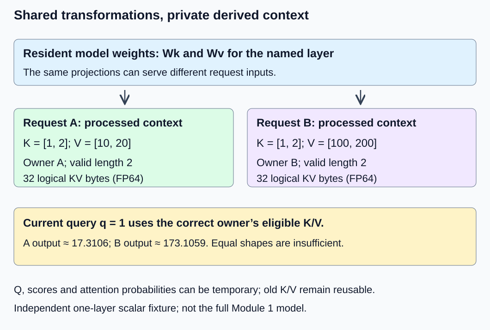
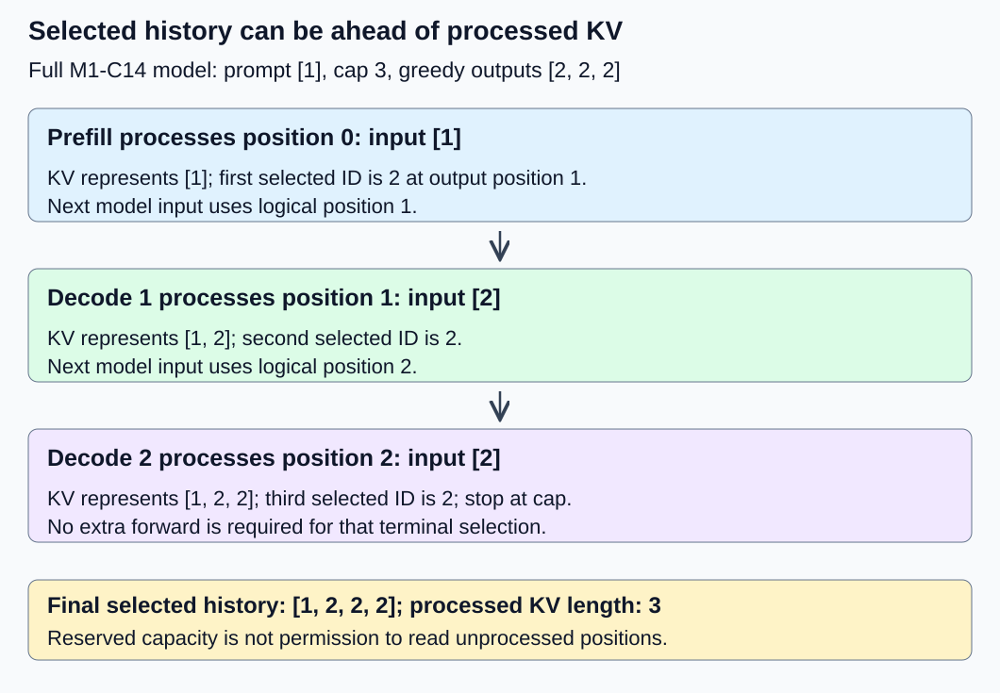

# M2-C01: What the KV cache retains and why

> **Status: Complete — detailed chapter authored and documentation validated; experimental procedures are proposed unless explicitly labelled observed**

**Module:** Treat the KV cache as a first-class systems problem

**Category:** [State, memory, and caching](index.md)

[Module 2 reading order](../module-2.md) · [Next: M2-C02](../model-computation-and-semantics/m2-c02-attention-head-sharing-mha-gqa-and-mqa.md)

## Target concepts

Cached keys and values, model weights versus request state, reuse versus recomputation, prefill and decode cache access, logical token positions.

## Concepts

### 1. Weights describe the model; KV describes processed context

A key-value (KV) cache retains attention keys and values derived from already processed input positions. It is not a cache of model weights, final answers or arbitrary text strings. Weights are the learned projection parameters shared by requests using the same model. KV is intermediate state conditional on a particular processed prefix, layer, position convention and model identity. Module 2 treats that state as something to own, size, move and eventually reclaim. Rust is the eventual language context; this chapter supplies no implementation.

For one attention layer, let X be the layer’s attention input rows, after its required normalization. The learned projections form **K = XWk** and **V = XWv**, before any model-specific positional transform of K. Wk/Wv are weights; K/V are results for these rows. In later layers, X depends on earlier attention and feed-forward computation, not simply on the raw token embedding. With rotary position encoding, the reusable key must follow the backend’s declared transform/position convention; values are not automatically transformed in the same way.

A query Q asks what the current position needs from earlier context. Future queries can use old K/V without reusing old queries. Ordinary cached causal inference therefore retains K/V at each layer; it need not retain every earlier Q, attention probability matrix, hidden activation or logit row. A particular engine may keep additional state, but those allocations are not the definition of KV. Token IDs, stopping state, valid lengths and owner metadata are also needed by the request; KV alone cannot reconstruct every part of the generation contract.

| Item | Meaning | Ordinary lifetime / sharing boundary |
|---|---|---|
| Projection weights | Fixed transformation for the named model/layer | Resident across requests; shared under a fixed model identity |
| Valid K/V rows | Derived context for processed positions | Request-local here; reusable only under a matching prefix/model contract |
| Current Q and attention scores | Work for the current query | Temporary unless an explicit diagnostic retains them |
| Token history and positions | Which IDs were selected/processed and where | Request state; selected history can extend beyond processed KV |
| Capacity and owner metadata | Which storage exists and which rows are valid | Must survive as long as any reader can access that state |

Cross-request prefix sharing is a later extension requiring a separate identity and lifetime contract. This chapter assumes private mutable request caches. Matching shapes, text or model names alone does not authorize sharing.

### 2. Causality makes earlier results reusable

Causal attention at query position i may read keys at j ≤ i, never future j. In deterministic inference with fixed weights, exact prefix IDs, positions and attention policy, appending a suffix cannot change an earlier position’s permitted inputs. Position-local normalization and feed-forward operations preserve that property layer by layer. Earlier K/V therefore remain valid. Dropout, a changed adapter, a modified earlier ID, a different position scheme or a model with future-dependent context can invalidate the argument. Reuse is an equivalence claim with assumptions, not a universal property of all models.

[Attention Is All You Need](https://arxiv.org/html/1706.03762v7) defines masked decoder attention. The [Transformers v4.57.1 cache explanation](https://huggingface.co/docs/transformers/v4.57.1/en/cache_explanation) documents retained per-layer keys/values and consistent positions. Read these alongside [M1-C19](../numerics-and-correctness/m1-c19-validating-cached-and-uncached-generation.md), which requires common-prefix and free-running comparisons before accepting a cached path.

For one head with key width d, query qᵢ and eligible key/value vectors kⱼ/vⱼ:

**Score: sᵢⱼ = (qᵢ · kⱼ)/√d.**

**Weight: αᵢⱼ = exp(sᵢⱼ) / [Σ over eligible m of exp(sᵢₘ)].**

**Output: oᵢ = Σ over eligible j of αᵢⱼvⱼ.**

The dot is a dot product, exp is the exponential, α is a normalized attention weight and o is the attention output. Positions start at zero; j and m both index eligible keys. Each sum includes only keys permitted by the mask. Retaining K/V avoids their recomputation; it does not remove the current query’s attention over eligible context, the new projections or later model layers.

Consider an independent scalar attention fixture, not the full M1-C14 model. There is one layer/head, d = 1 and q = 1 at every query; no positional transform or other layers are present. Rows of X are two coordinates, with Wk selecting the first and Wv selecting the second. Thus X = [(1,10),(2,20)] produces keys [1,2] and values [10,20]. At logical position 1:

**o₁ = (10e¹ + 20e²)/(e¹ + e²) ≈ 17.3105857863.**

Append X row (3,30) at position 2. The old rows do not change. For the new query:

**o₂ = (10e¹ + 20e² + 30e³)/(e¹ + e² + e³) ≈ 25.7521038260.**

Here e is exp(1). Full-prefix causal attention and reuse of the first two K/V rows yield the same result. Re-evaluating the old query at position 1 must still yield o₁; allowing it to see the key at logical position 2 would leak future context and incorrectly yield o₂. At position 0 only its own value is eligible, so o₀ = 10.

*The cache contains derived per-layer context. Sharing model weights does not make different requests’ context interchangeable.*

### 3. Prefill writes context; decode extends and reads it

Prefill processes a prepared prompt of P positions and creates each layer’s prompt K/V. Its required last logit row supplies the first selected output ID. If another output is needed, that selected ID becomes the next model input at logical position P; each layer creates one new K/V row and the current query uses old context plus its new self-key/value. The selected ID is not already represented in KV merely because it was chosen.

Let G be the configured output cap and g the actual number of selected output IDs. For g ≥ 1, ordinary cached generation performs **one prefill + (g − 1) subsequent decode forwards**. At termination its processed cache length is **N = P + g − 1**, provided no different terminal-processing policy was declared. [M1-C18](../runtime-and-concurrency/m1-c18-understanding-prefill-and-decode.md) establishes these phase boundaries. A selected end-of-sequence (EOS) ID need not be processed after it stops generation; G = 0 follows the existing no-forward policy.

In [M1-C14’s fixed model](../model-computation-and-semantics/m1-c14-assembling-a-small-decoder-only-transformer.md), prompt [1], output cap 3 and the existing greedy policy select [2,2,2]. Prefill processes [1]; the two decode inputs are [2] and [2]. Selected history ends [1,2,2,2], while KV represents [1,2,2] at positions 0–2. No fourth forward is needed just to store the last selected ID. Keep this model within its four-position limit.

For one request and one layer, logical K/V shapes are each **(Hkv,N,d)**, where Hkv is the number of KV heads, N valid processed positions and d head width. A batch axis may be added by a backend. The new suffix of r rows has positions **N,…,N + r − 1**. For suffix-local query row i = 0,…,r − 1, eligible keys satisfy **j ≤ N + i**. With N = 2, r = 2, the rows over logical keys 0–3 are [allow,allow,allow,block] and [allow,allow,allow,allow]. A local triangle that ignores the old context is incorrect.

Reserved slots are capacity, not context. An eight-slot cache with valid length two must expose only those two old positions plus permitted new rows. Physical addresses can change while logical positions stay fixed, provided the mapping, associated K/V and positional semantics remain consistent. Position IDs, validity and storage slots are related metadata, not interchangeable numbers. Head-sharing details and capacity accounting are developed in the next chapters.

*The final selected ID can remain outside processed KV. Valid length advances only when the corresponding model input has completed successfully.*

### 4. Reuse trades recomputation for retained state and access

A uniform full-attention cache’s logical payload for one request is **Mkv = 2L Hkv N d w bytes**: L layers, w bytes per stored element and factor two for K/V. This introduces the state boundary; [M2-C03](m2-c03-calculating-kv-memory-and-request-capacity.md) remains an outline for detailed capacity work. In the scalar fixture L = Hkv = d = 1 and FP64 has w = 8, so two positions retain 32 bytes; appending one row adds 16 bytes for a total of 48. A second request needs its own valid state here. These are payload counts, not actual allocator sizes or measured memory traffic.

The full two-layer M1-C14 model has d = 2, Hkv = 1 and FP64, hence 64 bytes per retained position and 192 bytes at N = 3. This is a different configuration from the scalar fixture. Metadata, weight storage, workspace, alignment and reserved capacity are additional. Even when old KV is reused, attention still needs eligible old context; registers, processor caches, layouts and kernels determine actual traffic.

Recomputing prefixes of lengths P through P + g − 1 processes **gP + g(g − 1)/2 input positions**. Cached generation processes **P + g − 1**. For P = 1, g = 3, that is six versus three position evaluations. It is not a twofold time prediction: prompt and decode shapes differ, and attention/weight movement, copies, launches and allocation remain. [M1-C20](../measurement-experimentation-and-economics/m1-c20-measuring-and-explaining-generation-latency.md) explains how to measure those effects.

A growing cache can also require append copies; reserved storage can avoid some reallocations while retaining unused capacity. Paging and sharing address other storage problems, but neither removes the semantic obligation to supply the right keys/values. The [PagedAttention paper](https://arxiv.org/html/2309.06180v1) motivates treating storage mapping and lifetime as serving concerns. Its reported performance is not a result of this chapter’s fixtures.

### 5. Validity includes ownership, publication and recovery

Give each cache a model/configuration identity, request/attempt owner, layer identity, exact processed-prefix identity, position convention, dtype/layout and valid length. Publish an extended valid prefix only after required writes are complete and visible to its reader. Storage lifetime must cover in-flight reads; in Rust, a host ownership boundary also needs an explicit completion contract for asynchronous device users. A host handle going out of scope is not proof that a GPU stopped reading.

| Fault or change | Required elementary treatment |
|---|---|
| Different earlier token, model weights/adapter or positional convention | Reject reuse or rebuild compatible state; equal shape is insufficient |
| Wrong layer/request cache with the same shape | Detect identity mismatch before use; preserve diagnostic evidence |
| New self-key omitted or append repeated | Fail prefix/valid-length and attention checks; do not accept convenient output alone |
| Append fails after some layers write | Do not publish a successful extended prefix; invalidate inconsistent request state under this chapter’s policy |
| Cancellation while work is in flight | Stop scheduling new use; retain storage until readers complete, then release under the owner’s policy |
| Retry with stale attempt state | Require attempt/prefix identity; do not silently inherit the old mutable cache |

The conservative failure policy here invalidates the request’s inconsistent cache and rebuilds from known IDs if recovery is attempted. It does not specify a rollback allocator or a concurrent prefix-sharing algorithm. Losing KV ordinarily loses reusable computation, not model weights; reconstruction costs time and may violate a deadline. Conversely, retaining every abandoned cache indefinitely can exhaust memory. An HFT analogy is derived market state owned by a processing task: stale or misidentified state can invalidate a fast decision. KV is not a market feed or durable order record, and the analogy establishes no trading guarantees.

## Experiments

These are proposed procedures with constructed references. No model runtime, memory allocator or performance benchmark is supplied or claimed as executed.

### E1 — Reuse the correct derived state

**Description:** Compare full-prefix attention with two cached rows plus one appended row in the scalar fixture.

**Purpose/objective:** Test whether reuse preserves causal attention while avoiding old projection recomputation.

**Target concepts:** Cached K/V, model weights versus state and reuse versus recomputation.

**Baseline and workload:** X rows (1,10), (2,20), (3,30); fixed selector projections, scalar q = 1, causal attention and FP64 candidate against an independent high-precision reference.

**Controls and prediction:** Hold projections, rows and mask fixed; vary only recomputation versus reuse. Predict o₁ ≈ 17.3105857863, o₂ ≈ 25.7521038260 and unchanged old K/V.

**Procedure:** Derive keys/values independently. Evaluate old and appended-query outputs by both routes. Compare all eligible attention weights and outputs, then deliberately swap only the first two values while keeping keys fixed as a negative control. Retain projections unchanged throughout.

**Hardware/software:** CPU supporting FP64, one worker thread, at least 1 GiB free RAM for reference/evidence tools. Record CPU, arithmetic-tool version and precision; no GPU is required.

**Failure and HFT connection:** A valid transformation applied to the wrong stored state can still produce plausible output, as stale derived market state can. The analogy concerns validity, not trading behavior.

**Exit criteria:** Numerical outputs pass the stated reference budget, old pairs remain unchanged and the value/key mismatch fails. No elapsed speedup is inferred from avoiding projections.

### E2 — Logical positions and self-context

**Description:** Audit valid lengths and cached suffix masks independently of physical capacity.

**Purpose/objective:** Detect future leakage, lost old context and an unnecessary terminal append.

**Target concepts:** Prefill/decode access, logical token positions, valid versus reserved storage.

**Baseline and workload:** Scalar append at logical position 2; separately, N = 2/r = 2 mask and the full-model [1] → [2,2,2] processed/selected ledger. These are labelled fixtures, not one combined model.

**Controls and prediction:** Fix prefix and model identities; vary the mask/length record deliberately. Predict the two suffix mask rows above and full-model final valid length three.

**Procedure:** Enumerate eligible keys by logical position. Re-evaluate the old scalar query with its causal mask; compare a future-leak variant and an omitted-self variant. Permute complete physical K/V pairs and update the logical mapping: correct results must remain equivalent. For a wrong-mapping probe, make logical position 0 resolve to the second physical pair: its one-key output would become 20 instead of 10. Then test a published reserved slot and a duplicate append as invalid state. Inspect cache lengths for each full-model generation step.

**Hardware/software:** CPU reference review; record mask polarity, index origin and layout description. A later backend must document its non-square mask convention before comparison.

**Failure and HFT connection:** Slot reuse with stale identity resembles confusing buffer location with market-event sequence. Logical history must remain correct even when storage moves; inference positions and feed sequence numbers have different meanings.

**Exit criteria:** All mask/ledger references match, a valid physical remapping preserves outputs, and every declared invalid mapping/length is detected before reuse is accepted.

### E3 — Owner isolation and failed append

**Description:** Check two private request caches sharing projections, followed by failed append/cancellation cases.

**Purpose/objective:** Establish that model sharing does not imply mutable request-state sharing or premature reclamation.

**Target concepts:** Weights versus request state, ownership, lifetime and recovery cost.

**Baseline and workload:** Request A has keys [1,2]/values [10,20]; B uses the same selector weights with X = [(1,100),(2,200)], producing keys [1,2]/values [100,200]. Both query with q = 1. Apply failed publication, stale retry and in-flight cancellation as separate state-ledger variants.

**Controls and prediction:** Fix projection/model identity; vary request/attempt ownership. Predict B’s output equals ten times A’s, while a wrong-owner reference must be rejected even when shapes match.

**Procedure:** Reconcile owners, exact processed rows, logical lengths and payload: 32 bytes each before append. Substitute B’s state into A’s request as a negative control. Model a partial multi-layer append failure using the full-model identity ledger; invalidate inconsistent state without publishing an extended prefix. For cancellation, distinguish terminal notification from observed reader completion and later safe release. Record a reconstruction requirement from known IDs rather than inventing a rollback mechanism.

**Hardware/software:** CPU worksheet/trace viewer; record owner/attempt schema and completion policy. No actual concurrent allocator or GPU cancellation is assumed.

**Failure and HFT connection:** Ownership and stale-state recovery matter for both request processing and market-data tasks, but these paper checks establish neither concurrent memory safety nor exchange recovery.

**Exit criteria:** A/B remain isolated, equal shapes never bypass identity checks, partial failure cannot publish valid extension, and release is permitted only after required users complete.

### E4 — Benchmark retained state against recomputation

**Description:** Specify a single-request timing comparison on the existing full small model.

**Purpose/objective:** Test whether retained state improves completed service under the same output contract.

**Target concepts:** Reuse cost, prefill/decode access, state payload and predicted versus measured latency.

**Baseline and workload:** M1-C14 FP64 model, prompt [1], cap three, greedy lowest-ID ties, EOS ID 3 and no text stop. Compare full-prefix reference with private cached state. Propose three independent process sessions, five excluded warmups per path/session and 30 timed pairs per session: 90 pairs/180 timed requests and 30 warmups.

**Controls and prediction:** Keep weights resident, reset valid request state before every request, counterbalance pair order and fix compiler/runtime, allocation policy, thread count and sink. Predict six versus three position evaluations and 192 final cached payload bytes, not a guaranteed speedup on this tiny workload.

**Procedure:** Pass M1-C19’s common-prefix numerical and exact greedy gates first. Time from prepared IDs/resident weights with empty request state to final text and terminal record after required work completes. Include cache allocation/append work inside the request when it occurs there. Record prefill, subsequent forwards, selected-ID gaps, actual g, outcome and peak allocated/reserved memory separately. Compare minimally instrumented and diagnostic runs. Profile a separate subset for projection recomputation, append copies, allocation and CPU scheduling; remeasure without heavy profiling. Use a predeclared 120 s host deadline as a hang cutoff, retaining unresolved completion/cleanup separately.

**Hardware/software:** CPU requirements from E1 plus CPU/cache/RAM specs, affinity, OS, power policy, compiler optimization, numerical/allocator versions and monotonic clock resolution. A GPU extension requires named hardware/VRAM, driver/runtime, stream dependencies and completed-device timing; it is not implied by this CPU design.

**Failure and HFT connection:** Include stale-state and cancellation faults separately from successful timing samples. Retaining useful state can shorten an HFT path too, but a faster local operation does not establish complete service or a deadline guarantee.

**Exit criteria:** All 180 timed attempts reconcile, warmups stay separate, outputs pass and timing includes the same completed work. Report paired request differences, session variation, overhead and failures. An inconclusive timing difference is acceptable; an invented improvement is not.

## Verification

| Check | Reference and acceptance evidence |
|---|---|
| V1 ↔ E1 | Independent 80-digit and 120-digit attention calculations agree beyond the FP64 screen. Compare outputs/weights within absolute 10⁻¹⁰ plus relative 10⁻¹⁰ × reference magnitude, a teaching budget for this bounded fixture. Swapping only values gives about 12.6894142137 instead of 17.3105857863 and must fail. |
| V2 ↔ E2 | Check old o₁ remains 17.3105857863; leaked future context yields 25.7521038260. Omitting the appended self-pair incorrectly leaves the new output at o₁. Verify suffix masks, logical mapping, eight reserved versus two valid old positions, and full-model total history length four (prompt plus three selected outputs) versus processed length three. |
| V3 ↔ E3 | B’s scalar output is about 173.1058578630; A’s is about 17.3105857863. Check exact owner/attempt/layer/prefix metadata, 32 + 32 = 64 bytes before append, and nonpublication/release rules in every fault ledger. Numeric closeness alone cannot authorize wrong-owner reuse. |
| V4 ↔ E4 | Verify 3 × 30 = 90 pairs, 180 timed requests and 3 × 5 × 2 = 30 warmups. If all complete as specified, 540 IDs are selected, with 180 cached subsequent decode calls and 180 subsequent full-prefix calls. Recheck six versus three position evaluations per request and 192 logical cache bytes. Counts are not timings. |

For the scalar fixture, compare unrounded references; displayed decimals are explanatory. For the full model, retain [M1-C19’s](../numerics-and-correctness/m1-c19-validating-cached-and-uncached-generation.md) independent logit and decision gates rather than use the scalar reference. [M9-C01](../numerics-and-correctness/m9-c01-defining-reference-behavior-and-evidence-before-optimizing.md) supplies evidence contracts, [M9-C17](../numerics-and-correctness/m9-c17-comparing-logits-with-justified-numerical-tolerances.md) numerical-budget reasoning and [M9-C19](../interfaces-protocols-and-streaming/m9-c19-validating-tokenization-stopping-and-final-output.md) token/stopping identity. Advanced cache-reuse and allocator-ownership validation remain outlines; the elementary checks above do not claim those mechanisms exist.

Use [M9-C02](../measurement-experimentation-and-economics/m9-c02-request-events-clocks-and-measurement-boundaries.md) for completed-work clocks and [M9-C07](../measurement-experimentation-and-economics/m9-c07-latency-distributions-and-statistical-uncertainty.md) for populations. Keep successful latency samples, fault outcomes and unresolved attempts visible in the report. Ninety pairs are an initial exercise, not a production p99 claim; extend independent sessions when uncertainty matters. Do not treat every token in a correlated request as independent evidence. GPU submission timing, profiler overhead and logical-payload counts cannot substitute for completed-request measurements. All runtime procedures remain proposed.

## Engineering dimensions and principles

| Dimension | Application in this chapter |
|---|---|
| Semantics and invariants | Reused K/V must match the exact processed prefix, layer/model and positions; E1/E2 compare reference attention and masks. |
| Workload and variability | Prompt length, output steps and prefix reuse change retention and recomputation; early stopping changes processed length. Text-only scope excludes non-text modalities. |
| Resources and bottlenecks | Retaining KV saves projection work while consuming capacity and context access; E4 separates logical bytes, append copies and actual traffic. |
| Time and distributions | Generation dependencies persist; timing includes allocation and completion. Warmups, gaps, request samples and recovery tails have distinct populations. |
| Ownership and coordination | E3 assigns private owners, publishes only completed state and delays reclamation until readers finish. |
| Failure and adaptation | Wrong state, failed append, stale retries and cancellation require invalidation or reconstruction with explicit cost and cutoff. |

1. **Correctness defines the optimization boundary.** Cache reuse preserves the agreed inference behavior; changing attention eligibility or positions is not an equivalent optimization.
2. **Performance depends on workload and operating point.** More reuse can save work, but tiny requests and append overhead can make its timing benefit uncertain.
3. **Data movement is part of the algorithm.** Old KV access and append copies remain even when projections are reused.
4. **State has ownership, lifetime and recovery cost.** Request state must remain valid until users finish; rebuilding a lost cache costs computation.
5. **Dependencies determine latency; bottlenecks determine capacity.** Each new selection depends on the preceding forward, while retained state consumes finite memory.
6. **Variability and synchronization shape the tail.** Growing state, allocation and delayed readers can create slow requests beyond a mean-step estimate.
7. **Local improvements must be evaluated end to end.** Fewer position evaluations matter only if correct completed requests benefit.
8. **Claims require reproducible evidence.** Publish fixture identities, valid lengths, masks, ownership, hardware and outcomes with every result.

## Specifications, articles, and hardware

Primary sources checked 25 October 2026:

- [Attention Is All You Need, arXiv v7](https://arxiv.org/html/1706.03762v7) (original 2017 paper; revised 2 August 2023): attention projections and decoder causal masking.
- [Transformers v4.57.1: Caching](https://huggingface.co/docs/transformers/v4.57.1/en/cache_explanation): retained layer state, combined old/new context and logical cache positions. Backend-specific layouts still require inspection.
- [Efficient Memory Management for Large Language Model Serving with PagedAttention, v1](https://arxiv.org/html/2309.06180v1) (12 September 2023; SOSP 2023): motivation for separate logical state and storage management. Paging/sharing mechanisms are deferred; no reported speedup is claimed for this chapter.

Hardware requirements and manifests are in E1/E4. No device, allocator footprint or measured bandwidth is invented. Detailed KV-head sharing, capacity, paging and sharing follow in later Module 2 chapters; Module 9 supports their evidence requirements throughout Modules 1–7. Module 8 is excluded.

## Key takeaways

KV retains derived per-layer context, while weights define the transformations. Causal, identity-preserving inference permits reuse of old keys/values, but the current query still reads eligible context. Logical positions and valid lengths determine what may be read; ownership and completion determine when that state may be changed or reclaimed. Fewer recomputed positions are a prediction to investigate, not a measured latency gain.

Its reading and authoring successor is now complete: [M2-C02: Attention head sharing](../model-computation-and-semantics/m2-c02-attention-head-sharing-mha-gqa-and-mqa.md). Consult the [execution plan](../chapter-execution-plan.md) for current progress.
