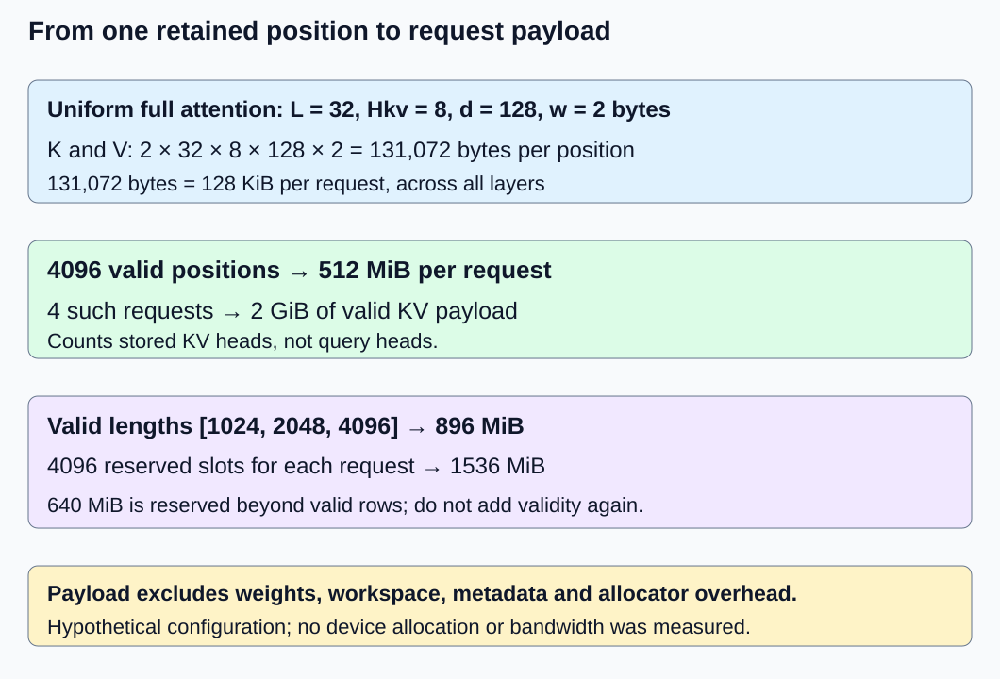
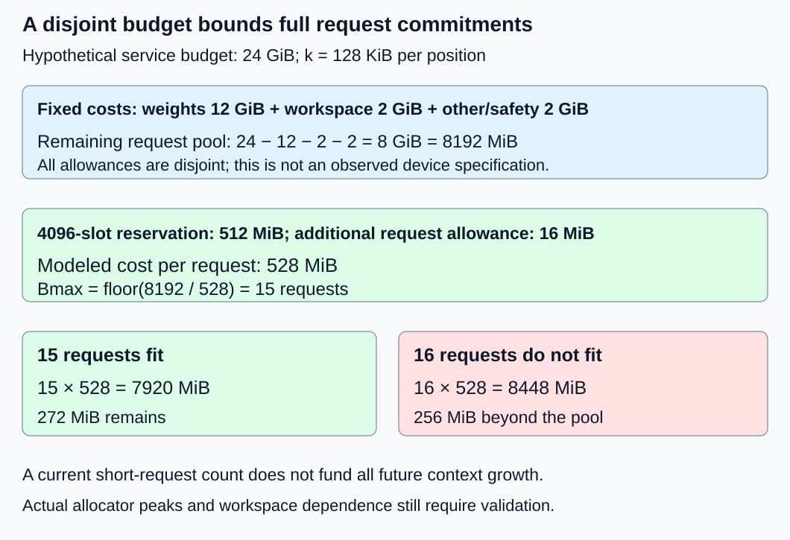

# M2-C03: Calculating KV memory and request capacity

> **Status: Complete — detailed chapter authored and documentation validated; experimental procedures are proposed unless explicitly labelled observed**

**Module:** Treat the KV cache as a first-class systems problem

**Category:** [State, memory, and caching](index.md)

[Module 2 reading order](../module-2.md) · [Previous: M2-C02](../model-computation-and-semantics/m2-c02-attention-head-sharing-mha-gqa-and-mqa.md) · [Next: M2-C04](../state-memory-and-caching/m2-c04-memory-ownership-handles-and-lifetimes-from-first-principles.md)

## Target concepts

Uniform full-attention KV formula, bytes per element, KiB and GiB, cached token counts, 128 KiB per token example, concurrency and context budgets, payload versus overhead.

## Concepts

### 1. Define the byte boundary before calculating capacity

KV capacity is the amount of attention state that can remain live together under a specified memory budget. It is not simply device memory divided by prompt length. [M2-C01](m2-c01-what-the-kv-cache-retains-and-why.md) established processed context and ownership; [M2-C02](../model-computation-and-semantics/m2-c02-attention-head-sharing-mha-gqa-and-mqa.md) established KV-head sharing. [M1-C05](m1-c05-how-tensors-occupy-memory.md) distinguishes logical tensor bytes from backing allocations, and [M1-C07](../numerics-and-correctness/m1-c07-floating-point-arithmetic-and-numerical-correctness.md) explains storage precision. This chapter turns those contracts into a budget. Rust remains the eventual language context; no implementation is provided.

A byte is eight bits. Binary memory units use powers of 1024: **1 KiB = 1024 bytes; 1 MiB = 1024² bytes; 1 GiB = 1024³ bytes**. Decimal kB/MB/GB use powers of 1000. Always retain integer bytes in the calculation and convert only for display. For example, 8 GiB is 8,589,934,592 bytes, while 8 GB is 8,000,000,000 bytes.

| Stored element | Bytes per element w | Boundary caveat |
|---|---:|---|
| FP64 | 8 | Fixed-width element payload |
| FP32 | 4 | Fixed-width element payload |
| FP16 or BF16 | 2 | Same storage width, different numerical formats |
| Eight-bit storage | 1 | Payload only; representation may need scales or other metadata |
| Four-bit packed storage | 1/2 ideally | Requires packing; scales, alignment and residual high-precision state can add bytes |

Weight precision does not establish KV precision. A quantized-weight model may still retain two-byte KV. Changing KV precision is a numerical/quality decision, not a free accounting edit. The [Transformers v4.57.1 cache-strategy guide](https://huggingface.co/docs/transformers/v4.57.1/en/kv_cache) distinguishes dynamic, static and quantized storage; its implementation details and tradeoffs do not prove any configuration fits a particular device.

### 2. Derive the uniform full-attention formula

Assume one device holds all L layers’ unshared, dense, full-attention KV for B independent requests of equal valid length N. Each layer/request stores Hkv heads, each with N positions and d elements per position, in both K and V. K/V have the same width and element size w here.

**Mpayload = 2 × L × B × Hkv × N × d × w bytes.**

The factor two counts K and V, not two forward passes. Hkv is the number of stored KV heads, not the number of query heads Hq. Define the bytes per retained position per request across all layers:

**k = 2L Hkv d w bytes/position; Mpayload = kBN.**

This counts valid element payload. It excludes weights, workspace, unused slots, padding, metadata, alignment, unused allocator-held blocks, temporary copies and unrelated processes. It is not measured device traffic. Distributed sharding, prefix sharing, sliding windows, nonuniform layers and latent/compressed state need their actual storage model; do not silently apply this uniform formula to them.

For the constructed configuration **L = 32, Hkv = 8, d = 128, w = 2**:

**k = 2 × 32 × 8 × 128 × 2 = 131,072 bytes = 128 KiB per position per request.**

One layer contributes 4096 bytes per position, and 32 layers contribute 131,072. With N = 4096 and B = 1, payload is **536,870,912 bytes = 512 MiB = 0.5 GiB**. It is also 0.536870912 decimal GB; units changed, not the allocation. This is a sizing example, not a named checkpoint or actual GPU allocation.

| Valid positions N per request | B | Payload with k = 128 KiB |
|---:|---:|---:|
| 1024 | 1 | 128 MiB |
| 2048 | 1 | 256 MiB |
| 4096 | 1 | 512 MiB |
| 4096 | 4 | 2 GiB |
| 8192 | 1 | 1 GiB |

*Count all layers, both K/V and the actual stored head count. These are logical bytes, not a device-capacity guarantee.*

### 3. Count processed positions, reservations and heterogeneous lengths

For prepared prompt length P and g ≥ 1 actually selected outputs, the existing ordinary generation policy leaves **N = P + g − 1** processed positions at termination. Prefill supplies the first selection; the final selected ID need not be processed. With output cap G, reserving P + G positions is a conservative planning policy, one position above this path’s maximum processed length. It is not proof that all reserved rows are valid. The model context check P + G ≤ Cmodel, where Cmodel is its declared supported context, is separate from device-memory fit. Under the established G = 0 no-forward policy, valid request KV remains empty.

For P = 3072, G = g = 1024, terminal processed length is 4095. The illustrative payload is **511.875 MiB**. A 4096-slot reservation is **512 MiB**; the 128 KiB difference is unused capacity, not missing output. A static cache can reserve many more unused slots, while a growing cache may allocate in steps. Neither a tensor’s capacity nor its largest index proves a row has been processed.

For requests of unequal valid lengths Nᵣ, r labels the request and the logical unshared payload is **k × Σᵣ Nᵣ**. A dense padded representation with B lanes of common capacity C reserves **kBC**, even when fewer rows are valid. Do not add both as separate allocations if the valid rows occupy the reserved buffers.

Take three requests with valid lengths [1024,2048,4096]. Their valid payload is **k × 7168 = 896 MiB**. Reserving 4096 slots independently for all three gives **1536 MiB**, including **640 MiB** beyond valid payload. If those slots already exist, growth inside them consumes validity, not another full buffer allocation. A scheduler that promises larger future contexts must budget that growth; current occupancy alone is not a safe commitment limit.

### 4. Derive a complete admission budget

An admission decision accepts a new request only under an explicit resource policy. Let Mdevice be the device-memory budget assigned to this service; Mweights resident weights; Mworkspace a conservative simultaneous workspace/activation allowance; and Mfixed other disjoint fixed state plus safety headroom. Define:

**Mavailable = Mdevice − Mweights − Mworkspace − Mfixed.**

For equal reservations C and per-request additional allowance h, a simplified bound is:

**Bmax = floor[Mavailable / (kC + h)].**

floor rounds down. Require nonnegative budgets and positive per-request cost; if fixed costs already exceed Mdevice, no request can be admitted under the model. The allowances must be disjoint: do not count allocator-managed weights twice or add “reserved” plus “allocated” as if they were separate pools. Workspace can change with batch/context, so this simple expression is valid only if its allowance covers all compared operating points. Fragmentation or contiguous-allocation constraints may still prevent a real allocation.

A hypothetical service has **24 GiB** assigned device memory: 12 GiB weights, 2 GiB workspace and 2 GiB other fixed state/safety allowance, leaving **8 GiB = 8192 MiB** for request reservations and their additional overhead. None of these numbers is an observed hardware specification.

With k = 128 KiB and C = 4096, each request reserves 512 MiB payload. Ignoring request overhead yields a payload-only bound of **16 requests**. With a deliberately specified **h = 16 MiB per request**, disjoint from the fixed allowances, cost becomes 528 MiB and the bound falls to **15**: 15 × 528 = 7920 MiB fits, while 16 × 528 = 8448 MiB exceeds 8192. The remaining 272 MiB does not fit another complete reservation.

| Budget policy under the same 8 GiB request pool | Per-request modeled cost | Bound | Interpretation |
|---|---:|---:|---|
| C = 4096, payload only | 512 MiB | 16 | Omits additional request cost |
| C = 4096 plus h = 16 MiB | 528 MiB | 15 | Includes declared per-request allowance |
| C = 8192 plus h = 16 MiB | 1040 MiB | 7 | Longer commitments reduce concurrency |
| Current N = 2048 plus h = 16 MiB | 272 MiB | 30 | Current occupancy estimate; does not fund later growth to C = 4096 |

Dividing all 24 GiB by a 512 MiB cache would incorrectly suggest 48 requests while forgetting weights and other state. Treating an 8 GB pool as 8 GiB would also overstate payload-only capacity: 8,000,000,000/536,870,912 supports only 14 complete 4096-position requests. Integer comparisons should decide admission; rounded displayed GiB should not.

*The illustrative 15-request bound includes a specified overhead allowance. It is a paper bound under fixed assumptions, not measured sustainable capacity.*

### 5. Logical payload is one view of memory

Valid payload measures meaningful K/V rows. Cache capacity includes unused slots. Live tensor allocations can additionally include alignment or temporary tensors. Allocator-reserved memory includes live allocations and reusable blocks held by that allocator; process/device occupancy can also include runtime contexts, other libraries and other processes. Compare these views at matched timestamps, with each counter’s definition recorded.

The [PyTorch 2.14 CUDA memory documentation](https://docs.pytorch.org/docs/2.14/notes/cuda.html#memory-management) distinguishes tensor-allocated from allocator-reserved memory. Released tensors can leave allocator reserves unchanged. This is one allocator’s contract, not a requirement that a Rust runtime expose identical counters. The [PagedAttention paper](https://arxiv.org/html/2309.06180v1) motivates accounting for storage waste and duplication; its serving gains are not results of this chapter.

Temporary growth can create a peak above final capacity. In a separate small storage fixture, let L = Hkv = d = 2 and w = 8, so k = 128 bytes per position. Growing one request from N = 3 to N = 4 by allocating a new exact-size buffer while retaining the old one yields **384 + 512 = 896 payload bytes** during coexistence. Releasing the old buffer leaves 512. A fixed eight-position buffer holds 1024 bytes throughout while only 512 are valid after append. Smaller final storage is not necessarily smaller transient storage, and lower bytes do not establish lower latency.

Old buffers remain live until readers finish. Cancellation receipt is not permission to reclaim memory while a device still reads it. An allocation failure must not publish an extended valid cache. Conversely, a decrease in valid rows does not imply the allocator returned memory to the device. Preserve owner, completion and outcome evidence rather than diagnose a leak from one counter.

## Experiments

These are proposed experiments with constructed arithmetic references. No allocator, GPU, serving system or measured capacity is supplied.

### E1 — Audit element widths and the 128 KiB position

**Description:** Derive the uniform payload formula from K/V tensor shapes and convert exact byte counts.

**Purpose/objective:** Detect missing factors, wrong head counts and binary/decimal unit errors.

**Target concepts:** Uniform KV formula, bytes per element, KiB/GiB and the 128 KiB example.

**Baseline and workload:** L = 32/Hkv = 8/d = 128/w = 2; N = 1024/2048/4096/8192 and B = 1/4 as in the table. Assume Hq = 32 solely for a wrong-head-count negative control.

**Controls and prediction:** Hold architecture and KV precision fixed. Predict k = 131,072 bytes and the table’s payloads. Using Hq = 32 instead of Hkv = 8 overcounts fourfold; dropping either K or V halves the true count.

**Procedure:** Count elements independently per layer, request and K/V tensor, then multiply widths and reconcile binary/decimal displays. Change w to 4 as a separately labelled FP32 sizing case: payload doubles without proving numerical equivalence. Treat four-bit width as ideal packed payload only, with explicit metadata exclusions.

**Hardware/software:** CPU integer-arithmetic worksheet or viewer; record calculation-tool version and integer range. No GPU or large allocation is needed.

**Failure and HFT connection:** Unit and field-width errors can corrupt a low-latency market-data buffer budget too. The analogy concerns resource accounting, not trading semantics or deadlines.

**Exit criteria:** All byte counts match exact references; wrong factors/units are detected and a precision change is never reported as a free equivalent optimization.

### E2 — Valid rows, growth commitments and unequal requests

**Description:** Compare processed length, reserved length and unequal-request occupancy.

**Purpose/objective:** Test whether current valid payload can be substituted for promised future capacity.

**Target concepts:** Cached token counts, context budgets, reservation versus use and skewed lengths.

**Baseline and workload:** P = 3072/G = 1024, actual g = 1024; separately use valid lengths [1024,2048,4096] with a common reservation C = 4096. Include G = 0 and P + G > Cmodel as separate policy cases, where Cmodel names the model’s supported context.

**Controls and prediction:** Keep k = 128 KiB. Predict 4095 processed rows versus 4096 reserved slots, and 896 MiB valid versus 1536 MiB reserved for the three-request fixture.

**Procedure:** Enumerate prefill and subsequent decode inputs before counting KV. Reconcile the final selected-but-unprocessed ID and unused reservation. Apply early stopping at g = 1 as a separate variant: valid length is 3072 positions, or 384 MiB, while the same 4096-slot commitment remains 512 MiB. Do not retroactively shrink the commitment policy. Reject over-context requests independently of free device memory. Check that G = 0 has no valid KV under the established no-forward contract.

**Hardware/software:** CPU ledger review; record model-context/stopping assumptions and allocation policy. These large lengths are hypothetical sizing data, not extensions of the four-position M1-C14 model.

**Failure and HFT connection:** Accepting many small current requests while ignoring their permitted growth resembles underbudgeting burst buffers in an HFT pipeline. Workload forecasts are uncertain; this exercise establishes no burst-loss guarantee.

**Exit criteria:** All valid/reserved counts reconcile; padded storage is not double-counted, invalid context is rejected and current occupancy is not advertised as a worst-case commitment limit.

### E3 — Admission boundaries and overhead sensitivity

**Description:** Evaluate the hypothetical 24 GiB service budget with competing reservation assumptions.

**Purpose/objective:** Find the first request that does not fit the declared disjoint budget.

**Target concepts:** Concurrency/context budgets, payload versus overhead and safe rounding.

**Baseline and workload:** Fixed costs 12 + 2 + 2 GiB; request pool 8 GiB. Compare C = 4096 and 8192, h = 0 and 16 MiB where specified; evaluate the exact boundary requests from the table.

**Controls and prediction:** Vary one allowance or reservation at a time. Predict bounds 16 payload-only, 15 with overhead and 7 with longer reservations; current N = 2048 suggests 30 only without growth commitment.

**Procedure:** Calculate the remaining pool in integer bytes. Check the last fitting and first nonfitting request by multiplication. Test an 8 GB unit substitution, fixed costs exceeding the budget and a hypothetical growing workspace as separate variants. Revise the model when a fixed workspace allowance fails; do not silently reduce the safety allowance to preserve a preferred concurrency.

**Hardware/software:** CPU worksheet; no 24 GiB device is required. A real service must replace every hypothetical allowance with a measured or justified upper budget and record hardware/model identities.

**Failure and HFT connection:** Admission under overload should preserve correctness and leave rejection evidence, as bounded queues in low-latency systems require explicit overload policy. Request rejection is not equivalent to dropped or executed orders.

**Exit criteria:** Every accepted reservation fits and each first nonfitting one rejects under the model. The report labels the bound as conditional and never calls it measured sustainable request capacity.

### E4 — Observe storage growth and allocator counters

**Description:** Specify a small cache-storage comparison between exact-size growth and fixed-capacity reservation.

**Purpose/objective:** Test logical, transient and allocator memory views at matched completion boundaries.

**Target concepts:** Payload/overhead, peak coexistence, valid lengths and memory measurement.

**Baseline and workload:** Separate synthetic storage fixture: L = Hkv = d = 2, FP64; B = 1/4 and N = 1/3/8, giving six cells. Compare exact-size buffers for N with fixed C = 8 buffers; use uniquely labelled K/V coordinates for each request/layer/head/position/feature. The N = 3→4 append is a separate peak-growth probe.

**Controls and prediction:** Hold valid values, owner identities, dtype, layout and completion policy fixed. Predict valid payload 128BN bytes and static capacity 1024B bytes. Propose three independent sessions, five excluded warmups per policy/cell/session and 30 paired trials per cell/session: 540 pairs/1080 timed trials plus 180 warmups. These counts exclude the separately labelled append and fault probes.

**Procedure:** Validate coordinate identity and masks first. Record a clean baseline, allocated capacity, filled/valid state, any copy-coexistence peak and safe release after readers complete. Time allocation/fill through successful publication of the required valid cache, retaining release timing separately. Compare minimally instrumented runs with separate allocator/profiler snapshots. Check the 896-byte growth peak versus the static 1024-byte reservation for B = 1, without inferring a universal latency ranking. Inject allocation failure and cancellation as separate ledger probes; do not publish partially filled rows. Use a predeclared 120 s host hang cutoff and retain unresolved completion/release explicitly.

**Hardware/software:** CPU FP64 and at least 1 GiB free RAM suffice for the small fixture; record CPU, RAM, OS, allocator/compiler/runtime, affinity, clock resolution and counter semantics. A conditional GPU extension additionally records GPU/VRAM, driver, memory backend, stream completion and peak-counter reset scope. Do not allocate the large E3 budget merely to test arithmetic.

**Failure and HFT connection:** Temporary buffer coexistence can exceed final storage in either inference or a market-data pipeline. A storage-only trial does not establish generation throughput, concurrent-memory safety or trading latency.

**Exit criteria:** All scheduled trials reconcile with correct valid coordinates and outcomes. Distinguish valid, capacity, allocated/reserved and process views; retain peaks and delayed release. Any memory/latency improvement remains unclaimed until actually measured on the named configuration.

## Verification

| Check | Reference and acceptance evidence |
|---|---|
| V1 ↔ E1 | Confirm 4096 bytes/layer/position × 32 = 131,072 bytes = 128 KiB, and 4096 positions = 536,870,912 bytes = 512 MiB. Validate all table cells and factor-four/factor-two negative controls; do not round before admission comparisons. |
| V2 ↔ E2 | Check 3072 + 1024 − 1 = 4095, payload 511.875 MiB versus 512 MiB reserved. Unequal valid lengths sum to 7168 positions (896 MiB); three reservations total 1536 MiB, leaving 640 MiB unused. Verify zero-cap and invalid-context outcomes independently. |
| V3 ↔ E3 | Confirm 24 − 12 − 2 − 2 = 8 GiB; 15 × 528 = 7920 MiB fits while 16 × 528 = 8448 fails. Seven × 1040 fits, eight does not. 8 decimal GB funds 14 payload-only requests, not 16. Fixed-cost overruns must not produce negative or wrapped capacity. |
| V4 ↔ E4 | Confirm six cells and 540 pairs/1080 timed trials plus 180 excluded warmups. For B = 1, valid bytes at N = 1/3/8 are 128/384/1024; B = 4 multiplies them by four. Static capacity is 1024/4096 bytes. Growth 3→4 has 384 + 512 = 896 coexistence bytes before old release. |

Integer reference checks require exact agreement, with overflow-checked products and a consistent byte unit. A budget’s rounded display is not an acceptance tolerance. Storage comparisons require exact coordinate/owner/validity checks; changing KV precision requires a separate numerical/output contract rather than applying a byte-only gate. [M9-C01](../numerics-and-correctness/m9-c01-defining-reference-behavior-and-evidence-before-optimizing.md) supplies reference-first evidence, [M9-C17](../numerics-and-correctness/m9-c17-comparing-logits-with-justified-numerical-tolerances.md) precision-contract reasoning and [M9-C02](../measurement-experimentation-and-economics/m9-c02-request-events-clocks-and-measurement-boundaries.md) completed-work boundaries. M9-C15’s advanced memory/fragmentation treatment remains an outline; elementary disjoint accounting is supplied locally.

An executed memory benchmark must name each counter’s scope and capture baseline, live peak and post-release values at compatible times. Do not add independently observed maxima as though they necessarily occurred simultaneously. Keep peak request allocations separate from allocator reserve and whole-device occupancy. Use [M9-C07](../measurement-experimentation-and-economics/m9-c07-latency-distributions-and-statistical-uncertainty.md) for uncertainty and population weighting: repeated allocator trials may be correlated, and a few sessions cannot certify production tails or sustainable serving capacity. Report failures and unresolved release alongside successful measurements. Runtime procedures here remain proposed.

## Engineering dimensions and principles

| Dimension | Application in this chapter |
|---|---|
| Semantics and invariants | Valid rows must match processed context; exact units, owners and tensor coordinates gate every storage claim. |
| Workload and variability | Context, concurrent requests, early stopping and uneven lengths change occupancy; commitments must fund growth. Text-only scope excludes non-text modalities. |
| Resources and bottlenecks | Weights, KV, workspace, overhead and temporary copies compete for the same finite budget; memory fit does not establish bandwidth or compute capacity. |
| Time and distributions | Peak coexistence and delayed release matter beyond final footprint; allocation/publication/release have distinct timing boundaries. |
| Ownership and coordination | Count each unique live allocation once and retain buffers until all readers complete; cancellation is not immediate reclamation. |
| Failure and adaptation | Invalid context, overflow, budget exhaustion, allocation failure and uncertain workspace growth require explicit rejection/revision rather than hidden overcommit. |

1. **Correctness defines the optimization boundary.** Smaller KV precision or discarded context needs a new behavior contract; miscounting valid rows is not a memory optimization.
2. **Performance depends on workload and operating point.** Thirty currently short requests may outgrow a budget that funds only fifteen full commitments.
3. **Data movement is part of the algorithm.** Growth copies and offloading can add cost even if final device payload shrinks.
4. **State has ownership, lifetime and recovery cost.** Validity, reservation and safe release differ; cancelled in-flight state can remain live.
5. **Dependencies determine latency; bottlenecks determine capacity.** Memory admission is one bound, while completed serving also depends on compute, bandwidth and queueing.
6. **Variability and synchronization shape the tail.** Allocation peaks, delayed readers and changing workspace can produce failures or stalls not predicted by average occupancy.
7. **Local improvements must be evaluated end to end.** A lower byte count is insufficient evidence of useful throughput or request-latency improvement.
8. **Claims require reproducible evidence.** Publish exact bytes, identity, reservation policy, counter definitions, hardware and all outcomes.

## Specifications, articles, and hardware

Primary sources checked 25 October 2026:

- [Transformers v4.57.1: KV cache strategies](https://huggingface.co/docs/transformers/v4.57.1/en/kv_cache): dynamic/static/quantized storage distinctions and architecture-dependent retention. Model-specific behavior must replace the uniform assumptions where appropriate.
- [PyTorch 2.14: CUDA memory management](https://docs.pytorch.org/docs/2.14/notes/cuda.html#memory-management): tensor allocation versus caching-allocator reserves and snapshot scope; these counter definitions are versioned and backend-dependent.
- [Efficient Memory Management for Large Language Model Serving with PagedAttention, v1](https://arxiv.org/html/2309.06180v1) (12 September 2023; SOSP 2023): retained-state waste and memory-management motivation. Paging/sharing details follow later, and no paper speedup is claimed here.

Hardware requirements/manifests appear in E1–E4. The 24 GiB budget and 128 KiB-per-position model are hypothetical assumptions combined for the budget exercise, not a supplied GPU/checkpoint pair. Module 9 supports these checks throughout Modules 1–7; Module 8 is excluded.

## Key takeaways

Count both K/V, all retained layers, actual KV heads and stored element bytes. Track valid positions separately from reservations and future commitments. Derive admission from a disjoint whole-service budget, then verify actual allocation peaks and release behavior. A payload formula is a useful bound under its assumptions; it is not a measured serving-capacity guarantee.

Its reading and authoring successor is now complete: [M2-C04: Memory ownership, handles, and lifetimes](m2-c04-memory-ownership-handles-and-lifetimes-from-first-principles.md). Consult the [execution plan](../chapter-execution-plan.md) for current progress.
