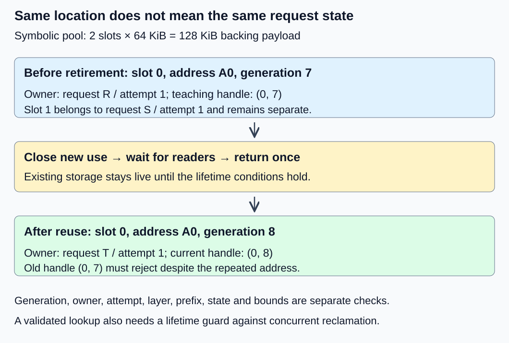
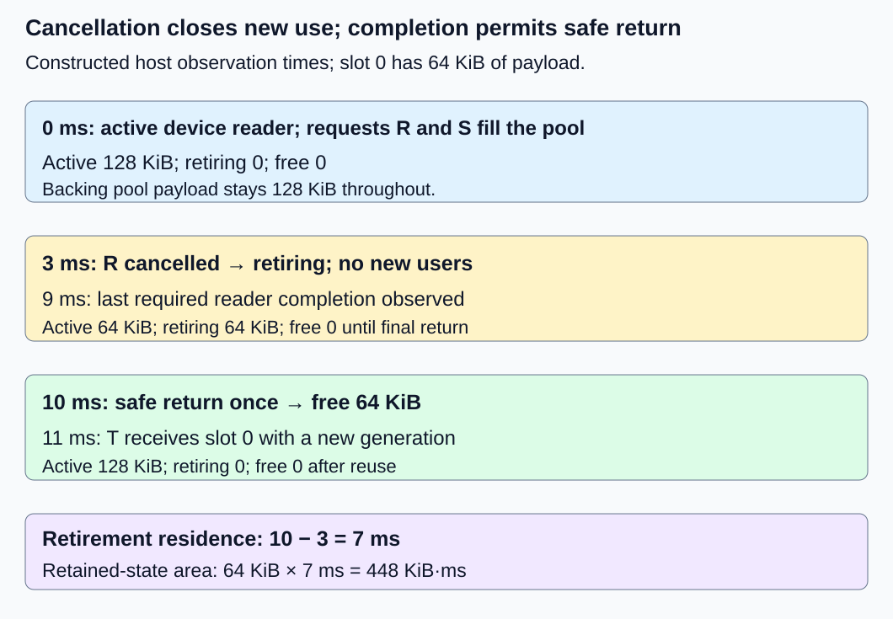

# M2-C04: Memory ownership, handles, and lifetimes from first principles

> **Status: Complete — detailed chapter authored and documentation validated; experimental procedures are proposed unless explicitly labelled observed**

**Module:** Treat the KV cache as a first-class systems problem

**Category:** [State, memory, and caching](index.md)

[Module 2 reading order](../module-2.md) · [Previous: M2-C03](../state-memory-and-caching/m2-c03-calculating-kv-memory-and-request-capacity.md) · [Next: M2-C05](../state-memory-and-caching/m2-c05-contiguous-kv-storage-and-its-limits.md)

## Target concepts

Allocation and reclamation, addresses versus handles, Rust ownership and borrowing concepts, request identity, stale handles, use-after-free, double-free.

## Concepts

### 1. Storage, contents and authority are different things

Allocation obtains storage for a purpose; reclamation makes it available for another use after its users finish. A KV buffer holds derived request context, but its address alone does not say which request owns it or whether its values are valid. [M2-C01](m2-c01-what-the-kv-cache-retains-and-why.md) established that identity requirement; [M1-C05](m1-c05-how-tensors-occupy-memory.md) separated tensor descriptions from backing buffers. This chapter supplies ownership reasoning for Module 2 without implementing an allocator or providing code.

An address identifies a location in a particular address space. A pointer carries address information with additional language/backend rules; treating it as an integer does not establish safe access. A handle is an indirect identifier resolved through metadata. The metadata can check the current allocation, owner, bounds and lifecycle before exposing access. Copying a handle need not copy the KV or grant ownership. A handle is not automatically a security capability or protection against deliberate forgery.

An owner is responsible for keeping a resource valid and arranging its eventual release. A borrow permits temporary access while another entity retains responsibility. A lifetime describes the interval over which an access is valid; it is not a stopwatch duration or a promise that a request completes within a deadline. Distinguish the backing allocation’s lifetime, the request’s logical use of a region and a reader’s access interval. A pooled region can remain allocated after its former request’s ownership ends.

| Concept | What it establishes | What it does not establish alone |
|---|---|---|
| Address | Location in a named address space | Current request identity, bounds or lifetime |
| Handle | An identity resolved by a declared lookup contract | Ownership, permanent validity or synchronization |
| Owner | Responsibility for lifetime and permitted transfer/release | That an external device has finished |
| Borrow or reader lease | Temporary permitted access under a contract | An independent right to reclaim storage |
| Valid KV length | Which logical rows completed processing | That other slots contain usable context |

The [Rust ownership chapter](https://doc.rust-lang.org/book/ch04-01-what-is-ownership.html) introduces values with one owner, ownership transfer and dropping values. Moving an ordinary owning buffer transfers responsibility; it does not require duplicating all its elements. A deep copy is a separate storage operation. Returning storage to a pool or allocator also does not necessarily return physical memory to the operating system or device, as [M2-C03](m2-c03-calculating-kv-memory-and-request-capacity.md) explains.

### 2. Borrowing controls access; identity controls which state is accessed

For ordinary Rust references to the same region, shared read access and exclusive mutable access have different rules. Multiple immutable borrows may coexist; an exclusive mutable borrow cannot coexist with conflicting ordinary borrows. A reference must remain valid for its use. The [Rust borrowing chapter](https://doc.rust-lang.org/book/ch04-02-references-and-borrowing.html) explains these compiler-checked rules. Controlled interior mutability and synchronized shared ownership require their own contracts; this introductory chapter does not infer them from a copied identifier.

As a paper access rule, let R be the number of active ordinary readers and W either zero or one exclusive writer. Allowed states are **W = 0 with R ≥ 0**, or **W = 1 with R = 0**. Thus a read-only cache view can be borrowed by several host consumers, while a conflicting append/move/release must wait for those borrows to end. These counts are an explanatory model, not an implemented reference counter or a concurrency proof.

Safe Rust prevents many memory-invalid operations through its type and borrowing rules, but it does not prove a handle identifies the intended request or that a numeric cache position is correct. A safe container can hold perfectly valid values for the wrong request. Raw-pointer, foreign-library or device interfaces add obligations that the ordinary host reference model does not discharge automatically.

Growth is also relevant. [Rust std 1.99.1 Vec documentation](https://doc.rust-lang.org/std/vec/struct.Vec.html) describes capacity and reallocation; a backing buffer may move when growth requires it. An old raw address must not be treated as a durable identity after such a change. A validated indirect handle can resolve the current location, but only if relocation is coordinated with active readers. The handle does not make a concurrent move safe by itself.

### 3. A stale-handle fixture separates location from identity

Use two symbolic 64 KiB pool slots, for 128 KiB total backing storage. Slot 0 is associated with address label A0, slot 1 with A1; these labels are not real CPU/GPU addresses. At the start, request R/attempt 1 owns slot 0 at generation 7, while request S/attempt 1 owns slot 1 at generation 2. A generation is a version distinguishing successive uses of a slot.

The teaching handle contains **(slot, generation)**. Its lookup also receives the expected request/attempt, layer and processed-prefix identity. It must match a live entry and valid row bounds. For slot s and generation g, a necessary identity screen is:

**entry exists; entry generation = g; expected owner/attempt/layer/prefix match; access is permitted by entry state and bounds.**

New lookups require an active entry. An already authorized reader may finish while its entry is retiring; retirement does not grant new readers access. This is a declarative acceptance specification, not lookup implementation. A valid result must additionally keep storage alive for the access; checking metadata and then allowing unsynchronized reclamation would create a check/use race. A race means another operation changes relevant state between the check and use.

After R is safely retired, slot 0 is reused by request T/attempt 1 at generation 8, potentially at the same address A0. The old handle (0,7) must reject, even though the slot and address still exist. A retry R/attempt 2 must not inherit R/attempt 1’s mutable cache merely because the logical request ID matches. Request identity, attempt identity and allocation generation answer different questions.

The author-maintained [slotmap 1.1.1 documentation](https://docs.rs/slotmap/1.1.1/slotmap/) gives a concrete example of versioned keys distinguishing reused slots. This chapter’s owner fields, device leases and lifecycle are its own teaching contract, not claims about that crate’s API or concurrency support. No dependency is installed.

*The backing location is the same; the allocation-use identity and request owner have changed.*

The main fixture’s generation field can represent 8. A separate finite-field example shows why versioning cannot prove uniqueness forever. A toy three-bit counter has **2³ = 8** different values and repeats after eight increments if it wraps. For this exercise, retire the slot before the finite counter wraps; do not silently wrap while old handles might exist. Production generation width, exhaustion and synchronization policies need separate justification. Versioning does not replace completion tracking or make arithmetic overflow harmless.

### 4. Cancellation is not a completion event

A host task can stop wanting a result while a worker or device still reads its KV. Model the slot as **active**, then **retiring** when new use is closed, then **free** only after all required users complete and final release is authorized. Retiring storage is unavailable for a new request. A later allocation issues a new generation. These state names are a teaching ledger, not a full block allocator or scheduler.

In a constructed timeline on one host observation clock, slot 0 has an in-flight device reader at 0 ms. Cancellation is recorded at 3 ms; completion evidence for that reader is observed at 9 ms; safe pool return occurs at 10 ms; T receives the slot at 11 ms. Slot 1 remains active for S throughout.

| Time (ms) | Event | Active payload | Retiring payload | Free payload |
|---:|---|---:|---:|---:|
| 0 | R and S active; R has device reader | 128 KiB | 0 | 0 |
| 3 | R cancelled; new use closed | 64 KiB | 64 KiB | 0 |
| 9 | R reader completion observed; final return pending | 64 KiB | 64 KiB | 0 |
| 10 | R slot returned once | 64 KiB | 0 | 64 KiB |
| 11 | T receives slot 0/generation 8 | 128 KiB | 0 | 0 |

**Total pool payload = active + retiring + free = 128 KiB** at every row. This is pool-state conservation, not a process-memory measurement. For this fixture, retirement residence is **10 − 3 = 7 ms**, including **9 − 3 = 6 ms** waiting for completion evidence. The retained-state area is **64 KiB × 7 ms = 448 KiB·ms**; it describes capacity tied up over time, not bandwidth or CPU work.

Here tclose marks closure of new use, tlast-host-use the end of required host access and tlast-device-completion observed completion of all required device use. A necessary reclamation bound is **treturn ≥ max(tclose, tlast-host-use, tlast-device-completion)**, followed by any required final ownership/release conditions. These timestamps must have compatible observation boundaries. The inequality is necessary, not sufficient: missing identity, an unrecorded reader or an outstanding owner still forbids return.

The [CUDA Runtime 13.4 event contract](https://docs.nvidia.com/cuda/cuda-runtime-api/cuda_runtime_api/group__CUDART__EVENT.html) distinguishes submitting/recording work from observing completion. Evidence must cover every stream or worker that can still use the buffer, not just an unrelated event. A compiler-checked host borrow cannot by itself prove that an external device stopped accessing memory.

*The cancelled request keeps 64 KiB unavailable until safe return. Reporting more free slots at cancellation would hide live users.*

### 5. Name failure classes precisely

Use-after-free is access after the relevant allocation’s lifetime ended. Double-free is releasing the same allocation ownership twice. A stale pool handle can access the wrong request even when the pool’s backing allocation is still live; that is an application identity/lifecycle defect and need not be a literal allocator use-after-free. All are unacceptable, but diagnosing them precisely helps choose evidence.

| Fault | Required elementary response |
|---|---|
| Old (0,7) handle after reuse as (0,8) | Reject generation mismatch before exposing data |
| Correct generation but wrong request/attempt/layer/prefix | Reject identity mismatch, even if numerical contents look plausible |
| Release R at 3 ms while reader remains | Forbid pool return; retain retirement/completion evidence |
| Repeat R’s return after the 10 ms release | Reject duplicate transition; never increase free payload twice |
| Owner transfer followed by old owner release | Old ownership authority is gone; only the current owner may arrange release |
| Partial append failure or missing completion | Do not publish extended valid state; invalidate inconsistent cache and retain unresolved users/storage |

Under this chapter’s private-owner policy, transfer changes who is responsible without creating a second deallocation right. Shared ownership and reference counting appear later and need explicit final-owner rules. A request becoming terminal does not automatically destroy every allocation, and an intentional pool reserve is not a leak. Conversely, losing the only release path can retain storage indefinitely even in memory-safe host code. Recovery must retain enough identity and completion information to rebuild or reclaim correctly.

For HFT, the useful analogy is a market-data snapshot or reusable message buffer whose readers outlive its producer’s decision to move on. Recycled storage must not become a new event while an old consumer still relies on it. Inference requests, market events and order lifetimes have different semantics; this analogy supplies no trading or deadline guarantee.

## Experiments

All experiments are proposed state/measurement exercises. No unsafe memory access, Rust implementation, concurrent allocator or GPU workload is executed here.

### E1 — Classify ownership transfer and borrowing

**Description:** Review access ledgers for one owning cache buffer and temporary host borrowers.

**Purpose/objective:** Distinguish ownership, borrowing and copying before discussing reclamation.

**Target concepts:** Rust ownership/borrowing, allocation and lifetimes.

**Baseline and workload:** One private 64 KiB buffer; examine one reader, two readers, one exclusive writer, reader/writer overlap, owner transfer and deep copy as separate cases.

**Controls and prediction:** Hold buffer identity fixed except in the deep-copy case. Predict multiple ordinary readers are permitted, conflicting reader/writer overlap is not, transfer keeps one allocation, and a simultaneous independent 64 KiB copy increases payload to 128 KiB.

**Procedure:** Annotate current owner, permitted accesses and last use in each case. Explain expected ordinary Rust borrowing restrictions without compiling or supplying code. Separate a copied handle from a copied buffer. Inspect a growth/reallocation variant: an old raw address cannot establish a new valid access, even if a host container remains usable.

**Hardware/software:** CPU worksheet or trace viewer; record reference-document version and the ledger conventions. No actual allocation or compiler experiment is required for this reasoning exercise.

**Failure and HFT connection:** Duplicate authority to release a buffer is as problematic in a low-latency message pipeline as in KV management. The analogy does not establish a safe concurrent implementation.

**Exit criteria:** Every case identifies owner, borrowers, allocation count and the first forbidden access/release; a handle copy never creates a second deallocation right.

### E2 — Reject stale identity after slot reuse

**Description:** Evaluate the two-slot identity fixture through release, reuse and retry.

**Purpose/objective:** Falsify the assumption that a repeated address identifies the same request state.

**Target concepts:** Addresses versus handles, request identity, stale handles and generation exhaustion.

**Baseline and workload:** Slot 0/generation 7 belongs to R/attempt 1; after safe return, slot 0/generation 8 belongs to T/attempt 1 at the same symbolic address. Slot 1/generation 2 belongs to S/attempt 1.

**Controls and prediction:** Preserve symbolic addresses and change identity fields deliberately. Predict stale generation, wrong owner/attempt and wrong layer/prefix must each reject independently; matching slot/address alone is insufficient.

**Procedure:** Check the declarative identity screen for live, free, retiring and reused entries. Add a delayed R/attempt 1 result arriving during R/attempt 2 as a negative control. Trace eight increments of a deliberately wrapping three-bit counter as a forbidden variant; require the exercise’s retire-before-wrap policy before actual reuse could reach that condition. Explain why validation still needs a lifetime guard against check/use races.

**Hardware/software:** CPU ledger review with integer arithmetic; record the generation range and exhaustion policy. No raw-pointer dereference or handle library installation is involved.

**Failure and HFT connection:** A recycled message slot can resemble an old event to a delayed HFT consumer. Sequence/version identity helps distinguish uses but cannot establish that all readers finished.

**Exit criteria:** All stale/incorrect identities reject, valid references resolve only under their allowed lifecycle, and wraparound cannot silently revalidate an old teaching handle.

### E3 — Delay reclamation until the last user completes

**Description:** Reconcile the cancellation timeline, capacity conservation and duplicate-return fault.

**Purpose/objective:** Test whether request termination is being mistaken for safe reuse.

**Target concepts:** Allocation/reclamation, lifetime, use-after-free and double-free prevention.

**Baseline and workload:** Two 64 KiB slots; use the 0/3/9/10/11 ms timeline exactly. Add early return at 3 ms and duplicate return after 10 ms as separate forbidden variants.

**Controls and prediction:** Hold reader completion at 9 ms. Predict no free payload at cancellation, 64 KiB free only at 10 ms, seven milliseconds retirement residence and 448 KiB·ms retained-state area.

**Procedure:** Reconcile active/retiring/free bytes at each row and mark the current owner/generation. Test early-return and duplicate-return transitions without performing unsafe accesses. Add an unobserved second reader as a diagnostic: the 9 ms event is insufficient unless it covers that user too. Record missing completion as unresolved retirement rather than inventing a safe timeout release.

**Hardware/software:** CPU timeline review; a conditional device extension must identify event/stream dependencies and host observation boundaries before interpreting timestamps.

**Failure and HFT connection:** Reusing an event snapshot before a slow consumer finishes can corrupt either inference or market-data processing. Retention trades capacity for correctness; this fixture does not establish actual tail latency.

**Exit criteria:** Every pool row conserves 128 KiB, forbidden transitions fail, and unresolved readers prevent release even after cancellation or a deadline.

### E4 — Measure checked access and retirement overhead

**Description:** Specify an identity-check benchmark and a separately labelled retirement trace study.

**Purpose/objective:** Measure the cost of preserving the full contract without treating unchecked access as an equivalent baseline.

**Target concepts:** Handle validation, ownership metadata, failure accounting and measurement overhead.

**Baseline and workload:** Use a separate immutable three-entry snapshot: two active entries and one free entry; it is not E3’s evolving two-slot trace. Prepare two lookup corpora of 100 checks each: all-valid, and mixed with 75 valid/10 stale-generation/10 wrong-owner/5 free-entry checks. Owner-mismatch cases otherwise match generation and bounds; free-entry cases target unused entries. Use an independently labelled expected-result ledger. Propose three sessions, five excluded corpus warmups per mix/session and 30 timed corpus trials per mix/session: 180 trials and 30 warmups.

**Controls and prediction:** Fix the three-entry snapshot, distribution/order seed, field widths, lifecycle snapshot and hardware. Every check uses all required identity/state/bounds fields. Predict no numerical latency target; rejection must remain correct under both mixes.

**Procedure:** Validate the entire corpus before timing, then measure from prepared entries/checks ready to all validation outcomes available, separately from request generation. Record outcomes and metadata footprint; compare minimal instrumentation with a diagnostic subset. Profile lookup/cache misses, branch behavior and bookkeeping only in separate runs. Study the E3 retirement trace separately from these immutable lookup trials; a lookup benchmark cannot validate concurrent check/use safety. Use a predeclared 120 s host hang cutoff, preserving unresolved work rather than force-freeing it.

**Hardware/software:** Record CPU model/cache/RAM, affinity, OS, compiler/runtime, allocator, clock resolution, optimization and profiler versions. A real GPU retirement study additionally needs named device/VRAM, driver/runtime, all stream/user identities and actual completion evidence. None has been supplied.

**Failure and HFT connection:** Fast validation of event-buffer identity is useful only if stale identities are still rejected and lifetime remains protected. This study establishes neither whole-request inference nor trading performance.

**Exit criteria:** All 18,000 timed checks match the expected ledger, including 15,750 valid and 2250 rejected results across mixes if every trial completes. Report mix-specific timing, session variation, overhead and failures; no claim of concurrent memory safety or speedup follows from the corpus alone.

## Verification

| Check | Required evidence and acceptance |
|---|---|
| V1 ↔ E1 | Classify ordinary reference cases under R/W rules. Transfer retains one 64 KiB allocation; a simultaneous deep copy adds a distinct 64 KiB. Count release authority independently from copied handles and require last-use evidence. |
| V2 ↔ E2 | Enumerate live/free/retiring/reused handle results and mismatched identity fields. Confirm (0,7) rejects after (0,8), stale attempts do not inherit new state and three-bit values repeat after eight increments unless reuse stops first. Lifetime protection is a separate gate. |
| V3 ↔ E3 | Every row satisfies active + retiring + free = 128 KiB. Check 10 − 3 = 7 ms, 9 − 3 = 6 ms and 64 × 7 = 448 KiB·ms. Repeated return cannot make total accounted slots exceed two; no missing reader may be assumed finished. |
| V4 ↔ E4 | Three × two mixes × 30 trials = 180 trials, each 100 checks. Ninety all-valid trials yield 9000 valid; ninety mixed trials yield 6750 valid and 2250 rejected (900 stale, 900 wrong-owner, 450 free-entry). Warmups are 3 × 2 × 5 = 30 and excluded. |

These deterministic ledgers need exact identity, count and transition agreement, not a floating-point tolerance. Do not intentionally dereference freed storage to demonstrate a fault. A future implementation needs compiler/type evidence plus targeted lifetime/concurrency validation under its actual foreign/device interfaces; this documentation supplies neither that implementation nor a safety proof.

[M9-C01](../numerics-and-correctness/m9-c01-defining-reference-behavior-and-evidence-before-optimizing.md) supplies invariant-first references, [M9-C02](../measurement-experimentation-and-economics/m9-c02-request-events-clocks-and-measurement-boundaries.md) supplies compatible completion clocks and [M9-C07](../measurement-experimentation-and-economics/m9-c07-latency-distributions-and-statistical-uncertainty.md) supplies population/uncertainty guidance. M9-C22’s advanced lifetime/alias validation remains an outline; elementary checks are local. Keep lookup trials, cancellation traces, faults and unresolved outcomes separate. Ninety trials per mix are an initial exercise, not production p99 evidence. Only actual measurements can establish metadata or retirement overhead, and lookup cost alone cannot establish end-to-end capacity.

## Engineering dimensions and principles

| Dimension | Application in this chapter |
|---|---|
| Semantics and invariants | Identity includes request/attempt/layer/prefix/version, and only a current owner may authorize final release. E1/E2 reject stale authority. |
| Workload and variability | Slow readers, retry delays, reuse frequency and cancellation churn change retention; text-only scope excludes non-text modalities. |
| Resources and bottlenecks | Live and retiring buffers consume capacity; validation metadata and reader tracking also use CPU/cache/memory. |
| Time and distributions | Cancellation, last use and safe return have separate times; delayed completion can shape the tail even if lookup is fast. |
| Ownership and coordination | Borrows constrain mutation; external users require a completion-backed lifetime guard beyond a copied handle. |
| Failure and adaptation | Stale identities, partial append, missing completion, duplicate return and generation exhaustion require explicit rejection/retirement rather than unsafe reuse. |

1. **Correctness defines the optimization boundary.** Skipping identity or completion checks changes the contract and is not an equivalent fast path.
2. **Performance depends on workload and operating point.** Reuse and slow readers change the mix of active, retiring and free slots.
3. **Data movement is part of the algorithm.** Transfer of ownership differs from deep copying KV; relocation needs reader coordination.
4. **State has ownership, lifetime and recovery cost.** Missing release evidence can retain memory; rebuilding invalidated context consumes work.
5. **Dependencies determine latency; bottlenecks determine capacity.** Reclamation depends on the last user, while retired buffers can limit admissions.
6. **Variability and synchronization shape the tail.** Delayed readers and completion observation can dominate safe-return time.
7. **Local improvements must be evaluated end to end.** Lower handle-lookup time is insufficient if retirement stalls or incorrect reuse harms service.
8. **Claims require reproducible evidence.** Preserve identities, transitions, field widths, completion sources, counter definitions and outcomes.

## Specifications, articles, and hardware

Primary sources checked 26 October 2026:

- [The Rust Programming Language: Ownership](https://doc.rust-lang.org/book/ch04-01-what-is-ownership.html) and [References and borrowing](https://doc.rust-lang.org/book/ch04-02-references-and-borrowing.html): introductory ownership/ordinary-reference rules; application identity and device completion remain separate obligations.
- [Rust std 1.99.1: Vec](https://doc.rust-lang.org/std/vec/struct.Vec.html): capacity, backing allocation and reallocation concerns.
- [slotmap 1.1.1 crate documentation](https://docs.rs/slotmap/1.1.1/slotmap/): a concrete versioned-key design. The teaching fixture does not prescribe its API, version width or synchronization behavior.
- [CUDA Runtime API 13.4: Event management](https://docs.nvidia.com/cuda/cuda-runtime-api/cuda_runtime_api/group__CUDART__EVENT.html): completion queries and captured work, for a conditional device extension rather than an observed GPU experiment.

E1–E4 specify hardware/evidence requirements. Symbolic addresses, 64 KiB slots and millisecond events are constructed fixtures. Module 9 supports these contracts throughout Modules 1–7; Module 8 is excluded.

## Key takeaways

An address is a location, a handle is an identity under validation and an owner carries lifetime responsibility. Borrowing regulates access; request/version checks regulate which state is used. Reclaim only after new use is closed, required users finish and final ownership conditions hold. Treat stale reuse, use-after-free and double-free precisely, without confusing cancelled work with completed work.

Continue reading with the completed [M2-C05: Contiguous KV storage and its limits](m2-c05-contiguous-kv-storage-and-its-limits.md). M2-C06 is next for authoring. Consult the [execution plan](../chapter-execution-plan.md) for current progress.
