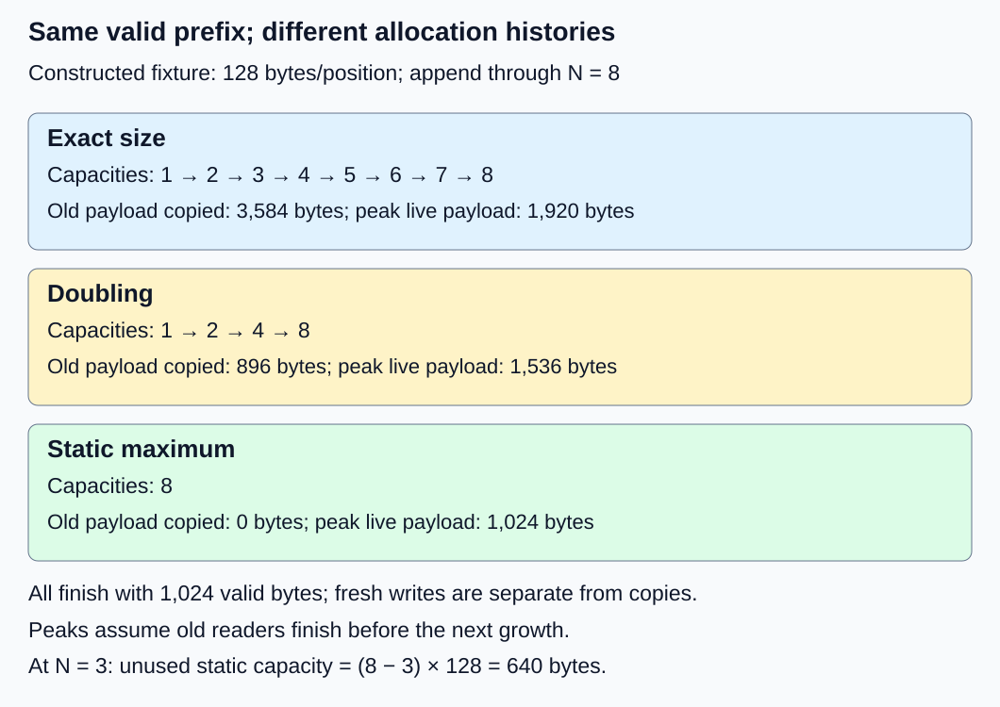
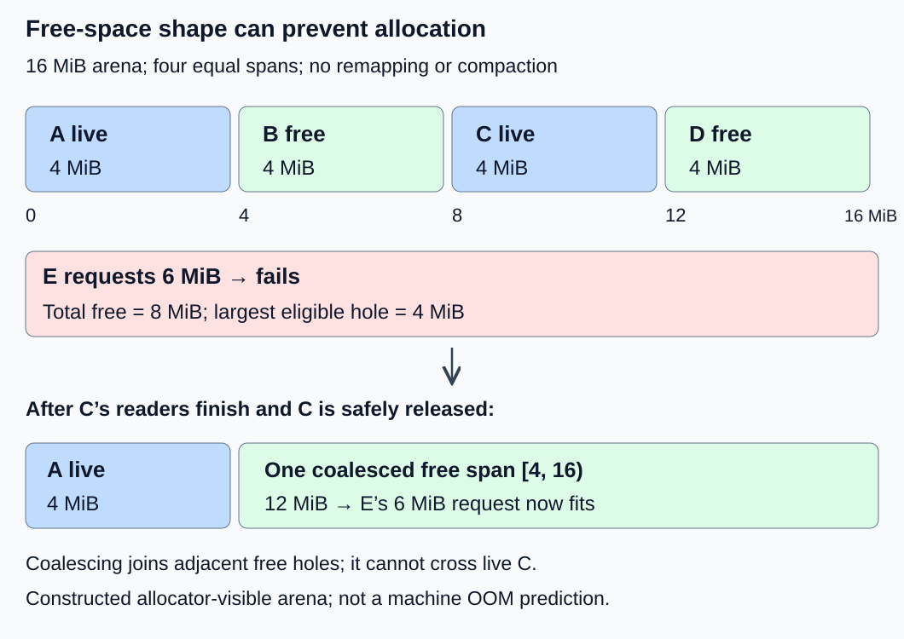

# M2-C05: Contiguous KV storage and its limits

> **Status: Complete — detailed chapter authored and documentation validated; experimental procedures are proposed unless explicitly labelled observed**

**Module:** Treat the KV cache as a first-class systems problem

**Category:** [State, memory, and caching](index.md)

[Module 2 reading order](../module-2.md) · [Previous: M2-C04](../state-memory-and-caching/m2-c04-memory-ownership-handles-and-lifetimes-from-first-principles.md) · [Next: M2-C06](../state-memory-and-caching/m2-c06-paged-kv-storage-and-logical-to-physical-mapping.md)

## Target concepts

Contiguous allocation, reserved versus used capacity, growth and copying, external fragmentation, allocation failure despite free space, contiguous baseline.

## Concepts

### 1. A simple address contract

A contiguous allocation gives an object one uninterrupted span in the allocator's address space. Contiguous virtual or device addresses do **not** establish contiguous physical DRAM. This chapter uses one private packed KV allocation per request as a teaching baseline. A real cache may instead allocate separate K and V tensors per layer; its layout, accounting and relocation rules must be specified separately.

Let L be the number of layers, Hkv the KV heads per layer, d the features per head, and w the bytes per stored element. Each processed position needs both K and V:

**k = 2 × L × Hkv × d × w bytes/position.**

For N valid positions and capacity C positions, with 0 ≤ N ≤ C:

**Valid payload = N × k; reserved payload = C × k; unused payload = (C − N) × k.**

These exclude allocation metadata, alignment padding, weights and workspace. Unused payload inside a live allocation differs from free space between allocations. A reservation is not evidence that any position has been computed.

Our synthetic layout orders axes as (position, K-or-V, layer, KV head, feature), with the last axis varying fastest. All indices start at zero. For position p, selector a (0 for K, 1 for V), layer ℓ, head h and feature f:

**Offset in bytes = ((((p × 2 + a) × L + ℓ) × Hkv + h) × d + f) × w.**

Only p < N is readable. The other indices must satisfy their respective axis bounds. Capacity changes the number of outer positions, not these inner strides. An attention kernel expecting another axis order needs a different contract; this packed fixture is not a drop-in kernel layout.

Use L = 2, Hkv = 2, d = 2 and w = 8 (FP64): k = 128 bytes/position. At N = 2 and C = 3, valid payload is 256 bytes, reservation 384 bytes and unused payload 128 bytes. Position 1's V, layer 1, head 0, feature 1 is at byte offset 232. Reserved position 2 remains unreadable. Publish an increased valid length only after its K and V writes complete and become visible to permitted readers.

This is a storage fixture, independent of the earlier small model's position limit. Extending it to 64 labelled storage rows does not extend that model's supported context. Unique exactly representable integer labels make coordinate checks unambiguous without interpreting arbitrary bit patterns as meaningful floating-point values.

### 2. Growth exchanges slack for data movement

When a request outgrows its allocation, a relocating baseline allocates a larger span, copies the valid prefix, publishes the replacement safely and eventually releases the old span. Rust's Vec illustrates the distinction between length and capacity, but its documentation does not guarantee a particular growth factor. The following are **chosen teaching policies**, not claims about Vec or a serving framework.

Append one position at a time from empty through N = 8. Release each old allocation after its readers finish and before the next append. Count the initial allocation, and count only old valid payload as copied bytes:

| Policy | Capacities allocated | Allocations / relocations | Old payload copied | Largest old + new payload coexistence |
|---|---|---|---|---|
| Exact size | 1, 2, 3, 4, 5, 6, 7, 8 | 8 / 7 | 28 × 128 = 3,584 bytes | (7 + 8) × 128 = 1,920 bytes |
| Geometric | 1, 2, 4, 8 | 4 / 3 | 7 × 128 = 896 bytes | (4 + 8) × 128 = 1,536 bytes |
| Static maximum | 8 | 1 / 0 | 0 bytes | 8 × 128 = 1,024 bytes |

All policies end with 1,024 bytes of valid payload and write 1,024 bytes of fresh position payload. Copying is additional work. A copy of X bytes entails X logical source bytes read and X destination bytes written; **2X is logical traffic**, not necessarily physical DRAM traffic after caching or device behavior.

For exact growth through N positions, copied positions sum to **N(N − 1)/2**. For doubling through a power-of-two N, they sum to **N − 1**. These formulas predict payload movement, not elapsed time. Allocation, synchronization and copy bandwidth can each dominate at different operating points.

The tradeoff changes when generation stops early. At N = 3, exact, geometric and static policies reserve 384, 512 and 1,024 bytes respectively; their unused payloads are 0, 128 and 640 bytes. At N = 5, geometric capacity 8 reserves 1,024 bytes for 640 valid bytes, leaving 384 bytes unused. Maximum reservation can avoid growth yet reduce the number of concurrent requests that fit. Fixed cache shapes can also affect compilation and masked computation; evaluate those separately from allocation cost.

### 3. Relocation is an ownership event

The simple peak calculation assumes only the old and replacement allocations coexist. Readers retaining older versions can raise the live peak further. Publication does not establish that old readers have completed. Apply [M2-C04's lifetime contract](m2-c04-memory-ownership-handles-and-lifetimes-from-first-principles.md): protect lookup and access, close new use of retired storage, and reclaim only after all required completions.

A replacement must preserve the same request, attempt, coordinate labels and valid prefix. Update handles or mappings under a specified publication protocol; a raw pointer into an old allocation cannot silently become a pointer into the new one. If replacement allocation fails before publication, the proposed baseline keeps the old prefix and valid length unchanged and returns an explicit failure. Never expose a partially copied replacement. If the implementation cannot preserve a trustworthy prefix, invalidate it under the request-state contract rather than continue from uncertain state.

Admission must budget transient coexistence and workspace, not just final capacity. Cancellation can close new use while an in-flight copy still retains both allocations. Neither a cancellation signal nor an allocation failure permits premature reclamation.

### 4. Enough free bytes may not mean a large enough span

Consider a **bounded 16 MiB allocator-visible arena**, with 1 MiB alignment, no remapping, no compaction and no in-place growth. MiB means 2²⁰ bytes. Allocate four 4 MiB objects A, B, C and D in that order. Free B and D while A and C remain live.

| State | Live payload | Free spans in MiB, half-open intervals | Total free | Largest free span |
|---|---|---|---|---|
| Four allocations | 16 MiB | None | 0 | 0 |
| B and D released | 8 MiB | [4, 8), [12, 16) | 8 MiB | 4 MiB |
| C safely released | 4 MiB | [4, 16) | 12 MiB | 12 MiB |
| E takes [4, 10) | 10 MiB | [10, 16) | 6 MiB | 6 MiB |

A new 6 MiB request E fails in the second state: the total free count passes, but neither hole fits. Adjacent free holes can coalesce; they cannot coalesce across live C. Once C's readers finish and it is released, a 12 MiB hole becomes available and E fits. This is **external fragmentation**, distinct from unused reserved capacity inside an active cache.

For an aligned request R, total free ≥ R and largest eligible free span ≥ R are necessary conditions in this arena. Other allocators may have additional constraints. A diagnostic proxy is **F = 1 − largest free span / total free** when total free > 0. The second state gives F = 0.5; it is not a universal fraction of memory wasted, and is undefined at zero free space.

Compaction can move live allocations, but requires destination capacity, copies, reference updates and safe completion. It is not free or automatically available. Actual CPU/GPU allocators can use size classes, caching or virtual remapping; this arena does not predict machine out-of-memory behavior. Track the allocator boundary, alignment, retained objects and concurrent allocations before attributing a failure to fragmentation.

A contiguous baseline remains useful: it supplies simple coordinate arithmetic and a correctness reference for later paged storage. Its limits motivate M2-C06 without proving that paging wins every workload.

## Experiments

These are proposed experiments. The arithmetic and documentation checks reported in the execution plan are not executed allocator or performance measurements. Complete E1–E3's correctness gates before accepting E4 timings.

### E1 — Packed-prefix coordinate audit

- **Description:** Audit labelled K/V coordinates across the synthetic packed layout.
- **Purpose/objective:** Separate valid state from reserved storage and establish an independent reference.
- **Target concepts:** Contiguous allocation; reserved versus used capacity; contiguous baseline.
- **Baseline and workload:** L = 2, Hkv = 2, d = 2, FP64; N = 2, C = 3, then append position 2.
- **Controls and prediction:** Keep axis order and request identity fixed. Predict 256/384 bytes before append and offset 232 for the stated coordinate.
- **Procedure:** Enumerate every valid coordinate and compare unique labels with the reference. Check that all offsets are distinct and in bounds. Reject a reserved-row read, wrong axis interpretation, duplicate append and wrong-request access. Publish the third row only after both K and V complete.
- **Hardware/software:** Paper ledger first; conditional CPU harness uses the manifest below and a separately checked layout reference.
- **Failure and HFT connection:** Reading reserved bytes resembles interpreting unused message-buffer capacity as received market data; allocation is not semantic validity.
- **Exit criteria:** Every valid label agrees; each negative case rejects before exposure; valid length changes exactly once after completion. No code is supplied here.

### E2 — Growth, early stop and retained readers

- **Description:** Compare three explicit capacity policies and trace replacement lifetime.
- **Purpose/objective:** Explain copying, slack and transient peak separately.
- **Target concepts:** Growth and copying; reserved versus used capacity; contiguous baseline.
- **Baseline and workload:** The three policies above through N = 8, with early-stop snapshots at N = 3 and N = 5 where applicable.
- **Controls and prediction:** Same labels and k = 128; normal trace releases old storage before another append. Predict the growth table and 640-byte static slack at N = 3.
- **Procedure:** Record capacity, valid bytes, copied payload, allocation count and simultaneous live allocations at every append. Separately delay an old reader across another growth. Inject replacement-allocation failure before publication; then cancel during an in-flight copy.
- **Hardware/software:** Deterministic ledger; conditional allocation traces require actual allocator/version and completion instrumentation.
- **Failure and HFT connection:** A growing order/event buffer can add copy latency and retain obsolete storage while consumers finish. The analogy concerns buffer lifetime, not exchange correctness.
- **Exit criteria:** Normal trace matches all byte/count predictions. Delayed-reader accounting includes every retained allocation. Failure preserves the old valid prefix; cancellation returns storage only after its completion conditions hold.

### E3 — Free-space shape versus free-space sum

- **Description:** Replay the bounded arena's allocation, release and coalescing sequence.
- **Purpose/objective:** Demonstrate allocation failure despite sufficient total free space.
- **Target concepts:** External fragmentation; allocation failure despite free space.
- **Baseline and workload:** 16 MiB arena; four 4 MiB allocations; E requests 6 MiB after B and D release.
- **Controls and prediction:** Fixed alignment; no remapping, compaction or in-place growth. Predict failure with 8 MiB free and success after C safely releases.
- **Procedure:** Record live intervals and eligible free spans after each transition. Verify nonoverlap and conservation. Try E before and after C's completion and release. Distinguish C being retired from C actually becoming free.
- **Hardware/software:** A paper interval ledger is sufficient; any later allocator experiment must document whether it implements this exact bounded model.
- **Failure and HFT connection:** Variable-size ingress buffers can fail admission under burst pressure despite a promising free-byte counter. Never reclaim a consumer's live buffer just to join holes.
- **Exit criteria:** All four table rows reconcile to 16 MiB; premature E fails without modifying live allocations; the safe release joins adjacent holes and permits E. No claim about a system allocator follows from the paper result.

### E4 — Conditional storage-path comparison

- **Description:** Benchmark completed append paths for exact, doubling and static policies, only if an implementation becomes available.
- **Purpose/objective:** Test whether predicted copying explains observed latency and capacity at specified operating points.
- **Target concepts:** All target concepts, with allocation and completion costs separated.
- **Baseline and workload:** Fresh request per trial; target N in {8, 64}; all policies use identical pre-prepared labelled rows, identity checks and final capacity N. Single worker; no concurrent readers in the normal comparison.
- **Controls and prediction:** Hold allocation scope, data type and completion rules fixed. Randomize balanced three-policy groups. Expect different copy counts, not a guaranteed timing ranking.
- **Procedure:** Run three independent sessions. For each target/session, exclude five warmups per policy, then run 30 balanced three-policy groups. Time from first allocation through final valid-prefix publication and required copy completion; verify labels afterward. Report final-allocation release separately. Collect allocation count, copy bytes, live peak and allocator reservation at defined snapshots. Run allocation failure, wrong-owner and cancellation cases as separately labelled fault populations. Preserve failed and timed-out outcomes.
- **Hardware/software:** Record the complete manifest below. GPU variants require explicit device completion, not submission-only timing. A 120-second host watchdog marks an unresolved trial; it does not authorize freeing active device storage.
- **Failure and HFT connection:** Profile allocator/copy synchronization and queueing analogues, then ask whether a faster buffer path improves useful service. Small storage trials do not establish production tail latency.
- **Exit criteria:** 180 timed groups = 540 trials, plus 90 excluded warmups. Each policy/target has 90 timed trials. Publish raw outcomes and correctness gates before comparisons. If an implementation is unavailable, retain this as a protocol and report no timings.

## Verification

| Pair | Reference and correctness gate | Measurement, benchmarking and profiling |
|---|---|---|
| V1 / E1 | Independent coordinate enumeration; exact label equality; valid bounds and owner/attempt checks | Record mismatches and rejected negative cases separately. Compare valid/reserved bytes and the 232-byte worked offset. Do not read uninitialized slack to test it. |
| V2 / E2 | Prefix invariant survives replacement; no stale reference or early reclaim; explicit publication point | Reconcile each allocation and release; distinguish copy payload from logical traffic and physical counters. Normal peaks are 1,920/1,536/1,024 bytes; retained readers require a different peak. |
| V3 / E3 | Live/free intervals partition the arena without overlap; release requires completion | Record total free, largest eligible span, alignment and request size at each outcome. F = 0.5 describes only the fragmented snapshot. |
| V4 / E4 | Exact labels and state invariants pass before performance acceptance; all outcomes retained | Report distributions, median and spread per policy/target/session, failures and watchdogs; do not infer p99 reliability from 90 trials. Profile allocation, copying, host coordination and completion separately from unprofiled timing. |

At N = 64, exact growth copies 2,016 positions = 258,048 bytes; doubling copies 63 positions = 8,064 bytes; static copies zero. Each ends with 8,192 valid payload bytes. The timed design contains 90 × (8 + 64) = 6,480 intended appends per policy, 19,440 across three policies **if all complete**. Count actual completed appends separately; failures cannot disappear from the denominator.

Record clock source, resolution, timer overhead, synchronization boundary and whether allocation initialization is included. Tiny 128-byte rows can make timer and allocator overhead dominate. Preserve that operating point; a larger workload is a separately declared experiment, not an undisclosed replacement. Hardware counters must identify their level (cache, memory controller or device); do not equate 2 × copied payload with a measured counter.

An eventual end-to-end claim needs a supplied reference generator, identical model/input/output and stopping contracts, representative arrivals and length distributions, admission outcomes and completion-defined latency. Apply [M1-C19](../numerics-and-correctness/m1-c19-validating-cached-and-uncached-generation.md) and [M1-C20](../measurement-experimentation-and-economics/m1-c20-measuring-and-explaining-generation-latency.md), plus the relevant completed Module 9 guidance; a storage-only win does not establish a generation win. No generator or benchmark has been executed for this chapter.

## Engineering dimensions and principles

| Dimension | Chapter-specific application |
|---|---|
| Semantics and invariants | Valid prefix, coordinate identity and completed publication define correctness; spare capacity is unreadable state. |
| Workload and variability | Unknown output length changes slack and copy count; skewed concurrent lengths change usable capacity. |
| Resources and bottlenecks | Account for allocated payload, unused reservation, copies, workspace and retained old versions separately. |
| Time and distributions | Growth adds dependencies on allocation/copy/completion; bursts and shared allocators can amplify tails. |
| Ownership and coordination | One request owns the baseline; old readers retain lifetime rights after replacement or cancellation. |
| Failure and adaptation | Reject failed growth atomically; distinguish retirement from release and fragmentation from total exhaustion. |

1. **Correctness defines the optimization boundary:** Preserve labels and valid-prefix semantics across every policy. Dropping old KV is a semantic change, not a free capacity optimization.
2. **Performance depends on workload and operating point:** Early stops favor small reservations; sustained growth changes copy economics. Test both lengths explicitly.
3. **Data movement is part of the algorithm:** Count old-prefix copies and new-row writes separately; layout and placement constrain both.
4. **State has ownership, lifetime, and recovery cost:** Retained readers raise peaks; failed replacement must leave a usable prefix or invalidate it explicitly.
5. **Dependencies determine latency; bottlenecks determine capacity:** A dependent reader cannot consume an unfinished copy. Fewer allocations do not automatically increase admitted useful work.
6. **Variability and synchronization shape the tail:** Unequal lengths and allocator contention require later concurrent workloads; the single-worker protocol establishes neither queueing nor p99 behavior.
7. **Local improvements must be evaluated end to end:** A faster append is useful only if completed generation, admission and correctness improve under the same service contract.
8. **Claims require reproducible evidence:** Publish fixtures, policies, raw outcomes, manifests and timing boundaries; keep predictions separate from observations.

## Specifications, articles, and hardware

- [Rust standard library Vec, checked at version 1.99.1](https://doc.rust-lang.org/std/vec/struct.Vec.html): length/capacity and reallocation contracts; the exact growth strategy is unspecified. This chapter prescribes its own policies.
- [PagedAttention paper, version 1, section 3.1](https://arxiv.org/html/2309.06180v1): motivation from reservation, internal and external fragmentation in contiguous KV management. Its workloads and performance results are not measurements of our fixture.
- [Transformers 4.57.1 KV cache strategies](https://huggingface.co/docs/transformers/v4.57.1/en/kv_cache): dynamic/static cache tradeoffs, fixed maximum shapes and masked unused positions. Architecture-specific cache behavior requires its own contract.

A conditional CPU experiment needs FP64 storage, one declared worker and at least 1 GiB available host RAM for the small fixtures and harness overhead; this is a proposed requirement, not a measured machine specification. Record CPU model, cores, cache sizes, frequency/power policy, affinity, RAM capacity/speed, OS/kernel, Rust/compiler and optimization settings, allocator/version, page size and background load. Record actual alignment and allocator-reported sizes rather than assuming payload equals committed or resident memory.

A conditional GPU variant additionally records GPU model/count, VRAM, driver/runtime, interconnect, stream ownership, host/device placement, transfer inclusion and completion primitive. Do not infer physical page layout from pointer adjacency. The 16 MiB arena is a bounded teaching model; do not force machine-wide exhaustion to reproduce its diagram.

Completed Module 9 support: M9-C01 for references and invariants, M9-C02 for measurement/completion, M9-C07 for outcome populations and M9-C17 for the exact FP64 label contract. Advanced fragmentation accounting in M9-C15 remains outlined; the elementary definitions needed here are explicit above.

## Key takeaways

Contiguous storage makes coordinates easy to audit. Its capacity policy determines slack, relocation work and transient lifetime costs. Total free bytes cannot establish that an eligible contiguous span exists. Establish this baseline's correctness and accounting before comparing the paged mapping in [M2-C06](m2-c06-paged-kv-storage-and-logical-to-physical-mapping.md), which is now a completed detailed chapter. M2-C07 is next for authoring.
