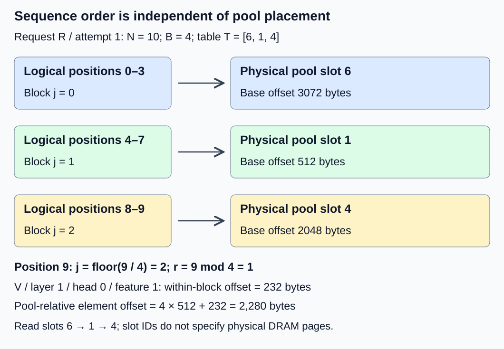
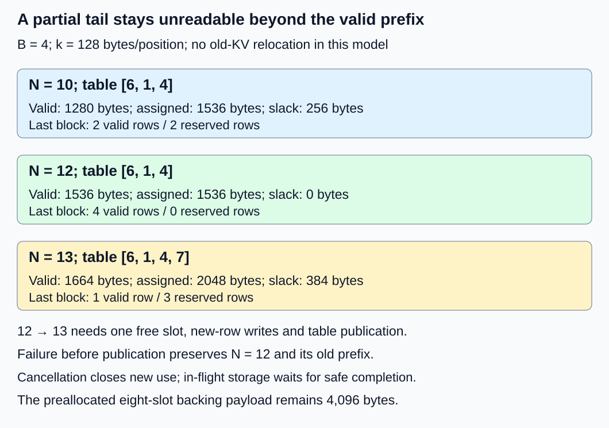

# M2-C06: Paged KV storage and logical-to-physical mapping

> **Status: Complete — detailed chapter authored and documentation validated; experimental procedures are proposed unless explicitly labelled observed**

**Module:** Treat the KV cache as a first-class systems problem

**Category:** [State, memory, and caching](index.md)

[Module 2 reading order](../module-2.md) · [Previous: M2-C05](../state-memory-and-caching/m2-c05-contiguous-kv-storage-and-its-limits.md) · [Next: M2-C07](../kernels-compilers-and-execution/m2-c07-how-attention-reads-a-paged-kv-layout.md)

## Target concepts

Operating-system paging analogy and limits, fixed-size token blocks, block tables, block offsets, noncontiguous physical storage, PagedAttention, mapping metadata.

## Concepts

### 1. Keep sequence order; change storage placement

A request's **logical position** is its token's place in the processed sequence: 0, 1, 2, and so on. It is not a memory address. In [M2-C05](m2-c05-contiguous-kv-storage-and-its-limits.md), one allocation held the request's entire valid KV prefix. Growing that allocation could require copying old state or finding a larger free span.

A **paged KV layout** divides the sequence into blocks containing B token positions each. A **logical block** identifies a consecutive group of sequence positions. A **physical block** here means an allocated storage slot in the KV pool. A **block table** maps logical block numbers to physical slot IDs. The word physical is relative to this pool: it does not identify DRAM page frames, guarantee physical-address adjacency or bypass the CPU/GPU's virtual-memory translation.

The [original PagedAttention paper, sections 4.1–4.3](https://arxiv.org/html/2309.06180v1), combines this storage indirection with attention that consumes mapped KV blocks. This makes nonadjacent block placement usable without first moving every request into one large span. The paper's design motivates the chapter; all small numbers and layouts below are explicit teaching fixtures, not its measured results.

The operating-system analogy is useful but limited. [Linux page-table documentation](https://docs.kernel.org/mm/page_tables.html) describes translation from CPU virtual addresses to physical addresses. Our KV table instead translates sequence-block identities to application-managed storage slots. It does not automatically provide hardware address translation, access protection, page faults, demand loading, swapping or a translation cache. A KV block's token count is not the operating system's page size in bytes. Likewise, a KV storage block is not a GPU thread block, which groups executing threads.

### 2. Translate a position in two steps

For zero-based position p, let **j = floor(p / B)** be the logical block number, and **r = p mod B** the position within that block. Floor rounds downward; modulo gives the nonnegative remainder. If T is this request's table, the physical slot is **s = T[j]**. Lookup requires p < N, where N is the completed valid prefix length; a table entry alone does not make every row valid.

Keep M2-C05's synthetic token-major layout: L = 2 layers, Hkv = 2 KV heads, d = 2 features/head and w = 8 bytes/FP64 element. Both K and V are stored, so:

**k = 2 × L × Hkv × d × w = 128 bytes/position.**

Choose B = 4 positions/block, making **Q = B × k = 512 bytes/block**. A pool of P = 8 equal slots has 4,096 bytes of backing payload. Inside each block, axes are (position-within-block, K-or-V, layer, KV head, feature). For a = 0 for K or 1 for V, layer ℓ, head h and feature f, all zero-based:

**Within-block byte offset = ((((r × 2 + a) × L + ℓ) × Hkv + h) × d + f) × w.**

For this fixture only, slots occupy one backing allocation. Slot s starts at **s × Q bytes relative to its base**; add the within-block offset for the element address. An implementation with separate per-layer or K/V allocations needs the corresponding base and stride contract. This packed layout is not a production attention-kernel specification.

Use request R, attempt 1, N = 10 and **T = [6, 1, 4]**:

| Logical positions | Logical block j | Physical slot T[j] | Valid rows within block | Slot base offset |
|---|---|---|---|---|
| 0–3 | 0 | 6 | 0–3 | 3,072 bytes |
| 4–7 | 1 | 1 | 0–3 | 512 bytes |
| 8–9 | 2 | 4 | 0–1 only | 2,048 bytes |

At p = 9, j = 2, r = 1 and s = 4. Its V, layer 1, head 0, feature 1 has within-block offset 232 bytes and pool-relative offset **4 × 512 + 232 = 2,280 bytes**. Positions 10 and 11 have reserved rows but remain invalid. Read in logical order 6 → 1 → 4, not sorted slot order 1 → 4 → 6. Sorting IDs without preserving the mapping silently changes sequence semantics.

The table and payload form one contract: request/attempt identity, layout version, B, N, valid table length, slot bounds, slot generation/ownership and permitted lifetime. A matching in-range slot number can still refer to another request after reuse. Rust bounds checks can prevent an out-of-range array access; they cannot establish that an in-range entry owns the intended KV state. Apply M2-C04's identity and lifetime conditions as well.

### 3. Account for payload, slack and metadata separately

For a private, nonsharing prefix with on-demand whole blocks, the required block count is **n = ceil(N / B)**, with n = 0 at N = 0. Ceiling rounds upward. Thus:

**Allocated request payload = n × B × k.**

**Tail slack = (n × B − N) × k.**

There is less than one block of tail slack per nonempty request under these assumptions. Pre-reserving extra blocks, keeping retired blocks or using different cache groups changes this accounting.

For N = 10, n = 3: valid payload is 1,280 bytes, allocated payload 1,536 bytes and tail slack 256 bytes. Slack is 20% of valid payload but 16⅔% of allocated payload; always name the denominator. Five free slots account for the other 2,560 backing bytes. Their availability is not additional request slack. The pool was preallocated, so assigning another slot does not by itself increase its backing allocation or return unused pool bytes to the operating system.

For a minimal metadata example, choose four bytes per table entry and a fixed 16-byte request header. At n = 3, active entries occupy 12 bytes; entries plus header occupy 28 bytes. Separately choose a 16-byte descriptor for each of eight pool slots: 128 bytes. Total defined metadata is **28 + 128 = 156 bytes**. These are chosen serialized-field sizes, not a Rust structure's actual layout. Table capacity, padding, locks, ownership records, device copies and allocator overhead must be added if present. Active table entries are 12/1,280 = 0.9375% of valid payload; that ratio excludes the header and descriptors.

At N = 12 the same three blocks are full. Appending position 12 raises N to 13, requires a fourth slot and leaves three unused rows: 384 bytes. If slot 7 is available, T becomes [6, 1, 4, 7]; allocated payload becomes 2,048 bytes and valid payload 1,664 bytes. **Old KV payload copied for this extension is zero** under our no-relocation model. New-row writes, table extension/copying and publication still cost work. A growing metadata array may itself reallocate; do not call this an allocation-free append.

### 4. Placement flexibility has a correctness price

Equal pool slots let a request use separate free slots without finding one request-sized span. With R holding slots {6, 1, 4}, the free set is {0, 2, 3, 5, 7}. Another 18-position request needs five blocks, so those five slots suffice even though no run of five adjacent IDs is free. This claim assumes an already established compatible pool, no sharing, no retirement, and no other reservations or metadata limits. It does not eliminate fragmentation or exhaustion in the allocator that created the pool.

When there is no eligible free slot, crossing a block boundary can still fail. For the N = 12 snapshot, an unsuccessful extension must leave N = 12, its three entries and every old label unchanged. An unpublished new slot is not readable. Write the new K/V row, establish required completion/visibility and publish a consistent mapping and valid length before readers use it. If cancellation intervenes, retain any storage still used by writers/readers until their completion conditions hold. Detailed pool allocation and concurrent publication designs belong to later chapters; the contract here is their acceptance boundary.

A paged layout needs a consumer that follows its mapping. PagedAttention is more than dividing a buffer: attention must honor logical position, valid rows, layout and the normalization over all eligible keys. Independently normalizing each block and concatenating results is not equivalent attention. [M2-C07](../kernels-compilers-and-execution/m2-c07-how-attention-reads-a-paged-kv-layout.md) will develop the access path. The [vLLM paged-attention design page](https://docs.vllm.ai/en/latest/design/paged_attention/) explicitly labels itself historical and says it no longer describes today's code. Use it to study layout dependence, not to infer a current backend's interface.

## Experiments

These are proposed procedures without implementation. The execution plan records only the document, arithmetic and rendering checks actually performed. The fixtures contain labelled storage rows, not generated model outputs; N = 18 does not extend an earlier toy model's position limit.

### E1 — Follow logical order through scattered slots

- **Description:** Reconstruct R's ten-position prefix through T = [6, 1, 4] and compare it with a contiguous labelled reference.
- **Purpose/objective:** Show that placement may change while logical coordinates remain identical.
- **Target concepts:** Logical/physical mapping, block tables, offsets and noncontiguous storage.
- **Baseline and workload:** B = 4, eight slots, k = 128; use unique exactly representable integer FP64 labels for every request/attempt/position/K-or-V/layer/head/feature coordinate.
- **Controls and prediction:** Hold labels, axis order and valid prefix fixed; vary only table/placement. Predict slot sequence 6 → 1 → 4 and the 2,280-byte element offset.
- **Procedure:** Enumerate all valid coordinates independently. Compare mapped values with the flat reference. Repeat with adjacent placement and another permutation. Try p = 10, a missing table entry, slot ID 8 and a stale generation; reject each before payload access. Deliberately interpret sorted slot IDs as sequence order and require the label comparison to detect the error.
- **Hardware/software:** Paper reference first; any later CPU harness records the manifest below and its independent reference method.
- **Failure and HFT connection:** Misreading a block resembles attaching an event-buffer segment to the wrong stream or sequence. This tests ordering and ownership, not exchange protocols or trading results.
- **Exit criteria:** All 160 valid FP64 elements agree exactly with the reference; every invalid access rejects, and the deliberately reordered result fails the semantic check.

### E2 — Tail occupancy and growth boundary

- **Description:** Audit N = 0, 1, 4, 5, 10, 12 and 13 under B = 4.
- **Purpose/objective:** Separate valid rows, allocated blocks, pool backing and metadata.
- **Target concepts:** Fixed-size token blocks, partial blocks, mapping metadata and extension.
- **Baseline and workload:** The same private pool, no sharing or delayed retirement; four-byte entries, 16-byte header and eight 16-byte slot descriptors.
- **Controls and prediction:** Keep payload/layout fixed; change only N. Predict n = 0, 1, 1, 2, 3, 3, 4, and zero old-KV copies for extension from 12 to 13 with a free slot.
- **Procedure:** Record valid bytes, assigned payload, slack, active entry bytes and fixed descriptor bytes at each length. Audit the new row and old prefix when slot 7 is appended. Count metadata movement separately. Distinguish assigned pool slots from new backing allocations.
- **Hardware/software:** Deterministic arithmetic ledger; conditional runtime observations require actual metadata representation and allocator counters.
- **Failure and HFT connection:** Fixed event-buffer segments bound per-segment slack but add indexing and bookkeeping. The analogy concerns capacity granularity, not a guarantee of bounded execution latency.
- **Exit criteria:** Every snapshot satisfies valid plus slack equals assigned payload; assigned plus free payload equals 4,096 bytes under the stated assumptions. N = 10 has 156 defined metadata bytes; extension preserves every old label and copies no old KV payload in this model.

### E3 — Availability, stale tables and interrupted extension

- **Description:** Contrast scattered-slot admission with failed or interrupted publication.
- **Purpose/objective:** Test flexibility without weakening state identity or lifetime.
- **Target concepts:** Noncontiguous storage, table validity, paging analogy limits and failure behavior.
- **Baseline and workload:** First use R's N = 10 snapshot and the five-slot free set above. Separately use R at N = 12 while other owners hold every remaining slot.
- **Controls and prediction:** Hold pool geometry fixed. First predict that an 18-position private request fits five scattered slots; second predict that R cannot publish position 12 while no slot is eligible.
- **Procedure:** Reconcile the two owners' eight assigned slots in the first case. In the separate exhausted case, reject extension without changing R's prefix/table/length. Test wrong request, stale generation, out-of-range slot and duplicate private-slot mapping. Interrupt an extension after reservation but before publication; close new use and retain any in-flight storage until completion. Retry only under a new declared attempt/state contract.
- **Hardware/software:** A paper state ledger establishes expected transitions; a future fault harness must expose reservation, writing, publication and safe-return events.
- **Failure and HFT connection:** Buffer exhaustion must produce explicit admission outcomes; stale buffer descriptors must not expose another stream's state. Hardware memory protection alone does not establish application identity.
- **Exit criteria:** Private writable slots never alias; no invalid table exposes data. Failed extension leaves N = 12 and its three entries unchanged. Cancelled or retired storage is counted as unavailable until safe return; record every fault outcome separately.

### E4 — Conditional mapped-read benchmark

- **Description:** Compare a flat reference, adjacent paged slots and scattered paged slots in a storage-only read/reconstruction path.
- **Purpose/objective:** Measure the cost of mapping and placement at a declared operating point, without claiming attention throughput.
- **Target concepts:** Block-table metadata, placement, PagedAttention's consumer requirement and mapping costs.
- **Baseline and workload:** N in {10, 18}, B = 4. Adjacent tables are [0, 1, 2] or [0, 1, 2, 3, 4]; scattered tables are [6, 1, 4] or [6, 1, 4, 0, 7]. The flat baseline reserves the same rounded position capacity. Each trial reconstructs the valid prefix 1,000 times into a fixed destination.
- **Controls and prediction:** One worker; identical labels, destination size, completed-read contract and reuse pattern. All allocations and fixture preparation are outside timing. Change representation/placement only; predict exact output agreement but no timing ranking.
- **Procedure:** Use three independent sessions. For each length/session, exclude five warmups per representation, then run 30 randomized balanced groups containing all three representations. Time completed reconstruction passes, including lookup and destination writes; validate exact labels afterward and retain observable work so optimization cannot discard the passes. Measure timer overhead. Profile table loads, cache behavior and memory traffic separately from unprofiled timings. GPU variants must include required device completion; report transfer scope explicitly.
- **Hardware/software:** Record actual compiler/optimization settings, allocator, CPU/cache/RAM and clock; GPU details only for a separately labelled variant. Apply a 120-second watchdog to flag unresolved trials, without reclaiming in-flight storage merely because it expired.
- **Failure and HFT connection:** Descriptor indirection can trade simpler allocation for extra dependent loads. This resembles segmented event storage, but hot synthetic loops do not establish live-feed or serving tails.
- **Exit criteria:** 180 balanced groups yield 540 timed trials and 90 excluded warmups. Each representation/length has 90 timed trials. Publish exact-output gates, raw durations, failed/unresolved outcomes and manifests. Leave timings unreported until an implementation is available.

## Verification

| Pair | Reference and correctness | Measurement and acceptance boundary |
|---|---|---|
| V1 / E1 | Independent coordinate labels and flat reference; exact equality, bounds, identity and generation checks | Count 160 elements at N = 10; audit the worked offset and all negative cases. No timing is needed for the paper mapping proof. A wrong-order comparison must fail even with in-range addresses. |
| V2 / E2 | Whole-block count and conservation equations; exact integer metadata arithmetic | Reconcile every length, payload/slack denominator and metadata scope. Runtime counters must distinguish assigned, backing, retained and resident memory. Paper sizes are not allocator measurements. |
| V3 / E3 | Private-slot uniqueness, owner/attempt contract and unchanged-prefix failure reference | Record each transition and outcome, especially reservation-to-publication and cancellation-to-safe-return. Fault observations need explicit completion timestamps; ledger checks do not prove concurrent safety. |
| V4 / E4 | Exact reconstruction and declared valid bounds pass before timing acceptance | Report durations per 1,000-pass trial, median, spread and session effects by representation/length. Preserve failures and watchdogs; profile outside the timing population. Do not claim reliable p99 from 90 trials. |

E4 intends **540 × 1,000 = 540,000 reconstruction passes**. Each representation intends **90 × 1,000 × (10 + 18) = 2,520,000 position reads** across its two lengths; all three total 7,560,000. Each position contains 128 payload bytes. A reconstruction logically reads that valid payload and writes the same amount to its destination, plus mapping metadata reads. Actual memory-controller traffic can differ because of caching and write policies; report the counter's level instead of treating logical bytes as measured DRAM bytes.

Record units, clock source/resolution, completion boundaries, warmup outcomes, randomized group order and all attempted trial outcomes. A tiny repeatedly reused pool emphasizes hot metadata and data; a larger cold or concurrent workload is a separate experiment with a new manifest. Neither this fixture nor the absence of old-KV copying predicts full-request latency.

Apply completed [M9-C01](../numerics-and-correctness/m9-c01-defining-reference-behavior-and-evidence-before-optimizing.md) for the reference/state contract, [M9-C02](../measurement-experimentation-and-economics/m9-c02-request-events-clocks-and-measurement-boundaries.md) for completion-defined events and [M9-C07](../measurement-experimentation-and-economics/m9-c07-latency-distributions-and-statistical-uncertainty.md) for populations and uncertainty. Advanced M9-C15 memory accounting and M9-C22 safety remain outlines; elementary obligations are specified locally here. An eventual end-to-end comparison additionally needs the actual reference generator, unchanged inputs/stopping rules, correct attention/logits, arrivals, admission outcomes and complete request timing. Storage reconstruction alone cannot establish that result.

## Engineering dimensions and principles

| Dimension | Chapter-specific question and check |
|---|---|
| Semantics and invariants | Does each logical coordinate resolve to the same valid request state? E1 checks labels; E3 rejects stale mappings. |
| Workload and variability | How often do lengths cross block boundaries? E2 separates tail occupancy; E4 declares hot reuse and two lengths. |
| Resources and bottlenecks | What are payload, tail slack, table bytes and pool descriptors? Count each separately before profiling lookup traffic. |
| Time and distributions | Which lookup, write and completion dependencies precede visibility? Separate boundary costs and session distributions. |
| Ownership and coordination | Who may publish, read and reclaim a mapped slot? Check owner/attempt, generation and protected lifetime together. |
| Failure and adaptation | What happens when free slots disappear or cancellation interrupts a write? Preserve the old prefix and defer reclamation. |

1. **Correctness defines the optimization boundary:** Placement may change; token order, valid bounds and ownership may not. An in-range wrong block is still incorrect.
2. **Performance depends on workload and operating point:** Tail slack depends on lengths; lookup cost depends on reuse, concurrency and backend layout. E4 is deliberately a small hot workload.
3. **Data movement is part of the algorithm:** Avoiding old-KV relocation still leaves new payload writes, metadata movement and mapped reads. Name each boundary.
4. **State has ownership, lifetime, and recovery cost:** A table entry is a reference with a lifetime, not authority to reclaim; recovery may require rejecting or rebuilding an attempt.
5. **Dependencies determine latency; bottlenecks determine capacity:** Payload access depends on a valid mapping; new visibility depends on completed writes. Free slots improve assignment flexibility without promising faster reads.
6. **Variability and synchronization shape the tail:** Unequal lengths cause boundary events at different times; shared pool/metadata coordination needs later concurrent measurements.
7. **Local improvements must be evaluated end to end:** Zero old-KV copies or a faster lookup matters only through correct admitted and completed generation under the same service contract.
8. **Claims require reproducible evidence:** Publish geometry, tables, labels, layout versions, manifests, raw outcomes and timing scope. Separate calculated fixtures from runtime observations.

## Specifications, articles, and hardware

- [PagedAttention paper, version 1, 12 September 2023](https://arxiv.org/html/2309.06180v1): original block-based storage and attention design. Its performance results are not reproduced here.
- [Linux kernel page tables](https://docs.kernel.org/mm/page_tables.html), checked 26 October 2026: CPU virtual-to-physical translation; the analogy does not supply those mechanisms to a KV table.
- [vLLM Paged Attention design](https://docs.vllm.ai/en/latest/design/paged_attention/), checked 26 October 2026: historical explanatory material with an explicit warning about current-code applicability. Select a pinned backend version and its actual layout contract before future kernel experiments.

The paper fixtures require no special hardware. A proposed CPU harness needs FP64 storage, one worker and at least 1 GiB available RAM for these small buffers and harness overhead; no such machine was benchmarked here. Record CPU model, cores/cache sizes, frequency/power policy, affinity, RAM capacity/speed, page size, OS/kernel, Rust/compiler version, optimization settings, allocator/version and background work. Record actual table capacity/alignment rather than claiming the serialized metadata example equals a Rust allocation's size.

For a separate GPU variant, record device/count, VRAM, driver/runtime, host/device table and payload placement, interconnect, stream/queue ownership, transfer scope and completion primitive. A pool slot ID is not a device pointer; host table publication must not race device consumption. Do not infer physical DRAM topology from the chosen IDs. No GPU, allocator, attention kernel or runtime benchmark has been executed for this chapter.

## Key takeaways

Paging preserves logical order through an explicit mapping while relaxing request-wide placement. It replaces one large span requirement with whole-slot availability, tail slack, metadata and consumer obligations. The next chapter, [M2-C07: How attention reads a paged KV layout](../kernels-compilers-and-execution/m2-c07-how-attention-reads-a-paged-kv-layout.md), is now complete and examines that consumer path. M2-C08 is next for authoring.
