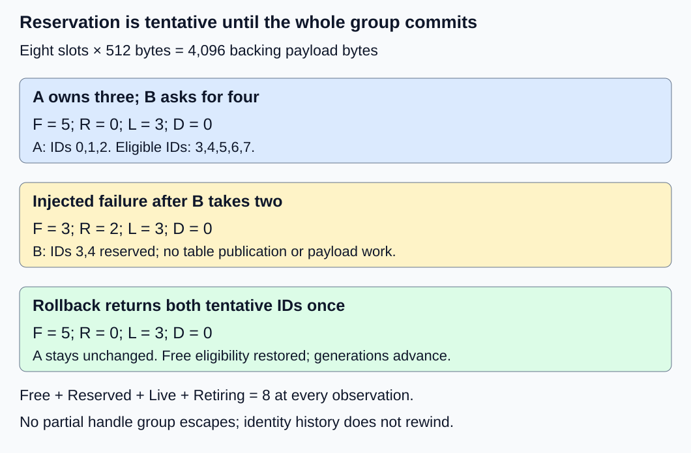
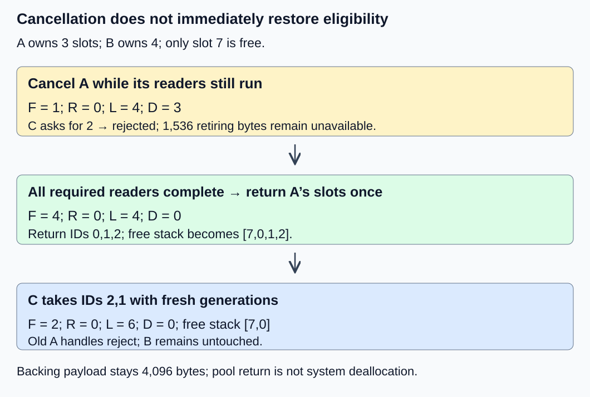

# M2-C08: Designing a fixed-size KV block allocator

> **Status: Complete — detailed chapter authored and documentation validated; experimental procedures are proposed unless explicitly labelled observed**

**Module:** Treat the KV cache as a first-class systems problem

**Category:** [State, memory, and caching](index.md)

[Module 2 reading order](../module-2.md) · [Previous: M2-C07](../kernels-compilers-and-execution/m2-c07-how-attention-reads-a-paged-kv-layout.md) · [Next: M2-C09](../state-memory-and-caching/m2-c09-choosing-block-size-and-measuring-fragmentation.md)

## Target concepts

Preallocated block pools, block IDs, free lists, allocation and release contracts, capacity accounting, all-or-nothing multi-block allocation, rollback.

## Concepts

### 1. Allocate the pool once; assign slots many times

A **block allocator** assigns and recovers fixed-size storage slots. A **preallocated pool** acquires backing memory before the request path, then manages subdivisions of that memory. Returning a slot to the pool makes it available to another eligible request; it does not necessarily release backing memory to the operating system or device allocator.

The [PagedAttention paper, version 1, section 4.2](https://arxiv.org/html/2309.06180v1) describes backing storage divided into KV blocks with request block tables. Our allocator below is a separate teaching specification, not a reproduction of its manager. [M2-C06](m2-c06-paged-kv-storage-and-logical-to-physical-mapping.md) supplies mapping semantics; [M2-C04](m2-c04-memory-ownership-handles-and-lifetimes-from-first-principles.md) supplies identity and lifetime obligations.

Return to the all-layer fixture: L = 2 layers, Hkv = 2 KV heads, d = 2 features/head and w = 8 bytes/FP64 element. Both K and V are stored. Thus **k = 2 × L × Hkv × d × w = 128 bytes/position**. With B = 4 positions/block, **Q = B × k = 512 bytes/block**. P = 8 slots require **P × Q = 4,096 backing payload bytes**. This is not M2-C07's separate one-layer/head consumer fixture, which used 32 bytes/position.

Slot IDs are integers 0–7. In this teaching pool, slot s begins at **s × Q bytes relative to the backing allocation base**. IDs describe application-managed regions, not physical DRAM page frames. Choose a 64-byte-aligned base for this fixture; 512-byte slot spacing preserves that alignment. A later backend may require another alignment. The pool must specify checked size arithmetic, layout version and placement. Every layer/K/V component needed by a slot assignment must be available before the assignment succeeds; real separate cache groups need coordinated reservations rather than an optimistic single counter.

Preallocation moves setup work; it does not remove initialization, page residency, metadata growth or completion costs. Payload need not be zeroed on every reuse, but old contents must remain unreadable until overwritten and published as valid for the new owner. A request cannot interpret a successful reservation as completed KV computation.

### 2. A free list represents eligibility, not just unused bytes

A **free list** is a collection of eligible slot IDs. This chapter chooses a stack: the rightmost entry is taken next. The initial list is **[7,6,5,4,3,2,1,0]**, so the first three assignments return 0, 1 and 2. Return order can affect the next IDs without changing semantic correctness; the ledger below specifies it where needed.

Use one serial pool owner to order all state changes. This is a simplifying baseline, not a lock-free or concurrent algorithm. Track four disjoint sets:

| State | Meaning | May appear in free list? |
|---|---|---|
| Free F | Eligible for a new reservation | Yes, exactly once |
| Reserved R | Tentatively held by an unpublished allocation operation | No |
| Live L | Committed to a request, with its payload validity tracked separately | No |
| Retiring D | Closed to new use, still awaiting safe-return conditions | No |

The letters also denote set sizes in count formulas. **P = F + R + L + D**, and the four sets must partition IDs 0–7 without overlap or duplication. Multiply counts by Q for their payload capacity. This conservation is necessary but insufficient: duplicate one ID and lose another and a count-only test can still pass. Check the actual sets and owners.

A request handle includes pool identity/epoch, slot ID, generation and request/attempt identity. A **generation** distinguishes successive uses of the same slot. For the main fixture, generations start at zero and advance on every transition from free to reserved; first assignment uses generation 1. They do not wrap in this exercise. A production finite counter needs an explicit exhaustion policy, such as refusing reuse before wrap; never assume perpetual uniqueness. A free-list entry need not itself contain all handle fields, but validation must obtain them before access or release.

Rust ownership can help keep one authority over pool state and restrict access through borrowed views. It does not prove external device work is complete. The [Rust 1.99.1 Allocator contract](https://doc.rust-lang.org/std/alloc/trait.Allocator.html) discusses valid allocation, layout and invalidation obligations, but that trait is marked nightly-only experimental. A request-slot manager is not automatically an implementation of that general allocator interface; this chapter requires no unstable API or implementation code.

### 3. Reserve a group completely or publish none of it

For a request requiring N positions, whole-block demand is **ceil(N/B)**, where ceiling rounds upward. If c compatible blocks are already assigned, additional demand is **q = max(0, ceil(N/B) − c)**. This expression assumes the existing prefix and tail are usable; shared or incompatible state needs another policy. An empty request can demand zero blocks. For this manager, q = 0 succeeds with an empty result and no state changes; negative, overflowing or greater-than-P demands are invalid inputs.

The reservation contract returns either q distinct protected handles or an explicit error with no newly published ownership. This is **all-or-nothing allocation**. At the serial owner's decision point, q ≤ F is necessary for capacity. It is not sufficient if descriptor storage, table capacity or another required resource can fail. A free-count observation made outside this owner does not reserve anything.

Before success becomes visible, request-table capacity and rollback bookkeeping must be secured. **Rollback** restores the availability and pre-existing semantic state affected by an unsuccessful tentative operation. No partial handle group may escape to a caller as success. Tentative IDs are not valid request table entries; a new group becomes live only after a consistent ownership/table publication. That publication still does not make unwritten KV rows readable.

Our baseline prepares metadata for up to P IDs before servicing requests. A hypothetical injected metadata/publication failure can still test the rollback boundary. Tentative slots are returned exactly once, original request tables and valid prefixes stay unchanged, and no writer/reader may have used those slots. If work has already been submitted, immediate rollback into Free is unsafe: retain the slots as unavailable until completion permits return. Do not call that delayed retirement an immediate restoration of free capacity.

Generation counters and diagnostic logs need not return to their prior values on failure. They must remain monotonic and trustworthy; rewinding them could revalidate an obsolete identity. The semantic guarantee is no leaked capacity or partial published ownership, not byte-for-byte identical manager metadata.

### 4. Work a failure and recovery ledger

All numbers below are constructed state counts, not allocator measurements. Initially every slot is free. Request A, attempt 1, reserves and commits three slots (0,1,2). B asks for four, but an injected prepublication failure occurs after tentative reservation of slots 3 and 4. No payload work has been submitted.

| Observation | F | R | L | D | Meaning |
|---|---|---|---|---|---|
| Initial | 8 | 0 | 0 | 0 | All IDs eligible |
| A commits three | 5 | 0 | 3 | 0 | A owns 0,1,2 |
| B tentatively holds two | 3 | 2 | 3 | 0 | IDs 3,4 unpublished |
| B rolls back | 5 | 0 | 3 | 0 | Same free eligibility and A state restored |
| B retries and commits four | 1 | 0 | 7 | 0 | B owns 3,4,5,6 |
| C asks for two; rejected | 1 | 0 | 7 | 0 | Only slot 7 is free |
| A cancels with readers active | 1 | 0 | 4 | 3 | A's slots remain unavailable |
| A safely returns three | 4 | 0 | 4 | 0 | Required readers completed |
| C commits two | 2 | 0 | 6 | 0 | Two eligible slots assigned |

Rollback returns tentative IDs in reverse take order, restoring the initial free-stack order for this trace. Their generations stay advanced: slots 3 and 4 use generation 2 on B's retry, whereas slots 5 and 6 use generation 1. A's generations remain 1. After A's completion, return its IDs in order 0,1,2; the stack becomes [7,0,1,2]. C then takes 2 and 1 at generation 2, leaving [7,0]. Old A handles must reject.

At B's tentative snapshot, free capacity is **3 × 512 = 1,536 bytes**, reserved capacity 1,024 bytes and live capacity 1,536 bytes. After rollback, free capacity is 2,560 bytes and live capacity 1,536 bytes. After A cancels, only 512 bytes are free even though A's 1,536 bytes no longer serve new work. The 4,096-byte backing payload remains constant throughout. These are assigned capacities; valid-token payload and tail slack need separate counts.

*The failed operation restores eligible slots without changing A's published state. Generation history does not rewind.*

### 5. Release needs identity, closure and completion

A release request must match current pool, owner/attempt, slot and generation. It must close new access and arrange safe retirement under the ownership contract. Actual return to Free requires all relevant owners and in-flight uses to be finished. The baseline has no sharing; reference-counted sharing is a later chapter. Reject wrong-pool, wrong-owner, stale, out-of-range and duplicate-return requests without modifying eligibility. An invalid batch of returns must not partially modify the pool under this chapter's serial all-or-nothing return contract.

Device submission is not device completion. The [CUDA Runtime 13.4 event contract](https://docs.nvidia.com/cuda/cuda-runtime-api/cuda_runtime_api/group__CUDART__EVENT.html) distinguishes completed captured work from work not yet ready. An event must capture all uses relevant to the slot; observing an unrelated or earlier event does not establish safe reuse. An event error is not successful completion. A CPU-only exercise can use a constructed completion ledger; it cannot claim GPU safety from that ledger.

*Cancellation changes admission of new uses. Required completion changes when old storage can become eligible again.*

Pool shutdown closes new reservations, waits for required work and drains owned/retiring state before releasing backing storage. If completion cannot be established, preserve unavailable state and report the unresolved condition. A timeout never authorizes reuse. Fixed-size slots simplify assignment and avoid a request-wide contiguous-span requirement within the established pool, but do not guarantee bounded latency, sufficient total capacity, fairness or recovery from component loss.

## Experiments

These are proposed experiments without implementation code. Exact ledger and documentation checks are recorded separately in the execution plan; no allocator benchmark is reported here.

### E1 — Pool partition and deterministic assignment

- **Description:** Audit the free stack, ID mapping and state conservation for one serial owner.
- **Purpose/objective:** Establish an exact reference beyond a free-count counter.
- **Target concepts:** Preallocated pools, block IDs, free lists and capacity accounting.
- **Baseline and workload:** Eight 512-byte slots, the stated initial stack, no sharing; reserve/commit A's three blocks and then inspect every ID.
- **Controls and prediction:** Hold pool size/layout and return order fixed. Predict IDs 0,1,2, five free slots, 1,536 live bytes and 2,560 free bytes.
- **Procedure:** Reconcile the sets and descriptors against an independent ID ledger. Check slot offsets, alignment requirements and generation 1 handles. Try q = 0, q = 9, an invalid negative demand and overflowing byte arithmetic. Deliberately duplicate a free ID while omitting another in a paper counterexample; require the set-based check to detect it even if the count is eight.
- **Hardware/software:** Paper integer ledger first; a later CPU harness records actual representation, allocator and manifest below.
- **Failure and HFT connection:** A reusable event-buffer pool needs trustworthy eligibility, not merely a hopeful byte count. The analogy covers buffer bookkeeping, not trading semantics.
- **Exit criteria:** Every ID has exactly one state and one applicable owner; all offsets and byte totals agree. Zero demand is unchanged success; invalid demands reject without mutation. Count-preserving corruption is detected.

### E2 — Multi-block failure and rollback matrix

- **Description:** Inject failures at reservation/publication boundaries in a four-block request.
- **Purpose/objective:** Verify all-or-nothing ownership and recoverability.
- **Target concepts:** Allocation contracts, multi-block allocation and rollback.
- **Baseline and workload:** Start each case after A commits three; B asks for four while F = 5. No payload work is submitted.
- **Controls and prediction:** Same starting ID eligibility, A table and valid prefix in every independent case. Inject failure after 0,1,2,3 or 4 tentative takes, all before publication; also run one successful case.
- **Procedure:** Record tentative IDs, generations and counts at each boundary. On failure, compare free eligibility and A state to the snapshot, reject partial results and ensure each tentative ID returns once. Retry and verify fresh generations. Separately ask C for two after B's successful four-block commit and require capacity rejection. Compare state, not generation-counter byte equality.
- **Hardware/software:** Deterministic fault ledger; a future harness needs an explicit fault point and preallocated rollback metadata, with no hidden allocations required for recovery.
- **Failure and HFT connection:** Reserving only some segments for an event batch can leak capacity or publish an incomplete batch. Atomic admission does not imply atomic market behavior.
- **Exit criteria:** All five failure cases restore F = 5, R = 0, L = 3, D = 0, with no escaped new ownership or altered A prefix. The success case commits four distinct IDs; C's rejection preserves state. Generation reuse never revives an obsolete handle.

### E3 — Cancel, retire and return once

- **Description:** Continue the successful A/B trace through A's cancellation and later C assignment.
- **Purpose/objective:** Distinguish release intent from safe reuse and validate return errors.
- **Target concepts:** Release contracts, eligibility and capacity recovery.
- **Baseline and workload:** A owns three, B four, one free; A's three blocks have outstanding readers. Use a declared completion marker for every relevant reader.
- **Controls and prediction:** Keep B live and untouched. Predict F = 1, L = 4, D = 3 after cancellation, then F = 4 after safe return. Return A's IDs in order 0,1,2; C receives 2,1.
- **Procedure:** Close new A uses, attempt C's two-block request before completion and require rejection. Record each required completion before final return. Then admit C. Test old A handles, duplicate return, wrong pool/owner and an invalid return batch containing a valid and a stale handle. Each invalid return leaves the pool unchanged. Separately cancel during a tentative operation with in-flight work and retain affected slots until safe completion.
- **Hardware/software:** Constructed completion trace first; actual device testing needs the recorded queue/event capture scope, driver/runtime and ownership guard.
- **Failure and HFT connection:** Reusing a cancelled event buffer while a consumer reads it can corrupt another stream's state. This teaches lifetime accounting, not proof of concurrent correctness.
- **Exit criteria:** No outstanding use observes recycled data; B remains unchanged. C sees fresh generations, invalid returns never duplicate capacity, and the final trace has F = 2, R = 0, L = 6, D = 0. Unresolved completion remains unavailable, not silently free.

### E4 — Conditional free-stack versus bitmap benchmark

- **Description:** Compare two slot-selection representations under the same reservation/return contract if implementations become available.
- **Purpose/objective:** Measure bookkeeping cost without confusing it with KV compute or preallocation.
- **Target concepts:** Free lists, capacity checks, group allocation and release costs.
- **Baseline and workload:** Eight-slot pool; free stack versus a bitmap (one eligibility bit per slot), both serial and all-or-nothing. Demand q in {1,4}. One trial performs 1,000 reserve/commit/immediate-safe-return cycles from an empty pool. No payload readers/writers are active.
- **Controls and prediction:** Same pool, validation obligations and demand; IDs may differ but must be eligible and unique. All backing/metadata setup is outside timing. No timing ranking is predicted; bitmap search and stack operations have different work patterns.
- **Procedure:** Use three sessions. Per demand/session, exclude five warmups per representation, then 30 randomized balanced pairs. Time entry to the first reservation through final completed return; retain observable IDs/outcomes so the work cannot be optimized away. Verify conservation after each trial outside timing. Record allocation and return subintervals in separate profiling runs, including instrumentation overhead. Report setup separately; run E2/E3 faults as a separate population. Drain any admitted work before closing accounting.
- **Hardware/software:** One worker, local monotonic clock and manifest below. This CPU metadata benchmark submits no device work. A 120-second watchdog marks a trial unresolved and stops new use rather than fabricating completion.
- **Failure and HFT connection:** Preallocated message pools can move costs away from the event path, but descriptor validation and contention still matter. Single-owner hot-loop timing does not establish an HFT or serving latency bound.
- **Exit criteria:** 180 balanced pairs yield 360 timed trials plus 60 excluded warmups if both representations are supported. Each representation/demand has 90 timed trials. Publish raw durations, actual outcomes, invariants and manifest; absent implementations mean no measured timings.

## Verification

| Pair | Reference and correctness gate | Measurement, benchmarking and profiling |
|---|---|---|
| V1 / E1 | Exact ID partition, owner/generation records and checked byte/offset arithmetic | Record free eligibility as well as counts. No tolerance applies to IDs, generations or capacity. A paper ledger needs no latency profile. |
| V2 / E2 | Five independent fault positions plus success; original published state preserved | Log reserved peak, returned IDs, failure reason and retry identity. Distinguish metadata failure from exhaustion; rollback latency belongs in its own failure population. |
| V3 / E3 | Closure and all relevant completions precede safe return; invalid return batches leave state unchanged | Record cancellation, last required completion and final eligibility events with identities. Retiring residence time consumes capacity; paper ordering is not observed device completion. |
| V4 / E4 | Same observable contract and all earlier gates pass before accepting speed | Report durations per 1,000-cycle trial, median/spread and session effects by demand/representation. Preserve failures/unresolved outcomes; profile separately. Ninety samples do not establish reliable p99. |

The full E4 design intends **360 × 1,000 = 360,000 cycles**, or 720,000 reservation and return calls combined. Each representation assigns **90 × 1,000 × (1 + 4) = 450,000 blocks** across its two demands; both assign 900,000 and return the same number if all cycles finish. These are operation counts, not KV bytes written. Count actual attempted, successful, failed and incomplete cycles separately. Warmups are excluded only from steady-state timings, not from correctness or failure reporting.

Record clock units/resolution, timer overhead, host affinity, randomized pair order and raw samples. With eight slots, hot-cache metadata and timer costs can dominate. Larger pools, concurrent owners, sharing, delayed completion and request arrivals need separately declared workloads; do not generalize this microbenchmark to service capacity or tails. A faster selection path must ultimately improve correctly admitted/completed generation under the same input, length, stopping and arrival contract.

Apply completed [M9-C01](../numerics-and-correctness/m9-c01-defining-reference-behavior-and-evidence-before-optimizing.md) for exact state/reference checks, [M9-C02](../measurement-experimentation-and-economics/m9-c02-request-events-clocks-and-measurement-boundaries.md) for completion-defined events and [M9-C07](../measurement-experimentation-and-economics/m9-c07-latency-distributions-and-statistical-uncertainty.md) for outcome populations and uncertainty. Advanced M9-C15 accounting and M9-C22 allocator/cache safety remain outlined; elementary obligations are explicit here. Preserve serialized traces, starting free sets/order, fault positions, request/attempt IDs, generation changes, completion scope, outcomes and actual software/hardware identity for reproduction.

## Engineering dimensions and principles

| Dimension | Chapter-specific application |
|---|---|
| Semantics and invariants | Free/reserved/live/retiring sets partition IDs; group success publishes every requested handle or none. |
| Workload and variability | Demand size and delayed readers change eligibility; E4's immediate returns deliberately exclude that variability. |
| Resources and bottlenecks | Separate backing payload, assigned capacities, metadata and rollback storage; a free counter does not include retiring slots. |
| Time and distributions | Reservation publication and reader completion are dependencies; profile success, rollback and delayed return separately. |
| Ownership and coordination | One serial authority orders changes; handles carry identity, and safe return waits for all uses. |
| Failure and adaptation | Inject partial failure, stale return and cancellation; restore eligibility only when doing so is safe. |

1. **Correctness defines the optimization boundary:** Pool selection may change; unique ownership, complete group publication and valid-prefix semantics may not.
2. **Performance depends on workload and operating point:** One versus four blocks and immediate versus delayed return produce different costs and usable capacity.
3. **Data movement is part of the algorithm:** Reserving IDs does not compute KV; initialization, metadata movement and any required scrubbing must be accounted for separately.
4. **State has ownership, lifetime, and recovery cost:** Retiring slots remain unavailable. Rollback needs secured bookkeeping and must not rewind identity history.
5. **Dependencies determine latency; bottlenecks determine capacity:** A count observation is not a reservation; return depends on completion. Preallocation alone establishes neither latency nor throughput.
6. **Variability and synchronization shape the tail:** Concurrent demands and slow readers can deplete free capacity; the serial benchmark cannot establish their tail behavior.
7. **Local improvements must be evaluated end to end:** Faster ID assignment is useful only through correct useful generation and admission outcomes under matched workloads.
8. **Claims require reproducible evidence:** Publish exact traces, failure boundaries, set invariants, manifests and raw outcomes, distinguishing ledger predictions from runtime observations.

## Specifications, articles, and hardware

- [PagedAttention paper, version 1, 12 September 2023](https://arxiv.org/html/2309.06180v1): block-pool and block-table context; its manager and performance results are not reproduced here.
- [Rust standard library 1.99.1 Allocator](https://doc.rust-lang.org/std/alloc/trait.Allocator.html): allocation/layout/invalidation obligations and explicit nightly-only experimental status. The chapter specifies a slot manager, not a required trait implementation.
- [CUDA Runtime 13.4 event management](https://docs.nvidia.com/cuda/cuda-runtime-api/cuda_runtime_api/group__CUDART__EVENT.html): recorded-work completion scope, not evidence that an arbitrary request or every stream has finished.

Paper examples require no device. A proposed CPU harness needs one worker and at least 1 GiB available RAM for these tiny pools and harness overhead. Record CPU model, cores/cache sizes, affinity, frequency/power policy, RAM capacity/speed, OS/kernel, page size, Rust/compiler and optimization settings, allocator and actual metadata sizes/alignment. Pre-touch or initialization choices must be named; record setup time separately from the steady-state path. No host configuration is claimed to have run these experiments.

A later GPU lifetime variant records device/count, VRAM, driver/runtime, pool/table placement, queue ownership, event capture scope, transfers and completion/error handling. It must not replace missing completion with a host timeout. Pool preallocation failure must prevent request admission; shutdown must retain backing storage until required uses are resolved. No allocator implementation, GPU lifetime test or performance benchmark has been executed for this chapter.

## Key takeaways

A fixed-size allocator manages eligibility and authority, not merely addresses. Preallocated slots need exact partition accounting, all-or-nothing publication, recoverable reservation failures and completion-aware return. [M2-C09: Choosing block size and measuring fragmentation](m2-c09-choosing-block-size-and-measuring-fragmentation.md) is now a completed detailed chapter. M2-C10 is next for authoring.
