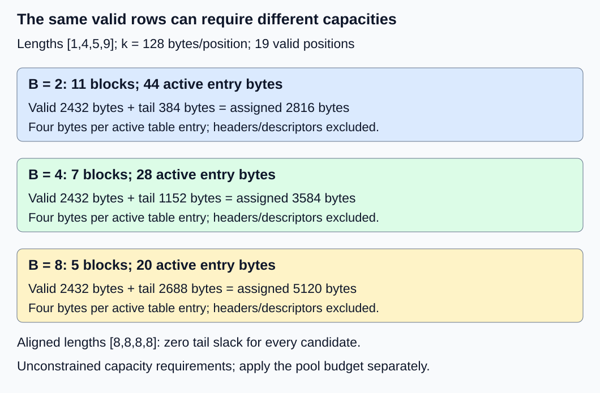
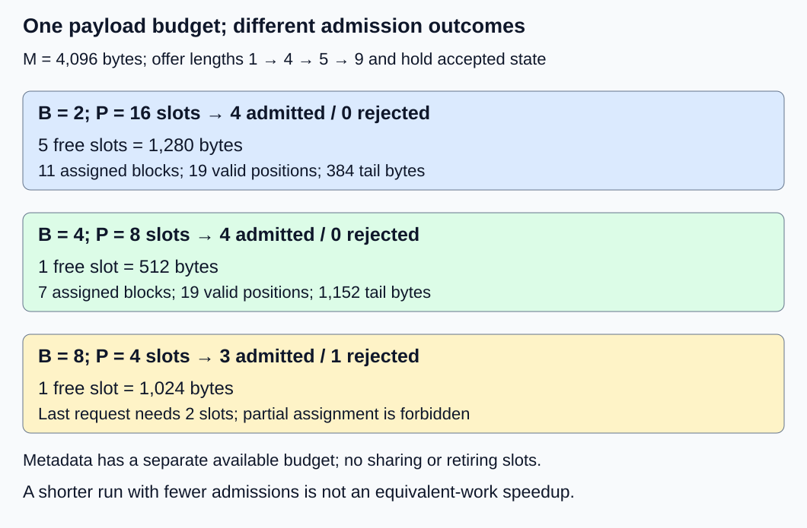

# M2-C09: Choosing block size and measuring fragmentation

> **Status: Complete — detailed chapter authored and documentation validated; experimental procedures are proposed unless explicitly labelled observed**

**Module:** Treat the KV cache as a first-class systems problem

**Category:** [State, memory, and caching](index.md)

[Module 2 reading order](../module-2.md) · [Previous: M2-C08](../state-memory-and-caching/m2-c08-designing-a-fixed-size-kv-block-allocator.md) · [Next: M2-C10](../runtime-and-concurrency/m2-c10-request-state-transitions-and-safe-block-reuse.md)

## Target concepts

Tokens per block, ceiling-based block counts, internal versus external fragmentation, tail waste, metadata overhead, allocation granularity, block-size tradeoffs.

## Concepts

### 1. Block size is an allocation granularity

A KV **block size B** specifies how many token positions one storage slot can hold. The **allocation granularity** is the smallest storage unit assigned by the pool. Larger B assigns capacity in larger steps; smaller B needs more slots and mappings for the same valid prefix. Neither choice alone establishes faster attention or better service latency.

Use the private, nonsharing, all-layer fixture from [M2-C08](m2-c08-designing-a-fixed-size-kv-block-allocator.md): two layers, two KV heads, two features/head and eight bytes/FP64 element, with both K and V. Its payload is **k = 2 × 2 × 2 × 2 × 8 = 128 bytes/position**. There is no speculative reservation or retained prefix cache. Every request has only the blocks needed for its current completed prefix. These are storage rows, not a claim that an earlier toy model accepts arbitrary context lengths.

For N ≥ 0 valid positions and positive integer B:

**n(N,B) = ceil(N/B), with n(0,B) = 0.**

**Block payload Q = B × k; assigned payload C = n × B × k.**

**Valid payload V = N × k; tail slack W = (n × B − N) × k.**

Ceiling rounds upward. Use checked integer arithmetic; invalid B, negative lengths and overflow must reject rather than produce a plausible small count. For N = 5, B = 4, two blocks reserve eight positions: V = 640 bytes, C = 1,024 bytes and W = 384 bytes. The last three positions are allocated but invalid; [M2-C07](../kernels-compilers-and-execution/m2-c07-how-attention-reads-a-paged-kv-layout.md) explains why attention must exclude them.

For each nonempty private request, **0 ≤ W ≤ (B − 1) × k**. The upper bound occurs when N leaves remainder one on division by B; an exact multiple leaves zero slack. The bound excludes extra reservations, shared ownership and retiring blocks. For A nonempty requests, **W_total ≤ A × (B − 1) × k** under the same assumptions.

### 2. Use a length distribution, not one convenient request

Consider four simultaneous lengths **[1,4,5,9]**, totalling 19 valid positions or **2,432 bytes**. The table calculates the capacity required to hold all four, before imposing any pool budget:

| B, positions/block | Blocks per request | Total blocks | Assigned payload | Tail slack | Active table-entry bytes |
|---|---|---|---|---|---|
| 2 | 1,2,3,5 | 11 | 2,816 bytes | 384 bytes | 44 bytes |
| 4 | 1,1,2,3 | 7 | 3,584 bytes | 1,152 bytes | 28 bytes |
| 8 | 1,1,1,2 | 5 | 5,120 bytes | 2,688 bytes | 20 bytes |

The final column chooses **four bytes per mapping entry**. It counts active entries only, not reserved table capacity, per-request headers, slot descriptors, synchronization or device copies. If each request also has a chosen 16-byte serialized header, add 64 bytes to every row: entries plus headers become 108, 92 and 84 bytes. These chosen field sizes are not actual Rust structure/allocation sizes. Pool descriptors are a separate cost that depends on configured pool slots, not just active mappings.

For B = 4, tail slack is **1,152/3,584 ≈ 32.14% of assigned payload**, or **1,152/2,432 ≈ 47.37% of valid payload**. Both are legitimate ratios with different denominators. Neither says that 47.37% of the entire machine's memory is wasted. Payload utilization is **V/C**; here it is 19/28 ≈ 67.86%.

*All rows describe the same 19 valid positions. Fewer mappings can coexist with more assigned storage.*

A common estimate assumes the length remainder N mod B is uniformly distributed over 0 through B − 1. Under that explicit assumption, expected slack is **E[W] = k × (B − 1)/2 bytes per request**. This is a model of remainders, not a general law about generation lengths. At B = 4 it predicts 1.5 unused positions/request, whereas this workload has 9/4 = 2.25. Length caps, aligned prompts and stopping behavior can strongly change remainders.

Use real length frequencies when available and preserve correlations with residence time and arrivals. A snapshot weights requests alive at that moment; a completed-request histogram weights terminal requests. A long-lived partial tail consumes capacity for longer. For example, B = 4 and N = 1 leave 384 bytes unused; holding that unchanged state for a constructed 10 ms consumes **384 × 10 = 3,840 byte·ms of tail-slack area**. This is an accounting example, not a measured latency. Time-weighted slack can reveal costs hidden by an average over completions.

### 3. Name the memory boundary before calling it fragmentation

**Internal fragmentation** is unused capacity inside an assigned allocation unit. This chapter's W is specifically whole-block tail slack. Other internal waste can arise from alignment, size-class rounding or additional reservation; measure it separately.

**External fragmentation** concerns the arrangement of eligible free spans relative to an allocation request. In M2-C05's bounded 16 MiB arena, two separate 4 MiB holes give 8 MiB total free but cannot satisfy one 6 MiB contiguous request. MiB means 2²⁰ bytes. Coalescing can join adjacent free holes only after the intervening live allocation safely releases. It cannot simply relabel live storage as free.

An established equal-slot pool can assign any eligible free slots to a request; it need not find a request-wide adjacent run. Scattered eligible IDs therefore do not constitute the same span problem at this boundary. Pool creation can still fail in its backing allocator, and alignment, different cache groups or device placement can make some nominally free bytes unusable for a particular request.

| Observation | What it means | What it does not establish |
|---|---|---|
| Assigned block minus valid row bytes | Tail slack under the declared layout | Total process memory waste |
| Total free spans exceed request, largest eligible span is too small | Contiguous-span failure in that allocator model | Failure of an equal-slot multi-block assignment |
| Slots remain retiring after cancellation | Lifetime-limited capacity | Tail slack or eligible free space |
| Allocator-reserved exceeds tensor-allocated bytes | Different allocator counters/scopes | A universal external-fragmentation percentage |

The [PyTorch 2.14 memory-management notes](https://docs.pytorch.org/docs/2.14/notes/cuda.html#memory-management) distinguish tensor-allocated memory from allocator-managed reservation and warn that some statistics depend on the allocator backend. Their difference can include reusable cache and other allocator state. A snapshot and allocation history are needed before attributing a failure to external fragmentation. Do not transfer those framework counters directly to our pool's live/free sets.

For a payload budget M bytes and block payload Q, a fixed-size pool has **P = floor(M/Q)** whole slots and **R_budget = M − P × Q** leftover budget bytes, where floor rounds down. R_budget is not request tail slack. Nor is it evidence that the backing allocator physically allocated those leftover bytes. For M = 3,000 and B = 8, Q = 1,024, P = 2 and R_budget = 952 bytes. At B = 2, Q = 256, P = 11 and R_budget = 184 bytes. Name whether M is a policy limit, an allocated region or observed available memory.

### 4. Fixed budgets change admission outcomes

Now impose **M = 4,096 bytes of pool payload only**. Budget metadata separately and assume it is available; otherwise capacity conclusions would mix payload and metadata limits. No slot is shared, reserved by another operation or retiring. Pool geometry changes with B:

| B | Q | Pool slots P | All four requests' block demand | Outcome in order 1,4,5,9 |
|---|---|---|---|---|
| 2 | 256 bytes | 16 | 11 | All four admitted; 5 slots free |
| 4 | 512 bytes | 8 | 7 | All four admitted; 1 slot free |
| 8 | 1,024 bytes | 4 | 5 | First three admitted; last needs 2 but only 1 free |

At B = 8, the admitted lengths [1,4,5] contain ten valid positions: 1,280 valid bytes inside 3,072 assigned bytes, with 1,792 tail bytes and 1,024 free bytes. The nine-position request needs 2,048 bytes in two blocks, so all-or-nothing reservation rejects it. Its 1,152 valid bytes would not fit the one remaining block anyway. Rejection must not take that last slot or modify existing owners.

After all four requests are admitted at B = 2, a new five-position request needs three blocks or 768 bytes and fits the five free slots. At B = 4 it needs two blocks or 1,024 bytes and cannot fit the one free slot. These are deterministic capacity observations, not measured throughput or a universal recommendation for B = 2.

*Hold the offered sequence and budget fixed. Count rejected requests; a path that does less useful work can appear faster.*

For aligned lengths **[8,8,8,8]**, every candidate uses exactly 32 valid/assigned positions and zero tail slack, filling the same payload budget. Total blocks are 16,8,4 and active entry bytes are 64,32,16. This second workload removes tail waste but still changes bookkeeping and consumer access granularity.

### 5. Choose a supported operating point, then measure end to end

Small blocks can reduce private-tail waste and improve assignment granularity, yet increase metadata, block-boundary work and coordination. Large blocks can reduce mapping count but increase over-allocation and change attention access behavior. The [PagedAttention v1 block-size ablation, section 7.2](https://arxiv.org/html/2309.06180v1), reports workload-dependent tradeoffs; its 2023 configuration is not a current universal default or a recommendation for this fixture.

Only compare sizes supported by the actual writer, reader and backend. Changing B changes mapping arithmetic and requires compatible pool geometry; do not reinterpret existing data under a new B without an explicit conversion/lifetime plan. Keep this chapter's configurations independent. Later sharing, copy-on-write and migration introduce additional tradeoffs, but no sharing savings are assumed here.

The useful choice is a configuration that preserves correctness and improves the intended service objective under representative lengths, arrivals, cancellations and resources. Lowest tail slack, fewest entries and fastest local allocator can name three different candidates. Exact memory accounting establishes a hypothesis; completed-request evidence decides whether it helps useful service.

## Experiments

The procedures below are proposed and contain no implementation. The execution plan reports only documentation and reference-arithmetic checks actually performed, not a runtime fragmentation benchmark.

### E1 — Length and block-size rounding audit

- **Description:** Compare B in {2,4,8} over skewed lengths [1,4,5,9] and aligned lengths [8,8,8,8].
- **Purpose/objective:** Falsify the assumption that fewer mappings necessarily mean less assigned memory.
- **Target concepts:** Tokens/block, ceiling counts, tail waste, metadata overhead and allocation granularity.
- **Baseline and workload:** k = 128, private on-demand blocks, no sharing/retirement; four-byte active entries and chosen 16-byte request headers. This audit is not constrained by the 4,096-byte budget.
- **Controls and prediction:** Same valid lengths and payload contract; vary only B. Predict both tables and zero aligned-workload slack. Compare measured remainders with the explicitly uniform-remainder estimate.
- **Procedure:** Enumerate each request's valid/assigned/slack bytes independently, then sum. Check both slack denominators and entry/header costs. Include N = 0 and exact multiples of B; reject B = 0, negative lengths and overflowing calculations. Do not count padded rows as valid.
- **Hardware/software:** Paper integer ledger first; a future harness records representation and the manifest below.
- **Failure and HFT connection:** Fixed-size event segments exchange unused tail capacity for descriptor count. This tests allocation granularity, not a claim about trading performance.
- **Exit criteria:** Every request satisfies V + W = C and the private-tail bound. All aggregate table values match; aligned lengths have zero slack and no invalid case mutates state.

### E2 — Distinguish holes, slack and retention

- **Description:** Classify three different reasons memory appears unavailable.
- **Purpose/objective:** Prevent a counter difference from being reported as universal fragmentation.
- **Target concepts:** Internal versus external fragmentation, tail waste and memory-accounting boundaries.
- **Baseline and workload:** Separate fixtures: B = 4, N = 5 tail slack; a 16 MiB arena with holes [4,8) and [12,16) and a 6 MiB request; and M2-C08's three retiring 512-byte slots with outstanding readers. These are not one combined pool.
- **Controls and prediction:** Declare each allocator/lifetime boundary. Predict 384 tail bytes, contiguous-span rejection despite 8 MiB total free, and 1,536 retiring bytes that remain unavailable.
- **Procedure:** Record the valid/assigned rows in the first fixture, exact eligible spans in the second and completion/ownership state in the third. Join holes only after the intervening allocation safely releases. Repeat the span reasoning for equal eligible slots and state why a multi-slot assignment has another condition. For any later framework snapshot, record allocated/reserved counters, backend and history before assigning a cause.
- **Hardware/software:** Paper snapshots require no device; conditional allocator profiling needs actual allocator/version and supported counter definitions.
- **Failure and HFT connection:** A segmented buffer can have slack, scattered capacity or an active reader preventing reuse. Those need different remedies; none permits reclaiming a live consumer's state.
- **Exit criteria:** Each byte amount has one declared accounting scope, each failure has a defensible cause, and no reserved-minus-allocated shortcut replaces span/lifetime evidence. Paper classifications remain separate from observed allocator behavior.

### E3 — Budget-limited all-or-nothing admission

- **Description:** Replay the fixed-budget offered request sequence under each B.
- **Purpose/objective:** Translate fragmentation arithmetic into explicit admission outcomes.
- **Target concepts:** Block counts, granularity, fixed-budget capacity and block-size tradeoffs.
- **Baseline and workload:** M = 4,096 payload bytes, lengths arriving in order [1,4,5,9], all held until the four decisions finish. Metadata is separately budgeted; no sharing, retirement or payload reader is active.
- **Controls and prediction:** Hold offered sequence and payload budget fixed; vary B and corresponding pool slots. Predict four admissions for B = 2/4 and three admissions plus one rejection for B = 8.
- **Procedure:** Snapshot eligible slots, owner identity and table state after each decision. Require the rejected request to publish no partial allocation. At the full-workload B = 2/4 snapshots, separately test one more N = 5 request. Repeat the original trace using aligned lengths. Release only after declared uses finish, then check complete restoration.
- **Hardware/software:** Deterministic state ledger; later harness uses M2-C08's pool contract and a declared layout for every size.
- **Failure and HFT connection:** Admission must reflect usable segments, not total logical demand. Rejecting more work can shorten a benchmark while harming useful service; the analogy concerns capacity admission, not exchange obligations.
- **Exit criteria:** Predicted outcomes and byte totals match; rejected requests leave earlier owners unchanged. Of the two full-workload B = 2/4 snapshots, the extra request fits only B = 2. All slots return once after safe completion.

### E4 — Conditional completed-trace comparison

- **Description:** Benchmark allocation, valid-row writing, mapped reconstruction and safe return for each independent pool configuration if a harness becomes available.
- **Purpose/objective:** Compare storage-path costs together with the amount of useful work actually admitted.
- **Target concepts:** All target concepts, especially metadata/data movement versus tail waste.
- **Baseline and workload:** The 4,096-byte payload budget; two traces S = [1,4,5,9] and A = [8,8,8,8]. One worker, no sharing. Process all four admission decisions before writing/reconstructing each admitted request's uniquely labelled valid rows; then return all slots. Each trial begins with a fresh empty logical pool; backing/metadata setup is outside timing.
- **Controls and prediction:** Same offered trace, labels, validation and completion boundaries; vary only supported B in {2,4,8}. Predict S's differing admission counts, not a timing ranking. Unsupported layouts remain explicit rather than silently changing B.
- **Procedure:** Use three sessions. Per trace/session, exclude five warmups per B, then 30 randomized balanced three-size groups. Time first admission entry through final reconstruction completion and safe return, including required metadata movement; record setup separately. Verify exact labels and restored eligibility outside timing. Profile allocation, table access, payload movement and coordination in separate runs. Preserve expected rejections, unexpected failures and watchdog outcomes; drain admitted work before closing accounting.
- **Hardware/software:** CPU FP64 harness and full manifest below; a GPU variant is separate and must include device completion and declared transfers. A 120-second watchdog flags unresolved work without authorizing unsafe return.
- **Failure and HFT connection:** Compare useful admitted work alongside local elapsed time, as with event-buffer capacity under load. Single-worker storage traces establish neither inference throughput nor production tail latency.
- **Exit criteria:** 180 groups yield 540 timed trials and 90 excluded warmups if all configurations are supported. Each B/trace has 90 trials. Publish raw outcomes, useful rows and duration distributions together; no implementation means no measured timings.

## Verification

| Pair | Reference and correctness gate | Measurement, benchmarking and profiling |
|---|---|---|
| V1 / E1 | Exact integer rounding, per-request bounds, table/header arithmetic and valid-coordinate membership | Compare skewed and aligned populations separately; name denominator and metadata scope. The uniform-remainder formula is accepted only under its stated assumption. |
| V2 / E2 | Independent span/row/lifetime ledgers identify the relevant allocation boundary | Record largest eligible span and total free where relevant, plus retiring and allocator-reserved state separately. Profiling a paper arena has no runtime meaning. |
| V3 / E3 | Exact pool demand and all-or-nothing owner/table state | Count offered/admitted/rejected requests, valid rows, slack and free capacity after each decision. Validate safe-return restoration, not an assumed terminal release. |
| V4 / E4 | Exact reconstructed labels and restored slot sets precede timing acceptance | Report duration by B/trace/session, median and spread, outcome counts and useful rows. Profile separately; fewer admissions cannot be called a speedup over equivalent work. Ninety trials do not establish reliable p99. |

E4 offers **540 × 4 = 2,160 requests**. Under the predicted supported, fault-free outcomes, B = 2 and B = 4 each admit 720, while B = 8 admits 630 and rejects 90. Total admissions are 2,070; total expected rejections are 90. Unexpected errors or missing completion change these actual totals and must remain visible. Expected capacity rejection is not an invisible dropped sample or an unexpected runtime failure.

For S, B = 2/4 each process 19 useful rows per trial, whereas B = 8 processes ten. For A all process 32. Useful-row totals across each configuration's 180 timed trials are 4,590,4,590,3,780 respectively. Raw per-trace time and rows/time have different meanings; these are tiny closed traces without serving arrivals. Do not derive generation capacity from them. Record logical payload reads/writes and metadata separately from physical cache/memory-controller counters.

Use completed [M9-C01](../numerics-and-correctness/m9-c01-defining-reference-behavior-and-evidence-before-optimizing.md) for exact references/invariants, [M9-C02](../measurement-experimentation-and-economics/m9-c02-request-events-clocks-and-measurement-boundaries.md) for completion-defined timing and [M9-C07](../measurement-experimentation-and-economics/m9-c07-latency-distributions-and-statistical-uncertainty.md) for populations/uncertainty. Advanced M9-C15 accounting and M9-C22 safety remain outlines; needed elementary contracts are local. Labels, IDs and byte counts compare exactly; no numerical tolerance can excuse a wrong row.

Record input trace/order, seed/group order, warmup outcomes, raw durations, clock units/resolution/overhead, setup policy, actual B/layout, metadata capacity, allocator backend/counters, failure identity and completion status. Later service comparisons need representative arrival and length distributions, cancellation/residence times, full generator correctness, stopping rules and complete-request latency/admission outcomes. The documentation does not contain an executed allocator, attention or serving benchmark.

## Engineering dimensions and principles

| Dimension | Chapter-specific application |
|---|---|
| Semantics and invariants | Valid rows stay unchanged across block sizes; ceiling capacity never makes padding valid. |
| Workload and variability | Length remainders, alignment and residence time determine tail waste; S and A expose different operating points. |
| Resources and bottlenecks | Separate valid payload, assigned slack, active/reserved metadata, pool remainder and backing allocator state. |
| Time and distributions | Block crossings add work; long-lived tails occupy capacity over time. Rejections and completed durations need separate accounting. |
| Ownership and coordination | Shared or retiring state violates the simple private-tail assumptions; wait for safe completion before reusing slots. |
| Failure and adaptation | Budget exhaustion and contiguous-span failure need distinct evidence; failed admission must publish no partial state. |

1. **Correctness defines the optimization boundary:** B changes placement/granularity, not valid positions or request identity. Exact labels gate every comparison.
2. **Performance depends on workload and operating point:** A size that reduces skewed-tail waste may only add bookkeeping on aligned lengths.
3. **Data movement is part of the algorithm:** More entries and boundaries can add traffic; fewer mappings do not establish fewer memory transactions.
4. **State has ownership, lifetime, and recovery cost:** Tail slack remains assigned to its owner; retiring capacity cannot be reclassified as free to improve a ratio.
5. **Dependencies determine latency; bottlenecks determine capacity:** New blocks need eligible resources and valid mappings; memory capacity alone does not establish the attention critical path.
6. **Variability and synchronization shape the tail:** Remainder and residence distributions matter alongside contention; closed traces cannot establish service p99.
7. **Local improvements must be evaluated end to end:** Less slack or a shorter trace matters only with correct useful admitted/completed work under matched service conditions.
8. **Claims require reproducible evidence:** Publish trace, geometry, accounting boundaries, counters, manifests and all outcomes; distinguish predictions from measurements.

## Specifications, articles, and hardware

- [PagedAttention paper, version 1, 12 September 2023, section 7.2](https://arxiv.org/html/2309.06180v1): original workload-dependent block-size tradeoff. Its historical defaults and speed results are not transferred to our fixture.
- [PyTorch 2.14 CUDA memory-management notes](https://docs.pytorch.org/docs/2.14/notes/cuda.html#memory-management): allocated versus allocator-reserved scopes and backend-dependent statistics. The chapter does not prescribe allocator tuning from these synthetic examples.

Paper calculations require no device. A proposed CPU harness needs FP64 storage, one worker and at least 1 GiB available RAM for these tiny pools and harness overhead. Record CPU model, cores/cache sizes, affinity, frequency/power policy, RAM capacity/speed, OS/kernel/page size, Rust/compiler and optimization settings, allocator and metadata sizes/alignment. Choose a 64-byte-aligned pool base; all candidate block payload sizes are multiples of 64. Budget headers/descriptors and a preallocated reconstruction destination separately from M; keep destination allocation outside timing and report all actual allocations.

A separate GPU variant records device/count, VRAM, driver/runtime, backend build and supported B/strides/dtype, host/device placement, transfers, queues and completion primitive. A failure to support these teaching sizes is an unsupported configuration, not permission to substitute unrecorded geometry. No GPU or CPU allocator performance measurements were made for this chapter.

## Key takeaways

Block size trades tail capacity against mapping and access granularity. Choose it using actual length/residence distributions, correct counter boundaries and useful-work outcomes under a fixed budget. Equal free-slot assignment, backing-allocator fragmentation and deferred reclamation are different problems. [M2-C10: Request state transitions and safe block reuse](../runtime-and-concurrency/m2-c10-request-state-transitions-and-safe-block-reuse.md) is now a completed detailed chapter. M2-C11 is next for authoring.
