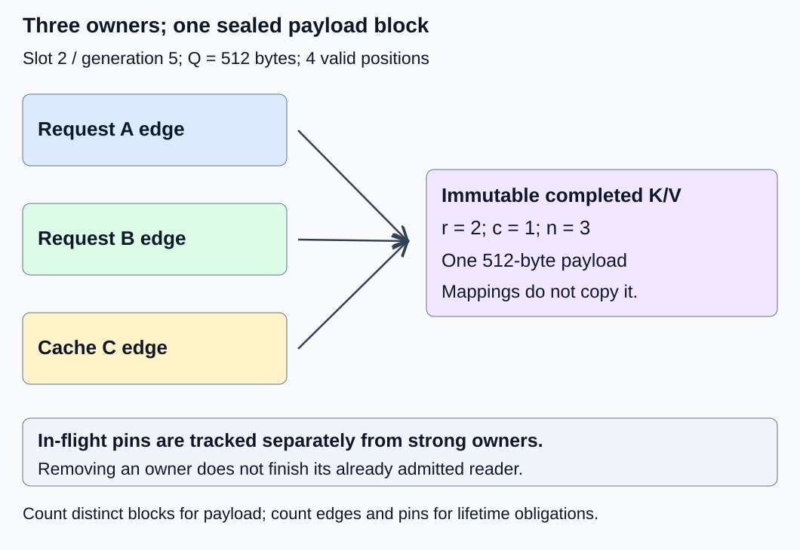
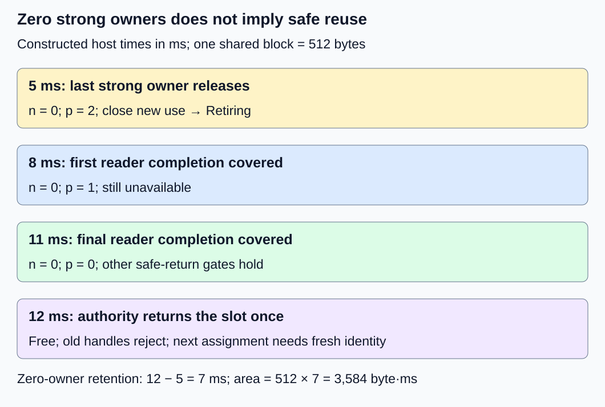

# M2-C11: Reference counting and shared block ownership

> **Status: Complete — detailed chapter authored and documentation validated; experimental procedures are proposed unless explicitly labelled observed**

**Module:** Treat the KV cache as a first-class systems problem

**Category:** [State, memory, and caching](index.md)

[Module 2 reading order](../module-2.md) · [Previous: M2-C10](../runtime-and-concurrency/m2-c10-request-state-transitions-and-safe-block-reuse.md) · [Next: M2-C12](../state-memory-and-caching/m2-c12-copy-on-write-for-branching-requests.md)

## Target concepts

Multiple owners, request references versus cache references, retain and release rules, reference-count invariants, zero-reference eligibility, in-flight pins.

## Concepts

### 1. Sharing adds owners without adding another payload copy

Two requests can read the same completed, compatible KV prefix rather than store duplicate payloads. Compatibility is an explicit premise here: same represented prefix state, model/version, positions, mask and layout, with permitted isolation. This chapter does not provide a prefix-identity lookup algorithm; M2-C13 will develop that topic. The [PagedAttention paper, version 1, section 4.4](https://arxiv.org/html/2309.06180v1) describes multiple logical mappings to physical KV blocks and per-block reference counts.

A **reference count** records ownership claims that keep an object available. It does not count payload copies, bytes, or necessarily distinct requests. An **ownership edge** is one named relationship from a request table or cache-retention object to a block. A request with two independently owned aliases would have two edges; this chapter's main fixture has one edge per request to its shared block.

Keep [M2-C10's lifetime distinction](../runtime-and-concurrency/m2-c10-request-state-transitions-and-safe-block-reuse.md): an owner permits future use, while an in-flight access claim protects work already admitted. Dropping the last owner does not erase device or host readers that are still using the data.

Use the all-layer storage fixture: two layers, two KV heads, two features/head and eight bytes/FP64 element, storing K and V. Payload per position is **k = 2 × 2 × 2 × 2 × 8 = 128 bytes**. Four positions/block give **Q = 512 bytes/block**. The main example uses a four-slot pool with 2,048 backing payload bytes. Slot 2, generation 5, contains one full completed block with four valid positions. These initial identities are independent of earlier traces.

### 2. Count request and cache ownership separately

For block b, define R_b as the set of active request ownership-edge tokens and K_b as the set of cache-retention edge tokens. Each token has a distinct identity so duplicate release can be rejected. Define:

**r_b = |R_b|; c_b = |K_b|; strong owners n_b = r_b + c_b.**

The vertical bars mean set size. A **request reference** keeps a block available for that request's future reads. A **cache reference** keeps it available for possible later requests even when no current request needs it. An index containing only an ID is not automatically an owning cache edge; its policy must say whether it retains payload.

| Reference or claim | What it preserves | What removing it does not prove |
|---|---|---|
| Request ownership edge | That request's right to future permitted reads | Other requests or cache owners are gone |
| Cache-retention edge | Payload availability for later compatible reuse | Active requests or old readers are finished |
| In-flight host/device pin | Storage lifetime for a previously admitted use | Payload is writable or available to a new owner |
| Nonowning identifier/index hint | A potential lookup candidate | Payload is alive or current identity still matches |

A cache holding the last strong edge intentionally retains capacity. That is not a reference-count leak merely because r_b = 0. Conversely, an edge that should have been released but remains indefinitely is a leak in ownership bookkeeping. Define policy and expected lifetime before classifying either case.

[Rust 1.99.1 Arc](https://doc.rust-lang.org/std/sync/struct.Arc.html) provides shared heap ownership: cloning adds an owner, and the inner value is dropped when the last strong owner disappears. Its atomic ownership counting does not make arbitrary contents safe to mutate. Arc is a language-context analogy, not a specification of our pool counters or device lifetime. Strong ownership cycles can also retain objects; avoid unexplained owning back-links in cache metadata. This chapter requires no Rust implementation.

### 3. Retain and release are protected state transitions

**Retain** creates one new ownership edge from a validated live source; **release** removes exactly the edge it names. An independent owner needs an independent token. Merely copying a raw slot ID does not retain payload. Moving an existing token between bookkeeping locations transfers ownership without increasing its count.

A useful exact ledger equation, over successful ownership operations, is:

**n_after = n_before + successful retains − successful releases.**

Counts cannot be negative. A release of an absent token, wrong pool, wrong generation or wrong request/attempt must reject without decrementing any count. Duplicate terminal notifications cannot release one request edge twice. Count overflow must reject a retain before publishing an edge; never wrap a finite counter into zero. A failed request-table publication must roll back any tentative retain exactly once, preserving existing owners and payload.

Use one serial ownership authority for this teaching baseline. Cache lookup, identity validation and retain must form a protected decision relative to eviction and final release. Otherwise a lookup can obtain an ID, eviction can free/reassign the slot, and a late increment can accidentally attach to another request's state. A nonowning hint must be validated and promoted under that contract or treated as a miss. **There is no retain-from-zero resurrection** once retirement has closed admission.

For two owners racing to release or a lookup racing eviction, actual concurrency needs a specified synchronization mechanism and proof obligations. Atomic increments alone do not define publication, token identity, closing admission or external completion. Nor does observing count one grant exclusive mutation: a cache owner, admitted reader or concurrent retain may invalidate that inference.

In this chapter, a published shareable block is **sealed and immutable** for its lifetime. Every reader sees the same completed valid coordinates. Mutation is rejected even if the owner count later becomes one; a different writable/private-state transition needs another contract. [M2-C12](m2-c12-copy-on-write-for-branching-requests.md) will explain divergence without modifying another owner's prefix.

*Three strong edges preserve one payload block. In-flight pins are separately tracked obligations, not extra payload copies.*

### 4. Zero owners closes future use; pins can still delay return

Let p_b count unresolved admitted host/device access pins, including writers if any exist before sealing. In this chapter the shared block is already complete, so the main trace has only reader pins. Pins are separate from n_b; an implementation that folds them into one total must preserve the same semantic categories and must not count or release a use twice.

A safe-return predicate is:

**Return eligible = n_b = 0 AND p_b = 0 AND new admission closed AND mappings detached AND no pending mutation/publication.**

All relevant completion conditions and identity checks must hold, and final pool return occurs once. Here zero strong owners closes admission under the authority. A request table entry or owning cache object remaining attached at n_b = 0 is an invariant failure. Detached read descriptors can still exist under their pins until completion.

With n_b > 0, a block remains owned. With n_b = 0 and p_b > 0, it is Retiring, not Free. With n_b = p_b = 0 and the other conditions satisfied, it is eligible for final return. Count values are evidence only if they match the actual ownership/use sets. [M2-C10](../runtime-and-concurrency/m2-c10-request-state-transitions-and-safe-block-reuse.md) defines why submission return, cancellation or a timeout cannot stand in for covered reader completion.

The following is a constructed trace for slot 2, generation 5. Cache owner C retains once. A and B are separate request attempts. D0/D1 identify completed-reader evidence, not owning references:

| Observation | Request owners r | Cache owners c | Strong n | Pins p | Meaning |
|---|---|---|---|---|---|
| A initially owns the sealed block | 1 | 0 | 1 | 0 | One payload copy |
| Cache C retains | 1 | 1 | 2 | 0 | Future reuse retained |
| B retains through protected lookup | 2 | 1 | 3 | 0 | A and B map the same block |
| A/B readers admitted | 2 | 1 | 3 | 2 | Two lifetime pins |
| A terminates and releases its edge | 1 | 1 | 2 | 2 | A's reader can still run |
| C evicts and releases its edge | 1 | 0 | 1 | 2 | B remains an owner |
| B terminates; last owner releases | 0 | 0 | 0 | 2 | Close admission; Retiring |
| D0 covers A's reader completion | 0 | 0 | 0 | 1 | Still unavailable |
| D1 covers B's reader completion | 0 | 0 | 0 | 0 | Eligible, pending final return |
| Authority returns the slot once | 0 | 0 | 0 | 0 | Free, old handles invalid |

In a separate cache-only branch, release A and B before eviction while c = 1. Then r = 0, n = 1: payload remains retained for the cache, and a protected compatible lookup can add a new request edge. This branch differs from the main trace's zero-owner retirement; do not treat those states as interchangeable.

For a time-area exercise, let the main trace's last-owner release occur at constructed host time 5 ms, D0 be observed at 8, D1 at 11 and final return at 12. The whole 512-byte slot remains unavailable for **12 − 5 = 7 ms**, giving **512 × 7 = 3,584 byte·ms** of zero-owner retention area. Earliest safe completion evidence is at 11; the final millisecond is reclaim scheduling delay. These are input-ledger calculations, not measured runtime behavior.

*Two owners can disappear while two previously admitted readers remain. Only the final covered completion permits return; no new owner may resurrect the retired generation.*

### 5. Count unique blocks for memory and edges for bookkeeping

The assigned payload is **Q × number of distinct unavailable physical blocks**, not Q times the sum of reference counts. Multiple owners of one block do not multiply its storage. Free-slot capacity, retained cache payload, request-used payload and retiring payload need disjoint accounting rules to avoid double counting a block used by both requests and the cache.

In a separate nine-slot pool, compare three requests, each with an identical eight-position prefix (two blocks) and a private four-position tail (one block). Assume all blocks are full, no pins delay return and compatibility is already established:

**Without sharing: 3 × (2 + 1) = 9 blocks = 4,608 assigned bytes.**

**With sharing: 2 + 3 × 1 = 5 blocks = 2,560 assigned bytes.**

**Payload saved = 4 × 512 = 2,048 bytes, or 4/9 ≈ 44.44% of unshared assigned payload.**

Each request still has three logical table entries, so both configurations have nine entries. At a chosen four bytes/entry, that is 36 active table bytes in either case, excluding headers, capacity and ownership metadata. Sharing reduces payload duplication; it does not automatically remove mappings or reduce backing allocation. With the same nine-slot preallocated pool, both backings stay 4,608 bytes; sharing makes four slots eligible for other assignments.

If the cache also retains each of the two shared prefix blocks, each has r = 3, c = 1 and n = 4. Three private tails have one owner each. The strong-edge sum is **2 × 4 + 3 × 1 = 11**, yet there are still only five assigned blocks. Request table edges total nine; the other two are cache-retention edges. Additional cache ownership changes future retention, not the immediate number of physical copies.

Smaller memory use can coexist with more retain/release coordination. Shared immutable event buffers in HFT have a similar distinction between one payload and many consumer claims. That analogy concerns fan-out, lifetime and bounded capacity, not trading advice or evidence that KV reuse preserves arbitrary model semantics.

## Experiments

These are proposed procedures without implementation. Reference-ledger and document checks are reported separately in the execution plan; no shared-cache runtime or concurrency test is claimed.

### E1 — Ownership edges and immutable sharing

- **Description:** Build the A/B/cache ownership ledger around one sealed block.
- **Purpose/objective:** Verify request/cache categories and immutable payload semantics independently of a total count.
- **Target concepts:** Multiple owners, request versus cache references, reference-count invariants and shared-data immutability.
- **Baseline and workload:** Four-slot pool, Q = 512, slot 2 generation 5 with four valid rows; unique exactly representable integer FP64 labels per K/V/layer/head/feature/position. One edge per A, B and cache C.
- **Controls and prediction:** Hold payload and identity fixed; vary ownership edges only. Predict n = 1,2,3 while assigned payload stays 512 bytes.
- **Procedure:** Enumerate ownership tokens and compare their set sizes with r/c/n. Require both readers to recover the same 64 valid FP64 elements. Reject a shared write and a write after count falls to one under the sealed-block contract. Distinguish transferring an existing token from retaining a new owner.
- **Hardware/software:** Paper edge/label ledger first; any later CPU harness records descriptor representation and the manifest below.
- **Failure and HFT connection:** Fan-out consumers share one immutable event payload, but each independent owner needs an accountable lifetime. The analogy does not establish a trading or prefix-matching protocol.
- **Exit criteria:** Every count matches its actual edge set; all 64 labels agree exactly for each reader, assigned bytes remain unchanged, and forbidden mutation rejects before changing any payload.

### E2 — Retain, release, rollback and eviction ordering

- **Description:** Exercise ownership transitions with invalid tokens and two lookup/eviction orders.
- **Purpose/objective:** Detect leaks, double release and stale promotion before they can become premature reuse.
- **Target concepts:** Retain/release rules, request/cache distinctions and count invariants.
- **Baseline and workload:** Independent snapshots: A plus cache C own the sealed block; a new B lookup either obtains a protected retain before C's eviction or occurs after all owners release and retirement closes. Include one tentative B retain whose table publication fails.
- **Controls and prediction:** Fixed current generation and token identity. Predict B remains an owner in the first ordering; the zero-owner generation cannot be retained in the second. Publication failure restores original ownership, not an extra count.
- **Procedure:** Record edge creation, publication and removal under the serial authority. Reject duplicate release, wrong owner/attempt/pool/generation and absent token. In a separate three-bit teaching-counter snapshot, seven valid request edges give the maximum count 7; reject an eighth retain before publishing its edge. This small counter is not a production recommendation. In a separate cache-only branch, release requests while c = 1, then promote a compatible lookup before eviction and verify n increases safely.
- **Hardware/software:** Deterministic transition ledger; a future concurrent harness needs an explicit synchronization/lookup contract and fault point, not just atomic arithmetic.
- **Failure and HFT connection:** An index hit can become stale before a consumer acquires ownership. This resembles reusable event descriptors; naming storage is not authority to use it.
- **Exit criteria:** Every successful retain has a valid source and one token; every release consumes one token once. Failed publication restores counts/owners, invalid operations leave them unchanged, and retired generations never resurrect.

### E3 — Last owner versus last reader

- **Description:** Replay the main trace through owner-zero retirement and later return.
- **Purpose/objective:** Show that n = 0 is necessary but insufficient for reclaiming a shared block.
- **Target concepts:** Zero-reference eligibility, in-flight pins and deferred reclamation.
- **Baseline and workload:** Two admitted reader pins remain after A, B and C release. Last owner at 5 ms, covered completions at 8/11 and actual return at 12, all constructed host observations.
- **Controls and prediction:** Same complete use set; vary which owner releases first without altering the declared reader completions. Predict pins 2 → 1 → 0, seven milliseconds retirement and 3,584 byte·ms area.
- **Procedure:** Close new retain/read admission when the last owner leaves, detach ownership mappings and preserve admitted read descriptors under pins. Reject reuse at owner zero while p > 0. Reject duplicate completion release and a completion for another operation. Keep an unresolved/error use pinned; after sufficient evidence, return once and assign a fresh generation with valid length zero.
- **Hardware/software:** Constructed use/evidence ledger first; actual GPU testing requires declared streams, completion coverage and runtime versions from the manifest.
- **Failure and HFT connection:** Removing every subscription does not finish consumers already reading an event buffer. Cancellation must preserve those lifetimes; a paper trace is not a concurrency-safety proof.
- **Exit criteria:** No zero-owner pinned slot becomes free early, every pin discharges once with matching evidence, and old handles reject after return/reassignment. Capacity and time-area totals reconcile.

### E4 — Conditional shared versus duplicated storage path

- **Description:** Compare immutable sharing with separate prefix copies if a compatible harness becomes available.
- **Purpose/objective:** Relate saved payload to completed storage work and coordination costs.
- **Target concepts:** Multiple owners, retain/release, unique-block accounting and pins.
- **Baseline and workload:** m in {3,6} requests; each has eight identical prefix positions and a private four-position tail. Use an independent 18-slot pool per configuration, Q = 512, no cache-retention edge in this benchmark. Source labels and reconstruction destinations are preallocated outside the pool/timing. Shared path writes/seals the prefix once under the first request's ownership, then retains one edge for each of the other m − 1 requests; duplicated path writes m copies. Tails are private.
- **Controls and prediction:** Same logical rows, request order, completion and output checks; vary sharing only. Predict 5/8 assigned shared blocks versus 9/18 duplicated blocks, not a timing ranking. All request mappings still contain three entries each.
- **Procedure:** Use three sessions. Per m/session, exclude five warmups per path, then 30 randomized balanced pairs. Time first allocation through payload preparation, table/owner publication, reconstruction by every request and safe final release. Verify exact labels and restored free set outside timing. Include retain/release and pin/completion bookkeeping, with no artificial delayed work in the normal CPU case. Profile payload writes, table lookups and owner coordination separately; run lifecycle faults in a separate population. Drain all admitted work.
- **Hardware/software:** Single-worker CPU FP64 harness with full manifest below. A GPU path is a separate experiment with completed-device timing and declared transfers. A 120-second watchdog records unresolved work and does not authorize reclaiming active slots.
- **Failure and HFT connection:** Fan-out can save duplicate buffer writes while adding ownership traffic. Single-worker storage timing cannot establish serving capacity, cache-hit benefit or HFT tail latency.
- **Exit criteria:** 180 balanced pairs yield 360 timed trials and 60 excluded warmups if supported. Each path/m has 90 trials. Publish exact logical equality, unique/edge counts, raw durations and all outcomes; absent implementations mean no measured timings.

## Verification

| Pair | Reference and correctness gate | Measurement, benchmarking and profiling |
|---|---|---|
| V1 / E1 | Exact request/cache token sets, immutable labels and unique physical identity | Count owners and payload copies separately. Check 64 elements per reader; no tolerance hides wrong request/generation or a mutated prefix. |
| V2 / E2 | Protected source retain, once-only token release and failure rollback | Preserve event order and token identity. Record invalid/overflow/publication outcomes; paper transitions do not prove a concurrent mechanism correct. |
| V3 / E3 | Full safe-return predicate, exact pin-to-evidence mapping and fresh reassignment | Record last-owner release, final required completion and actual return separately. Profile retention only when actual runtime observations exist. |
| V4 / E4 | Every request reconstructs the same logical prefix/tail; no premature reuse or leaked owners | Report duration, unique blocks, edge operations and useful rows by m/path/session. Profile separately; 90 trials do not establish reliable p99. |

The full E4 design intends **90 × 2 × (3 + 6) = 1,620 request reconstructions** across both paths and fan-outs, each of 12 valid positions: 19,440 logical position reads. Each path/m cell has 90 trials. Actual attempted, successful, failed and unresolved counts must remain visible. Shared-prefix materialization writes eight positions per trial versus 8m for duplication; private tails add 4m in either path. Thus unique written positions are 20/32 for sharing and 36/72 for duplication at m = 3/6. Those are logical workload counts, not measured physical DRAM traffic or elapsed time.

Use completed [M9-C01](../numerics-and-correctness/m9-c01-defining-reference-behavior-and-evidence-before-optimizing.md) for exact ownership/state references, [M9-C02](../measurement-experimentation-and-economics/m9-c02-request-events-clocks-and-measurement-boundaries.md) for completion/event identities and [M9-C07](../measurement-experimentation-and-economics/m9-c07-latency-distributions-and-statistical-uncertainty.md) for populations/uncertainty. Advanced M9-C15 accounting and M9-C22 safety remain outlines; elementary owner/pin/unique-block obligations are local here.

Record token/source identities, starting edge/pin sets, layout and prefix compatibility premise, failure points, completion coverage, randomized trial order, warmup outcomes, clock units/resolution/overhead, raw samples and final pool state. Small serial workloads do not measure contention on a shared atomic counter; a later concurrent experiment must preserve the same contract and vary owner locality/fan-out explicitly. Full-service claims additionally need correct generator outputs and matched arrivals, cancellation, prefix-reuse opportunities, admission and complete-request timing. No allocator, cache or concurrent runtime is supplied by this documentation.

## Engineering dimensions and principles

| Dimension | Chapter-specific application |
|---|---|
| Semantics and invariants | Strong count equals request plus cache edges; payload remains sealed and every token/pin releases once. |
| Workload and variability | Fan-out, cache retention and reader duration change payload savings and coordination; m = 3/6 isolate one factor. |
| Resources and bottlenecks | Count distinct blocks for payload and edges for metadata; cache-only and retiring capacity have different causes. |
| Time and distributions | Last-owner release and last-reader completion are separate gates; reclaim scheduling adds retention. |
| Ownership and coordination | Retain validates a live source under the authority; an ID hint or count snapshot is insufficient. |
| Failure and adaptation | Publication rollback, eviction races, overflow and unresolved completion must preserve owners and unavailable state correctly. |

1. **Correctness defines the optimization boundary:** Sharing preserves exact compatible KV state; mutation or stale promotion is not an approximate optimization.
2. **Performance depends on workload and operating point:** Prefix fan-out saves copies, while low reuse or prolonged cache retention can reduce its useful benefit.
3. **Data movement is part of the algorithm:** One shared prefix reduces duplicate writes, but every request still reads logical data and uses mapping/ownership metadata.
4. **State has ownership, lifetime, and recovery cost:** Cache owners intentionally retain payload; zero owners still require outstanding pins to complete.
5. **Dependencies determine latency; bottlenecks determine capacity:** Protected promotion precedes use and final completion precedes return; fewer copies alone cannot establish capacity.
6. **Variability and synchronization shape the tail:** Shared-counter contention and slow consumers need later concurrent workloads, not a tail claim from serial medians.
7. **Local improvements must be evaluated end to end:** Saved blocks and quicker attaches matter through correct useful admission/completion under actual reuse patterns.
8. **Claims require reproducible evidence:** Preserve exact edge/use ledgers, immutable labels, manifests and fault outcomes; separate calculated sharing savings from runtime measurements.

## Specifications, articles, and hardware

- [Rust standard library 1.99.1 Arc](https://doc.rust-lang.org/std/sync/struct.Arc.html): shared ownership, immutable access, thread-safety boundaries and ownership cycles. It does not define this pool's cache tokens or external completion.
- [PagedAttention paper, version 1, 12 September 2023, section 4.4](https://arxiv.org/html/2309.06180v1): block sharing and reference-count motivation. Its copy-on-write implementation and performance results are not reproduced here.

Paper ledgers need no device. A proposed CPU harness needs FP64 storage, one worker and at least 1 GiB available RAM for these small buffers and harness overhead. Record CPU model, core/cache sizes, affinity, frequency/power policy, RAM capacity/speed, OS/kernel, page size, Rust/compiler/optimization settings, allocator, metadata representation and token/counter widths. Use a 64-byte-aligned pool base; 512-byte block spacing preserves it. Keep source/destination allocations and pool setup outside timing, but include actual ownership and payload work as declared above.

A separate GPU variant records device/count, VRAM, backend build, driver/runtime, payload/table placement, owner authority, queues/streams, transfers and completion scope. Atomic host reference counts do not establish device memory ordering or completion. No CPU/GPU sharing benchmark, reference-count runtime or concurrency-safety test has been executed for this chapter.

## Key takeaways

One immutable payload can have multiple request and cache owners. Retain/release must match actual ownership edges, while admitted uses retain their own lifetime protection. Zero strong owners closes new use; only completed pins and the remaining reclamation gates permit return. [M2-C12: Copy-on-write for branching requests](m2-c12-copy-on-write-for-branching-requests.md) is now a completed detailed chapter. M2-C13 is next for authoring.
