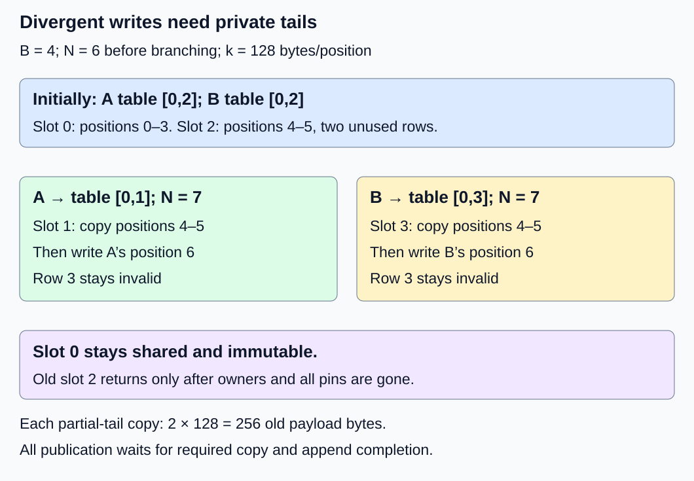
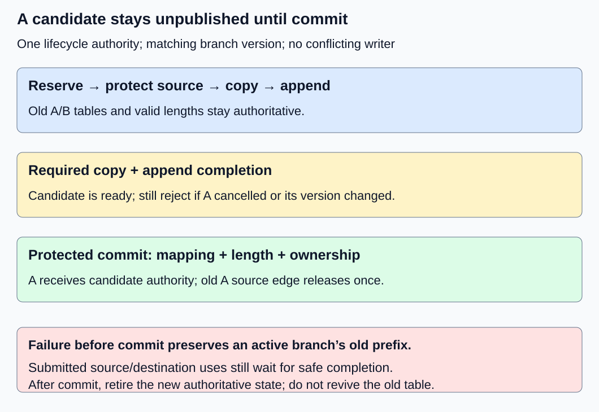

# M2-C12: Copy-on-write for branching requests

> **Status: Complete — detailed chapter authored and documentation validated; experimental procedures are proposed unless explicitly labelled observed**

**Module:** Treat the KV cache as a first-class systems problem

**Category:** [State, memory, and caching](index.md)

[Module 2 reading order](../module-2.md) · [Previous: M2-C11](../state-memory-and-caching/m2-c11-reference-counting-and-shared-block-ownership.md) · [Next: M2-C13](../state-memory-and-caching/m2-c13-prefix-reuse-and-cache-identity.md)

## Target concepts

Immutable shared blocks, divergent continuations, partially filled blocks, private writable tails, copying costs, ownership transfer, failure-safe copy-on-write.

## Concepts

### 1. Branching changes future state, not the shared past

A **branch** is a request continuation with its own future token choices and KV writes. Two branches can initially share a compatible completed prefix, but their first divergent write must not change the other's state. **Copy-on-write (COW)** delays making a private copy until a branch needs to change shared storage.

[M2-C11](m2-c11-reference-counting-and-shared-block-ownership.md) distinguished ownership edges from in-flight pins and kept shared blocks sealed and immutable. This chapter preserves that contract. A new private destination may be writable under exclusive authority; the old sealed source remains immutable even when only one owner remains. A separate protocol could regain exclusive writable ownership of an old block, but count one alone is insufficient, and that optimization is not assumed here.

The [PagedAttention v1 paper, section 4.4](https://arxiv.org/html/2309.06180v1), describes block-level sharing and copying when branches modify a shared tail. Its manager can reuse a uniquely owned block under its own rules; our conservative teaching baseline always creates a private destination when extending a sealed partial tail. [Rust 1.99.1 Arc make_mut](https://doc.rust-lang.org/std/sync/struct.Arc.html#method.make_mut) illustrates clone-on-write for shared heap values. It does not specify KV validity, device completion, pool accounting or a safe branch-publication transaction.

Compatibility of the shared prefix is a premise: same represented KV state, model/version, positions, mask and layout, with permitted isolation. Copying storage does not establish compatibility. Exact identity checks are developed further in M2-C13. The worked examples are labelled storage fixtures; they do not extend an earlier toy model's context limit or implement sampling.

### 2. A partial tail contains shared valid rows and unused capacity

Use the all-layer fixture: two layers, two KV heads, two features/head and eight bytes/FP64 element, including K and V. Thus **k = 2 × 2 × 2 × 2 × 8 = 128 bytes/position**. With **B = 4 positions/block**, block payload **Q = B × k = 512 bytes**. Within each block, the packed axis order is (row, K-or-V, layer, KV head, feature), with feature varying fastest. Each row is therefore 128 contiguous payload bytes. A four-slot pool has 2,048 backing payload bytes; slot IDs are 0–3, not physical DRAM page numbers.

Branches A and B each have **N = 6 valid positions** and table **[0,2]**. Slot 0 holds positions 0–3. Slot 2 holds positions 4–5 in rows 0–1; rows 2–3 are reserved and invalid. Each source block has two request ownership edges and no cache owner. All valid payload is complete and sealed.

For general prefix length N, define **m = floor(N/B)** full blocks and **r = N mod B** tail rows, where floor rounds down and modulo gives the remainder. If 0 < r < B, a divergent append to a sealed partial tail needs a private block containing the r valid old rows followed by the new row. For this fixture, m = 1, r = 2. A appends position 6 with branch-specific values:

| State | A table / valid length | B table / valid length | Source slot 2 ownership |
|---|---|---|---|
| Shared prefix | [0,2] / 6 | [0,2] / 6 | A and B |
| A's destination slot 1 prepared, unpublished | [0,2] / 6 | [0,2] / 6 | A and B; copy source protected |
| A publishes completed private tail | [0,1] / 7 | [0,2] / 6 | B remains |
| B prepares/publishes destination slot 3 | [0,1] / 7 | [0,3] / 7 | No owners; return waits for all pins |

A's slot 1 preserves source positions 4–5 in rows 0–1 and writes A's position 6 into row 2. B later preserves the same old rows and writes a different position-6 value in slot 3. The full-prefix slot 0 stays shared and immutable. Neither branch may read row 3 as valid. [M2-C07](../kernels-compilers-and-execution/m2-c07-how-attention-reads-a-paged-kv-layout.md) explains why a reader must use the new table, correct strides and valid length together.

*The old prefix labels survive in both destinations. Only the new position differs; no write is made to the sealed source.*

If r = 0, the old prefix ends on a block boundary. Allocate an empty private block for the next position; no old tail rows need copying. N = 8 therefore extends to N = 9 with zero old-KV payload copied. Do not copy the last full block merely because it is shared. At N = 0 there is no source tail either. Both boundary cases still require allocation, ownership and write-completion checks.

### 3. Copy traffic and temporary capacity have different units

For valid-row-only COW with r > 0:

**Old payload copied X = r × k bytes; logical copy traffic = 2 × X bytes.**

A copy reads X source bytes and writes X destination bytes. Writing the new position adds k destination bytes. At r = 2, X = 256 bytes, logical copy traffic is 512 bytes and fresh KV writing adds 128 bytes: **640 logical payload bytes moved/written** in this simplified path, excluding metadata, query/attention reads and any additional passes. This is not measured memory-controller traffic or a time prediction.

An alternative whole-block copy moves Q = 512 old bytes, giving 1,024 logical copy bytes plus 128 fresh-write bytes. Whole-block copying must use legally readable source storage. The comparison experiment explicitly initializes slack for that purpose; it does not make those rows valid. Backend layouts may require strided per-layer K/V copies rather than one packed copy. Record the actual transfer plan and bytes.

A requires a destination while retaining the old mapping and source lifetime. The first preparation has **three unavailable blocks = 1,536 bytes**, versus two before divergence. After A commits, three blocks remain assigned because B still owns slot 2. B's later preparation temporarily requires **four blocks = 2,048 bytes**. When B commits and all source pins finish, slot 2 can return, leaving **three assigned blocks = 1,536 bytes**. A reader retaining the old source can extend the four-block residence beyond commit.

The two valid-row copies total 512 copied payload bytes and 1,024 logical copy-traffic bytes; the two new rows add 256 writes. Final unique valid payload is **(4 shared prefix positions + 3 A-tail positions + 3 B-tail positions) × 128 = 1,280 bytes**. Three blocks provide 1,536 assigned bytes, with 256 total tail slack. The two logical prefixes contain 14 positions in total, but four are physically shared; multiplying logical row counts by k would double-count those shared bytes.

With only two pool slots, A cannot begin this baseline's COW. With three slots A can commit, but B cannot prepare another destination until eligible capacity becomes available. Freeing B's old source before its replacement is complete would destroy the fallback prefix. Do not hide a transient-capacity requirement behind a smaller final-state calculation.

### 4. Publication transfers ownership only after completion

A **candidate** is a privately prepared replacement that is not yet visible in the branch's table. One lifecycle authority orders allocation, cancellation, table/version changes and final ownership decisions. Its conceptual transaction must satisfy the following gates; these are a specification, not pseudocode:

| Gate | Required evidence | Observable invariant |
|---|---|---|
| Candidate reservation | Eligible destination, secured metadata/cleanup capacity and identity | A/B tables and valid lengths remain unchanged |
| Source protection and copy | Valid source version and protected lifetime; exclusive destination writer | No source mutation; no destination reader admitted |
| Append and completion | Copied old rows and new branch row complete/visible | Candidate still unpublished until all required writes finish |
| Publication decision | A still active; original mapping/version still matches; candidate ready | One consistent A table/length/version becomes visible |
| Ownership reconciliation | Candidate ownership transfers to A; A's old source edge removed once | B's edge remains; old pins retain source lifetime |
| Deferred cleanup | Every source/destination use covered by completion evidence | No cancelled, failed or obsolete candidate is returned early |

Treat publication and ownership reconciliation as one protected commit decision from the viewpoint of new readers. Do not publish a destination pointer and later repair counts or valid length. Existing readers of the old table version remain protected by their old pins. If the original branch mapping changed while preparation ran, reject the stale candidate rather than overwrite a newer version. The target branch is closed to conflicting writers throughout this baseline's preparation, but it can still be cancelled.

The old source ownership edge is not “moved” into the destination: they are different block identities. A retains its old source ownership until the commit decision. The candidate's preparation authority transfers into the new request ownership; the old request edge then releases once. A source-copy pin can outlast or be released before the edge change depending on the completion scope, but it must cover every actual copy read. [M2-C11's owner/pin invariants](m2-c11-reference-counting-and-shared-block-ownership.md) remain exact throughout.

The [CUDA Runtime 13.4 event contract](https://docs.nvidia.com/cuda/cuda-runtime-api/cuda_runtime_api/group__CUDART__EVENT.html) covers work recorded in a stream at a specified point. A completion event must cover the required copy and append dependencies; submission return, a never-recorded event or an unrelated stream's success is insufficient. A device error leaves completion/state uncertain until the runtime's recovery contract resolves it.

### 5. Failure before commit differs from failure after commit

Before publication, a failed preparation leaves A's original table, valid length and represented prefix unchanged, provided A remains active. B is unchanged in every case. An unsubmitted candidate can be returned after its local claims unwind. A candidate touched by submitted work remains unavailable until all required accesses finish, even if it was never published. Source lifetime must remain protected as well.

Cancellation during preparation closes A's future use; it does not require keeping a cancelled request available for retry. It does require no candidate publication to that cancelled attempt and safe cleanup of its old ownership, source pins and destination writer claims. Count and report cancellation separately from a recoverable failure of an active branch.

After commit, the new table is authoritative. A later failure cannot silently roll back into an old table whose ownership may already have been released. Apply the normal failure/cancellation lifecycle to the committed branch. Duplicate completion, cancellation or cleanup notifications must not release either block twice. Unknown completion remains unavailable; a timeout does not authorize reuse.

*Before commit, preserve an active branch's original prefix. After submission, cleanup waits for completion. After commit, retire the committed state under its own lifetime contract.*

This is the HFT systems analogy: a shared event snapshot can serve several consumers, while a consumer needing mutable derived state takes a private version. Publishing a half-prepared version or reclaiming an in-flight copy is unsafe in either setting. The analogy concerns snapshot lifetime and critical-path dependencies, not exchange behavior or trading results.

## Experiments

These are proposed experiments without implementation. The execution plan distinguishes document/reference arithmetic checks from executed allocator, copy or device tests; none of those runtime tests is claimed here.

### E1 — Divergent private tails preserve a shared prefix

- **Description:** Follow both branches from [0,2]/6 to their private seven-position continuations.
- **Purpose/objective:** Verify old-prefix equivalence and isolation of divergent writes.
- **Target concepts:** Immutable shared blocks, divergent continuations, partial tails, private writable tails and ownership transfer.
- **Baseline and workload:** Four-slot pool, B = 4, k = 128, no cache owner. Give every old coordinate an exact small integer FP64 label; A/B append rows use distinct labels. Use an independent flat seven-row reference per branch.
- **Controls and prediction:** Hold old prefix/layout fixed; vary only the branch's new row. Predict A table [0,1], B table [0,3], shared slot 0 and unchanged source labels in slot 2.
- **Procedure:** Check every valid coordinate before and after each publication. Reconstruct A/B in logical order and compare to their flat references. Confirm the other branch's N/table stays unchanged during preparation. Reject writes to sealed slot 2, premature candidate reads and row-3 padding reads. Preserve existing old-version reader descriptors under their pins.
- **Hardware/software:** Paper table/label ledger first; future CPU/device harness records actual layout and manifest below.
- **Failure and HFT connection:** Consumers can share an immutable event snapshot while keeping private derived continuations. The analogy tests version isolation, not a trading protocol.
- **Exit criteria:** Each completed seven-row branch has 112 exact FP64 elements matching its reference. Positions 0–5 agree across branches; position 6 differs as declared. Ownership and old-reader lifetimes remain correct, and forbidden accesses reject before exposure.

### E2 — Copy payload, block boundaries and transient budget

- **Description:** Audit copy/peak costs for partial and full-block prefix endings.
- **Purpose/objective:** Separate copy work from assigned capacity and reveal the required spare destination.
- **Target concepts:** Partially filled blocks, copying costs and private-tail granularity.
- **Baseline and workload:** B = 4, k = 128; N in {0,4,5,6,7,8}. A extends one position. For r > 0, compare valid-row-only and whole-block copying with all source padding legally initialized in the latter case.
- **Controls and prediction:** Same valid prefix and appended row. Predict valid old-copy bytes 0,0,128,256,384,0 respectively. Whole-block copying uses 512 for partial tails, zero at the declared boundaries.
- **Procedure:** Record valid copied rows, fresh writes, logical traffic and simultaneous unavailable blocks. Replay the N = 6 two-branch sequence with two-, three- and four-slot pool limits. Delay a source reader after both commits in a separate case and include its retained block in the peak/residence accounting. Name metadata movement separately.
- **Hardware/software:** Exact integer ledger; conditional profiling needs actual copy layout, allocation counters and completion boundaries.
- **Failure and HFT connection:** Private snapshot preparation can require spare capacity before old storage is released. Final footprint alone is not an admission bound for event processing either.
- **Exit criteria:** The byte sequence and 1,536/2,048-byte preparation peaks reconcile. Insufficient-spare cases reject without changing active prefixes; no full-block copy reads illegal storage or makes padding valid.

### E3 — Failure and cancellation around publication

- **Description:** Inject five precommit failure cases plus a separate postcommit failure.
- **Purpose/objective:** Validate transaction boundaries and completion-aware cleanup.
- **Target concepts:** Failure-safe COW, ownership transfer and in-flight copy lifetime.
- **Baseline and workload:** Independent snapshots of A/B at [0,2]/6. Cases: no eligible destination; after reservation before dispatch; after copy dispatch with work pending; after copy completion before append; after append completion before commit. Add cancellation while the dispatched copy is pending and a stale branch-version case.
- **Controls and prediction:** Same original labels/edges in each active-branch failure case. Predict unchanged original A/B state before publication; pending work retains source/destination lifetime. Postcommit failure treats the new mapping as authoritative.
- **Procedure:** Record candidate identity, source pin, writer claim, branch version and every completion. Inject the stated outcomes and reconcile owner/use sets. On cancellation, forbid new publication and retire each affected resource safely. Reject an obsolete candidate version and duplicate cleanup/completion. For the postcommit case, close/retire the committed branch rather than revive its old mapping.
- **Hardware/software:** Deterministic state/evidence ledger; future runtime tests need fault points and actual queue/event scope. A 120-second unresolved-work watchdog cannot substitute for completion.
- **Failure and HFT connection:** A prepared private snapshot must become visible completely or remain unpublished. Cancellation does not retract bytes already being copied; this is lifetime reasoning, not a proof of live-system safety.
- **Exit criteria:** Active precommit failures preserve original prefixes and owners. Cancelled attempts never publish candidates; all submitted uses finish before return, or remain explicitly unavailable. No leaked/double-released ownership or stale postcommit rollback occurs.

### E4 — Conditional valid-row versus whole-block COW benchmark

- **Description:** Compare two copy scopes under the same conservative private-destination policy if implementations become available.
- **Purpose/objective:** Test whether fewer copied bytes improve the completed branch-append path.
- **Target concepts:** Copying costs, partial tails, private preparation and publication overhead.
- **Baseline and workload:** Four-slot pool, B = 4, FP64 fixture; r in {1,3}, giving N = 5 or 7. A appends one row while B remains at N. Both source tail blocks have legally initialized padding, but only r rows are valid. Each trial begins at the same shared two-block prefix. Pool backing, source initialization and reference/reconstruction buffers are prepared outside timing; candidate slot reservation remains inside timing.
- **Controls and prediction:** Identical valid labels, row writes, owner/pin validation, layout and completion rules; vary copied scope only. Predict 128/384 old-copy bytes for valid rows versus 512/512 for whole blocks, not a timing ranking.
- **Procedure:** Use three sessions. Per r/session, exclude five warmups per copy scope, then 30 randomized balanced pairs. Time candidate reservation through copy, append, required completion and consistent branch commit/ownership reconciliation. Reconstruct both branches and clean up safely outside timing; report delayed cleanup separately. Profile allocation, payload copy, metadata and waits in separate runs. Preserve failed/cancelled/unresolved outcomes and drain submitted work.
- **Hardware/software:** One-worker CPU FP64 harness and manifest below. A GPU variant is separate and includes required device completion and declared transfer scope. Unsupported layouts remain explicit; a watchdog never permits unsafe return.
- **Failure and HFT connection:** Less snapshot copying may help one operating point yet lose to bookkeeping or dispatch overhead. Small serial trials establish neither inference throughput nor production tail bounds.
- **Exit criteria:** 180 balanced pairs yield 360 timed trials and 60 excluded warmups if supported. Each scope/r has 90 trials. Publish correctness gates, raw durations, copy counts, peaks and all outcomes; absent implementations mean no measured timings.

## Verification

| Pair | Reference and correctness gate | Measurement, benchmarking and profiling |
|---|---|---|
| V1 / E1 | Exact old-prefix preservation, branch-specific new row, table/length/version and owner sets | Check 112 elements per completed branch, including shared/full and private/partial blocks. Counts alone cannot validate source identity or isolation. |
| V2 / E2 | Boundary-dependent copy formula and unavailable-block accounting | Separate old copied bytes, new writes, metadata and physical counters. Include unpublished and retiring destinations in transient capacity; paper peaks are not allocator measurements. |
| V3 / E3 | Correct commit boundary, source/destination completion coverage and once-only cleanup | Record fault, cancellation, publication, last relevant completion and safe return separately. Unresolved work stays visible; paper traces do not prove concurrent correctness. |
| V4 / E4 | Exact valid-row reconstruction for A and B before accepting timing | Report median/spread and session effects by r/scope, faults and unsupported outcomes. Include required completion; profile separately. Ninety trials do not establish reliable p99. |

E4 intends 360 completed append operations if every trial succeeds. Valid-row copying totals **90 × (128 + 384) = 46,080 old payload bytes** across its two r cases; whole-block copying totals **90 × (512 + 512) = 92,160 bytes**. These totals exclude warmups, fresh row writes and logical read/write doubling. All successful trials together write **360 × 128 = 46,080 fresh payload bytes**. Count actual completed/attempted operations separately; faults change the actual workload.

Use completed [M9-C01](../numerics-and-correctness/m9-c01-defining-reference-behavior-and-evidence-before-optimizing.md) for exact prefix/state references, [M9-C02](../measurement-experimentation-and-economics/m9-c02-request-events-clocks-and-measurement-boundaries.md) for event/completion identity and [M9-C07](../measurement-experimentation-and-economics/m9-c07-latency-distributions-and-statistical-uncertainty.md) for populations/uncertainty. Advanced M9-C22 safety remains outlined; the local transaction and lifetime gates state the required elementary obligations. Labels, byte counts and ownership tokens compare exactly; no numerical tolerance excuses a different branch prefix.

Record source/candidate generations, tables/versions, valid rows, initialized padding policy, copied layout/byte scope, owner and pin sets, fault points, completion coverage, clock units/resolution/overhead, randomized order, warmups and raw outcomes. Backend copies can be strided and cache-resident; logical 2X traffic is not a measured DRAM counter. Later service comparisons need actual generator equivalence per branch, representative branching/length/cancellation patterns, admission and full-request latency. A copy microbenchmark alone cannot establish that benefit.

## Engineering dimensions and principles

| Dimension | Chapter-specific application |
|---|---|
| Semantics and invariants | Shared old rows remain exact and immutable; branch tables/valid lengths publish consistently with distinct new rows. |
| Workload and variability | Tail remainder determines copy size; block-aligned prefixes need no old-tail copy. Branch count and delayed readers change retained capacity. |
| Resources and bottlenecks | Count source plus candidate, copy reads/writes, fresh rows, metadata and delayed cleanup separately. |
| Time and distributions | Copy/append completion precedes commit; reclaim scheduling can retain source capacity afterward. |
| Ownership and coordination | Candidate authority transfers at commit; old request ownership releases once while old-reader pins remain valid. |
| Failure and adaptation | Precommit failure preserves active state; cancellation and postcommit failure require different cleanup, with unresolved work retained. |

1. **Correctness defines the optimization boundary:** Copies may move layout but cannot change the old prefix or another branch's continuation.
2. **Performance depends on workload and operating point:** r = 0,1,3 have different copy work; dispatch and bookkeeping can dominate tiny payloads.
3. **Data movement is part of the algorithm:** Distinguish old-copy traffic, fresh row writes and metadata, including actual backend strides.
4. **State has ownership, lifetime, and recovery cost:** Preparing a destination retains the source and requires rollback/retirement resources even before publication.
5. **Dependencies determine latency; bottlenecks determine capacity:** Completion gates commit; spare destination capacity gates admission. A smaller final footprint does not remove transient needs.
6. **Variability and synchronization shape the tail:** Delayed source readers and cancelled copies can prolong peaks; serial timing cannot establish production p99.
7. **Local improvements must be evaluated end to end:** Fewer copied bytes matter through correct branch completion, useful admission and full-request behavior.
8. **Claims require reproducible evidence:** Preserve exact references, commit/fault boundaries, copy scopes, manifests and unresolved outcomes; separate calculated costs from observed performance.

## Specifications, articles, and hardware

- [PagedAttention paper, version 1, 12 September 2023, section 4.4](https://arxiv.org/html/2309.06180v1): block-level branch sharing and copy-on-write motivation. The chapter's conservative sealed-source policy is declared separately.
- [Rust standard library 1.99.1 Arc make_mut](https://doc.rust-lang.org/std/sync/struct.Arc.html#method.make_mut): clone-on-write ownership analogy; not a KV validity or device-lifetime specification.
- [CUDA Runtime 13.4 event management](https://docs.nvidia.com/cuda/cuda-runtime-api/cuda_runtime_api/group__CUDART__EVENT.html): completion scope for recorded work; not proof that a host launch or unrelated event covers a copy/append transaction.

Paper calculations require no device. A proposed CPU harness needs FP64 storage, one worker and at least 1 GiB available RAM for these small pools and harness overhead. Record CPU model, core/cache sizes, affinity, frequency/power policy, RAM capacity/speed, OS/kernel/page size, Rust/compiler and optimization settings, allocator and metadata sizes. Use a 64-byte-aligned pool base; 512-byte spacing preserves it. Preallocate reference/reconstruction destinations outside the pool and timing; report total allocation scope separately from pool payload.

A separate GPU variant records device/count, VRAM, backend build and supported dtype/strides/block size, driver/runtime, host/device placement, copy mechanism, queues, source/destination completion scope, transfers and error handling. No allocator implementation, COW runtime, CPU/GPU copy benchmark or concurrency-safety test has been executed for this chapter.

## Key takeaways

A shared partial tail needs a private valid prefix before a divergent append can publish. Copy work depends on the tail remainder; capacity must cover source and candidate together. Commit transfers the authoritative branch mapping only after required completion, while failure cleanup preserves every outstanding lifetime. [M2-C13: Prefix reuse and cache identity](m2-c13-prefix-reuse-and-cache-identity.md) is now a completed detailed chapter. M2-C14 is next for authoring.
