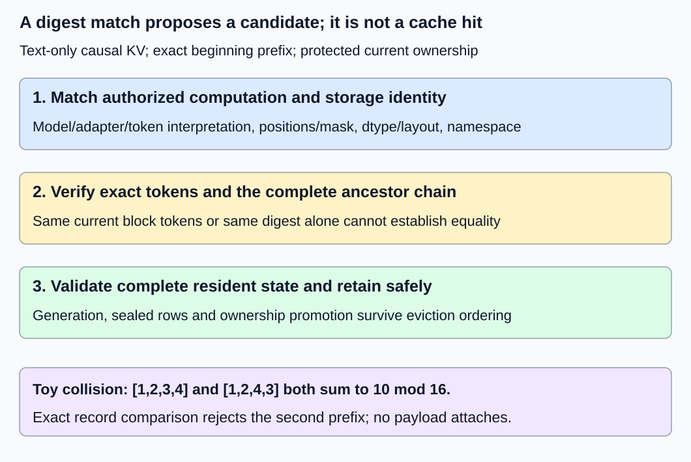
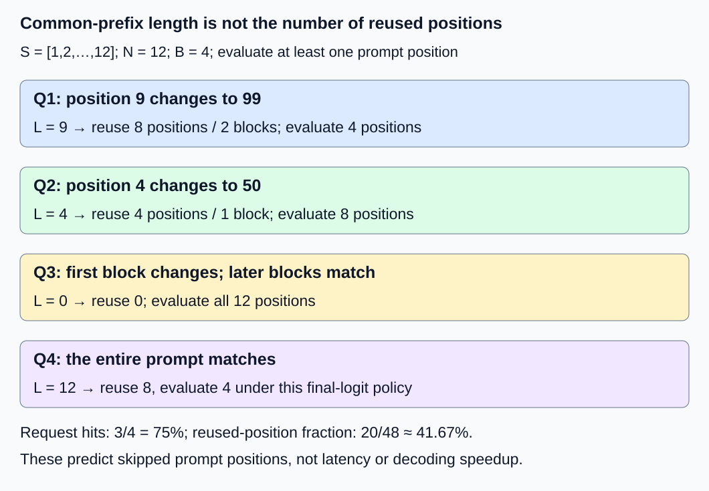

# M2-C13: Prefix reuse and cache identity

> **Status: Complete — detailed chapter authored and documentation validated; experimental procedures are proposed unless explicitly labelled observed**

**Module:** Treat the KV cache as a first-class systems problem

**Category:** [State, memory, and caching](index.md)

[Module 2 reading order](../module-2.md) · [Previous: M2-C12](../state-memory-and-caching/m2-c12-copy-on-write-for-branching-requests.md) · [Next: M2-C14](../state-memory-and-caching/m2-c14-eviction-retention-and-reconstruction.md)

## Target concepts

Exact token-prefix matching, block-granular reuse, prefix indexes, model and adapter identity, position and mask compatibility, dtype and layout compatibility, collision checks, isolation boundaries.

## Concepts

### 1. Reuse computed state, not similar-looking text

**Prefix reuse** attaches a new request to compatible KV state already computed for the beginning of its input. It can avoid computing that prefix's query positions again. It does not eliminate later attention reads of those keys/values, generate a stored answer, or automatically accelerate decode. The [vLLM prefix-caching feature description](https://docs.vllm.ai/en/latest/features/automatic_prefix_caching/) explains this prefill-reuse distinction.

[M1-C02](../interfaces-protocols-and-streaming/m1-c02-representing-text-as-tokens.md) established that the actual input is a token-ID sequence, including template/special tokens. Equal display text does not establish equal IDs; tokenizer versions, templates, whitespace and inserted control tokens can change them. Compare the represented input after tokenization, not a reconstructed string.

For causal text generation, a position's state depends on its preceding context and allowed attention, not just the token at that position. [M1-C11](../model-computation-and-semantics/m1-c11-causal-masking-and-positional-information.md) supplies the position/mask contract. Two blocks containing the same token IDs can have different KV because their earlier prefixes, positions or attention rules differ. This chapter assumes full causal attention without sliding-window or cross-attention state. More complex architectures require additional identity fields and their own proof of compatibility.

The [PagedAttention v1 shared-prefix discussion](https://arxiv.org/html/2309.06180v1) motivates attaching logical request blocks to precomputed physical state. The concrete index and acceptance contract below are teaching choices; they are not a description of every serving backend.

### 2. Define computation identity and storage compatibility

A **cache identity descriptor** states the conditions under which cached state may substitute for fresh computation. A human-readable name is not enough when the named weights or adapter can change. Use immutable revisions or content identities, and record the meaning of every field.

| Identity component | Required comparison in this chapter | Example of an unsafe shortcut |
|---|---|---|
| Model and computation | Exact weight/config revision and numerical-execution contract | Same model nickname after weights changed |
| Adapters | Exact adapter weight revision, order, scale and relevant configuration; explicit no-adapter value | Same adapter name with different contents |
| Input interpretation | Token IDs plus vocabulary/tokenizer/template revision defining their meaning | Equal rendered text only |
| Positions | Exact position IDs and positional-encoding configuration for the reused range | Same IDs shifted to another position offset |
| Attention | Same causal visibility/mask semantics over the prefix and padding | Treating left padding or another mask as equivalent without proof |
| Storage | Same KV dtype, quantization/scales if present, block size, shape/strides/layout and placement contract | Reading one dtype/layout as another |
| Isolation | Same authorized cache-sharing namespace and compatible policy epoch | A user-supplied string granting access to another tenant's state |

For the fixture, call this descriptor D0: model revision M0, no adapter, tokenizer/template revision T0, positions starting at zero, full causal visibility, execution contract E0 and sharing namespace tenant-A/epoch-1. Storage is FP64 with two layers, two KV heads, two features/head and both K/V, packed axes (row, K-or-V, layer, KV head, feature), feature fastest. Thus **k = 128 bytes/position**. With **B = 4 positions/block**, **Q = B × k = 512 bytes/block**.

D0 is a specification label for these declared conditions, not an existing model artifact. A change to any required component yields a miss under the conservative baseline. Dtype/layout conversion or mathematically equivalent position/mask transformations require separately validated mechanisms; they are not implicit cache hits. Likewise, chunking or backend precision changes can alter rounded KV. Exact identity checks are distinct from the numerical budget needed to compare a real fresh and reused execution.

Isolation is part of eligibility even when computations are identical. A trusted service determines the authorized namespace; caller-controlled salts can further partition it but do not grant authorization. The [vLLM design documentation](https://docs.vllm.ai/en/latest/design/prefix_caching/) describes parent-linked block keys, additional identities and cache salts. Our baseline requires explicit authorization and exact-record verification rather than treating a digest or salt as a complete access-control mechanism.

### 3. A prefix index proposes candidates; validation establishes a hit

A **prefix index** maps a description of an earlier token prefix to retained block candidates. A trie follows token edges from the sequence beginning; a hash index puts records in buckets selected by a digest. A **digest** is a fixed-size summary of an input. This chapter chooses a chain of block records and hash buckets; it does not implement either index.

For block number j, a record contains its exact B token IDs, full descriptor, logical position range, parent-record identity and storage handle/generation. Its parent represents the complete validated preceding prefix. Conceptually:

**Key(j) = H(schema version, descriptor, parent key, block token IDs, position/mask description).**

H names the selected hash function, not a proof of equality. Use an unambiguous, versioned serialization: field order, lengths, integer encoding and absent-value representation must be defined before hashing. Concatenating ambiguous strings can create key aliases even without a hash collision.

A **collision** occurs when different serialized inputs yield the same digest. A fixed-width hash cannot uniquely encode arbitrary inputs. The baseline stores full identity/token records and checks the complete relevant prefix chain before accepting a bucket candidate. Equal parent digests are not sufficient when their underlying prefixes differ. If verification fails, continue to another candidate in the bucket or report a miss; never attach the wrong payload.

For a deliberately weak teaching digest, **h(tokens) = sum(token IDs) mod 16**. Blocks [1,2,3,4] and [1,2,4,3] both yield 10. Their order differs, so they cannot represent the same four-position prefix. This digest is used only to force a collision test, not recommended for a cache. A production digest choice does not remove the declared verification/authorization contract. The vLLM design describes hashing and version-specific choices; this chapter neither assumes its current default nor reproduces its collision-handling behavior.

An exact candidate must also be complete, immutable, available and current. Lookup validation and creation of request ownership edges must be protected against eviction/reassignment under [M2-C11's retain contract](m2-c11-reference-counting-and-shared-block-ownership.md). An index entry can be stale even if its token identity is correct. If an expected block is absent, retired, unfinished or incompatible, reuse stops before it; later blocks cannot skip over that missing causal prefix. Shared reused blocks remain sealed; private continuation uses [M2-C12](m2-c12-copy-on-write-for-branching-requests.md) when its storage requires divergence handling.

*An index lookup is a candidate, not authority to read. Validate context, exact prefix, sharing permission and current lifetime before attaching.*

### 4. Round the common prefix down to reusable blocks

Let cached token sequence S and new prompt T have lengths |S| and N. Their **longest common prefix L** is the largest number of equal token IDs beginning at position zero, limited by both lengths. It does not count a later matching substring. Under a matching descriptor, enough resident full blocks and a nonempty prompt, this chapter chooses:

**Reusable blocks q = floor(min(L, N − 1)/B).**

**Reused positions R = q × B; newly evaluated prompt positions F = N − R.**

Floor rounds down. The N − 1 cap is deliberate: cached KV alone is not assumed to include final hidden state or next-token logits. Leaving at least one prompt position for evaluation gives the generator a defined way to obtain final prompt logits. Block rounding may leave an entire final block to recompute. Other valid contracts can store logits or reuse more state, but require an explicit interface and validation. This is not a universal backend policy.

Use S = [1,2,3,4,5,6,7,8,9,10,11,12], with all three full blocks retained under D0. All queries below have D0 and N = 12:

| Query | Token IDs differing from S | L | Reused positions R | Fresh positions F |
|---|---|---|---|---|
| Q1 | Position 9 is 99; other positions equal S | 9 | 8, two blocks | 4 |
| Q2 | Position 4 is 50; other positions equal S | 4 | 4, one block | 8 |
| Q3 | First block is [21,22,23,24]; later blocks equal S | 0 | 0 | 12 |
| Q4 | None; entire prompt equals S | 12 | 8, two blocks | 4 |

Positions are zero-based. Q3's second block [5,6,7,8] matches S's second block tokens but not its preceding context; it is not reusable. Q1 shares nine positions, yet only eight are eligible full-block reuse. Q4 leaves four positions for evaluation because of the selected logits contract and block rounding. For T = S's first eight IDs, L = N = 8 and R = 4, F = 4. A one-token prompt reuses zero; an empty prompt is rejected by this operation's nonempty-input contract.

*Only a validated chain from the sequence beginning qualifies. An exact full-prompt match still obeys the declared final-logits policy.*

The four 12-position queries offer 48 positions. Reuse totals **8 + 4 + 0 + 8 = 20 positions**, and fresh evaluation totals 28. Three requests have some reuse, so request hit rate is **3/4 = 75%**, while reused-position fraction is **20/48 ≈ 41.67%**. These denominators answer different questions. Skipping 20 query positions does not establish a 41.67% latency saving: lookup, metadata, suffix attention over reused KV and other model work remain.

At 128 bytes/position, those query attachments refer to 2,560 logical reused payload bytes. The union of referenced physical blocks is only the first two 512-byte source blocks, or 1,024 unique payload bytes. Five request-block edges (2 + 1 + 0 + 2) do not mean five physical copies. The third source block can remain cache-owned even though this batch does not reuse it. All three cache blocks occupy 1,536 assigned bytes inside a proposed eight-slot, 4,096-byte backing pool; ownership and free capacity remain separate from hit statistics.

### 5. A correct miss is preferable to an unjustified substitution

Model/adapter revision changes, namespace changes, position/mask changes and incompatible storage all produce misses under this baseline. A miss is an expected path: compute the needed state under the ordinary admission/validation contract. A semantic rejection is different from a capacity rejection or runtime failure; preserve all outcome categories.

A hit requires both substitution correctness and lifetime protection. If retaining a multi-block candidate chain fails, roll back its tentative request edges without changing cache owners or exposing a partial prefix. Existing readers retain pins until covered completion. If eviction wins the protected decision, the lookup misses; if retain wins, eviction may drop its cache edge while the request edge preserves payload. Detailed eviction policy belongs to M2-C14.

Fresh and reused generator paths must agree under the declared represented inputs, computation contract and justified numerical allowances. Token equality alone cannot certify KV computed under different weights or precision. Output-string equality alone can also hide incorrect intermediate state. Use exact identity/label checks first, then relevant KV/logit/output comparisons for any actual model. The HFT analogy is a cached event-derived snapshot keyed by its input history and configuration: a matching label without matching history/version is not valid reuse. It concerns evidence and stale state, not trading outcomes.

## Experiments

These are proposed procedures without code. The execution plan records arithmetic, source and documentation validation separately; no prefix index, generator or cache runtime has been executed for this chapter.

### E1 — Exact prefixes, block rounding and final-logit policy

- **Description:** Audit Q1–Q4 plus short and empty inputs against the retained S prefix.
- **Purpose/objective:** Distinguish common-prefix length from reusable full blocks and freshly evaluated positions.
- **Target concepts:** Exact token-prefix matching, block-granular reuse and causal prefix context.
- **Baseline and workload:** D0, B = 4, all three source blocks complete and resident. Use an independent token-by-token oracle; labelled KV records stand in for stored state, not model outputs.
- **Controls and prediction:** Same descriptor and source; vary only the declared tokens/lengths. Predict R = 8,4,0,8 and F = 4,8,12,4; short-eight case gives R = 4, and N = 1 gives zero reuse.
- **Procedure:** Compare from position zero, stop at first mismatch, apply the cap/rounding formula and enumerate exact reused block records. Reject the later matching substring in Q3. Verify no partial tail is attached as a full block and no final prompt logit is assumed to exist merely because KV is cached. Reject empty input explicitly.
- **Hardware/software:** Paper token/identity ledger first; later harness records tokenizer/template/input and manifest below.
- **Failure and HFT connection:** Repeated event fields after a changed history do not establish an equivalent snapshot. This tests causal identity, not an event-feed protocol.
- **Exit criteria:** Every query matches the table and boundary cases; all reused records correspond to an exact beginning prefix, and fresh-position accounting sums back to N.

### E2 — Identity mismatch and forced collision matrix

- **Description:** Mutate one descriptor field at a time and force digest collisions.
- **Purpose/objective:** Establish that candidates cannot bypass exact identity or authorization.
- **Target concepts:** Model/adapter identity, positions/masks, dtype/layout, collision checks and isolation.
- **Baseline and workload:** Q4 under D0. Independent negative cases change model revision; adapter from none to revision A1; tokenizer/template revision; position start; causal/padding mask; dtype; axis layout; block size; execution contract; or authorized namespace. Add the toy-digest colliding first block [1,2,4,3].
- **Controls and prediction:** Hold all unmodified fields fixed. Every mismatch yields a miss under this conservative policy, even if a bucket digest is equal.
- **Procedure:** Compare full canonical records and validated ancestors, not just current block IDs or parent digests. Reject ambiguous serialization before indexing. Force a parent-digest collision with different ancestor tokens and require rejection of the later otherwise-equal block. Demonstrate that a caller choosing another salt cannot grant another namespace's authorization.
- **Hardware/software:** Exact identity ledger and synthetic digest; a future harness records actual serialization schema/hash version and trusted namespace derivation. The toy digest is never used for real isolation.
- **Failure and HFT connection:** Configuration/version belongs in the identity of a cached event-derived result. The analogy concerns stale-state rejection; these cases do not certify a complete security boundary.
- **Exit criteria:** All ten field mutations and both token/ancestor collision cases miss without attaching payload or changing owners. Only the exact authorized D0 record can pass; duplicate/malformed field encodings do not alias.

### E3 — Protected lookup, retain and stale candidate handling

- **Description:** Audit hit promotion relative to eviction, unfinished blocks and owner publication failure.
- **Purpose/objective:** Separate a correct identity match from an available, safely owned hit.
- **Target concepts:** Prefix indexes, current storage identity and reference-safe attachment.
- **Baseline and workload:** Three source blocks retained by cache edges; Q1 intends two request-block edges. Independent cases make logical block 1 (the second block) absent, unfinished, stale-generation or evicted before promotion. Also inject failure after one tentative retain.
- **Controls and prediction:** Same exact tokens/D0. Missing or unusable block 1 permits at most block 0 reuse; later matches cannot skip the gap. Failed group promotion exposes no partial chain under this experiment's all-or-nothing attachment contract.
- **Procedure:** Order validation/retain and eviction under the ownership authority. If retain wins, keep request ownership through reads; if eviction wins, miss/retry safely. Check generations, complete valid rows and sealed payload. Roll back the one-edge tentative retain on failure. Cancel after attachment and retain pins for admitted readers until covered completion.
- **Hardware/software:** Deterministic state/evidence ledger; later host/device tests need actual authority, fault points and completion scope.
- **Failure and HFT connection:** A lookup ID can become stale before a consumer acquires a snapshot. Lifetime must survive the whole access; a paper ordering is not proof of concurrency safety.
- **Exit criteria:** No unavailable/uninitialized block is exposed. Gaps stop the reusable chain, failed attachment leaves original cache owners unchanged, and all successful request edges/pins release once after their obligations finish.

### E4 — Conditional prefix-index comparison

- **Description:** Compare an exact ordered-record scan with a chained hash-bucket index plus exact verification, if implementations become available.
- **Purpose/objective:** Measure lookup/attachment overhead without inventing prefill or generation speedups.
- **Target concepts:** Prefix indexes, exact/collision validation, block reuse and ownership metadata.
- **Baseline and workload:** One batch of Q1–Q4 per trial, D0 and the same final-logit policy. Compare an empty index and a warm index holding S's three full blocks. An eight-slot pool backs the warm fixture; cache ownership persists across trials. Each trial attaches every batch request before releasing its request edges; no model computation or device work is performed.
- **Controls and prediction:** Same canonical records, query order and output/retain contract; vary index representation only. Predict zero reuse in empty trials, and 20 reused positions/five request edges per warm batch. No timing ranking is predicted.
- **Procedure:** Use three sessions. Per index-population/session, exclude five warmups per representation, then 30 randomized balanced pairs. Time first query entry through the final batch request-edge release, including identity checks and protected attachment. Validate exact oracle decisions afterward; prepare source records, query arrays and destination bookkeeping outside timing. Profile hashing, candidate comparisons, ancestor traversal and ownership separately from unprofiled timing. Preserve faults and unresolved outcomes; drain admitted state.
- **Hardware/software:** Single-worker CPU metadata harness and manifest below. A 120-second watchdog marks unresolved work without permitting unsafe return. Any real generator/GPU experiment requires a separate protocol and completion boundaries.
- **Failure and HFT connection:** Index locality can help snapshot lookup while hashing or validation dominates short inputs. Metadata-only timing cannot establish serving throughput, cache privacy or HFT tails.
- **Exit criteria:** 180 balanced pairs yield 360 timed trials and 60 excluded warmups if both representations are supported. Each representation/population has 90 trials. Publish exact decisions, raw durations, hit denominators, owner counts and all outcomes; no implementation means no measured timings.

## Verification

| Pair | Reference and correctness gate | Measurement, benchmarking and profiling |
|---|---|---|
| V1 / E1 | Independent exact token oracle, descriptor equality, cap/rounding and record chain | Count L, R, F and q separately; report request hits versus reused positions. Paper matches do not measure model compute savings. |
| V2 / E2 | Full identity/authorization and exact serialized-token/ancestor verification | Log each field/collision verdict; no numerical tolerance permits a wrong identity. Index correctness does not prove all isolation mechanisms. |
| V3 / E3 | Current generation, complete immutable payload, protected ownership promotion and pins | Record candidate, retain, eviction, cancellation and completion identities. Separate identity misses from unavailable state, capacity rejection and runtime faults. |
| V4 / E4 | Both indexes agree exactly with the oracle and restore request-owner state | Report duration by representation/population/session, median/spread and fault counts. Profile separately; 90 trials do not establish reliable p99 or service benefit. |

E4 offers **360 × 4 = 1,440 request lookups**. Of these, 720 occur in warm-index trials. Under the predicted fault-free outcomes, warm request hits are **180 batches × 3 = 540**; remaining 900 lookups are misses. Warm attachment creates **180 × 5 = 900 request-block edges** and releases the same number. It reports **180 × 20 = 3,600 logical reused positions**, not 3,600 newly allocated KV rows. Cache edges remain intact. Count actual attempted/successful/failed/unresolved trials separately; expected misses are not discarded timings.

Use completed [M9-C01](../numerics-and-correctness/m9-c01-defining-reference-behavior-and-evidence-before-optimizing.md) for reference/identity gates, [M9-C02](../measurement-experimentation-and-economics/m9-c02-request-events-clocks-and-measurement-boundaries.md) for completion events and [M9-C07](../measurement-experimentation-and-economics/m9-c07-latency-distributions-and-statistical-uncertainty.md) for populations/uncertainty. [M9-C17](../numerics-and-correctness/m9-c17-comparing-logits-with-justified-numerical-tolerances.md) supplies numerical-comparison methodology when a real fresh/reused generator exists; this chapter's identity/label checks are exact. Advanced M9-C20/M9-C22 remain outlines, with elementary substitution/lifetime obligations stated locally.

Record actual token IDs, tokenizer/template and descriptor versions, serialized schema/hash identity, namespace policy, resident-block state, generations/owners, seed/trial order, warmups, raw samples, clock units/resolution/overhead and all decisions. Empty versus warm index describes cache population, not a claim about CPU cache temperature. Larger indexes, skew and concurrent eviction need separate representative workloads. End-to-end evaluation additionally compares fresh versus reused KV/logits/output under justified arithmetic budgets and matched arrivals, lengths, stopping, admission and complete-request latency. A high hit rate alone cannot establish useful service improvement.

## Engineering dimensions and principles

| Dimension | Chapter-specific application |
|---|---|
| Semantics and invariants | Exact beginning tokens plus computation/storage/isolation identity define substitution; matching a later block is insufficient. |
| Workload and variability | Prefix lengths, template churn, index population and tenant locality change reuse; four queries expose distinct match shapes. |
| Resources and bottlenecks | Logical reused rows, unique resident blocks, request edges and index metadata require separate counts. |
| Time and distributions | Lookup/validation/retain precede reuse; suffix work still reads old KV. Metadata timing is not prefill latency. |
| Ownership and coordination | Promote candidates under protection from eviction; reads retain pins until covered completion. |
| Failure and adaptation | Field mismatch, collision, stale generation, missing blocks and failed retain have explicit miss/rollback paths. |

1. **Correctness defines the optimization boundary:** Exact compatible state and authorized sharing gate reuse; an appealing digest or output string cannot override identity failure.
2. **Performance depends on workload and operating point:** Reused-position fraction depends on prefix distribution and block/final-logit policy, not only request hit rate.
3. **Data movement is part of the algorithm:** Reused KV remains an input to suffix attention; hashing, traversal and mapping add work rather than erase all prefix traffic.
4. **State has ownership, lifetime, and recovery cost:** A retained cache record consumes capacity; a hit needs protected request ownership and later safe release.
5. **Dependencies determine latency; bottlenecks determine capacity:** Candidate validation precedes attachment; resident capacity and suffix/model work can dominate after a fast lookup.
6. **Variability and synchronization shape the tail:** Skewed prefixes and concurrent eviction can change lookup/retain latency; serial medians do not establish p99.
7. **Local improvements must be evaluated end to end:** More hits or faster hashing matter through correct useful request completion under matched service conditions.
8. **Claims require reproducible evidence:** Preserve tokens, descriptors, schemas, oracle verdicts, manifests and every miss/fault outcome; separate predicted reuse from measured generation benefit.

## Specifications, articles, and hardware

- [vLLM Automatic Prefix Caching design](https://docs.vllm.ai/en/latest/design/prefix_caching/), checked 26 October 2026: parent-linked block keys, additional identity, full-block caching and optional salt partitioning. The teaching baseline adds its own explicit full-record verification and trusted authorization contract; pin a backend version before reproducing behavior.
- [vLLM Automatic Prefix Caching feature description](https://docs.vllm.ai/en/latest/features/automatic_prefix_caching/), checked 26 October 2026: prefill reuse and scope of performance benefit.
- [PagedAttention paper, version 1, 12 September 2023](https://arxiv.org/html/2309.06180v1): original shared-prefix motivation. Its performance measurements are not reproduced here.

Paper fixtures need no device. A proposed CPU index harness uses one worker and at least 1 GiB available RAM for these small records and harness overhead. Record CPU model, cores/cache sizes, affinity, frequency/power policy, RAM capacity/speed, OS/kernel/page size, Rust/compiler/optimization settings, allocator, serialization/hash versions and metadata sizes. Warm source storage uses FP64, a 64-byte-aligned pool base and 512-byte block spacing; metadata/source preparation is outside timing. Tokens 1–12 are synthetic IDs for the storage/index oracle, not an assumed vocabulary for an earlier model.

A later generator/GPU experiment records actual model/adapter/tokenizer revisions, numerical settings, device/count, VRAM, driver/runtime, backend build, KV layout/placement, transfers, stream ownership and completion scope. No prefix index implementation, cache runtime, CPU/GPU benchmark or fresh/reused generator comparison has been executed for this chapter.

## Key takeaways

A cache hit needs an exact authorized beginning-prefix identity, compatible computed/storage state and safe current ownership. Hashes propose candidates; validation and lifetime gates permit substitution. Block rounding and the final-logit contract limit how much work can be skipped. [M2-C14: Eviction, retention, and reconstruction](m2-c14-eviction-retention-and-reconstruction.md) is now a completed detailed chapter. M2-C15 is next for authoring.
