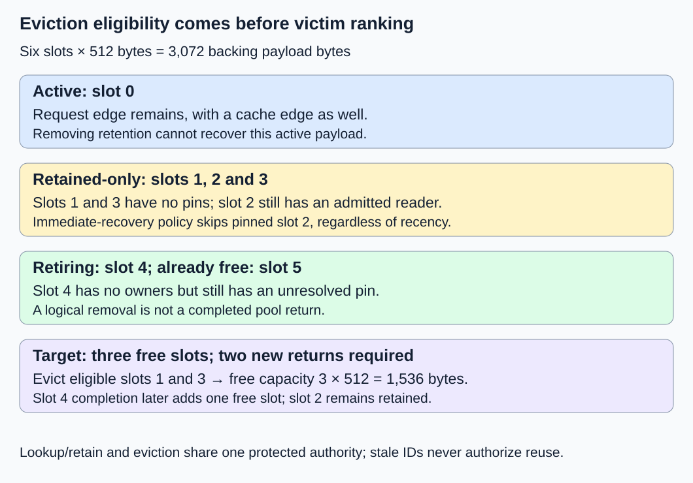
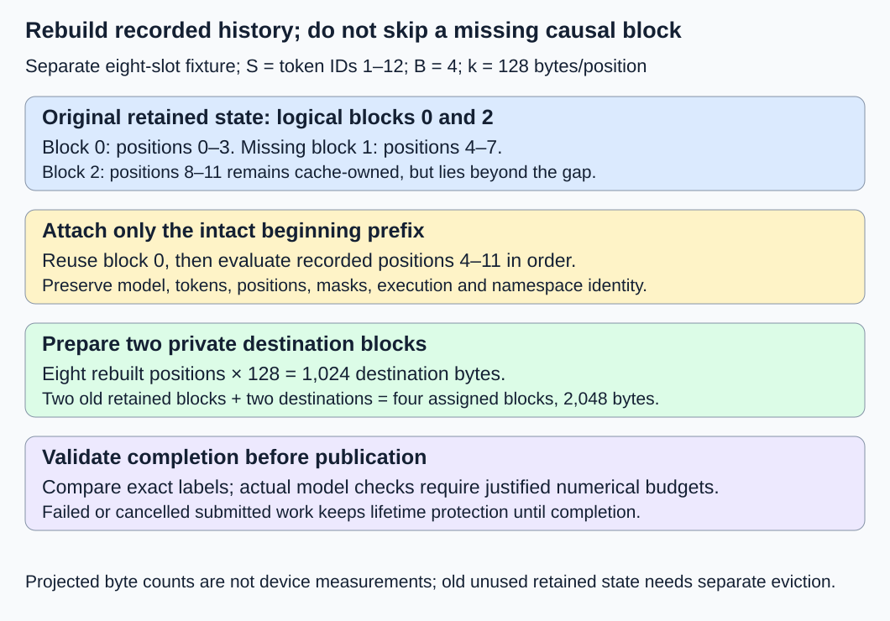

# M2-C14: Eviction, retention, and reconstruction

> **Status: Complete — detailed chapter authored and documentation validated; experimental procedures are proposed unless explicitly labelled observed**

**Module:** Treat the KV cache as a first-class systems problem

**Category:** [State, memory, and caching](index.md)

[Module 2 reading order](../module-2.md) · [Previous: M2-C13](m2-c13-prefix-reuse-and-cache-identity.md) · [Next: M2-C15](../scheduling-and-queueing/m2-c15-admission-and-growth-under-a-finite-kv-budget.md)

## Target concepts

Active versus retained blocks, eviction eligibility, recency and reuse, policy metadata, reference-safe eviction, recomputation cost, exact reconstruction versus lossy state removal.

## Concepts

### 1. Retained state is useful inventory with a capacity cost

**Retention** keeps completed KV state for a possible later compatible request. **Eviction** removes that reuse opportunity. **Reclamation** returns storage to the allocator for reassignment. These events need not happen together. An index entry disappearing does not prove that admitted readers have finished with the payload.

Use [M2-C11's ownership contract](m2-c11-reference-counting-and-shared-block-ownership.md): r is the number of request ownership edges, c the number of cache-retention edges, and p the number of unresolved admitted access pins. Pins preserve previously admitted host/device access; they are not Rust Pin or page-locked memory. One serial ownership authority protects lookup, retain, detachment and final return. Shared blocks are complete and immutable. The categories below are disjoint **accounting categories**, not all possible combinations of ownership flags:

| Category | Meaning in this baseline | Can its capacity be promised immediately? |
|---|---|---|
| Active | At least one request edge, whether or not cache edges also exist | No; retention policy cannot revoke request ownership |
| Retained-only | No request edges, at least one cache edge; pins may remain | Only after all cache edges can be detached and every safe-return gate passes |
| Retiring | No strong owners; admission closed, but completion/detachment still outstanding | No |
| Free | Fully returned once; no owners, pins or stale attached mappings | Yes, subject to reservation/admission policy |

Retained-only does not mean unused: an old reader can still hold a pin after its request edge is gone. An active block can also be cached; count its physical payload once. Removing a cache edge from an active block can disable future reuse without freeing any bytes. A nonowning lookup hint alone retains nothing.

The [vLLM prefix-caching design](https://docs.vllm.ai/en/latest/design/prefix_caching/#eviction-lru) describes LRU eviction and invalidating cached block identity when recycling a block. Its free-queue/reference-count terminology differs from our separate cache-edge ledger. Do not translate a backend's counter value into our r/c/p predicates without checking what it counts. The following eligibility rules are a teaching specification, not an assertion about every vLLM version.

### 2. Eligibility is a correctness gate; ranking is a policy

A **victim** is a retained item selected for removal. A ranking such as oldest-first applies only after eligibility has been established. For immediate payload recovery, our baseline selects blocks satisfying:

**Eligible now = r = 0 AND c = 1 AND p = 0 AND complete/sealed AND all mappings can be detached under the authority.**

The single cache edge is owned by this policy. If other cache owners exist, their edges require coordination; this baseline skips them. Outstanding writes, publication or unknown completion disqualify immediate return. Revalidate generation and eligibility at the protected commit point, because a ranked candidate is only a hint. The protected decision closes future lookup admission, invalidates owning/nonowning mappings as required and removes exactly the named cache edge. Return happens once only after every lifetime gate holds. A stale generation or duplicate eviction notification changes no current owner's count.

A broader policy could detach a cache edge from pinned state, then retire it until completion. That is **logical eviction**, with zero immediately recovered bytes. This chapter's pressure-relief baseline skips pinned candidates, so an immediate-capacity target has an honest meaning. If no eligible victim exists, wait or reject under the admission contract; never overwrite active or pinned storage to satisfy a target.

Keep the earlier synthetic packed FP64 fixture: two K/V tensors, two layers, two KV heads, two features/head and eight bytes/scalar. Thus **k = 2 × 2 × 2 × 2 × 8 = 128 bytes/position**, **B = 4 positions/block**, and **Q = B × k = 512 bytes/block**. These dimensions specify storage labels, not an actual model checkpoint. In a six-slot pool, consider this initial snapshot; block numbers are physical slot IDs with current generations validated separately:

| Slot | r | c | p | Category and reason |
|---|---:|---:|---:|---|
| 0 | 1 | 1 | 0 | Active, complete; cannot recover its payload |
| 1 | 0 | 1 | 0 | Retained-only, oldest eligible, last-use sequence 1 |
| 2 | 0 | 1 | 1 | Retained-only, sequence 2; reader still outstanding |
| 3 | 0 | 1 | 0 | Retained-only, sequence 3; eligible |
| 4 | 0 | 0 | 1 | Retiring; admission already closed |
| 5 | 0 | 0 | 0 | Free; already returned |

Define F as the number of free slots, G as the desired total free slots and E as the number immediately eligible. Then:

**Required returns D = max(0, G − F); immediate target feasible only if E ≥ D.**

For G = 3, F = 1 and E = 2, D = 2. Evict slots 1 and 3, recovering **2 × 512 = 1,024 bytes**. Free capacity becomes three slots or 1,536 bytes. Slot 2's older recency does not override its pin. Slot 4's later completion adds another free slot; completion of slot 2's pin only makes it eligible while its cache edge remains. Completion is not automatically eviction.

Initial active/retained/retiring/free payload is **512 + 1,536 + 512 + 512 = 3,072 bytes**. After the two returns it is **512 + 512 + 512 + 1,536 = 3,072 bytes**. After slot 4 completes and returns it is **512 + 512 + 0 + 2,048 = 3,072 bytes**. Pool backing stays allocated throughout; metadata, model weights and reconstruction workspace are outside this payload equation.

*Ranking cannot bypass a pin or request owner. Only completed returns increase the free-slot budget.*

### 3. Recency is evidence about the past, not a reuse guarantee

**Recency** measures how recently an item was used. **LRU**, least recently used, evicts the eligible item with the oldest recorded use. **Reuse** is a future compatible lookup; it may never occur. Define when recency changes: here a successful request attachment updates a monotonically increasing access sequence; failed lookups and background scans do not. At insertion, initialize the sequence to that event. Ties use a stable item ID. Larger sequences mean newer uses; they are ordering labels, not elapsed-time measurements.

Policy metadata includes current identity/generation, eligibility/owner links, last-use sequence, index membership and any estimated reconstruction cost. Account for its bytes and update work separately from payload. Updating recency on every hit can introduce coordination on a hot shared prefix. An exact list, periodic approximation or sampled policy changes that cost and needs its own comparison.

A simple **cost-weighted policy** in this chapter evicts the eligible item with the smallest fixed reconstruction score, breaking ties by oldest use then ID. It ignores future reuse probability. This is deliberately simple, not an optimal policy. A conceptual retention value is **expected avoided reconstruction work / retained bytes**, but both expected reuse and reconstruction work depend on future workload, model, context and operating point. Do not silently treat an old estimate as a measurement or maximize hit rate without checking useful service.

For a transparent policy replay, use a separate two-slot cache of independent full four-position prefixes A, B and C, all compatible within their own identities, with no shared blocks or pins. A miss reconstructs one block, inserts it and releases its request edge before the next event; a hit attaches and releases, updating recency. Cache owners remain until eviction. Start empty for each trace. Fixed scores are A = 100, B = 10 and C = 10 **accounting units**, not measured microseconds. Both policies use exactly the same scores for reporting cost.

| Trace | LRU misses / hits | Cost-weighted misses / hits | LRU score sum | Cost-weighted score sum |
|---|---|---|---:|---:|
| T1: A, B, B, C, A, B | 5 / 1 | 4 / 2 | 230 | 130 |
| T2: A, B, B, C, C, B | 3 / 3 | 4 / 2 | 120 | 130 |

At T1's C insertion, LRU removes A; the cost policy removes B. On the later A access, LRU misses and removes B, causing another miss at the last event. In T2, retaining expensive A is wasted inventory: C and B are needed next, so LRU wins both hit count and score sum. Scores and two traces cannot establish a deployment winner. Equal block sizes also hide byte-weighting and shared-prefix ancestry issues.

### 4. Reconstruction preserves history; dropping required history changes the operation

**Recomputation** evaluates the recorded tokens again to rebuild KV. **Exact reconstruction** preserves the represented token history and computation semantics; it does not mean every floating-point backend is bitwise reproducible. A **lossy removal** drops or compresses required state while continuing as if full-context state were present. Full causal attention can depend on any earlier visible key/value, so such removal is an approximation unless a separate model contract proves otherwise.

The [PagedAttention paper, version 1, section 4.5](https://arxiv.org/html/2309.06180v1#S4.SS5) discusses recomputation and swapping as recovery choices. That motivates separating recovery work from storage relief; its measured tradeoffs do not predict our fixture's performance. Swapping copies retained state to/from another memory tier and needs its own capacity, bandwidth, identity and completion contract. No swap implementation or timing is specified here.

For reconstruction, preserve exact prompt and previously generated token IDs, model/adapter revisions, tokenizer/template interpretation, positions, masks, numerical execution contract and authorized namespace from [M2-C13](m2-c13-prefix-reuse-and-cache-identity.md). Replaying the **recorded** generated IDs does not resample them. Resuming generation additionally needs its decoding/stopping/RNG state if applicable; KV alone is not a complete request checkpoint. If the required history or model revision is unavailable, fail or restart under an explicit new-request contract; do not claim transparent recovery.

Use a separate eight-slot reconstruction fixture. Source S contains IDs 1–12 with B = 4. Its middle logical block 1 has been evicted. Logical blocks 0 and 2 remain cache-owned in two physical slots. Under our conservative contiguous-prefix policy, only block 0 can be attached immediately. Recompute positions 4–11, eight positions, into two new blocks. The later cached block is not used to skip the causal gap; a more advanced mechanism could validate and reconnect it after rebuilding ancestors, but is outside this baseline.

**Rebuilt positions = N − R = 12 − 4 = 8; destination payload = 8 × 128 = 1,024 bytes.**

With the two old retained blocks still owned, source plus destinations occupy **4 × 512 = 2,048 bytes** at publication. The old logical block 2 and its replacement are distinct physical payloads; do not double-count their logical meaning as additional history. Reclaiming the unused old block requires a separate valid eviction. A cold reconstruction evaluates 12 positions and writes three blocks, 1,536 destination bytes. These counts exclude workspace, activations, logits and attention reads. Recomputed suffix positions still read the required earlier context. The new final prompt position supplies logits under the prior KV-only interface.

*Rebuild recorded history into private destinations, validate completion and publish safely. Simply omitting the missing block is a different attention operation.*

Allocate destinations under a finite budget before promising recovery. Publish only completed validated state. On prepublication failure, roll back tentative metadata and keep old valid owners intact. Submitted writes keep destinations pinned until covered completion; cancellation does not authorize immediate reuse. Unknown device completion quarantines the affected capacity. CPU metadata ordering alone cannot prove a real device lifetime safe. Reconstruction can itself cause overload through extra compute, memory and queueing; reserve headroom rather than repeatedly evicting the state needed to finish the same request.

## Experiments

All procedures below are proposed and contain no implementation code. Arithmetic and document review are recorded separately from runtime evidence.

### E1 — Eligible victims and delayed capacity

- **Description:** Audit the six-slot snapshot and a target of three free slots.
- **Purpose/objective:** Distinguish retained inventory, logical eviction, retirement and actual free capacity.
- **Target concepts:** Active/retained blocks, eligibility and reference-safe eviction.
- **Baseline and workload:** The six rows above; one serial authority; each cache edge has a unique release identity.
- **Controls and prediction:** Keep owners/pins fixed until named completions. Predict victims 1 and 3, two returns and three free slots. Slot 4 completion yields four; slot 2 completion alone returns nothing.
- **Procedure:** Rank, then revalidate identity/eligibility under the authority. Audit lookup-before-eviction and eviction-before-lookup outcomes: protected retain wins and prevents immediate recovery, or eviction wins and late lookup misses. Inject duplicate release, stale generation and an unresolved pin; none may free a current user's payload. Recompute the byte partition after every event.
- **Hardware/software:** Paper ownership ledger first; later tests require an actual owner, pool, fault schedule and host/device completion evidence.
- **Failure and HFT connection:** Removing a cached snapshot from a directory does not finish a consumer's admitted access. This is a lifetime analogy, not exchange cancellation semantics.
- **Exit criteria:** Every slot has one accounting category; no protected reader is overwritten; named edges release once; only completed returns count toward the target. An infeasible target reports shortage rather than inventing free capacity.

### E2 — Recency versus reconstruction score

- **Description:** Replay T1 and T2 against LRU and the fixed-score policy.
- **Purpose/objective:** Explain why policy choice depends on future locality and reconstruction cost.
- **Target concepts:** Recency/reuse, metadata and recomputation cost.
- **Baseline and workload:** Two equal slots, initially empty per trace; three independent prefixes; fixed scores 100/10/10; no overlap or shared ownership.
- **Controls and prediction:** Vary victim ranking only. Predict the four miss/hit and cost totals in the table; every victim must first be eligible.
- **Procedure:** Record resident IDs, access sequence, hit/miss, victim and score at each of six events. After servicing each event, release request edges but preserve retained cache edges. For any tied scores use recency, then stable ID. Repeat from empty state; do not carry T1 contents into T2.
- **Hardware/software:** Exact paper replay; a later metadata harness records representation sizes, clocks and policy versions.
- **Failure and HFT connection:** Stale estimates can retain an expensive but unused snapshot while frequently used state churns. Scores are accounting hypotheses, not measured latency or trading value.
- **Exit criteria:** All 24 event decisions across two policies/two traces are auditable; table totals agree; logical retained entries match the two-slot limit; no claim that either policy universally wins.

### E3 — Rebuild history without changing attention

- **Description:** Reconstruct S after losing its middle block, comparing with an uninterrupted reference.
- **Purpose/objective:** Validate history-preserving recovery and expose lossy omission.
- **Target concepts:** Exact reconstruction, recomputation work and failure-safe publication.
- **Baseline and workload:** Eight slots, original blocks 0 and 2 retained; attach the four-position intact prefix and prepare two destination blocks. Use exact identity/position labels before any numerical model test.
- **Controls and prediction:** Same recorded tokens and descriptor; predict eight rebuilt positions, 1,024 destination bytes and four simultaneously assigned blocks. Cold reconstruction needs 12 positions/three destination blocks.
- **Procedure:** Validate each rebuilt coordinate's token, layer/head and context labels. A real generator additionally compares full KV/logits and resumed output against the uninterrupted path under a justified numerical budget. Negative controls omit the missing block, change the model revision or regenerate rather than replay recorded IDs; reject the changed contract even if an output happens to match. Inject allocation failure, cancellation after submission and unknown completion; never publish partial state or return an unresolved destination.
- **Hardware/software:** Label ledger now; any numerical run must supply actual model/tokenizer/backend revisions, memory budget, workspace and stream completion evidence.
- **Failure and HFT connection:** Replaying a recorded event history is distinct from dropping events and continuing. A recovered cache is not a complete durable service checkpoint.
- **Exit criteria:** Exact identity/label and capacity checks pass; any real numerical run passes predeclared KV/logit/output gates. Faults preserve old owners and drain/quarantine new work safely. Without an implemented generator, numerical recovery remains unverified.

### E4 — Conditional policy replay benchmark

- **Description:** Measure host metadata replay overhead if both policy representations become available.
- **Purpose/objective:** Separate policy bookkeeping duration from synthetic recovery cost and end-to-end service impact.
- **Target concepts:** Policy metadata, workload sensitivity and reproducible benchmarking.
- **Baseline and workload:** One complete T1 or T2 trace per timed trial, empty two-slot cache each time. Replay labels/owners/scores only; no model, KV payload writes or device work.
- **Controls and prediction:** Same IDs, capacity, eligibility and output records. Three sessions, two traces, 30 randomized balanced policy pairs per trace/session; exclude five warmups per policy/trace/session. Predict correctness counts, not a timing winner.
- **Procedure:** Prepare trace inputs and reset storage outside the clock; time first event entry through last request-edge release, including policy updates, misses and eviction bookkeeping. Retained owners remain for post-timing audit, then drain/reset before the next trial. Check output against E2 outside timing. Profile ranking, metadata updates, lookup and release in separate runs. Keep failed and unresolved trials; a 120-second watchdog does not permit unsafe reclamation.
- **Hardware/software:** Single-worker CPU harness with the manifest below. Preserve representation sizes and raw durations; separately measure any timer overhead.
- **Failure and HFT connection:** A faster policy loop can still cause more reconstruction or worse request tails. Short serial replay is not an HFT latency or serving-capacity benchmark.
- **Exit criteria:** If both implementations are supported, 180 pairs produce 360 timed trials and 60 excluded warmups. Each policy/trace has 90 timed trials. Publish every outcome, per-trace distributions and synthetic score sums separately; unavailable implementations mean no timing result.

## Verification

| Pair | Reference and correctness gate | Measurement, benchmarking and profiling |
|---|---|---|
| V1 / E1 | Exact owner/pin/generation ledger and disjoint slot partition | Victim decisions, edge removals, completed returns and free-byte deltas; count logical removals separately |
| V2 / E2 | Independent event-by-event replay with declared tie rules | Hits/misses, resident IDs, victims, score sum and metadata updates; do not convert scores to time |
| V3 / E3 | Recorded identity/history, intact-prefix boundary and completed private publication | Rebuilt positions, destination/peak bytes, allocation faults and completion scope; real KV/logit/output comparison only with a supplied model |
| V4 / E4 | Both policies reproduce E2 and leave auditable owners | Raw durations by policy/trace/session, median/spread, fault/timeout counts; separate profiling and synthetic cost reporting |

E4 has **360 × 6 = 2,160 timed event lookups**. Each policy handles 1,080 events. LRU has **90 × (5 + 3) = 720 misses** and 360 hits; cost-weighted has **90 × (4 + 4) = 720 misses** and 360 hits. Equal aggregate hit counts conceal their different trace behavior. LRU's score sum is **90 × (230 + 120) = 31,500 units**; cost-weighted is **90 × (130 + 130) = 23,400 units**. Each policy's misses imply **720 × 4 = 2,880 reconstructed positions** and **2,880 × 128 = 368,640 destination payload bytes** if the declared one-block reconstruction were actually performed. The metadata-only benchmark performs neither writes nor reconstruction; those are accounting projections, not traffic measurements.

Use completed [M9-C01](../numerics-and-correctness/m9-c01-defining-reference-behavior-and-evidence-before-optimizing.md) for references, [M9-C02](../measurement-experimentation-and-economics/m9-c02-request-events-clocks-and-measurement-boundaries.md) for completion/timing, [M9-C07](../measurement-experimentation-and-economics/m9-c07-latency-distributions-and-statistical-uncertainty.md) for populations and uncertainty, and [M9-C17](../numerics-and-correctness/m9-c17-comparing-logits-with-justified-numerical-tolerances.md) for actual model comparisons. Identity and owner checks are exact; numerical allowances never excuse a wrong history. Require bitwise equality only where the actual execution contract justifies it. Ninety trials per policy/trace do not establish reliable p99; retain timeouts and failed outcomes rather than silently removing slow samples. Advanced accounting/safety chapters remain outlines; elementary lifetime and byte gates are stated here.

For real service evaluation, preserve arrivals, prompt/generated lengths, prefix skew, namespace/model mix, admission limits and cancellation/failure schedule. Compare complete-request latency distributions and useful completion rate, including queueing, eviction, reconstruction and resumed generation. Report available/free/retiring capacity, policy metadata bytes and reconstruction workspace separately. A lower replay score or better hit rate is insufficient if recovery overloads the critical path. Preserve raw event IDs, recency rules, scores and their origin, victim decisions, generations, completion observations, seeds/order, timing units/resolution and all outcome categories.

## Engineering dimensions and principles

| Dimension | Chapter-specific application |
|---|---|
| Semantics and invariants | Retention policy cannot revoke active ownership or alter required token history. |
| Workload and variability | T1/T2 reverse the local policy advantage; real prefix skew and churn change retention value. |
| Resources and bottlenecks | Distinguish retained payload, free slots, policy metadata and reconstruction workspace/compute. |
| Time and distributions | Return can lag logical removal; recovery and queueing can dominate after a fast victim decision. |
| Ownership and coordination | Revalidate victims under the same authority as lookup/retain; pins survive edge removal. |
| Failure and adaptation | Stale generations, pinned victims, shortages and failed reconstruction have explicit outcomes. |

1. **Correctness defines the optimization boundary:** Remove a reuse opportunity without invalidating a current reader; dropping required attention state is an approximation.
2. **Performance depends on workload and operating point:** Recency and expensive reconstruction predict different priorities; neither predicts future locality perfectly.
3. **Data movement is part of the algorithm:** Recovery writes new KV and reads history; swapping adds tier transfers rather than making recovery free.
4. **State has ownership, lifetime, and recovery cost:** Retained owners consume capacity, pins delay return and rebuilding needs preserved history and headroom.
5. **Dependencies determine latency; bottlenecks determine capacity:** Safe completion precedes return; destination allocation and prefix reconstruction precede resumed use.
6. **Variability and synchronization shape the tail:** Popular shared prefixes, policy updates and bursts of recovery can create contention and slow requests.
7. **Local improvements must be evaluated end to end:** Faster ranking or lower synthetic score matters through useful complete service under matched load.
8. **Claims require reproducible evidence:** Preserve exact histories, policy rules, owners, raw measurements and faults; do not report projected costs as observed speedups.

## Specifications, articles, and hardware

- [vLLM Automatic Prefix Caching design](https://docs.vllm.ai/en/latest/design/prefix_caching/), checked 26 October 2026: concrete LRU recycling/index invalidation example. Pin a version before reproducing backend behavior; its free-queue semantics differ from our explicit cache owners.
- [PagedAttention paper, version 1, 12 September 2023](https://arxiv.org/html/2309.06180v1), section 4.5: recomputation and swapping as recovery mechanisms. Published performance is not a measurement of this chapter's policies.

Paper ledgers need no device. A proposed CPU replay harness uses one worker and at least 1 GiB available RAM for tiny records and harness overhead. Record CPU model, core/cache sizes, affinity, frequency/power policy, RAM capacity/speed, OS/kernel/page size, Rust/compiler/optimization settings, allocator and metadata representation/version. The six-slot payload model is 3,072 bytes; the separate reconstruction pool is 4,096 bytes with 64-byte-aligned base and 512-byte spacing. Neither is an actual machine's total memory requirement. Real GPU recovery additionally records device/count, VRAM, model/adapter/tokenizer revisions, backend/numerical settings, driver/runtime, KV layout, workspace limits, transfers and stream/event ownership. No policy implementation, reconstruction runtime, device lifetime test or CPU/GPU benchmark was executed for this chapter.

## Key takeaways

Eviction ranks only eligible state; storage becomes free after safe return. Retention buys a chance of avoiding future reconstruction, with workload-dependent capacity and coordination costs. Rebuilding recorded history preserves the operation's semantics; silently omitting required state does not. [M2-C15: Admission and growth under a finite KV budget](../scheduling-and-queueing/m2-c15-admission-and-growth-under-a-finite-kv-budget.md) is now a completed detailed chapter. M2-C16 is next for authoring.
