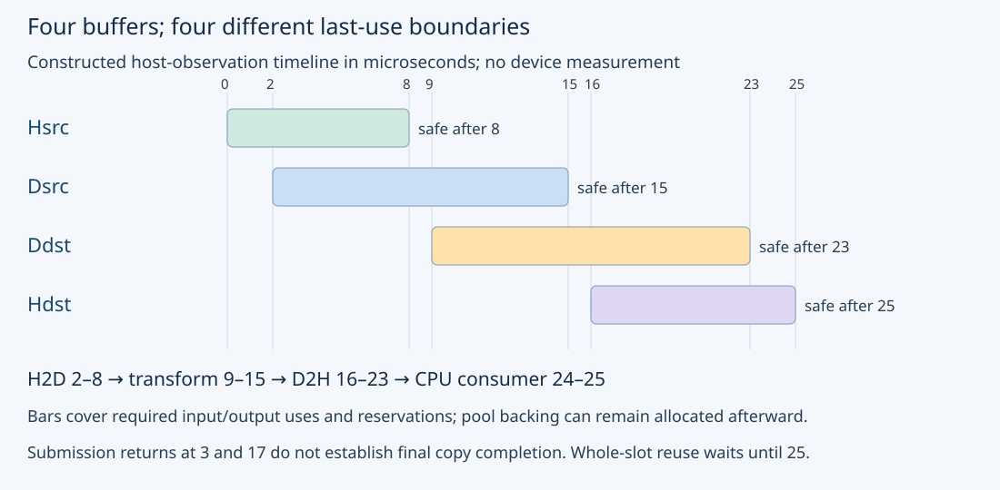
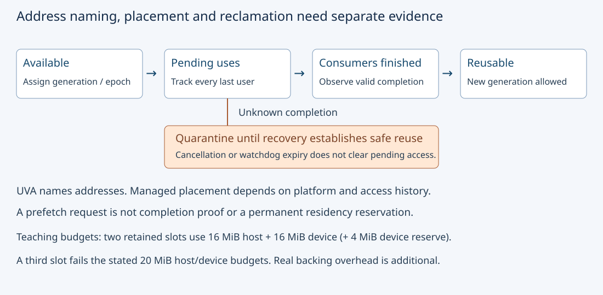

# M3-C10: Host and device buffer placement and lifetime

> **Status: Complete — detailed chapter authored and documentation validated; experimental procedures are proposed unless explicitly labelled observed**

**Module:** Learn GPU architecture through data movement

**Category:** [State, memory, and caching](index.md)

[Module 3 reading order](../module-3.md) · [Previous: M3-C09](../kernels-compilers-and-execution/m3-c09-tensor-cores-and-supported-matrix-operations.md) · [Next: M3-C11](../runtime-and-concurrency/m3-c11-streams-events-and-dependency-ordering.md) · [Execution plan and progress](../chapter-execution-plan.md)

## Target concepts

Pageable versus pinned host memory, device allocations, unified addressing versus unified memory, migration and residency, buffer reuse, ownership across transfers, allocation outside timed regions.

## Concepts

### 1. Name the allocation, its physical location and its current users

A **buffer** is a region of storage used to hold data. Its descriptor identifies an allocation, byte range, element representation and authorized use. **Host memory** belongs to the CPU-side memory system; **device memory** in this chapter means memory attached to the executing discrete GPU. **Residency** describes where backing data is currently available physically, rather than which processor can name its address.

**Pageable host memory** can be managed by the operating system's normal virtual-memory mechanisms. **Pinned**, or page-locked, host memory has a registration/allocation contract that keeps backing pages suitable for the supported device transfer path. **Registration** makes an existing eligible host allocation available under that contract; it does not copy the logical data to device memory. Keep registered storage at a stable address and valid until all relevant users finish and registration is safely removed.

**DMA**, direct memory access, is a mechanism through which a device/copy engine transfers data without the CPU copying each value itself. A pageable transfer can require an internal staging copy into suitable host storage. Pinning can avoid that staging requirement for the supported path, but setup cost, host memory pressure, interconnect and workload still affect performance. The [CUDA pinned-memory guidance](https://docs.nvidia.com/cuda/cuda-c-best-practices-guide/index.html#pinned-memory) discusses allocation/registration costs and bounded use. No universal transfer bandwidth is assumed here.

A normal host collection is not automatically CUDA page-locked, and a language-level pinned object is not automatically DMA-registered host memory. Rust's ownership reasoning helps keep allocations valid, but a destructor running after CPU scope exit does not prove the GPU finished. Completed [M2-C04](m2-c04-memory-ownership-handles-and-lifetimes-from-first-principles.md) explains addresses, handles and lifetimes; [M3-C05](../hardware-architecture-and-topology/m3-c05-device-memory-hbm-and-the-cache-hierarchy.md) explains memory-level boundaries. No implementation code is provided.

High-Frequency Trading (HFT) systems motivate bounded pools, stable working state and predictable handoff costs. Those systems-engineering concerns transfer to inference; CPU/NIC registration, exchange events and CUDA completion have different contracts, and this chapter establishes no trading-performance result.

### 2. Unified addressing is not a residency or ownership guarantee

**Unified virtual addressing**, UVA, gives host and device allocation ranges a coordinated virtual-address naming scheme within a process. It does not make every pointer safely dereferenceable by every processor, promise identical access cost or establish that a transfer completed. A pointer's numeric value is not an allocation-generation ID.

**Unified Memory** provides supported managed access and, depending on the platform, placement/migration/coherence mechanisms. **Migration** moves backing data between memory locations. A **page fault** is an event requiring the memory system to resolve an access that cannot proceed under its current mapping/residency. Some systems support broader access to ordinary system allocations or hardware-coherent access; others require explicit managed allocation and stronger access restrictions. Inspect actual device, driver, OS and interconnect capabilities. The [CUDA memory overview](https://docs.nvidia.com/cuda/cuda-programming-guide/02-basics/understanding-memory.html) distinguishes these platform-dependent models.

**Mapped host memory** lets a supported GPU access host backing storage through its interconnect; it does not turn those bytes into ordinary device-local memory. **Managed memory** may migrate or be accessed remotely under its platform contract. Neither a shared address nor coherent access removes the program's obligation to order conflicting uses.

| Allocation/access choice | What the descriptor establishes | What still needs evidence |
|---|---|---|
| Ordinary pageable host buffer | CPU storage under its host allocation contract | Device accessibility, staging behavior and transfer completion |
| CUDA-pinned or registered host buffer | Page-lock/registration under the selected flags and platform | Mapping/access permissions, lifetime and completed transfer |
| Explicit device allocation | Storage for the selected device under the runtime contract | CPU access permissions, initialized data and completed producer |
| Managed allocation | Supported CPU/GPU access under the platform's managed-memory rules | Actual placement, migration, ordering and host-readable completion |

**Prefetch** requests placement work before expected access. It is not a permanent reservation: later accesses or memory pressure can change placement. A last-prefetch-location attribute describes a request, not proof that the request completed or that data remains there. The [CUDA Unified Memory guide](https://docs.nvidia.com/cuda/cuda-programming-guide/04-special-topics/unified-memory.html) explains hints, prefetch and their observation limits.

### 3. Submission return, result readiness and safe reuse are separate events

A host transfer call can return before its destination contains the final data. The exact behavior depends on the API, source/destination kinds and arguments. The [CUDA Runtime synchronization specification](https://docs.nvidia.com/cuda/cuda-runtime-api/api-sync-behavior.html) documents important differences, including pageable host-to-device staging. An “Async” name is not a portable promise that the call never blocks; a call without that suffix is not a universal device-wide completion proof.

This chapter uses a conservative ownership rule: retain each source/destination through an explicitly established completion boundary covering its last use. Some APIs permit earlier release of a particular host source after internal staging; use that only when its exact contract is recorded. Never infer it merely from observed early returns.

A transfer temporarily borrows its source for reading and destination for writing. While those uses are pending, source mutation or destination observation/reassignment may violate correctness. A later kernel may extend a device buffer's lifetime beyond the copy that created its values. A device-to-host copy can finish while a CPU consumer still needs the host output. Allocation, content readiness, permitted readers and reclamation are different states.

Consider a **constructed, unmeasured timeline** for one explicit-copy transform. Hsrc/Hdst are host source/output; Dsrc/Ddst are device source/output. Times below are microseconds from a common illustrative host clock; completion entries mean valid completion evidence has been observed:

| Time | Named event | Ownership implication |
|---:|---|---|
| 0 | Host finishes Hsrc epoch 0 | Input values ready; allocation remains owned |
| 2 / 3 | H2D submitted / submission returns | No final-transfer completion inferred from return |
| 8 | H2D completion observed | Hsrc transfer read ends; Dsrc now contains input |
| 9 / 15 | Transform submitted / completion observed | Dsrc must retain input through its last kernel read |
| 16 / 17 | D2H submitted / submission returns | Ddst remains copy source; Hdst is not yet host-readable |
| 23 | D2H completion observed | Ddst transfer read ends; Hdst is host-readable |
| 24 / 25 | CPU reads Hdst / consumer finishes | Hdst cannot be reassigned before its CPU consumer ends |

Here Dsrc cannot return to a general pool at time 8 because its intended kernel use is still reserved. Its last-use boundary is 15. Ddst cannot be reclaimed at kernel completion 15 because its output is reserved for the D2H read ending at 23. Hdst's last consumer ends at 25. The whole slot may be recycled conservatively at 25 even though individual buffers have earlier release opportunities.

### 4. Size pools from live storage and registration coverage

For N packed FP32 elements, each input/output buffer holds **B = 4N bytes**. A four-buffer explicit-copy slot has Hsrc,Hdst,Dsrc,Ddst, so host payload is **2B**, device payload **2B**, and combined payload **4B**. Count pinned host storage and device storage against their own budgets; host pinning does not consume ordinary device-local capacity in the same way as a device allocation.

At N = 2²⁰, B = 4 MiB. One slot retains 8 MiB host plus 8 MiB device payload. Three retained slots use 24 MiB in each location, or 48 MiB combined, even when only one slot is executing. A **pool** retains allocations for reuse; an idle pooled allocation still occupies its backing budget. MiB means 2²⁰ bytes.

For a constructed pinned-host budget of 20 MiB and a device budget of 20 MiB including a required 4 MiB device reserve:

**maximum slots = min(floor(20/8), floor((20−4)/8)) = 2.**

Floor rounds down. A third slot fails both budgets. This is a payload-only teaching ledger; actual registration coverage, allocator/runtime allocations and reserves can lower capacity further. It is not a recommendation to pin a fixed fraction of an arbitrary machine.

Page coverage can exceed requested payload. For an illustrative 4,096-byte accounting page, a nonempty B-byte range starting at offset o within its first page covers:

**page count = ceil((o + B)/4,096), for 0 ≤ o < 4,096 and B > 0.**

Ceil rounds up. A 280-byte range at offset zero covers one page; at offset 4,080 it covers two. Two separate page-aligned 280-byte host allocations cover 8,192 bytes of pages for only 560 logical bytes. If ranges share pages, count the union rather than double-counting. This is illustrative page accounting, not a claim that CUDA registration granularity or allocator overhead is always 4 KiB. N = 0 is a no-payload case under this specification and does not create a phantom one-page range.

### 5. Moving allocation outside a timed region changes the question

A **steady reuse interval** starts with allocations/registration and input preparation already established. A **setup-inclusive interval** includes acquiring/initializing the resources needed to perform the work. Both are useful; neither should be silently substituted for the other. Report allocation, registration, first-touch and teardown separately where relevant.

Let C be one-time setup cost, t completed operation cost with reusable buffers, and K uses before release. Under a serial additive model, **total cost = C + Kt**, and amortized setup cost/use is **C/K**. This model does not assume concurrent overlap or free recovery.

For **constructed, unmeasured** pageable and pinned costs, let Cpage = 5 μs, Cpinned = 101 μs, tpage = 30 μs and tpinned = 26 μs. Pinned improves total cost only when **K > (101−5)/(30−26) = 24**, so strict improvement starts at K = 25. At K = 24 both totals are 725 μs; at K = 25 they are 755 and 751 μs. Faster steady transfers do not prove lower cost for a one-use request.

Registration failure must be an explicit outcome. A pageable fallback changes the route and timing interpretation; retain it as a labelled result rather than report it as pinned. Excessive retained pinned memory can affect the host system, so the pool budget and release policy belong in the experiment, not only its peak copy rate.

### 6. Reuse needs identity and completion, not merely the same pointer

A pooled slot has an allocation ID, generation, byte range, current data epoch and outstanding users. A **generation** changes when a slot is assigned a new logical lifetime, allowing old handles or completion records to be rejected. An **epoch** identifies the data version being transferred/consumed. Reusing the same address cannot make an old handle current.

A completion record must match the operation, allocation/generation, device/context and expected use before it releases a lease. Duplicate completion is not another release. A completion from generation 7 must not free a slot reassigned as generation 8. A host request cancellation can stop future submissions and discard an eventual result, but does not by itself cancel already submitted memory accesses. Under unknown device completion, quarantine affected storage until recovery establishes safe reuse.

For serialized work, a simple lifecycle is **available → assigned/filling → transfer/device/return uses pending → host consumer or discard → reusable**. Unknown completion takes a separate quarantine branch. Streams and cross-stream dependencies are developed in M3-C11; this chapter does not require concurrent transfers or infer overlap from pinned memory.

## Experiments

All experiments are proposed. Apply completed [M9-C01](../numerics-and-correctness/m9-c01-defining-reference-behavior-and-evidence-before-optimizing.md) references, [M9-C02](../measurement-experimentation-and-economics/m9-c02-request-events-clocks-and-measurement-boundaries.md) completion/clock boundaries, [M9-C07](../measurement-experimentation-and-economics/m9-c07-latency-distributions-and-statistical-uncertainty.md) distributions, [M9-C15](m9-c15-accounting-for-weights-kv-state-workspace-and-fragmentation.md) live storage and [M9-C17](../numerics-and-correctness/m9-c17-comparing-logits-with-justified-numerical-tolerances.md) numerical gates. Advanced overlap/topology/profiling material remains later work; required introductory controls are local here.

### E1 — Build placement, page-coverage and pool ledgers

- **Description:** Classify allocation/access choices and reconcile the four-buffer pool budget.
- **Purpose/objective:** Separate address naming, physical storage, pinning and capacity before benchmarking.
- **Target concepts:** Pageable/pinned host memory, device allocations, UVA/managed memory and buffer reuse.
- **Baseline and workload:** N in {0,70,4,096,1,048,576} FP32 elements. Use the four-buffer explicit-copy slot, the 20 MiB host/device teaching budgets with 4 MiB device reserve, and illustrative 4 KiB page accounting.
- **Controls and prediction:** Fix byte units and locations. Predict payload bytes 0,280,16,384,4,194,304 per buffer; two maximum-size retained slots fit the teaching budgets, three do not. A managed allocation is not counted as one guaranteed resident copy in each location.
- **Procedure:** Record requested payload, addressed range, page coverage and retained backing by location. Compare the 280-byte ranges at page offsets 0 and 4,080; include a shared-page pair counted by union. Reject a ledger that infers GPU accessibility/residency solely from a common pointer or registers the same logical page coverage twice in its accounting.
- **Hardware/software:** Arithmetic baseline needs no GPU. Optional runtime inspection records OS/page model, allocation/registration flags and actual UVA/managed/mapped-access capabilities; this is not a device-throughput test.
- **Failure and HFT connection:** Record allocation/registration rejection and budget exhaustion. HFT bounded-pool reasoning transfers, but CUDA pinning and NIC/CPU registration have different contracts.
- **Exit criteria:** All sizes, page cases and two-versus-three-slot decisions reconcile, including zero-payload handling. Distinguish requested bytes, covered pages, allocator backing and observed residency.

### E2 — Compare completed pageable, pinned and registered routes

- **Description:** Compare a serialized host-input → device transform → host-output operation across three host-allocation choices.
- **Purpose/objective:** Measure completed useful work while keeping setup and API-return latency visible separately.
- **Target concepts:** Transfer staging, pinned/registered memory, device buffers and allocation outside timing.
- **Baseline and workload:** N in {70,4,096,1,048,576}; routes are ordinary pageable host buffers, runtime-allocated pinned buffers and eligible host buffers registered before timed use. Each uses separate explicit Dsrc/Ddst. Input Xᵢ(e) = 256e + (i modulo 256); output Yᵢ(e) = 2Xᵢ(e) + 1. Each cell's 60 measured trials use distinct epochs e = 0,…,59.
- **Controls and prediction:** Nine cells share shape/dtype, output contract, transform, serialized dependencies and target device. Allocate/register and prepare inputs before the primary interval; retain one trial in flight. No bandwidth ranking or overlap is guaranteed. A registration failure is not a pinned result.
- **Procedure:** Establish allocation attributes and every output reference first. Use 3 sessions × 20 trials/cell = 540 scheduled measured trials and 10 warmups/cell/session = 270 warmups. Randomize matched route order per N with a recorded seed. Record API-return intervals, completed H2D/transform/D2H scopes, whole-operation host completion and one-time setup/teardown. Reinitialize trial input epoch only after its previous lease ends.
- **Hardware/software:** One supported discrete GPU, legal host/device allocations and registration capability, sufficient host/device capacity plus reserves. Largest slot has 8 MiB host and 8 MiB device payload; pageable runtime staging and other allocations are additional observed costs.
- **Failure and HFT connection:** Preserve unsupported registration, fallback identity, wrong epoch, errors and unknown completion; do not mutate a pending source. HFT handoff timing motivates completed boundaries, but these transfers omit network arrivals and trading decisions.
- **Exit criteria:** All 540 outcomes reconcile and every successful output matches its epoch. Report setup and completed operation costs separately; an early API return or faster copy stage alone cannot establish a better route.

### E3 — Test managed placement histories and host-read completion

- **Description:** Compare on-demand managed access with a supported prefetch route at two device-use horizons.
- **Purpose/objective:** Locate migration/remote-access costs without equating a unified address or prefetch hint with residency.
- **Target concepts:** Unified memory, migration, residency, reuse and timing boundaries.
- **Baseline and workload:** N = 262,144 FP32 values, Xᵢ = i modulo 256 in one 1 MiB managed input. K in {1,8} device passes each produce a distinct 1 MiB managed output Yᵢ(q) = 2Xᵢ + q + 1 for q = 0,…,K−1. CPU initializes input and all outputs (output sentinel −1) before each trial. Retain a separate CPU-owned check buffer for every output.
- **Controls and prediction:** Four mode/K cells share logical work at the same K and serialize CPU/device access. On-demand route has no explicit prefetch; prefetch route requests device placement for input/outputs before compute and host placement for outputs afterward, using supported completed operations. CPU initialization defines access history, not guaranteed cold placement. Hardware-coherent/remote access can behave differently.
- **Procedure:** Check platform support and access restrictions first; skip unsupported cells explicitly. Use 3 sessions × 20 trials/cell = 240 scheduled measured trials and 10 warmups/cell/session = 120 warmups. Primary timing includes placement requests, compute completion, output host access and materialization into CPU check buffers. Record placement/compute/host-access subintervals and supported migration/fault evidence separately; never put prefetch outside an inclusive route comparison. Validate all K output vectors after materialization.
- **Hardware/software:** Supported managed allocation and prefetch destination capabilities on the actual OS/device/runtime. At K = 8, managed payload is 9 MiB plus 8 MiB CPU check buffers and runtime overhead/reserve. A device without the required managed/prefetch support is not assigned invented results.
- **Failure and HFT connection:** Keep CPU/device conflicting accesses ordered; retain failed placement, unknown completion and stale source identity. HFT working-set residency motivates the investigation, but managed-memory faults are not market-message latency.
- **Exit criteria:** All 240 outcomes reconcile, successful values match every pass and the timer includes completed CPU-visible materialization. Report observed placement evidence or its absence; a last-prefetch attribute alone never proves completion or current location.

### E4 — Audit transfer leases, cancellation and generation-safe reuse

- **Description:** Review the constructed four-buffer timeline and fault/recovery traces without launching unsafe work.
- **Purpose/objective:** Preserve each buffer through its actual last user, independently of host request lifetime.
- **Target concepts:** Ownership across transfers, buffer reuse, completion and stale handles.
- **Baseline and workload:** N = 70, epoch 0, exact transform from E2; timeline events at 0,2,3,8,9,15,16,17,23,24,25 μs. Slot generation 7 is reassigned as generation 8 only after all required users finish. Whole-slot baseline recycling waits until time 25.
- **Controls and prediction:** Fix operation IDs, generations and valid completion events. Hsrc can be released conservatively from its transfer lease at 8, Dsrc after its reserved kernel use at 15, Ddst after return transfer at 23 and Hdst after CPU consumption at 25. Earlier individual release does not free still-retained pool backing.
- **Procedure:** Reject Hsrc mutation at 4, Dsrc reassignment at 10, Ddst release at 18 and Hdst read at 20. Add cancellation at 12: stop future submissions, retain the already submitted kernel's buffers until its completion, and record whether an output copy is subsequently omitted or drained. Separately mark completion unknown and quarantine affected buffers. Reject a delayed generation-7 completion after generation-8 reassignment and make duplicate completion idempotent, meaning it has no extra release effect.
- **Hardware/software:** Paper/reference ledger needs no GPU. Any future correct runtime extension requires operation-bound completion evidence and ownership/epoch checks; this is not authorization to provoke use-after-free on hardware.
- **Failure and HFT connection:** Cancellation, delayed completion and repeated addresses must not produce stale reuse. HFT receive/transmit pools have related last-user concerns, but their completion contracts must be established independently.
- **Exit criteria:** All legal boundaries and fault decisions reconcile, cancellation does not free pending state, unknown completion quarantines, stale/duplicate completion cannot release a new generation, and exact output remains tied to epoch 0 when delivered.

## Verification

### Exact values, byte counts and lifetime witnesses

E1's maximum-size slot uses 16 MiB combined payload; two retained slots use 16 MiB host and 16 MiB device plus the separate 4 MiB device reserve. Three slots need 24 MiB in each location and fail the teaching budgets. At 280 bytes, a page-aligned range covers 4,096 bytes; at offset 4,080 it spans 8,192 covered bytes. Two 280-byte ranges starting at offsets 0 and 512 within the same illustrative page have 560 distinct requested bytes but only 4,096 bytes of page union. Do not apply that shared-page result to two separately allocated pages.

For E2, epoch 0 at N = 70 produces odd values 1,…,139 with sum **4,900**. At larger N, epoch-0 sums are **1,048,576** for N = 4,096 and **268,435,456** for N = 1,048,576. Epoch e adds **512e** to every epoch-0 output, so expected sum is **epoch-0 sum + 512eN**. Every input/output value remains a small exact FP32 integer for e = 0,…,59; compare every coordinate and epoch, not just checksums.

Across E2's three routes, 180 measured trials/N produce **189,493,560 output values**. Explicit H2D/D2H payload is **eight bytes/element total**, giving **1,515,948,480 transfer-payload bytes** across successful planned trials. Device transform logical input/output accesses also total eight bytes/element, but are a separate memory-level population. Internal host staging, protocol traffic, readback verification, warmups and profiler replays must not be silently folded into either count.

For E3, every pass q has output mean **256 + q** and checksum **262,144 × (256 + q)**. At K = 8 the final pass has mean 263 and maximum value 518. All values are exact FP32 integers. Across 60 trials/mode/K and two modes, the valid-output population is **60 × 2 × (1 + 8) × 262,144 = 283,115,520 values**. Logical device input-read/output-write demand totals **2,160 MiB**, excluding materialization and managed migration/remote traffic. Managed capacity at K = 8 is 9 MiB, while CPU check buffers require another 8 MiB; pointer identity does not multiply that managed allocation into a guaranteed second physical copy.

E4's full slot latency to CPU-consumer completion is **25 μs** in the constructed timeline, while H2D and D2H submission-return intervals are only one microsecond each. Neither one-microsecond return is a completed-transfer duration. H2D submit-to-observed-completion is six microseconds; transform submit-to-observed-completion is six; D2H submit-to-observed-completion is seven. The gaps and host consumer time explain why those stage intervals cannot alone be called whole-slot latency.

The cancellation-at-12 branch differs from the noncancelled baseline: H2D completed at 8, but the kernel submitted at 9 remains pending until 15. With no later D2H or CPU consumer submitted, cancellation permits discarding the completed result after 15 under this branch's contract. If a return copy was already submitted in another trace, it must instead drain or enter recovery; cancellation does not retroactively erase that use. Unknown completion never becomes permission merely because a watchdog expired.

### Measurement, benchmarking and profiling

E2's primary interval starts with input epoch filled and resources allocated/registered, immediately before H2D submission, and ends when final D2H completion is observed and output is safe for CPU access. Exact validation follows outside that interval. E3 uses the stricter materialization boundary specified above because ending at device completion would omit CPU-access placement cost. Do not compare these two boundaries as if they measured the same service.

Record setup-inclusive cost from allocation/registration/initialization through completed useful operation and teardown cost separately. Reused trials need the pooled manifest and use count; allocation outside timing does not make it free. The constructed break-even example requires K ≥ 25 for strict pinned improvement; actual experiments must replace its costs with measured observations and their uncertainty.

Use a predeclared 120-second observation watchdog for future device trials. It is not a latency target, cancellation proof or reclamation permission. Preserve correct completion, wrong values/epoch, allocation/registration failure, unsupported capability, labelled fallback, runtime error and timeout/unknown completion. Reconcile every scheduled trial and retain missing timings. Quarantine uncertain allocations until safe recovery.

Report counts/raw timings per size/route/K/session, median and spread, explicitly defined nearest-rank quantiles and paired differences at matched work/boundary. Twenty trials/session cannot establish stable p99; do not average percentiles, pool shapes or compare K = 1 and K = 8 as equal work. Retain clocks/power/temperature, co-tenancy, host allocation/first-touch conditions and trial order. NUMA, meaning CPU-local memory topology, is recorded here; controlled topology experiments come later.

For separate diagnostic runs collect available copy/migration/fault timelines and allocation/registration/placement attributes, with tool version, event/clock domains and sampling scope. An attribute indicating requested placement is not observed transfer completion. Missing migration counters are unavailable evidence; a coherent platform might access remotely without the migration pattern expected on a discrete noncoherent system. Avoid CPU inspection during a device-only timing interval if it can change managed placement. Diagnostic overhead must be evaluated separately from uninstrumented timing.

The later end-to-end service gate preserves model/token/cache identity, arrivals and outcomes while measuring useful completed throughput, TTFT and delivered response distributions. Faster copies can be offset by setup, retained memory, migration, queueing or recovery costs. No real transfer, managed-memory profile, inference service or HFT benchmark has been executed here.

## Engineering dimensions and principles

### Six dimensions applied

| Dimension | Chapter-specific reasoning and evidence |
|---|---|
| Semantics and invariants | Allocation/generation/epoch identity, valid byte ranges and exact output remain tied to the correct operation. |
| Workload and variability | Sizes, use horizons, CPU/device access histories and placement capabilities change staging and migration behavior. |
| Resources and bottlenecks | Pinned host pages, device allocations, retained pools, staging, interconnect and page faults have distinct budgets/costs. |
| Time and distributions | Submission return, transfer completion, host materialization and final CPU consumption have different boundaries. |
| Ownership and coordination | Every source/destination lease extends through its last authorized user; cancellation and repeated addresses do not revoke pending access. |
| Failure and adaptation | Reject registration/capability failures explicitly, label fallback, quarantine unknown completion and reject stale-generation records. |

### Eight principles applied

1. **Correctness defines the optimization boundary.** Faster allocation or transfer cannot excuse stale epochs, early reads or use-after-free.
2. **Performance depends on workload and operating point.** One-use pageable storage, retained pinned pools and repeated managed access answer different questions.
3. **Data movement is part of the algorithm.** Host staging, explicit transfers, managed migration and remote access belong at their own byte/timing boundaries.
4. **State has ownership, lifetime, and recovery cost.** Registration, pool backing, operation leases and quarantine persist beyond request cancellation when required.
5. **Dependencies determine latency; bottlenecks determine capacity.** Consumers wait for valid producer completion; host/device budgets constrain retained slots separately.
6. **Variability and synchronization shape the tail.** Faults, setup, shared interconnect and host/device completion observation can alter distributions even at fixed payload.
7. **Local improvements must be evaluated end to end.** Include setup amortization, host-readable output and required final consumers before promoting a faster copy.
8. **Claims require reproducible evidence.** Preserve allocation attributes, capability manifests, operation/generation/epoch IDs, raw outcomes and declared completion boundaries.

## Specifications, articles, and hardware

Primary sources checked 26 October 2026:

- [CUDA Best Practices Guide 13.4 pinned-memory guidance](https://docs.nvidia.com/cuda/cuda-c-best-practices-guide/index.html#pinned-memory): page-lock/registration setup and retained-memory tradeoffs; published transfer rates are not measurements reproduced here.
- [CUDA unified/system-memory overview](https://docs.nvidia.com/cuda/cuda-programming-guide/02-basics/understanding-memory.html): UVA, managed/mapped memory and platform capability distinctions.
- [CUDA Unified Memory guide](https://docs.nvidia.com/cuda/cuda-programming-guide/04-special-topics/unified-memory.html): migration/coherence, prefetch and requested-versus-actual placement limits.
- [CUDA Runtime API 13.4 memory management](https://docs.nvidia.com/cuda/cuda-runtime-api/cuda_runtime_api/group__CUDART__MEMORY.html) and [synchronization behavior](https://docs.nvidia.com/cuda/cuda-runtime-api/api-sync-behavior.html): exact allocation/registration/prefetch and transfer contracts; inspect the selected operation and arguments.
- [Unified Memory for CUDA Beginners](https://developer.nvidia.com/blog/unified-memory-cuda-beginners/): NVIDIA's historical explanatory article on placement and first-use cost. Its architecture-specific examples do not replace the current platform documentation.

| Required specification | Record before future GPU execution |
|---|---|
| Platform | Exact CPU/GPU/partition, OS/kernel, interconnect, usable host/device budgets, host page/accounting model and co-tenancy |
| Capabilities | Actual unified-addressing, managed/concurrent access, ordinary-system-memory access, coherence, mapped access and prefetch support |
| Allocation | Requested/backing/registered bytes, flags, device/location, registration owner, generation, epoch, shape, offset and ranges |
| Lifetime | Operation-bound completion evidence, pending source/destination users, last use, CPU consumers and cancellation/recovery branch |
| Software/observation | Driver/runtime/compiler versions, executable identity, tool/version/sampling scope, clock domains, setup policy, clocks/power/temperature, seed and trial order |

Arithmetic/lifetime references need no GPU. E2 needs one supported discrete GPU and budgets for the selected slot plus staging/overhead/reserve. E3 requires supported managed/prefetch behavior and up to 9 MiB managed plus 8 MiB host check payload before overhead. Multi-GPU, NIC and network experiments are unnecessary. No actual transfer hardware or measured benchmark has been supplied.

## Completion and next chapter

Track acceptance in the clickable [execution plan](../chapter-execution-plan.md). [M3-C11: Streams, events, and dependency ordering](../runtime-and-concurrency/m3-c11-streams-events-and-dependency-ordering.md) is now complete and remains the next Module 3 reading chapter. The next authoring chapter is [M3-C12](../runtime-and-concurrency/m3-c12-asynchronous-copies-and-useful-overlap.md). Module 9 supports Modules 1–7; Module 8 is excluded.
