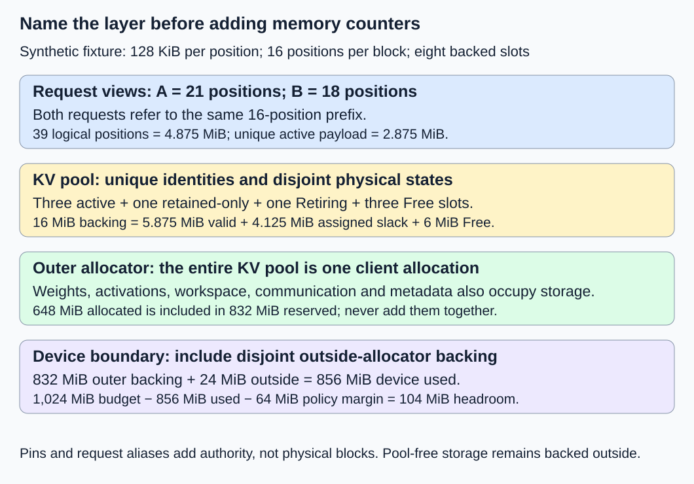
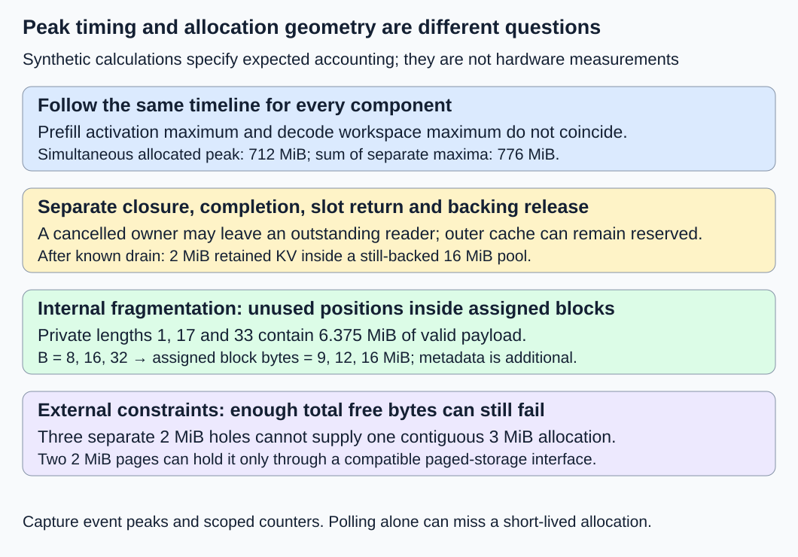

# M9-C15: Accounting for weights, KV state, workspace, and fragmentation

> **Status: Complete — detailed chapter authored and documentation validated; experimental procedures are proposed unless explicitly labelled observed**

**Module:** Make measurement and correctness part of the foundation

**Category:** [State, memory, and caching](index.md)

[Module 9 reading order](../module-9.md) · [Previous: M9-C14](../networking-and-communication/m9-c14-measuring-transfer-and-collective-completion.md) · [Next: M9-C16](../hardware-architecture-and-topology/m9-c16-recording-hardware-conditions-that-change-measurements.md) · [Execution plan and progress](../chapter-execution-plan.md)

## Target concepts

Logical versus physical memory, weights, live KV, retained prefixes, unique shared blocks, workspace and communication buffers, allocated versus reserved bytes, peaks, internal and external fragmentation.

## Concepts

### Ask which memory, whose memory, and at what time

A serving engine can run out of memory even when its weight file fits comfortably on a GPU. Requests retain attention keys and values, or KV; kernels need temporary buffers; libraries and drivers use storage; and allocators may retain unused backing memory. A memory claim needs a location, ownership boundary, unit and observation time.

This chapter supports Modules 1–7. It builds on [M1-C14's parameter manifest](../model-computation-and-semantics/m1-c14-assembling-a-small-decoder-only-transformer.md) and [M2-C20's allocator safety model](../numerics-and-correctness/m2-c20-validating-allocator-and-cache-safety.md). It supplies accounting specifications and proposed experiments, with Rust as the host-engine context and no implementation code. Text generation is the workload; non-text modalities and Module 8 remain outside scope.

**Logical memory** describes the data an application says it needs: tensor values or request-visible KV positions. **Physical accounting** counts unique storage allocations and their backing at a declared layer. A pointer or a virtual address does not establish physical residency, especially for mapped files or managed memory that can migrate. Keep CPU resident memory, CPU pinned transfer buffers and GPU memory in separate ledgers; do not add them and call the result GPU usage. CPU pinned memory is page-locked host storage used for transfer/lifetime guarantees; this is different from M2-C20's logical access pins that track submitted operations.

Use bytes as the stored unit. **1 KiB = 1,024 bytes; 1 MiB = 1,048,576 bytes; 1 GiB = 1,073,741,824 bytes.** Decimal GB means 1,000,000,000 bytes. A value displayed as “GB” without its conversion can make a fitting model appear too large or a nearly full device appear safe.

### Build a storage manifest before trusting a total

A **manifest** is a list of storage objects with identity, role, size, location and lifetime. Two tensor views can refer to the same allocation; count that allocation once. Identical contents in separate allocations count twice. M1-C14 has 90 separately specified FP64 values, so its dense parameter payload is **90 × 8 = 720 bytes**. FP64 means 64-bit floating-point values. That mathematical payload excludes object headers, allocator rounding, temporary loading copies and resident-page behavior.

| Role | What belongs here | Common counting mistake |
|---|---|---|
| Weights W | Unique parameter storage, admitted adapter weights and required precision/packing metadata | Counting tied views twice or equating checkpoint file size with loaded storage |
| Active KV | Unique blocks referenced by active requests, including shared prefixes | Summing per-request bytes without deduplicating allocation identities |
| Retained-only KV | Cache-owned blocks with no active request owner | Calling all cache hits new storage, or treating all retention as immediately evictable |
| Retiring KV | No strong owner, but pending access/cleanup prevents reuse | Reporting cancellation as instant recovery |
| Activations A | Intermediate forward results, logits and other request temporaries | Assuming inference needs only weights and KV |
| Workspace X | Scratch storage required by the chosen execution algorithm | Omitting temporary peak buffers or counting aliases again |
| Communication C | Staging, collective and transfer buffers in this memory domain | Adding host and device copies into one device total |
| Metadata D | Block tables, descriptors and other allocations owned by this allocator | Ignoring metadata, graphs or library allocations because they contain no tokens |

A **workspace** is temporary scratch storage used to perform an operation, rather than a retained model result. An activation and a workspace that share the same backing interval cannot be added as separate allocations. Either split the interval into disjoint byte ranges or assign it one storage role at that instant. Keep graph-private pools, library allocations and memory outside the main allocator explicit when present; “not measured” is different from zero.

### Count shared KV once, then account for unused block space

For a uniform full-attention cache, define L layers, H KV heads per layer, d features per head, and b bytes per scalar. One position stores a key and a value, giving:

**k = 2 × L × H × d × b bytes/position; Q = B × k bytes/block.**

B is positions per physical block. For request lengths Sᵣ, the request-view logical payload is **M_request = k × Σ Sᵣ**. This sum intentionally counts shared positions once per requesting view. Physical active storage instead uses the union of allocation identities across requests. For fixed blocks, **M_active_blocks = Q × count(unique active block identities)**. Identity includes worker epoch, pool, slot and generation; the slot number alone is insufficient after reuse.

The following is a synthetic accounting fixture, not a measured checkpoint. Let L = 32, H = 8, d = 128 and b = 2, so k = 131,072 bytes = 128 KiB/position. B = 16 gives Q = 2 MiB/block. An eight-slot, eagerly backed KV pool occupies 16 MiB at its outer allocator. A and B have lengths 21 and 18 and share exactly the first full 16-position block. Another 16-position prefix is retained-only. One eight-position allocation is Retiring with a pending reader. There is no other aliasing.

| Slots | Role | Valid unique positions | Physical block bytes | Unused positions inside assigned blocks |
|---|---|---:|---:|---:|
| 0 | Shared active prefix for A and B | 16 | 2 MiB | 0 |
| 1 | A's private tail | 5 | 2 MiB | 11 |
| 2 | B's private tail | 2 | 2 MiB | 14 |
| 3 | Retained-only prefix | 16 | 2 MiB | 0 |
| 4 | Retiring, pending reader | 8 | 2 MiB | 8 |
| 5–7 | Free within the KV pool | 0 | 6 MiB backing | Not assigned; excluded from internal waste |

A and B expose 39 logical positions, or **4.875 MiB**. Their unique valid positions are 16 + 5 + 2 = 23, or **2.875 MiB**; sharing saves **2 MiB** of valid payload relative to independent copies. Their three assigned blocks occupy **6 MiB**, including 25 unused positions, or **3.125 MiB**, inside those blocks.

Across all five assigned blocks, 47 valid positions occupy **5.875 MiB** of payload. Assigned storage is **10 MiB**; the remaining 33 positions are **4.125 MiB of internal fragmentation**, meaning unused capacity inside assigned blocks. The other **6 MiB** is reusable pool capacity, not internal fragmentation. One retained-only block and one pinned Retiring block are already included in the 10 MiB. Pins describe outstanding access; they are not an additional storage bucket.

Thus **16 = 5.875 + 4.125 + 6 MiB** reconciles valid payload, assigned-block slack and free pool backing. The whole 16 MiB remains allocated at the outer layer, even though the KV allocator can assign three slots immediately. These nested boundaries explain why “allocated,” “free” and “reserved” need a named layer.

### Allocated and reserved are inclusive measures at a chosen layer

For this chapter's outer-allocator model, **M_alloc** counts allocations currently charged to its clients, including the entire 16 MiB KV pool. **M_res** counts backing held by that allocator, including allocated and unused cached portions. Then:

**M_cached_unused = M_res − M_alloc; M_alloc ≤ M_res.**

This difference is not automatically fragmentation. It can include reusable cache, size-class restrictions, uncompleted frees or other allocator-specific states. Do not add M_alloc and M_res: the former is included in the latter. Do not also add the 10 MiB KV occupancy when the pool's 16 MiB is already in M_alloc.

These are model definitions, not universal API names. [PyTorch's CUDA memory-management documentation](https://docs.pytorch.org/docs/2.14/notes/cuda.html#memory-management) distinguishes tensor-occupied allocation from the caching allocator's total reserved storage. Unused cached storage can remain visible as device usage. Its cache-release operation does not free live tensors; statistics also depend on allocator backend. In a Rust engine, use the actual allocator's documented semantics rather than assuming a framework's counters exist or mean the same thing.

[CUDA Runtime 13.4 memory-pool attributes](https://docs.nvidia.com/cuda/cuda-runtime-api/cuda_runtime_api/group__CUDART__MEMORY__POOLS.html) distinguish current backing reserved, current application use and their separate high-water marks. Pool statistics describe that pool, not all allocations on the device. A stream-ordered free is constrained by the completion/order contract; API submission is not a completed safe-return event.

Device-level counters form another boundary. [NVML's memory-query documentation](https://docs.nvidia.com/deploy/nvml-api/latest/api/group__nvmlDeviceQueries.html) states that the v2 used amount includes its system-reserved amount. NVML “reserved” refers to system use, not the framework's unused allocation cache. Record the exact API/version; do not add similarly named inclusive counters or assume they are interchangeable.

For a closed synthetic snapshot with no other processes, let W = 512 MiB, A = 32, X = 64, C = 16 and D = 8. These are independently stipulated accounting allocations, not parameter counts derived from the cache shape or M1-C14's toy model. With the 16 MiB KV pool:

**M_alloc = 512 + 32 + 64 + 16 + 8 + 16 = 648 MiB.**

Let M_res = 832 MiB and outside-allocator device backing be a disjoint 24 MiB. Device used is then **856 MiB**, allocator cached-unused is **184 MiB**, and a declared 1,024 MiB device budget has **168 MiB** outside current backing. Reserving a policy safety margin of 64 MiB leaves **104 MiB** of uncommitted device headroom. This 64 MiB is a chosen experiment policy, not a guaranteed safe production margin. Existing pool-free slots and eligible allocator cache may serve some future allocations; they must not be added again as device-free bytes.

A real reconciliation needs matched scope and time. Driver/system allocations, other processes, graph pools and library allocations can make device usage exceed a framework counter. If residency, granularity or attribution is unknown, record a labelled reconciliation residual rather than calling it a leak. A **leak** requires evidence that no legitimate owner or pending operation explains unrecovered storage over an appropriate lifecycle.

### Measure simultaneous peaks, including cancellation and recovery

A **peak** is the maximum within a stated observation interval. For disjoint component allocations Mᵢ(t), **M_total_peak = max over t of Σ Mᵢ(t)**. This generally differs from **Σ max over t of Mᵢ(t)** because components may peak at different times.

The synthetic timeline below fixes W = 512 MiB and D = 8 MiB. Communication storage C = 16 MiB while work is active and zero at the loaded, drained and trimmed checkpoints. KV backing is zero at loaded, then 16 MiB for the remaining checkpoints. No timestamp spacing or runtime is implied. Outer cached storage is retained until the declared trim step; “trim” means an attempt to release eligible unused backing, not to invalidate live storage.

| Ordered checkpoint | A | X | M_alloc | M_res | Device used, including 24 outside |
|---|---:|---:|---:|---:|---:|
| Loaded: weights and metadata only | 0 | 0 | 520 | 576 | 600 |
| Prefill phase | 96 | 64 | 712 | 768 | 792 |
| Decode scratch peak | 32 | 128 | 712 | 832 | 856 |
| Steady snapshot above | 32 | 64 | 648 | 832 | 856 |
| Cancelled request, access still pending | 16 | 32 | 600 | 832 | 856 |
| Known accesses drained; retained cache remains | 0 | 0 | 536 | 832 | 856 |
| Eligible outer cache trimmed; KV pool still backed | 0 | 0 | 536 | 576 | 600 |

All sizes in this table are **MiB**. After draining, only slot 3 remains retained in the KV pool: occupancy is 2 MiB, internal slack zero and pool-free backing 14 MiB. The 16 MiB pool allocation remains. The final trim releases **256 MiB** of outer backing while retaining **40 MiB** of allocator cached-unused storage; actual allocators need not reach these stipulated values.

The simultaneous allocated peak is **712 MiB**, while adding separate maxima gives 512 + 96 + 128 + 16 + 8 + 16 = **776 MiB**. Reserved/device peaks are 832/856 MiB. During cancellation, lower logical activity does not imply lower backing. Preserve access lifetimes before interpreting recovery time.

Periodic sampling can miss a short workspace allocation entirely. Record allocation/free events and allocator high-water counters where available, plus coarse device samples with timestamps and scope. A sampled maximum is a lower bound on the maximum visible to that sampler, not an exact device peak. Synchronized diagnostic checkpoints help reconcile bytes but can change overlap and peak behavior; separate them from ordinary service measurements.

### Separate internal waste from external allocation constraints

For private requests of lengths 1, 17 and 33 at k = 128 KiB/position, total valid payload is 51 positions = **6.375 MiB**. With a fixed 32 MiB pool and no sharing, retention or pending accesses:

| B, positions/block | Block size | Blocks required | Assigned bytes | Internal slack | Pool-free bytes |
|---|---:|---:|---:|---:|---:|
| 8 | 1 MiB | 1 + 3 + 5 = 9 | 9 MiB | 2.625 MiB | 23 MiB |
| 16 | 2 MiB | 1 + 2 + 3 = 6 | 12 MiB | 5.625 MiB | 20 MiB |
| 32 | 4 MiB | 1 + 1 + 2 = 4 | 16 MiB | 9.625 MiB | 16 MiB |

Smaller blocks reduce this fixture's slack but increase block-table entries: 9, 6 and 4. Metadata, kernel access patterns and allocation work can change the end-to-end result. The payload calculation alone predicts no speed winner.

**External fragmentation** occurs when free space exists but the allocator cannot satisfy the required allocation geometry. In a separate 16 MiB contiguous arena, suppose three nonadjacent holes of 2 MiB each are separated by allocations totalling 10 MiB. Total free space is 6 MiB, but a 3 MiB contiguous request fails because the largest eligible hole is 2 MiB. Alignment and allocator constraints are part of eligibility.

A diagnostic ratio is **1 − largest eligible hole / total eligible free bytes = 1 − 2/6 = 2/3**. Report it as not applicable when total eligible free bytes is zero. It is not a universal failure probability. If the interface permits paged storage in 2 MiB blocks, a 24-position request can use two eligible holes, occupying 4 MiB for 3 MiB valid payload. This changes the storage interface and requires a correct paged reader; it does not magically create one contiguous 3 MiB allocation. GPU virtual remapping and underlying allocator behavior can further change which geometry matters.

## Experiments

### E1 — Reconcile a shared-cache snapshot across allocator layers

- **Description:** Build a paper/storage-manifest audit of the eight-slot fixture and its nested outer/device counters.
- **Purpose/objective:** Explain every byte without counting shared prefixes, pins or inclusive reservation counters twice.
- **Target concepts:** Logical/physical memory; unique shared blocks; retained/retiring KV; allocated versus reserved.
- **Baseline and workload:** A length 21, B length 18, shared prefix 16; one retained prefix 16 and one retiring prefix 8. Use the exact cache geometry and stipulated 648/832/856 MiB snapshot above.
- **Controls and prediction:** Fix identity, precision, layout and ownership; predict 4.875 MiB request-view bytes, 10 MiB occupied block bytes and 16 MiB outer pool allocation.
- **Procedure:** Enumerate allocation identities and owners, deduplicate active storage, partition occupied/free slots, then reconcile outer and device ledgers. Introduce an intentional shared-block double count and confirm rejection.
- **Hardware/software:** CPU arithmetic and manifest inspection suffice. A future device replication needs allocator and device counter semantics, matched timestamps and the hardware record below.
- **Failure and HFT connection:** Buffer reuse and shared market-data snapshots require the same ownership accounting. A pending access prevents reuse even after a consumer cancels; financial correctness is outside this experiment.
- **Exit criteria:** All worked totals reconcile exactly in bytes; every allocation has one storage role at each layer; the deliberate double count fails; unexplained real residuals remain labelled and investigated.

### E2 — Observe peaks and recovery at declared boundaries

- **Description:** Audit the seven-checkpoint timeline, then specify how an eventual runtime trace would test it.
- **Purpose/objective:** Distinguish simultaneous allocation peak, reserved backing, sampled device maximum and delayed recovery.
- **Target concepts:** Workspace/activation peaks; communication buffers; ownership; cancellation; allocated/reserved bytes.
- **Baseline and workload:** The ordered synthetic checkpoints above. Real replication must freeze the model, prompts, cache warm state, execution algorithms and cancellation point rather than assume these synthetic magnitudes.
- **Controls and prediction:** Keep W, D and outside backing fixed; predict 712 MiB simultaneous allocated peak, distinct component-maximum sum 776 MiB and persistent backed KV after drain.
- **Procedure:** Compare per-event/high-water and periodic observations in separate diagnostic runs; reconcile completion checkpoints; inject cancellation before completion and a lost-completion case. Record the first event that permits reuse and any later backing release.
- **Hardware/software:** CPU arithmetic for the reference; one compatible GPU for actual device counters, with declared allocator backend, driver/runtime, sample period and high-water reset scope.
- **Failure and HFT connection:** Like cancelling a consumer of a shared feed buffer, logical closure does not discharge submitted work. Unknown completion requires quarantine or domain retirement, not forced recovery.
- **Exit criteria:** Synthetic maxima match; real traces identify their interval and scope, expose missed samples and explain residuals. No unsafe return occurs; unknown completion is reported separately from successfully drained storage.

### E3 — Separate block slack from allocation geometry

- **Description:** Compare the three private-length block sizes and the separate contiguous-hole fixture.
- **Purpose/objective:** Attribute memory loss to internal slack, metadata or external eligibility constraints.
- **Target concepts:** Internal/external fragmentation; physical capacity; workload lengths; unique storage.
- **Baseline and workload:** Lengths 1, 17 and 33 in a 32 MiB fixed pool for B = 8, 16 and 32; separately, three 2 MiB holes in a 16 MiB arena and a 3 MiB request.
- **Controls and prediction:** Preserve scalar precision and logical contents. Predict 9/12/16 MiB assigned payload-block storage, and contiguous failure despite 6 MiB total free.
- **Procedure:** Count blocks, valid positions, slack and block-table bytes; test the eligible-hole predicate. Compare paged admission only through a compatible reader and validate its contents before considering performance.
- **Hardware/software:** CPU geometry audit first; eventual Rust allocator/candidate versions, alignment and address-space rules must be recorded. A GPU comparison requires matching layout/reader capability.
- **Failure and HFT connection:** A bounded buffer arena can have enough aggregate space but insufficient suitable spans. The analogy explains capacity geometry; it supplies no inference reader or trading outcome.
- **Exit criteria:** Each table reconciles exactly; failure identifies size/alignment constraints; a paged alternative preserves logical contents. Report metadata separately and assert no latency advantage without measurement.

### E4 — Benchmark backing-retention policy and its observation cost

- **Description:** Compare retaining eligible outer allocator cache between bursts with requesting a trim between bursts, while keeping the same backed KV pool and retention policy.
- **Purpose/objective:** Test whether lower idle backing improves useful capacity at an acceptable service cost.
- **Target concepts:** Reserved bytes; workspace reuse; peak intervals; resource/latency tradeoffs; reproducible profiling.
- **Baseline and workload:** A future supported text model with context at least 25; paired requests with prompt lengths 21 and 18 sharing an exact 16-ID prefix, each requesting four selected output IDs. Freeze actual token IDs and all stop rules; warmed background retained/retiring fixtures must match across policies. Load weights and prepare the same model/KV and eligible outer-cache state outside timing for each trial. The timed cycle starts with the between-burst policy step, then admits the paired requests, so any reacquisition cost is included. Three sessions of 20 balanced pairs give 60 pairs/120 measured bursts; five excluded warm-ups per policy per session add 30 bursts.
- **Controls and prediction:** Hold model, cache identities, precision, scheduling, arrivals, block size and completion behavior fixed. Predict only that successful trimming can reduce eligible idle backing; allocation cost or reduced reuse may worsen latency. Both outputs and lifecycle gates must pass.
- **Procedure:** Time the policy step, admit both requests at the same recorded arrival boundary immediately afterward, then continue through their final declared output and known-access drain. Keep arrival-to-output client latency and the full cycle, including pre-arrival maintenance, separate. Record seven checkpoints: before policy, after policy, arrivals, prefill complete, first decode complete, final outputs, and known-access drain complete. Record allocator peaks over the whole timed cycle. Repeat diagnostic profiling separately to attribute allocation/trim/synchronization cost and compare enabled/disabled observation overhead.
- **Hardware/software:** One supported GPU, enough actual memory for the selected model and all buffers, reproducible CPU/driver/runtime/allocator records and stable clocks. These synthetic MiB amounts are not a model-fitting requirement.
- **Failure and HFT connection:** Releasing idle cache resembles reclaiming a reusable buffer reserve before a burst: it can reduce idle footprint while increasing reacquisition work. Count rejected, failed, cancelled and unfinished requests; do not time only the successes.
- **Exit criteria:** All 120 bursts and 240 scheduled request outcomes are accounted for; output/ownership checks pass; raw paired latency, full-cycle and memory results are retained. Seven completed snapshots per successful burst imply at most 840 such snapshots. Report actual counts, uncertainty and observation overhead; 60 bursts per policy do not establish p99 or sustainable-load goodput.

## Verification

### V1 — Reconcile exact bytes with independent identities

Derive byte counts from manifest shapes and scalar widths, then compare them with allocation intervals. The eight-slot fixture has three active, one retained-only, one Retiring and three free slots. Its occupied state remains five blocks even if several owners share slot 0. Check 39 request-view versus 23 unique-active positions, 47 total valid unique positions, 33 unused assigned positions and 48 free positions: **47 + 33 + 48 = 128 positions of backing**.

Run negative audits that double-count slot 0, add pin bytes as another bucket, omit workspace or add M_alloc to inclusive M_res. Each must violate the designated reconciliation. In a real trace, use the exact identity and initialization gates from M2-C20; arithmetic agreement cannot certify valid contents. Nonuniform/hybrid/window/MLA caches need a sum over their actual per-layer storage representations, not automatic use of the uniform formula.

### V2 — Label peak population, time and recovery

Keep separate peak records for allocated, reserved and device-used bytes. State whether the interval covers load, warm-up, prefill, decode, idle maintenance or a complete serving lifecycle. Reset supported high-water counters at a completed boundary, record prior outstanding work and include pending-deallocation events. Do not reset a shared pool's counters while another measured client is using it.

The timeline's seven snapshots are synthetic reference states, not evidence that a polling interval would capture an actual allocation peak. For runtime tests, retain event traces and coarse samples with clock, granularity and device/process/pool scope. Device measurements may not be atomic with host-side snapshots; bounded mismatch needs explanation rather than fabricated exact reconciliation. Track request closure, final access completion, slot reuse eligibility and backing release as distinct recovery events.

A lost worker/completion fault must leave unknown storage explicitly protected. After known drain, verify only the 2 MiB retained object remains occupied inside the 16 MiB KV pool. Trimming outer unused cache cannot free that live pool allocation. Profiling that synchronizes every phase belongs to a diagnostic run; ordinary runtime peaks may differ when work overlaps.

### V3 — Verify geometry and account for metadata

For each private length S, block count is **ceil(S/B)** and internal slack is **(B × ceil(S/B) − S) × k bytes**. The three lengths sum to 51 positions; verify all three table rows independently. If each block-table entry occupies e bytes, entry payloads are **9e, 6e and 4e bytes**; descriptor/alignment overhead is additional and depends on the real representation.

For the contiguous arena, inspect eligible extents and alignment rather than only the free-byte total. For paged storage, prove two distinct free slots can be attached legally and preserve logical token order; 4 MiB assigned for 3 MiB payload has 1 MiB internal slack. A real allocator may expand its pool, remap virtual pages or use other free classes; freeze those capabilities in the comparison. Allocation failure alone does not prove external fragmentation without excluding a hard quota, unavailable address space and other limits.

### V4 — Preserve useful work and expose instrumentation effects

A four-selection request typically processes only three of those selected IDs before terminal closure; do not append an unnecessary final forward merely to make both policies match a mistaken token count. Declare EOS behavior and compare controlled common-prefix logits under the selected model's justified numerical tolerance, then output IDs and terminal reasons. The M1-C14 four-position toy model cannot run this length-25 workload; E4 requires a separately admitted supported model and makes no claim that one was run.

Retain paired raw measurements in all three sessions. Report median paired differences/ratios, dispersion, session variation and a declared paired confidence method. Report request-level latency separately from burst-cycle time including trim; measure idle backing after the pre-arrival policy step and peak backing over the whole cycle. Report failures and deadline misses in their own outcome counts. A burst test has no representative open-loop arrival process or justified service objective, so it cannot establish sustainable production goodput.

Record memory-query and trace volume, CPU time and copied metadata. Compare observation-enabled/disabled diagnostic pairs at the same workload and show their effect on latency and peaks; do not subtract a guessed constant overhead. Claim a policy benefit only for the measured workload and declared objective. If one policy lowers idle backing but worsens latency, preserve both findings.

| Evidence gate | Required result | Limit |
|---|---|---|
| E1 / V1 | Identity-based byte and counter reconciliation; negative audits fail | Synthetic manifest; no residency measurement |
| E2 / V2 | Simultaneous peaks and lifecycle boundaries identified | Samples and counters have distinct scope |
| E3 / V3 | Slack and geometry checks agree; compatible reader preserves contents | No automatic speed or device-paging claim |
| E4 / V4 | Matched output/ownership, complete outcomes and paired raw results | Chosen burst workload; no p99/capacity certification |

**Observed during authorship:** exact arithmetic, table structure, required experiment fields, local links, diagram validity and documentation build/rendering are checked. MiB snapshots, counter values, allocation geometry and trial counts are stipulated or calculated examples. No allocator, device counter, model-serving, cancellation, trim-policy or performance experiment has been executed for this chapter.

## Engineering dimensions and principles

| Dimension | Application |
|---|---|
| Semantics and invariants | Deduplicate exact allocation identities; preserve payload contents and M2-C20's ownership/readiness gates. |
| Workload and variability | Lengths, prefix reuse, concurrency and cancellation skew change both logical demand and occupied bytes; text is the scope. |
| Resources and bottlenecks | Separate GPU backing, CPU resident/pinned memory, metadata traffic, communication and scratch allocations. |
| Time and distributions | Track simultaneous peaks and completion dependencies; measure service and maintenance intervals separately. |
| Ownership and coordination | Cache owners and pending access explain retention; outer allocator cache differs from request-owned storage. |
| Failure and adaptation | Diagnose exhaustion geometry, stale snapshots, partial allocation and unknown completion before reclaiming capacity. |

1. **Correctness defines the optimization boundary.** Lower footprint must preserve output identity and safe access; trimming cannot revoke a live allocation.
2. **Performance depends on workload and operating point.** Smaller blocks reduce slack in this fixture but add descriptors and may change reader cost.
3. **Data movement is part of the algorithm.** Loading copies, transfer buffers, snapshots and reconstruction move bytes beyond the persistent payload.
4. **State has ownership, lifetime, and recovery cost.** Retained and Retiring storage need different recovery rules; future cache reconstruction also costs work.
5. **Dependencies determine latency; bottlenecks determine capacity.** A pending read delays return; workspace and backing limits can constrain admission despite idle compute.
6. **Variability and synchronization shape the tail.** Burst shapes and trim/reallocation boundaries can change slow outcomes; synchronized diagnostics perturb overlap.
7. **Local improvements must be evaluated end to end.** Reduced reserved bytes count as a benefit only against the chosen useful-service objective and latency costs.
8. **Claims require reproducible evidence.** Keep manifests, scope/version definitions, exact byte units, timelines, raw paired trials and unresolved residuals.

## Specifications, articles, and hardware

The accounting specification is a per-location, per-layer manifest of nonoverlapping storage identities, explicit aliases, requested and assigned sizes, ownership/pins, allocation/completion/release events and observation timestamps. A result must identify whether it is logical payload, occupied block bytes, outer allocated bytes, pool backing, device usage or host residency. Separate policy credits/headroom from physically assigned memory.

Primary reading includes [PyTorch 2.14 CUDA memory management](https://docs.pytorch.org/docs/2.14/notes/cuda.html#memory-management), [CUDA Runtime 13.4 stream-ordered pool accounting](https://docs.nvidia.com/cuda/cuda-runtime-api/cuda_runtime_api/group__CUDART__MEMORY__POOLS.html), and [NVML memory queries](https://docs.nvidia.com/deploy/nvml-api/latest/api/group__nvmlDeviceQueries.html). They define different observation layers; record the API and installed version used in a real run. The [M1-C14 manifest](../model-computation-and-semantics/m1-c14-assembling-a-small-decoder-only-transformer.md) and [M2-C20 state contract](../numerics-and-correctness/m2-c20-validating-allocator-and-cache-safety.md) provide the local mathematical and lifecycle references. Future detailed M9-C16 hardware guidance is not required to understand the basic record here.

No hardware or checkpoint has been supplied. Paper audits need only exact byte arithmetic. A device replication must record CPU model/core counts/cache sizes, host RAM, NUMA placement, pinned-buffer limits, OS, GPU model/count, architecture, physical/partition-visible VRAM, ECC mode if applicable, driver/runtime/toolkit, allocator backend/configuration, memory-pool settings, graph capture, execution algorithms, power/frequency/temperature conditions and other device users. Record interconnect/link topology and communication library when buffers support transfers or collectives. A single-GPU fixture's communication allocation can be a stipulated buffer; it is not evidence of a measured multi-GPU collective.

Freeze model/tokenizer/adapter identities, tensor and KV precision/layout, context limits, graph state, actual token IDs, output/stopping rules, arrivals, cache warm state and cancellation timing. E4's actual memory budget must include all real allocations plus an explicit margin, rather than scaling the synthetic 512 MiB weight number. Software/tool versions and raw byte logs belong in the experiment artifact; this chapter supplies no engine implementation.

## Takeaways and next step

Count request views for logical demand, unique blocks for cache occupancy and full backing at the outer allocator/device boundary. Keep internal slack, free cached capacity and external geometry distinct. Measure simultaneous peaks and wait for completion before declaring recovered capacity.

Progress is tracked in the clickable [execution plan](../chapter-execution-plan.md). The completed Module 2 benchmark chapter is [M2-C21: Benchmarking KV management end to end](../measurement-experimentation-and-economics/m2-c21-benchmarking-kv-management-end-to-end.md), which uses this accounting foundation. [M3-C15](../measurement-experimentation-and-economics/m3-c15-counting-flops-and-bytes-at-a-defined-boundary.md) is next for authoring. [M9-C16](../hardware-architecture-and-topology/m9-c16-recording-hardware-conditions-that-change-measurements.md) is now complete and remains the next Module 9 **reading** chapter.
